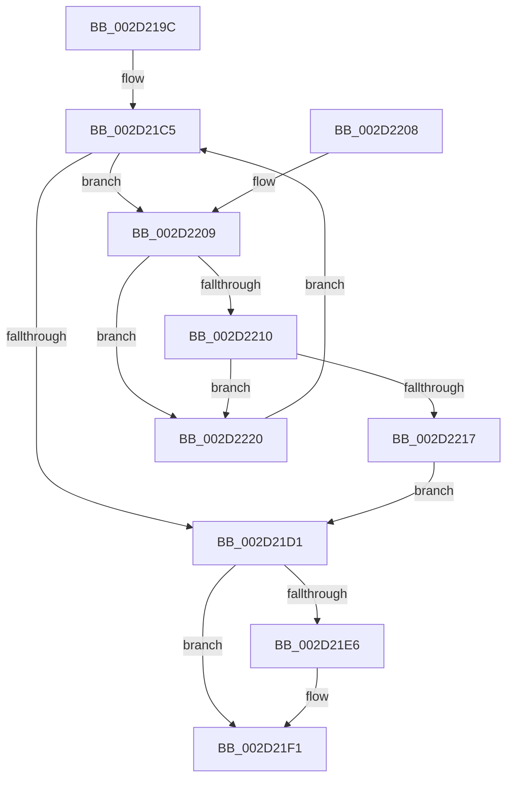

# HalpFindSecondaryIcEntry

- RVA: `0x002D219C`–`0x002D2225` (길이 `137` bytes)
- VA: `0x00000001402D219C`
- 실행 섹션: `.text`
- PDB 이름 있음: `예`; PDB Function 태그: `아니요`
- unwind 정보 RVA: `0x0006F908`
- 디코드: `39`개 명령, `137/137` bytes 표시
- 미해석 바이트: `0` (있으면 어셈블리에 `.byte`로 보존)

> 이 문서는 커널 이미지의 기계어와 PDB 기호를 분석해 생성했습니다. 4번과 5번은 함수 원형과 자료형을 바이너리 사용 방식에서 추정한 C 해석이며 원본 소스 복구 결과는 아닙니다.

## 1. Dependencies

- 직접 호출 지점: **3**; 고유 호출 대상: **3**
- 직접 호출자로 확인된 함수: **5**
- RIP 상대 이미지 참조: **3**

### Outgoing calls
- `0x002D21B4` → [HalpAcquireHighLevelLock](HalpAcquireHighLevelLock_function_002D2390.md) (function, `0x002D2390`)
- `0x002D21D8` → [KxReleaseSpinLock](../20/KxReleaseSpinLock_function_00206670.md) (function, `0x00206670`)
- `0x002D21EC` → [KiLowerIrqlProcessIrqlFlags](../4F/KiLowerIrqlProcessIrqlFlags_function_004F5698.md) (function, `0x004F5698`)

### Direct callers
- [HalpHandleMaskUnmaskSecondaryInterrupt](HalpHandleMaskUnmaskSecondaryInterrupt_function_002D1C8C.md) at `0x002D1CF6`
- [HalpDisableSecondaryInterrupt](../48/HalpDisableSecondaryInterrupt_function_00488F34.md) at `0x00488F5D`
- [HalpInterruptRequestSecondaryInterrupt](../55/HalpInterruptRequestSecondaryInterrupt_function_005570A8.md) at `0x005570D7`
- [HalpQueryPrimaryInterruptInformation](../../page/AB/HalpQueryPrimaryInterruptInformation_function_00AB888C.md) at `0x00AB88CE`
- [HalpEnableSecondaryInterrupt](../../page/AC/HalpEnableSecondaryInterrupt_function_00AC4DC0.md) at `0x00AC4E02`

### Static image references
- `0x002D21AD` → RVA `0x00F909D0` (`.data`; read)
- `0x002D21B9` → RVA `0x00F909C0` (`.data`; read)
- `0x002D21DD` → RVA `0x00FC6D20` (`ALMOSTRO`; read)

## 2. Other-region calls and transfers

- 다른 실행 섹션으로 향하는 call: **0**
- 별도 외부 분기/꼬리 이동을 확인하지 못했습니다.

## 3. Assembly (complete function range)

```asm
002D219C  48 89 5C 24 08                  mov qword ptr [rsp + 8], rbx
002D21A1  48 89 74 24 10                  mov qword ptr [rsp + 0x10], rsi
002D21A6  57                              push rdi
002D21A7  48 83 EC 20                     sub rsp, 0x20
002D21AB  8B F1                           mov esi, ecx
002D21AD  48 8D 0D 1C E8 CB 00            lea rcx, [rip + 0xcbe81c]
002D21B4  E8 D7 01 00 00                  call 0x1402d2390
002D21B9  48 8B 15 00 E8 CB 00            mov rdx, qword ptr [rip + 0xcbe800]
002D21C0  33 FF                           xor edi, edi
002D21C2  0F B6 D8                        movzx ebx, al
002D21C5  48 8D 05 F4 E7 CB 00            lea rax, [rip + 0xcbe7f4]
002D21CC  48 3B D0                        cmp rdx, rax
002D21CF  75 38                           jne 0x1402d2209
002D21D1  48 8D 0D F8 E7 CB 00            lea rcx, [rip + 0xcbe7f8]
002D21D8  E8 93 44 F3 FF                  call 0x140206670
002D21DD  83 3D 3C 4B CF 00 00            cmp dword ptr [rip + 0xcf4b3c], 0
002D21E4  74 0B                           je 0x1402d21f1
002D21E6  44 0F 20 C1                     mov rcx, cr8
002D21EA  8A D3                           mov dl, bl
002D21EC  E8 A7 34 22 00                  call 0x1404f5698
002D21F1  44 0F 22 C3                     mov cr8, rbx
002D21F5  48 8B 5C 24 30                  mov rbx, qword ptr [rsp + 0x30]
002D21FA  48 8B C7                        mov rax, rdi
002D21FD  48 8B 74 24 38                  mov rsi, qword ptr [rsp + 0x38]
002D2202  48 83 C4 20                     add rsp, 0x20
002D2206  5F                              pop rdi
002D2207  C3                              ret
002D2208  CC                              int3
002D2209  8B 4A 10                        mov ecx, dword ptr [rdx + 0x10]
002D220C  3B F1                           cmp esi, ecx
002D220E  72 10                           jb 0x1402d2220
002D2210  03 4A 14                        add ecx, dword ptr [rdx + 0x14]
002D2213  3B F1                           cmp esi, ecx
002D2215  73 09                           jae 0x1402d2220
002D2217  48 8B FA                        mov rdi, rdx
002D221A  F0 FF 42 70                     lock inc dword ptr [rdx + 0x70]
002D221E  EB B1                           jmp 0x1402d21d1
002D2220  48 8B 12                        mov rdx, qword ptr [rdx]
002D2223  EB A0                           jmp 0x1402d21c5
```

## 4. C-style interpretation (structured pseudocode)

```c
__int64 __fastcall HalpFindSecondaryIcEntry(int a1)
{
    __int64 result;
    __int64 v_rdi;
    __int64 v_rsp;
    unsigned __int64 v_stack_p10;
    unsigned __int64 v_stack_p8;

    v_stack_p8 = v_rbx;
    v_stack_p10 = v_rsi;
    v_rsp = (v_rsp) - (32);
    result = HalpAcquireHighLevelLock(v_rip + 13363228, a2, a3, a4);
    v_rdi = 0;
loc_002D21C5:
    if ((*(unsigned __int64 *)(v_rip + 13363200)) != (v_rip + 13363188)) goto loc_002D2209;
loc_002D21D1:
    result = KxReleaseSpinLock(v_rip + 13363192, *(unsigned __int64 *)(v_rip + 13363200), a3, a4);
    if ((*(unsigned int *)(v_rip + 13585212)) != 0) {
        a1 = v_cr8;
        a2 = (unsigned __int8)((unsigned __int8)(result));
        result = KiLowerIrqlProcessIrqlFlags(a1, a2, a3, a4);
    }
    v_rsp = (v_rsp) + (32);
    return 0;
loc_002D2209:
    if (((unsigned int)(v_stack_p10)) < ((unsigned int)((unsigned int)(*(unsigned int *)(a2 + 16))))) goto loc_002D2220;
    a1 = (unsigned int)(((unsigned int)(*(unsigned int *)(a2 + 16))) + (*(unsigned int *)(a2 + 20)));
    if (((unsigned int)(v_stack_p10)) >= a1) goto loc_002D2220;
    goto loc_002D21D1;
loc_002D2220:
    goto loc_002D21C5;
}
```

## 5. (Beta) C Style

```c
int64_t HalpFindSecondaryIcEntry(int32_t Arg1)
{
    int64_t result;
    int64_t local_rdi;
    int64_t local_rsp;
    uint64_t v_stack_p10;
    uint64_t v_stack_p8;

    v_stack_p8 = local_rbx;
    v_stack_p10 = local_rsi;
    local_rsp = (local_rsp) - (32);
    result = HalpAcquireHighLevelLock(v_rip + 13363228, a2, a3, a4);
    local_rdi = 0;
loc_002D21C5:
    if ((*(uint64_t *)(v_rip + 0xCBE800)) != (v_rip + 13363188)) goto loc_002D2209;
loc_002D21D1:
    result = KxReleaseSpinLock(v_rip + 13363192, *(uint64_t *)(v_rip + 0xCBE800), a3, a4);
    if ((*(uint32_t *)(v_rip + 0xCF4B3C)) != 0) {
        Arg1 = v_cr8;
        a2 = (uint8_t)((uint8_t)(result));
        result = KiLowerIrqlProcessIrqlFlags(Arg1, a2, a3, a4);
    }
    local_rsp = (local_rsp) + (32);
    return 0;
loc_002D2209:
    if (((uint32_t)(v_stack_p10)) < ((uint32_t)((uint32_t)(*(uint32_t *)(a2 + 0x10))))) goto loc_002D2220;
    Arg1 = (uint32_t)(((uint32_t)(*(uint32_t *)(a2 + 0x10))) + (*(uint32_t *)(a2 + 0x14)));
    if (((uint32_t)(v_stack_p10)) >= Arg1) goto loc_002D2220;
    goto loc_002D21D1;
loc_002D2220:
    goto loc_002D21C5;
}
```

## 6. Execution-region graph

[열기: 2D/3D 그래프와 함수 탐색 컨트롤 패널](../../../control-panel.html?section=text&rva=0x002D219C&view=graph)

- 2D 그래프는 위에서 아래로 흐르고, 3D 그래프는 빈 공간을 드래그해 회전합니다. Shift+드래그는 이동, 휠은 확대·축소, 함수 노드 선택은 대상 보고서 이동입니다.

### Static fallback


