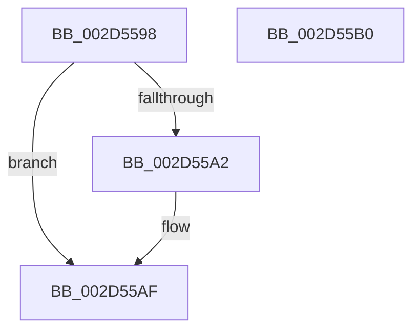

# HalpGetProcessorStateByNtIndex

- RVA: `0x002D5598`–`0x002D55B1` (길이 `25` bytes)
- VA: `0x00000001402D5598`
- 실행 섹션: `.text`
- PDB 이름 있음: `예`; PDB Function 태그: `아니요`
- unwind 정보 RVA: `0x000DB714`
- 디코드: `8`개 명령, `25/25` bytes 표시
- 미해석 바이트: `0` (있으면 어셈블리에 `.byte`로 보존)

> 이 문서는 커널 이미지의 기계어와 PDB 기호를 분석해 생성했습니다. 4번과 5번은 함수 원형과 자료형을 바이너리 사용 방식에서 추정한 C 해석이며 원본 소스 복구 결과는 아닙니다.

## 1. Dependencies

- 직접 호출 지점: **0**; 고유 호출 대상: **0**
- 직접 호출자로 확인된 함수: **4**
- RIP 상대 이미지 참조: **2**

### Outgoing calls
- 직접 디코드된 call 명령이 없습니다.

### Direct callers
- [HalGetMessageRoutingInfo](HalGetMessageRoutingInfo_function_002D4E00.md) at `0x002D4EF6`
- [HalGetProcessorIdByNtNumber](HalGetProcessorIdByNtNumber_function_002D5560.md) at `0x002D556C`
- [HalpInterruptStartBlockedProcessors](../55/HalpInterruptStartBlockedProcessors_function_00558914.md) at `0x00558923`
- [sub_006DD9A0](../6D/Unknown_function_006DD9A0.md) at `0x006DD9AA`

### Static image references
- `0x002D559A` → RVA `0x00E10200` (`.data`; read)
- `0x002D55A2` → RVA `0x00FC3E20` (`.data`; read)

## 2. Other-region calls and transfers

- 다른 실행 섹션으로 향하는 call: **0**
- 별도 외부 분기/꼬리 이동을 확인하지 못했습니다.

## 3. Assembly (complete function range)

```asm
002D5598  33 C0                           xor eax, eax
002D559A  3B 0D 60 AC B3 00               cmp ecx, dword ptr [rip + 0xb3ac60]
002D55A0  73 0D                           jae 0x1402d55af
002D55A2  48 8B 05 77 E8 CE 00            mov rax, qword ptr [rip + 0xcee877]
002D55A9  8B C9                           mov ecx, ecx
002D55AB  48 8B 04 C8                     mov rax, qword ptr [rax + rcx*8]
002D55AF  C3                              ret
002D55B0  CC                              int3
```

## 4. C-style interpretation (structured pseudocode)

```c
__int64 __fastcall HalpGetProcessorStateByNtIndex(int a1)
{
    __int64 result;

    result = 0;
    if (a1 < (*(unsigned int *)(v_rip + 11775072))) {
        result = *(unsigned __int64 *)(v_rip + 13559927);
        a1 = a1;
        result = *(unsigned __int64 *)(result + a1 * 8);
    }
    return result;
}
```

## 5. (Beta) C Style

```c
int64_t HalpGetProcessorStateByNtIndex(int32_t Arg1)
{
    int64_t result;

    result = 0;
    if (Arg1 < (*(uint32_t *)(v_rip + 0xB3AC60))) {
        result = *(uint64_t *)(v_rip + 0xCEE877);
        Arg1 = Arg1;
        result = *(uint64_t *)(result + Arg1 * 8);
    }
    return result;
}
```

## 6. Execution-region graph

[열기: 2D/3D 그래프와 함수 탐색 컨트롤 패널](../../../control-panel.html?section=text&rva=0x002D5598&view=graph)

- 2D 그래프는 위에서 아래로 흐르고, 3D 그래프는 빈 공간을 드래그해 회전합니다. Shift+드래그는 이동, 휠은 확대·축소, 함수 노드 선택은 대상 보고서 이동입니다.

### Static fallback


