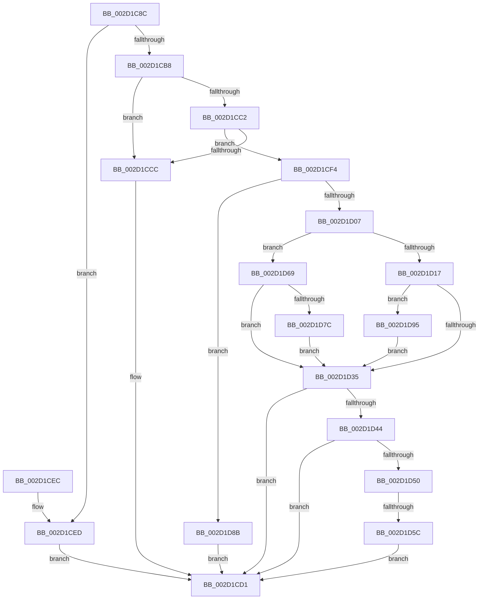

# HalpHandleMaskUnmaskSecondaryInterrupt

- RVA: `0x002D1C8C`–`0x002D1D9F` (길이 `275` bytes)
- VA: `0x00000001402D1C8C`
- 실행 섹션: `.text`
- PDB 이름 있음: `예`; PDB Function 태그: `예`
- unwind 정보 RVA: `0x0006F88C`
- 디코드: `80`개 명령, `275/275` bytes 표시
- 미해석 바이트: `0` (있으면 어셈블리에 `.byte`로 보존)

> 이 문서는 커널 이미지의 기계어와 PDB 기호를 분석해 생성했습니다. 4번과 5번은 함수 원형과 자료형을 바이너리 사용 방식에서 추정한 C 해석이며 원본 소스 복구 결과는 아닙니다.

## 1. Dependencies

- 직접 호출 지점: **4**; 고유 호출 대상: **3**
- 직접 호출자로 확인된 함수: **2**
- RIP 상대 이미지 참조: **3**

### Outgoing calls
- `0x002D1CF6` → [HalpFindSecondaryIcEntry](HalpFindSecondaryIcEntry_function_002D219C.md) (function, `0x002D219C`)
- `0x002D1D2A` → [guard_dispatch_icall](../6B/guard_dispatch_icall_function_006BAAD0.md) (function, `0x006BAAD0`)
- `0x002D1D5F` → [HalpInsertSecondarySignalList](../55/HalpInsertSecondarySignalList_function_00556EFC.md) (function, `0x00556EFC`)
- `0x002D1D71` → [guard_dispatch_icall](../6B/guard_dispatch_icall_function_006BAAD0.md) (function, `0x006BAAD0`)

### Direct callers
- [HalpMaskInterrupt](HalpMaskInterrupt_function_002D1DB0.md) at `0x002D1EA5`
- [HalpUnmaskInterrupt](HalpUnmaskInterrupt_function_002D1EE0.md) at `0x002D2010`

### Static image references
- `0x002D1CAA` → RVA `0x00E10424` (`.data`; read)
- `0x002D1CB8` → RVA `0x00F909DC` (`.data`; read)
- `0x002D1CC2` → RVA `0x00F90A30` (`.data`; read)

## 2. Other-region calls and transfers

- 다른 실행 섹션으로 향하는 call: **0**
- call이 아닌 외부 분기/꼬리 이동: **1**
  - `0x002D1D56` → [sub_006DD81E](../6D/Unknown_function_006DD81E.md) (`tail-transfer`)

## 3. Assembly (complete function range)

```asm
002D1C8C  48 89 5C 24 08                  mov qword ptr [rsp + 8], rbx
002D1C91  48 89 6C 24 10                  mov qword ptr [rsp + 0x10], rbp
002D1C96  48 89 74 24 18                  mov qword ptr [rsp + 0x18], rsi
002D1C9B  57                              push rdi
002D1C9C  41 56                           push r14
002D1C9E  41 57                           push r15
002D1CA0  48 83 EC 20                     sub rsp, 0x20
002D1CA4  45 33 FF                        xor r15d, r15d
002D1CA7  41 8A E8                        mov bpl, r8b
002D1CAA  44 38 3D 73 E7 B3 00            cmp byte ptr [rip + 0xb3e773], r15b
002D1CB1  44 8B F2                        mov r14d, edx
002D1CB4  8B F9                           mov edi, ecx
002D1CB6  74 35                           je 0x1402d1ced
002D1CB8  8B 0D 1E ED CB 00               mov ecx, dword ptr [rip + 0xcbed1e]
002D1CBE  3B F9                           cmp edi, ecx
002D1CC0  72 0A                           jb 0x1402d1ccc
002D1CC2  03 0D 68 ED CB 00               add ecx, dword ptr [rip + 0xcbed68]
002D1CC8  3B F9                           cmp edi, ecx
002D1CCA  72 28                           jb 0x1402d1cf4
002D1CCC  BF 0D 00 00 C0                  mov edi, 0xc000000d
002D1CD1  48 8B 5C 24 40                  mov rbx, qword ptr [rsp + 0x40]
002D1CD6  8B C7                           mov eax, edi
002D1CD8  48 8B 6C 24 48                  mov rbp, qword ptr [rsp + 0x48]
002D1CDD  48 8B 74 24 50                  mov rsi, qword ptr [rsp + 0x50]
002D1CE2  48 83 C4 20                     add rsp, 0x20
002D1CE6  41 5F                           pop r15
002D1CE8  41 5E                           pop r14
002D1CEA  5F                              pop rdi
002D1CEB  C3                              ret
002D1CEC  CC                              int3
002D1CED  BF BB 00 00 C0                  mov edi, 0xc00000bb
002D1CF2  EB DD                           jmp 0x1402d1cd1
002D1CF4  8B CF                           mov ecx, edi
002D1CF6  E8 A1 04 00 00                  call 0x1402d219c
002D1CFB  48 8B D8                        mov rbx, rax
002D1CFE  48 85 C0                        test rax, rax
002D1D01  0F 84 84 00 00 00               je 0x1402d1d8b
002D1D07  8B F7                           mov esi, edi
002D1D09  44 8B C7                        mov r8d, edi
002D1D0C  2B 70 10                        sub esi, dword ptr [rax + 0x10]
002D1D0F  41 8B D6                        mov edx, r14d
002D1D12  40 84 ED                        test bpl, bpl
002D1D15  75 52                           jne 0x1402d1d69
002D1D17  48 8B 40 50                     mov rax, qword ptr [rax + 0x50]
002D1D1B  48 03 F6                        add rsi, rsi
002D1D1E  C6 84 F3 AC 00 00 00 01         mov byte ptr [rbx + rsi*8 + 0xac], 1
002D1D26  48 8B 4B 20                     mov rcx, qword ptr [rbx + 0x20]
002D1D2A  E8 A1 8D 3E 00                  call 0x1406baad0
002D1D2F  8B F8                           mov edi, eax
002D1D31  85 C0                           test eax, eax
002D1D33  78 60                           js 0x1402d1d95
002D1D35  83 C8 FF                        or eax, 0xffffffff
002D1D38  F0 0F C1 43 70                  lock xadd dword ptr [rbx + 0x70], eax
002D1D3D  FF C8                           dec eax
002D1D3F  83 F8 01                        cmp eax, 1
002D1D42  75 8D                           jne 0x1402d1cd1
002D1D44  33 C0                           xor eax, eax
002D1D46  F0 44 0F B1 7B 74               lock cmpxchg dword ptr [rbx + 0x74], r15d
002D1D4C  85 C0                           test eax, eax
002D1D4E  74 81                           je 0x1402d1cd1
002D1D50  44 0F 20 C0                     mov rax, cr8
002D1D54  3C 02                           cmp al, 2
002D1D56  0F 86 C2 BA 40 00               jbe 0x1406dd81e
002D1D5C  48 8B CB                        mov rcx, rbx
002D1D5F  E8 98 51 28 00                  call 0x140556efc
002D1D64  E9 68 FF FF FF                  jmp 0x1402d1cd1
002D1D69  48 8B 40 48                     mov rax, qword ptr [rax + 0x48]
002D1D6D  48 8B 4B 20                     mov rcx, qword ptr [rbx + 0x20]
002D1D71  E8 5A 8D 3E 00                  call 0x1406baad0
002D1D76  8B F8                           mov edi, eax
002D1D78  85 C0                           test eax, eax
002D1D7A  78 B9                           js 0x1402d1d35
002D1D7C  8B CE                           mov ecx, esi
002D1D7E  48 03 C9                        add rcx, rcx
002D1D81  44 88 BC CB AC 00 00 00         mov byte ptr [rbx + rcx*8 + 0xac], r15b
002D1D89  EB AA                           jmp 0x1402d1d35
002D1D8B  BF 21 A1 00 C0                  mov edi, 0xc000a121
002D1D90  E9 3C FF FF FF                  jmp 0x1402d1cd1
002D1D95  44 88 BC F3 AC 00 00 00         mov byte ptr [rbx + rsi*8 + 0xac], r15b
002D1D9D  EB 96                           jmp 0x1402d1d35
```

## 4. C-style interpretation (structured pseudocode)

```c
__int64 __fastcall HalpHandleMaskUnmaskSecondaryInterrupt(int a1, int a2, unsigned __int8 a3)
{
    __int64 result;
    __int64 v_r15;
    __int64 v_rsi;
    __int64 v_rsp;
    unsigned __int64 v_stack_p10;
    unsigned __int64 v_stack_p18;
    unsigned __int64 v_stack_p8;

    v_stack_p8 = v_rbx;
    v_stack_p10 = v_rbp;
    v_stack_p18 = v_rsi;
    v_rsp = (v_rsp) - (32);
    v_r15 = 0;
    if ((*(unsigned __int8 *)(v_rip + 11790195)) == 0) goto loc_002D1CED;
    if (((unsigned int)((unsigned int)(a1))) < ((unsigned int)((unsigned int)(*(unsigned int *)(v_rip + 13364510))))) goto loc_002D1CCC;
    a1 = (unsigned int)(((unsigned int)(*(unsigned int *)(v_rip + 13364510))) + (*(unsigned int *)(v_rip + 13364584)));
    if (((unsigned int)((unsigned int)(a1))) < a1) goto loc_002D1CF4;
loc_002D1CCC:
loc_002D1CD1:
    v_rsp = (v_rsp) + (32);
    return (unsigned int)((unsigned int)((unsigned int)(0xC000000DULL)));
loc_002D1CED:
    goto loc_002D1CD1;
loc_002D1CF4:
    result = HalpFindSecondaryIcEntry((unsigned int)((unsigned int)((unsigned int)(0xC00000BBULL))), a2, a3, a4);
    if (result == 0) goto loc_002D1D8B;
    v_rsi = (unsigned int)(((unsigned int)((unsigned int)((unsigned int)(0xC00000BBULL)))) - (*(unsigned int *)(result + 16)));
    if ((unsigned __int8)(v_stack_p10) != 0) goto loc_002D1D69;
    v_rsi = (v_rsi) + (v_rsi);
    *(unsigned __int8 *)(result + v_rsi * 8 + 172) = 1;
    result = guard_dispatch_icall(*(unsigned __int64 *)(result + 32), (unsigned int)((unsigned int)((unsigned int)(a2))), (unsigned int)((unsigned int)((unsigned int)(0xC00000BBULL))), a4);
    if (sign_flag) goto loc_002D1D95;
loc_002D1D35:
    result = (unsigned int)((result) | (0xFFFFFFFFULL));
    result = (unsigned int)((result) - 1);
    if (((unsigned int)(result)) != 1) goto loc_002D1CD1;
    result = 0;
    if (0 == 0) goto loc_002D1CD1;
    result = HalpInsertSecondarySignalList(0, (unsigned int)((unsigned int)((unsigned int)(a2))), (unsigned int)((unsigned int)((unsigned int)(0xC00000BBULL))), a4);
    goto loc_002D1CD1;
loc_002D1D69:
    result = guard_dispatch_icall(*(unsigned __int64 *)(result + 32), (unsigned int)((unsigned int)((unsigned int)(a2))), (unsigned int)((unsigned int)((unsigned int)(0xC00000BBULL))), a4);
    if (sign_flag) goto loc_002D1D35;
    a1 = ((unsigned int)((unsigned int)(v_rsi))) + ((unsigned int)((unsigned int)(v_rsi)));
    *(unsigned __int8 *)(result + a1 * 8 + 172) = 0;
    goto loc_002D1D35;
loc_002D1D8B:
    goto loc_002D1CD1;
loc_002D1D95:
    *(unsigned __int8 *)(result + v_rsi * 8 + 172) = 0;
    goto loc_002D1D35;
}
```

## 5. (Beta) C Style

```c
int64_t HalpHandleMaskUnmaskSecondaryInterrupt(int32_t Arg1, int32_t Arg2, uint8_t Arg3)
{
    int64_t result;
    int64_t local_r15;
    int64_t local_rsi;
    int64_t local_rsp;
    uint64_t v_stack_p10;
    uint64_t v_stack_p18;
    uint64_t v_stack_p8;

    v_stack_p8 = local_rbx;
    v_stack_p10 = local_rbp;
    v_stack_p18 = local_rsi;
    local_rsp = (local_rsp) - (32);
    local_r15 = 0;
    if ((*(uint8_t *)(v_rip + 0xB3E773)) == 0) goto loc_002D1CED;
    if (((uint32_t)((uint32_t)(Arg1))) < ((uint32_t)((uint32_t)(*(uint32_t *)(v_rip + 0xCBED1E))))) goto loc_002D1CCC;
    Arg1 = (uint32_t)(((uint32_t)(*(uint32_t *)(v_rip + 0xCBED1E))) + (*(uint32_t *)(v_rip + 0xCBED68)));
    if (((uint32_t)((uint32_t)(Arg1))) < Arg1) goto loc_002D1CF4;
loc_002D1CCC:
loc_002D1CD1:
    local_rsp = (local_rsp) + (32);
    return (uint32_t)((uint32_t)((uint32_t)(0xC000000DULL)));
loc_002D1CED:
    goto loc_002D1CD1;
loc_002D1CF4:
    result = HalpFindSecondaryIcEntry((uint32_t)((uint32_t)((uint32_t)(0xC00000BBULL))), Arg2, Arg3, a4);
    if (result == 0) goto loc_002D1D8B;
    local_rsi = (uint32_t)(((uint32_t)((uint32_t)((uint32_t)(0xC00000BBULL)))) - (*(uint32_t *)(result + 0x10)));
    if ((uint8_t)(v_stack_p10) != 0) goto loc_002D1D69;
    local_rsi = (local_rsi) + (local_rsi);
    *(uint8_t *)(result + local_rsi * 8 + 0xAC) = 1;
    result = guard_dispatch_icall(*(uint64_t *)(result + 0x20), (uint32_t)((uint32_t)((uint32_t)(Arg2))), (uint32_t)((uint32_t)((uint32_t)(0xC00000BBULL))), a4);
    if (sign_flag) goto loc_002D1D95;
loc_002D1D35:
    result = (uint32_t)((result) | (0xFFFFFFFFULL));
    result = (uint32_t)((result) - 1);
    if (((uint32_t)(result)) != 1) goto loc_002D1CD1;
    result = 0;
    if (0 == 0) goto loc_002D1CD1;
    result = HalpInsertSecondarySignalList(0, (uint32_t)((uint32_t)((uint32_t)(Arg2))), (uint32_t)((uint32_t)((uint32_t)(0xC00000BBULL))), a4);
    goto loc_002D1CD1;
loc_002D1D69:
    result = guard_dispatch_icall(*(uint64_t *)(result + 0x20), (uint32_t)((uint32_t)((uint32_t)(Arg2))), (uint32_t)((uint32_t)((uint32_t)(0xC00000BBULL))), a4);
    if (sign_flag) goto loc_002D1D35;
    Arg1 = ((uint32_t)((uint32_t)(local_rsi))) + ((uint32_t)((uint32_t)(local_rsi)));
    *(uint8_t *)(result + Arg1 * 8 + 0xAC) = 0;
    goto loc_002D1D35;
loc_002D1D8B:
    goto loc_002D1CD1;
loc_002D1D95:
    *(uint8_t *)(result + local_rsi * 8 + 0xAC) = 0;
    goto loc_002D1D35;
}
```

## 6. Execution-region graph

[열기: 2D/3D 그래프와 함수 탐색 컨트롤 패널](../../../control-panel.html?section=text&rva=0x002D1C8C&view=graph)

- 2D 그래프는 위에서 아래로 흐르고, 3D 그래프는 빈 공간을 드래그해 회전합니다. Shift+드래그는 이동, 휠은 확대·축소, 함수 노드 선택은 대상 보고서 이동입니다.

### Static fallback


