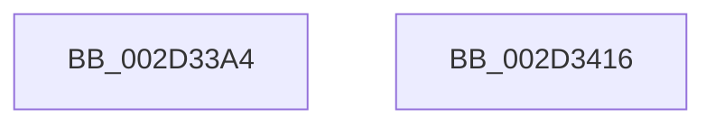

# HalpHvRetargetDeviceMsiInterrupt

- RVA: `0x002D33A4`–`0x002D3417` (길이 `115` bytes)
- VA: `0x00000001402D33A4`
- 실행 섹션: `.text`
- PDB 이름 있음: `예`; PDB Function 태그: `아니요`
- unwind 정보 RVA: `0x0006F9F8`
- 디코드: `27`개 명령, `115/115` bytes 표시
- 미해석 바이트: `0` (있으면 어셈블리에 `.byte`로 보존)

> 이 문서는 커널 이미지의 기계어와 PDB 기호를 분석해 생성했습니다. 4번과 5번은 함수 원형과 자료형을 바이너리 사용 방식에서 추정한 C 해석이며 원본 소스 복구 결과는 아닙니다.

## 1. Dependencies

- 직접 호출 지점: **2**; 고유 호출 대상: **2**
- 직접 호출자로 확인된 함수: **1**
- RIP 상대 이미지 참조: **2**

### Outgoing calls
- `0x002D33FF` → [guard_dispatch_icall](../6B/guard_dispatch_icall_function_006BAAD0.md) (function, `0x006BAAD0`)
- `0x002D340C` → [_security_check_cookie](../6A/_security_check_cookie_function_006AC640.md) (function, `0x006AC640`)

### Direct callers
- [HalpInterruptSetRemappedDestinationHv](HalpInterruptSetRemappedDestinationHv_function_002D3248.md) at `0x002D327F`

### Static image references
- `0x002D33A8` → RVA `0x00E0A740` (`.data`; read)
- `0x002D33F0` → RVA `0x00FC1CB8` (`.data`; read)

## 2. Other-region calls and transfers

- 다른 실행 섹션으로 향하는 call: **0**
- 별도 외부 분기/꼬리 이동을 확인하지 못했습니다.

## 3. Assembly (complete function range)

```asm
002D33A4  48 83 EC 68                     sub rsp, 0x68
002D33A8  48 8B 05 91 73 B3 00            mov rax, qword ptr [rip + 0xb37391]
002D33AF  48 33 C4                        xor rax, rsp
002D33B2  48 89 44 24 50                  mov qword ptr [rsp + 0x50], rax
002D33B7  8B 41 30                        mov eax, dword ptr [rcx + 0x30]
002D33BA  4C 8D 44 24 40                  lea r8, [rsp + 0x40]
002D33BF  83 64 24 34 00                  and dword ptr [rsp + 0x34], 0
002D33C4  0F 57 C0                        xorps xmm0, xmm0
002D33C7  48 83 64 24 20 00               and qword ptr [rsp + 0x20], 0
002D33CD  4C 8B CA                        mov r9, rdx
002D33D0  89 44 24 38                     mov dword ptr [rsp + 0x38], eax
002D33D4  48 8D 54 24 30                  lea rdx, [rsp + 0x30]
002D33D9  8B 41 04                        mov eax, dword ptr [rcx + 4]
002D33DC  0F 11 44 24 40                  movups xmmword ptr [rsp + 0x40], xmm0
002D33E1  89 44 24 40                     mov dword ptr [rsp + 0x40], eax
002D33E5  8B 41 34                        mov eax, dword ptr [rcx + 0x34]
002D33E8  48 8B 49 40                     mov rcx, qword ptr [rcx + 0x40]
002D33EC  89 44 24 3C                     mov dword ptr [rsp + 0x3c], eax
002D33F0  48 8B 05 C1 E8 CE 00            mov rax, qword ptr [rip + 0xcee8c1]
002D33F7  C7 44 24 30 01 00 00 00         mov dword ptr [rsp + 0x30], 1
002D33FF  E8 CC 76 3E 00                  call 0x1406baad0
002D3404  48 8B 4C 24 50                  mov rcx, qword ptr [rsp + 0x50]
002D3409  48 33 CC                        xor rcx, rsp
002D340C  E8 2F 92 3D 00                  call 0x1406ac640
002D3411  48 83 C4 68                     add rsp, 0x68
002D3415  C3                              ret
002D3416  CC                              int3
```

## 4. C-style interpretation (structured pseudocode)

```c
__int64 __fastcall HalpHvRetargetDeviceMsiInterrupt(__int64 a1, __int64 a2)
{
    __int64 result;
    __int64 v_rsp;
    unsigned __int64 v_stack_m18;
    unsigned __int64 v_stack_m28;
    unsigned int v_stack_m2C;
    unsigned int v_stack_m30;
    unsigned int v_stack_m34;
    unsigned __int64 v_stack_m38;
    unsigned __int64 v_stack_m48;

    v_rsp = (v_rsp) - (104);
    result = (*(unsigned __int64 *)(v_rip + 11760529)) ^ (v_rsp);
    v_stack_m18 = result;
    v_stack_m30 = (unsigned int)((unsigned int)(*(unsigned int *)(a1 + 48)));
    v_stack_m28 = v_xmm0;
    v_stack_m28 = (unsigned int)((unsigned int)(*(unsigned int *)(a1 + 4)));
    v_stack_m2C = (unsigned int)((unsigned int)(*(unsigned int *)(a1 + 52)));
    v_stack_m38 = 1;
    result = guard_dispatch_icall(*(unsigned __int64 *)(a1 + 64), v_stack_m38, v_stack_m28, a2);
    a1 = (v_stack_m18) ^ (v_rsp);
    result = _security_check_cookie(a1, v_stack_m38, v_stack_m28, a2);
    v_rsp = (v_rsp) + (104);
    return result;
}
```

## 5. (Beta) C Style

```c
int64_t HalpHvRetargetDeviceMsiInterrupt(void *Arg1, int64_t Arg2)
{
    uint8_t *arg1 = (uint8_t *)Arg1;

    int64_t result;
    int64_t local_rsp;
    uint64_t v_stack_m18;
    uint64_t v_stack_m28;
    uint32_t v_stack_m2C;
    uint32_t v_stack_m30;
    uint32_t v_stack_m34;
    uint64_t v_stack_m38;
    uint64_t v_stack_m48;

    local_rsp = (local_rsp) - (104);
    result = (*(uint64_t *)(v_rip + 0xB37391)) ^ (local_rsp);
    v_stack_m18 = result;
    v_stack_m30 = (uint32_t)((uint32_t)(*(uint32_t *)(arg1 + 0x30)));
    v_stack_m28 = v_xmm0;
    v_stack_m28 = (uint32_t)((uint32_t)(*(uint32_t *)(arg1 + 0x4)));
    v_stack_m2C = (uint32_t)((uint32_t)(*(uint32_t *)(arg1 + 0x34)));
    v_stack_m38 = 1;
    result = guard_dispatch_icall(*(uint64_t *)(arg1 + 0x40), v_stack_m38, v_stack_m28, Arg2);
    Arg1 = (v_stack_m18) ^ (local_rsp);
    result = _security_check_cookie(Arg1, v_stack_m38, v_stack_m28, Arg2);
    local_rsp = (local_rsp) + (104);
    return result;
}
```

### 관측된 메모리 오프셋

구조체 형식이 확인되지 않은 접근은 인자 기준의 오프셋으로만 기록했습니다.

| 기준 인자 | 오프셋 표현 | 폭 (bit) | 접근 |
|---|---:|---:|---|
| `Arg1` | `+ 0x4` | `32` | `R` |
| `Arg1` | `+ 0x30` | `32` | `R` |
| `Arg1` | `+ 0x34` | `32` | `R` |
| `Arg1` | `+ 0x40` | `64` | `R` |

## 6. Execution-region graph

[열기: 2D/3D 그래프와 함수 탐색 컨트롤 패널](../../../control-panel.html?section=text&rva=0x002D33A4&view=graph)

- 2D 그래프는 위에서 아래로 흐르고, 3D 그래프는 빈 공간을 드래그해 회전합니다. Shift+드래그는 이동, 휠은 확대·축소, 함수 노드 선택은 대상 보고서 이동입니다.

### Static fallback


