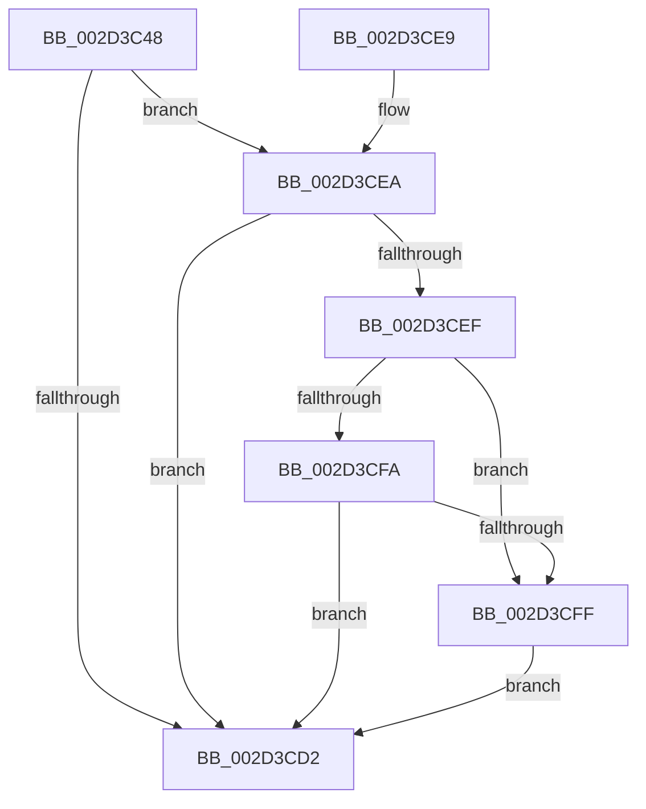

# HalpHvRetargetIoApicDeviceInterrupt

- RVA: `0x002D3C48`–`0x002D3D0A` (길이 `194` bytes)
- VA: `0x00000001402D3C48`
- 실행 섹션: `.text`
- PDB 이름 있음: `예`; PDB Function 태그: `아니요`
- unwind 정보 RVA: `0x0006FACC`
- 디코드: `60`개 명령, `194/194` bytes 표시
- 미해석 바이트: `0` (있으면 어셈블리에 `.byte`로 보존)

> 이 문서는 커널 이미지의 기계어와 PDB 기호를 분석해 생성했습니다. 4번과 5번은 함수 원형과 자료형을 바이너리 사용 방식에서 추정한 C 해석이며 원본 소스 복구 결과는 아닙니다.

## 1. Dependencies

- 직접 호출 지점: **2**; 고유 호출 대상: **2**
- 직접 호출자로 확인된 함수: **1**
- RIP 상대 이미지 참조: **2**

### Outgoing calls
- `0x002D3CC9` → [guard_dispatch_icall](../6B/guard_dispatch_icall_function_006BAAD0.md) (function, `0x006BAAD0`)
- `0x002D3CD9` → [_security_check_cookie](../6A/_security_check_cookie_function_006AC640.md) (function, `0x006AC640`)

### Direct callers
- [HalpInterruptSetRemappedDestinationHv](HalpInterruptSetRemappedDestinationHv_function_002D3248.md) at `0x002D32FB`

### Static image references
- `0x002D3C56` → RVA `0x00E0A740` (`.data`; read)
- `0x002D3CB9` → RVA `0x00FC1CB8` (`.data`; read)

## 2. Other-region calls and transfers

- 다른 실행 섹션으로 향하는 call: **0**
- 별도 외부 분기/꼬리 이동을 확인하지 못했습니다.

## 3. Assembly (complete function range)

```asm
002D3C48  40 55                           push rbp
002D3C4A  53                              push rbx
002D3C4B  56                              push rsi
002D3C4C  57                              push rdi
002D3C4D  41 56                           push r14
002D3C4F  48 8B EC                        mov rbp, rsp
002D3C52  48 83 EC 70                     sub rsp, 0x70
002D3C56  48 8B 05 E3 6A B3 00            mov rax, qword ptr [rip + 0xb36ae3]
002D3C5D  48 33 C4                        xor rax, rsp
002D3C60  48 89 45 F8                     mov qword ptr [rbp - 8], rax
002D3C64  45 33 F6                        xor r14d, r14d
002D3C67  48 C7 45 C8 02 00 00 00         mov qword ptr [rbp - 0x38], 2
002D3C6F  0F 57 C0                        xorps xmm0, xmm0
002D3C72  48 8D 7D D8                     lea rdi, [rbp - 0x28]
002D3C76  48 B8 00 00 00 00 00 00 00 80   movabs rax, 0x8000000000000000
002D3C80  49 8B F1                        mov rsi, r9
002D3C83  48 89 45 C0                     mov qword ptr [rbp - 0x40], rax
002D3C87  48 8B DA                        mov rbx, rdx
002D3C8A  48 8B 42 28                     mov rax, qword ptr [rdx + 0x28]
002D3C8E  48 89 45 D0                     mov qword ptr [rbp - 0x30], rax
002D3C92  8B 42 30                        mov eax, dword ptr [rdx + 0x30]
002D3C95  45 88 31                        mov byte ptr [r9], r14b
002D3C98  4D 8B C8                        mov r9, r8
002D3C9B  44 39 72 08                     cmp dword ptr [rdx + 8], r14d
002D3C9F  4C 8D 45 E8                     lea r8, [rbp - 0x18]
002D3CA3  88 4D C0                        mov byte ptr [rbp - 0x40], cl
002D3CA6  48 8D 55 C8                     lea rdx, [rbp - 0x38]
002D3CAA  48 8B 4D C0                     mov rcx, qword ptr [rbp - 0x40]
002D3CAE  49 0F 45 FE                     cmovne rdi, r14
002D3CB2  0F 11 45 E8                     movups xmmword ptr [rbp - 0x18], xmm0
002D3CB6  89 45 E8                        mov dword ptr [rbp - 0x18], eax
002D3CB9  48 8B 05 F8 DF CE 00            mov rax, qword ptr [rip + 0xcedff8]
002D3CC0  48 89 7C 24 20                  mov qword ptr [rsp + 0x20], rdi
002D3CC5  0F 11 45 D8                     movups xmmword ptr [rbp - 0x28], xmm0
002D3CC9  E8 02 6E 3E 00                  call 0x1406baad0
002D3CCE  85 C0                           test eax, eax
002D3CD0  79 18                           jns 0x1402d3cea
002D3CD2  48 8B 4D F8                     mov rcx, qword ptr [rbp - 8]
002D3CD6  48 33 CC                        xor rcx, rsp
002D3CD9  E8 62 89 3D 00                  call 0x1406ac640
002D3CDE  48 83 C4 70                     add rsp, 0x70
002D3CE2  41 5E                           pop r14
002D3CE4  5F                              pop rdi
002D3CE5  5E                              pop rsi
002D3CE6  5B                              pop rbx
002D3CE7  5D                              pop rbp
002D3CE8  C3                              ret
002D3CE9  CC                              int3
002D3CEA  48 85 FF                        test rdi, rdi
002D3CED  74 E3                           je 0x1402d3cd2
002D3CEF  8B 55 E0                        mov edx, dword ptr [rbp - 0x20]
002D3CF2  8B 4D E4                        mov ecx, dword ptr [rbp - 0x1c]
002D3CF5  3B 53 20                        cmp edx, dword ptr [rbx + 0x20]
002D3CF8  75 05                           jne 0x1402d3cff
002D3CFA  3B 4B 24                        cmp ecx, dword ptr [rbx + 0x24]
002D3CFD  74 D3                           je 0x1402d3cd2
002D3CFF  C6 06 01                        mov byte ptr [rsi], 1
002D3D02  89 53 20                        mov dword ptr [rbx + 0x20], edx
002D3D05  89 4B 24                        mov dword ptr [rbx + 0x24], ecx
002D3D08  EB C8                           jmp 0x1402d3cd2
```

## 4. C-style interpretation (structured pseudocode)

```c
__int64 __fastcall HalpHvRetargetIoApicDeviceInterrupt(unsigned __int8 a1, __int64 a2, __int64 a3, __int64 a4)
{
    __int64 result;
    __int64 v_r14;
    __int64 v_rdi;
    __int64 v_rsp;
    unsigned __int64 v_stack_m30;
    unsigned __int64 v_stack_m40;
    unsigned int v_stack_m44;
    unsigned int v_stack_m48;
    unsigned __int64 v_stack_m50;
    unsigned __int64 v_stack_m58;
    unsigned __int64 v_stack_m60;
    unsigned __int64 v_stack_m68;
    unsigned __int64 v_stack_m78;

    v_rsp = (v_rsp) - (112);
    result = (*(unsigned __int64 *)(v_rip + 11758307)) ^ (v_rsp);
    v_stack_m30 = result;
    v_r14 = 0;
    v_stack_m60 = 2;
    v_stack_m68 = result;
    v_stack_m58 = *(unsigned __int64 *)(a2 + 40);
    *(unsigned __int8 *)(a4) = 0;
    v_stack_m68 = a1;
    v_rdi = v_stack_m50;
    if ((*(unsigned int *)(a2 + 8)) != 0) { v_rdi = 0; }
    v_stack_m40 = v_xmm0;
    v_stack_m40 = (unsigned int)((unsigned int)(*(unsigned int *)(a2 + 48)));
    v_stack_m78 = v_rdi;
    v_stack_m50 = v_xmm0;
    result = guard_dispatch_icall(v_stack_m68, v_stack_m60, v_stack_m40, a3);
    if (!sign_flag) goto loc_002D3CEA;
loc_002D3CD2:
    a1 = (v_stack_m30) ^ (v_rsp);
    result = _security_check_cookie(a1, v_stack_m60, v_stack_m40, a3);
    v_rsp = (v_rsp) + (112);
    return result;
loc_002D3CEA:
    if (v_rdi == 0) goto loc_002D3CD2;
    if (((unsigned int)((unsigned int)(v_stack_m48))) != (*(unsigned int *)(a2 + 32))) goto loc_002D3CFF;
    if (((unsigned int)((unsigned int)(v_stack_m44))) == (*(unsigned int *)(a2 + 36))) goto loc_002D3CD2;
loc_002D3CFF:
    *(unsigned __int8 *)(a4) = 1;
    *(unsigned int *)(a2 + 32) = (unsigned int)((unsigned int)(v_stack_m48));
    *(unsigned int *)(a2 + 36) = (unsigned int)((unsigned int)(v_stack_m44));
    goto loc_002D3CD2;
}
```

## 5. (Beta) C Style

```c
int64_t HalpHvRetargetIoApicDeviceInterrupt(uint8_t Arg1, void *Arg2, int64_t Arg3, void *Arg4)
{
    uint8_t *arg2 = (uint8_t *)Arg2;
    uint8_t *arg4 = (uint8_t *)Arg4;

    int64_t result;
    int64_t local_r14;
    int64_t local_rdi;
    int64_t local_rsp;
    uint64_t v_stack_m30;
    uint64_t v_stack_m40;
    uint32_t v_stack_m44;
    uint32_t v_stack_m48;
    uint64_t v_stack_m50;
    uint64_t v_stack_m58;
    uint64_t v_stack_m60;
    uint64_t v_stack_m68;
    uint64_t v_stack_m78;

    local_rsp = (local_rsp) - (112);
    result = (*(uint64_t *)(v_rip + 0xB36AE3)) ^ (local_rsp);
    v_stack_m30 = result;
    local_r14 = 0;
    v_stack_m60 = 2;
    v_stack_m68 = result;
    v_stack_m58 = *(uint64_t *)(arg2 + 0x28);
    *(uint8_t *)(arg4) = 0;
    v_stack_m68 = Arg1;
    local_rdi = v_stack_m50;
    if ((*(uint32_t *)(arg2 + 0x8)) != 0) { local_rdi = 0; }
    v_stack_m40 = v_xmm0;
    v_stack_m40 = (uint32_t)((uint32_t)(*(uint32_t *)(arg2 + 0x30)));
    v_stack_m78 = local_rdi;
    v_stack_m50 = v_xmm0;
    result = guard_dispatch_icall(v_stack_m68, v_stack_m60, v_stack_m40, Arg3);
    if (!sign_flag) goto loc_002D3CEA;
loc_002D3CD2:
    Arg1 = (v_stack_m30) ^ (local_rsp);
    result = _security_check_cookie(Arg1, v_stack_m60, v_stack_m40, Arg3);
    local_rsp = (local_rsp) + (112);
    return result;
loc_002D3CEA:
    if (local_rdi == 0) goto loc_002D3CD2;
    if (((uint32_t)((uint32_t)(v_stack_m48))) != (*(uint32_t *)(arg2 + 0x20))) goto loc_002D3CFF;
    if (((uint32_t)((uint32_t)(v_stack_m44))) == (*(uint32_t *)(arg2 + 0x24))) goto loc_002D3CD2;
loc_002D3CFF:
    *(uint8_t *)(arg4) = 1;
    *(uint32_t *)(arg2 + 0x20) = (uint32_t)((uint32_t)(v_stack_m48));
    *(uint32_t *)(arg2 + 0x24) = (uint32_t)((uint32_t)(v_stack_m44));
    goto loc_002D3CD2;
}
```

### 관측된 메모리 오프셋

구조체 형식이 확인되지 않은 접근은 인자 기준의 오프셋으로만 기록했습니다.

| 기준 인자 | 오프셋 표현 | 폭 (bit) | 접근 |
|---|---:|---:|---|
| `Arg2` | `+ 0x8` | `32` | `R` |
| `Arg2` | `+ 0x20` | `32` | `R` |
| `Arg2` | `+ 0x20` | `32` | `W` |
| `Arg2` | `+ 0x24` | `32` | `R` |
| `Arg2` | `+ 0x24` | `32` | `W` |
| `Arg2` | `+ 0x28` | `64` | `R` |
| `Arg2` | `+ 0x30` | `32` | `R` |
| `Arg4` | `+ 0x0` | `8` | `W` |

## 6. Execution-region graph

[열기: 2D/3D 그래프와 함수 탐색 컨트롤 패널](../../../control-panel.html?section=text&rva=0x002D3C48&view=graph)

- 2D 그래프는 위에서 아래로 흐르고, 3D 그래프는 빈 공간을 드래그해 회전합니다. Shift+드래그는 이동, 휠은 확대·축소, 함수 노드 선택은 대상 보고서 이동입니다.

### Static fallback


