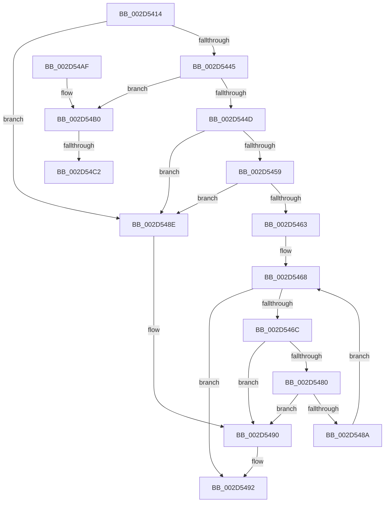

# HalpInterruptAffinityIsSteerable

- RVA: `0x002D5414`–`0x002D54D2` (길이 `190` bytes)
- VA: `0x00000001402D5414`
- 실행 섹션: `.text`
- PDB 이름 있음: `예`; PDB Function 태그: `예`
- unwind 정보 RVA: `0x0006FC4C`
- 디코드: `57`개 명령, `190/190` bytes 표시
- 미해석 바이트: `0` (있으면 어셈블리에 `.byte`로 보존)

> 이 문서는 커널 이미지의 기계어와 PDB 기호를 분석해 생성했습니다. 4번과 5번은 함수 원형과 자료형을 바이너리 사용 방식에서 추정한 C 해석이며 원본 소스 복구 결과는 아닙니다.

## 1. Dependencies

- 직접 호출 지점: **1**; 고유 호출 대상: **1**
- 직접 호출자로 확인된 함수: **1**
- RIP 상대 이미지 참조: **4**

### Outgoing calls
- `0x002D5475` → [KeQueryInterruptPartitionInformation](KeQueryInterruptPartitionInformation_function_002D54E0.md) (function, `0x002D54E0`)

### Direct callers
- [HalGetMessageRoutingInfo](HalGetMessageRoutingInfo_function_002D4E00.md) at `0x002D4E70`

### Static image references
- `0x002D5445` → RVA `0x00F10E60` (`.data`; read)
- `0x002D544D` → RVA `0x00F10E68` (`.data`; read)
- `0x002D54B0` → RVA `0x00FC7120` (`ALMOSTRO`; read)
- `0x002D54C2` → RVA `0x00FC7128` (`ALMOSTRO`; read)

## 2. Other-region calls and transfers

- 다른 실행 섹션으로 향하는 call: **0**
- call이 아닌 외부 분기/꼬리 이동: **2**
  - `0x002D54BC` → [sub_006DDB1E](../6D/Unknown_function_006DDB1E.md) (`tail-transfer`)
  - `0x002D54CD` → [sub_006DDB1E](../6D/Unknown_function_006DDB1E.md) (`tail-transfer`)

## 3. Assembly (complete function range)

```asm
002D5414  48 8B C4                        mov rax, rsp
002D5417  48 89 58 08                     mov qword ptr [rax + 8], rbx
002D541B  48 89 68 10                     mov qword ptr [rax + 0x10], rbp
002D541F  48 89 70 18                     mov qword ptr [rax + 0x18], rsi
002D5423  48 89 78 20                     mov qword ptr [rax + 0x20], rdi
002D5427  41 56                           push r14
002D5429  48 83 EC 30                     sub rsp, 0x30
002D542D  0F 57 C0                        xorps xmm0, xmm0
002D5430  33 DB                           xor ebx, ebx
002D5432  0F 11 40 E8                     movups xmmword ptr [rax - 0x18], xmm0
002D5436  0F B7 41 08                     movzx eax, word ptr [rcx + 8]
002D543A  48 8B FA                        mov rdi, rdx
002D543D  4C 8B F1                        mov r14, rcx
002D5440  66 85 C0                        test ax, ax
002D5443  75 49                           jne 0x1402d548e
002D5445  38 1D 15 BA C3 00               cmp byte ptr [rip + 0xc3ba15], bl
002D544B  74 63                           je 0x1402d54b0
002D544D  48 8B 05 14 BA C3 00            mov rax, qword ptr [rip + 0xc3ba14]
002D5454  48 85 C0                        test rax, rax
002D5457  74 35                           je 0x1402d548e
002D5459  0F B6 68 02                     movzx ebp, byte ptr [rax + 2]
002D545D  8B D3                           mov edx, ebx
002D545F  85 ED                           test ebp, ebp
002D5461  74 2B                           je 0x1402d548e
002D5463  C6 07 01                        mov byte ptr [rdi], 1
002D5466  8B F3                           mov esi, ebx
002D5468  3B F5                           cmp esi, ebp
002D546A  73 26                           jae 0x1402d5492
002D546C  33 C9                           xor ecx, ecx
002D546E  4C 8D 44 24 20                  lea r8, [rsp + 0x20]
002D5473  8B D6                           mov edx, esi
002D5475  E8 66 00 00 00                  call 0x1402d54e0
002D547A  8B D0                           mov edx, eax
002D547C  85 C0                           test eax, eax
002D547E  78 10                           js 0x1402d5490
002D5480  49 8B 0E                        mov rcx, qword ptr [r14]
002D5483  48 85 4C 24 20                  test qword ptr [rsp + 0x20], rcx
002D5488  74 06                           je 0x1402d5490
002D548A  FF C6                           inc esi
002D548C  EB DA                           jmp 0x1402d5468
002D548E  8B D3                           mov edx, ebx
002D5490  88 1F                           mov byte ptr [rdi], bl
002D5492  48 8B 5C 24 40                  mov rbx, qword ptr [rsp + 0x40]
002D5497  8B C2                           mov eax, edx
002D5499  48 8B 6C 24 48                  mov rbp, qword ptr [rsp + 0x48]
002D549E  48 8B 74 24 50                  mov rsi, qword ptr [rsp + 0x50]
002D54A3  48 8B 7C 24 58                  mov rdi, qword ptr [rsp + 0x58]
002D54A8  48 83 C4 30                     add rsp, 0x30
002D54AC  41 5E                           pop r14
002D54AE  C3                              ret
002D54AF  CC                              int3
002D54B0  66 3B 05 69 1C CF 00            cmp ax, word ptr [rip + 0xcf1c69]
002D54B7  BA 03 01 00 00                  mov edx, 0x103
002D54BC  0F 83 5C 86 40 00               jae 0x1406ddb1e
002D54C2  48 8D 1D 5F 1C CF 00            lea rbx, [rip + 0xcf1c5f]
002D54C9  48 8B 1C C3                     mov rbx, qword ptr [rbx + rax*8]
002D54CD  E9 4C 86 40 00                  jmp 0x1406ddb1e
```

## 4. C-style interpretation (structured pseudocode)

```c
__int64 __fastcall HalpInterruptAffinityIsSteerable(__int64 a1, __int64 a2)
{
    __int64 result;
    __int64 v_rbx;
    __int64 v_rsi;
    __int64 v_rsp;
    unsigned __int64 v_stack_m18;
    unsigned __int64 v_stack_p10;
    unsigned __int64 v_stack_p18;
    unsigned __int64 v_stack_p20;
    unsigned __int64 v_stack_p8;

    *(unsigned __int64 *)(v_rsp + 8) = v_rbx;
    *(unsigned __int64 *)(v_rsp + 16) = v_rbp;
    *(unsigned __int64 *)(v_rsp + 24) = v_rsi;
    *(unsigned __int64 *)(v_rsp + 32) = v_rdi;
    v_rsp = (v_rsp) - (48);
    v_rbx = 0;
    *(unsigned __int64 *)(v_rsp - 24) = v_xmm0;
    if ((unsigned __int16)(*(unsigned __int16 *)(a1 + 8)) != 0) goto loc_002D548E;
    if ((*(unsigned __int8 *)(v_rip + 12827157)) == 0) goto loc_002D54B0;
    if (*(unsigned __int64 *)(v_rip + 12827156) == 0) goto loc_002D548E;
    if ((unsigned int)(*(unsigned __int8 *)(*(unsigned __int64 *)(v_rip + 12827156) + 2)) == 0) goto loc_002D548E;
    *(unsigned __int8 *)(a2) = 1;
loc_002D5468:
    if (0 >= ((unsigned int)(*(unsigned __int8 *)(*(unsigned __int64 *)(v_rip + 12827156) + 2)))) goto loc_002D5492;
    a1 = 0;
    result = KeQueryInterruptPartitionInformation(a1, 0, v_stack_m18, a4);
    if (sign_flag) goto loc_002D5490;
    if (((v_stack_m18) & (*(unsigned __int64 *)(a1))) == 0) goto loc_002D5490;
    v_rsi = (unsigned int)((0) + 1);
    goto loc_002D5468;
loc_002D548E:
loc_002D5490:
    *(unsigned __int8 *)(a2) = 0;
loc_002D5492:
    v_rsp = (v_rsp) + (48);
    return 0;
loc_002D54B0:
}
```

## 5. (Beta) C Style

```c
int64_t HalpInterruptAffinityIsSteerable(void *Arg1, void *Arg2)
{
    uint8_t *arg1 = (uint8_t *)Arg1;
    uint8_t *arg2 = (uint8_t *)Arg2;

    int64_t result;
    int64_t local_rbx;
    int64_t local_rsi;
    int64_t local_rsp;
    uint64_t v_stack_m18;
    uint64_t v_stack_p10;
    uint64_t v_stack_p18;
    uint64_t v_stack_p20;
    uint64_t v_stack_p8;

    *(uint64_t *)(local_rsp + 0x8) = local_rbx;
    *(uint64_t *)(local_rsp + 0x10) = local_rbp;
    *(uint64_t *)(local_rsp + 0x18) = local_rsi;
    *(uint64_t *)(local_rsp + 0x20) = local_rdi;
    local_rsp = (local_rsp) - (48);
    local_rbx = 0;
    *(uint64_t *)(local_rsp - 0x18) = v_xmm0;
    if ((uint16_t)(*(uint16_t *)(arg1 + 0x8)) != 0) goto loc_002D548E;
    if ((*(uint8_t *)(v_rip + 0xC3BA15)) == 0) goto loc_002D54B0;
    if (*(uint64_t *)(v_rip + 0xC3BA14) == 0) goto loc_002D548E;
    if ((uint32_t)(*(uint8_t *)(*(uint64_t *)(v_rip + 0xC3BA14) + 0x2)) == 0) goto loc_002D548E;
    *(uint8_t *)(arg2) = 1;
loc_002D5468:
    if (0 >= ((uint32_t)(*(uint8_t *)(*(uint64_t *)(v_rip + 0xC3BA14) + 0x2)))) goto loc_002D5492;
    Arg1 = 0;
    result = KeQueryInterruptPartitionInformation(Arg1, 0, v_stack_m18, a4);
    if (sign_flag) goto loc_002D5490;
    if (((v_stack_m18) & (*(uint64_t *)(arg1))) == 0) goto loc_002D5490;
    local_rsi = (uint32_t)((0) + 1);
    goto loc_002D5468;
loc_002D548E:
loc_002D5490:
    *(uint8_t *)(arg2) = 0;
loc_002D5492:
    local_rsp = (local_rsp) + (48);
    return 0;
loc_002D54B0:
}
```

### 관측된 메모리 오프셋

구조체 형식이 확인되지 않은 접근은 인자 기준의 오프셋으로만 기록했습니다.

| 기준 인자 | 오프셋 표현 | 폭 (bit) | 접근 |
|---|---:|---:|---|
| `Arg1` | `+ 0x0` | `64` | `R` |
| `Arg1` | `+ 0x8` | `16` | `R` |
| `Arg2` | `+ 0x0` | `8` | `W` |

## 6. Execution-region graph

[열기: 2D/3D 그래프와 함수 탐색 컨트롤 패널](../../../control-panel.html?section=text&rva=0x002D5414&view=graph)

- 2D 그래프는 위에서 아래로 흐르고, 3D 그래프는 빈 공간을 드래그해 회전합니다. Shift+드래그는 이동, 휠은 확대·축소, 함수 노드 선택은 대상 보고서 이동입니다.

### Static fallback


