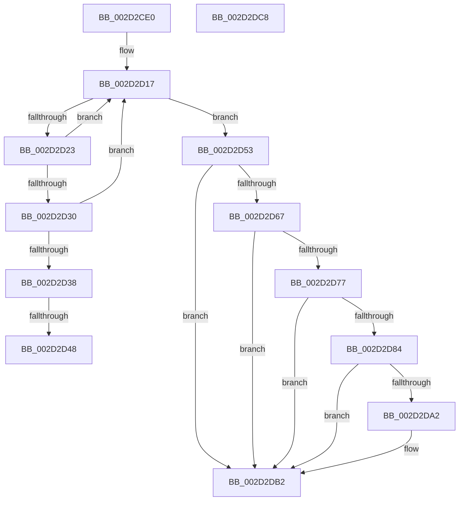

# HalpInterruptApplyOverrides

- RVA: `0x002D2CE0`–`0x002D2DC9` (길이 `233` bytes)
- VA: `0x00000001402D2CE0`
- 실행 섹션: `.text`
- PDB 이름 있음: `예`; PDB Function 태그: `예`
- unwind 정보 RVA: `0x0006F978`
- 디코드: `65`개 명령, `233/233` bytes 표시
- 미해석 바이트: `0` (있으면 어셈블리에 `.byte`로 보존)

> 이 문서는 커널 이미지의 기계어와 PDB 기호를 분석해 생성했습니다. 4번과 5번은 함수 원형과 자료형을 바이너리 사용 방식에서 추정한 C 해석이며 원본 소스 복구 결과는 아닙니다.

## 1. Dependencies

- 직접 호출 지점: **3**; 고유 호출 대상: **3**
- 직접 호출자로 확인된 함수: **9**
- RIP 상대 이미지 참조: **3**

### Outgoing calls
- `0x002D2D08` → [HalpAcquireHighLevelLock](HalpAcquireHighLevelLock_function_002D2390.md) (function, `0x002D2390`)
- `0x002D2D5D` → [HalpReleaseHighLevelLock](HalpReleaseHighLevelLock_function_002D1C58.md) (function, `0x002D1C58`)
- `0x002D2D98` → [HalpInterruptFindLinesForGsiRange](HalpInterruptFindLinesForGsiRange_function_002D204C.md) (function, `0x002D204C`)

### Direct callers
- [HalDisableInterrupt](HalDisableInterrupt_function_002D39F0.md) at `0x002D3AA0`
- [HalpInterruptSetDestinationInternal](../48/HalpInterruptSetDestinationInternal_function_0048A530.md) at `0x0048A565`
- [HalpInterruptConnect](../54/HalpInterruptConnect_function_005426F8.md) at `0x005427CF`
- [HalpInterruptRemap](../54/HalpInterruptRemap_function_00542AE4.md) at `0x00542DA0`
- [HalpInterruptRestoreClock](../54/HalpInterruptRestoreClock_function_00544580.md) at `0x005445BF`
- [HalpTimerConfigureInterrupt](../54/HalpTimerConfigureInterrupt_function_00548AB0.md) at `0x00548E05`
- [HalpTimerUnmapInterrupt](../54/HalpTimerUnmapInterrupt_function_0054A140.md) at `0x0054A22B`
- [HalpTimerInitializeHypervisorTimer](../54/HalpTimerInitializeHypervisorTimer_function_0054B8F4.md) at `0x0054BA83`
- [HalpInterruptMaskAcpi](../../pagelk/B7/HalpInterruptMaskAcpi_function_00B7C128.md) at `0x00B7C156`

### Static image references
- `0x002D2CFB` → RVA `0x00F906F0` (`.data`; read)
- `0x002D2D0D` → RVA `0x00F906E0` (`.data`; read)
- `0x002D2D67` → RVA `0x00E101F0` (`.data`; read)

## 2. Other-region calls and transfers

- 다른 실행 섹션으로 향하는 call: **0**
- call이 아닌 외부 분기/꼬리 이동: **2**
  - `0x002D2D42` → [sub_006DD98E](../6D/Unknown_function_006DD98E.md) (`tail-transfer`)
  - `0x002D2D4E` → [sub_006DD98E](../6D/Unknown_function_006DD98E.md) (`tail-transfer`)

## 3. Assembly (complete function range)

```asm
002D2CE0  48 89 5C 24 08                  mov qword ptr [rsp + 8], rbx
002D2CE5  48 89 74 24 10                  mov qword ptr [rsp + 0x10], rsi
002D2CEA  48 89 7C 24 18                  mov qword ptr [rsp + 0x18], rdi
002D2CEF  41 56                           push r14
002D2CF1  48 83 EC 20                     sub rsp, 0x20
002D2CF5  48 8B D9                        mov rbx, rcx
002D2CF8  40 32 FF                        xor dil, dil
002D2CFB  48 8D 0D EE D9 CB 00            lea rcx, [rip + 0xcbd9ee]
002D2D02  49 8B F0                        mov rsi, r8
002D2D05  4C 8B F2                        mov r14, rdx
002D2D08  E8 83 F6 FF FF                  call 0x1402d2390
002D2D0D  4C 8B 0D CC D9 CB 00            mov r9, qword ptr [rip + 0xcbd9cc]
002D2D14  44 8A C0                        mov r8b, al
002D2D17  48 8D 05 C2 D9 CB 00            lea rax, [rip + 0xcbd9c2]
002D2D1E  4C 3B C8                        cmp r9, rax
002D2D21  74 30                           je 0x1402d2d53
002D2D23  8B 0B                           mov ecx, dword ptr [rbx]
002D2D25  49 8B D1                        mov rdx, r9
002D2D28  4D 8B 09                        mov r9, qword ptr [r9]
002D2D2B  39 4A 10                        cmp dword ptr [rdx + 0x10], ecx
002D2D2E  75 E7                           jne 0x1402d2d17
002D2D30  8B 43 04                        mov eax, dword ptr [rbx + 4]
002D2D33  39 42 14                        cmp dword ptr [rdx + 0x14], eax
002D2D36  75 DF                           jne 0x1402d2d17
002D2D38  48 8B 42 18                     mov rax, qword ptr [rdx + 0x18]
002D2D3C  48 89 03                        mov qword ptr [rbx], rax
002D2D3F  4D 85 F6                        test r14, r14
002D2D42  0F 84 46 AC 40 00               je 0x1406dd98e
002D2D48  8B 42 24                        mov eax, dword ptr [rdx + 0x24]
002D2D4B  41 89 06                        mov dword ptr [r14], eax
002D2D4E  E9 3B AC 40 00                  jmp 0x1406dd98e
002D2D53  41 8A D0                        mov dl, r8b
002D2D56  48 8D 0D 93 D9 CB 00            lea rcx, [rip + 0xcbd993]
002D2D5D  E8 F6 EE FF FF                  call 0x1402d1c58
002D2D62  40 84 FF                        test dil, dil
002D2D65  75 4B                           jne 0x1402d2db2
002D2D67  48 8B 05 82 D4 B3 00            mov rax, qword ptr [rip + 0xb3d482]
002D2D6E  83 B8 F0 00 00 00 02            cmp dword ptr [rax + 0xf0], 2
002D2D75  75 3B                           jne 0x1402d2db2
002D2D77  8B 0B                           mov ecx, dword ptr [rbx]
002D2D79  8D 81 00 50 FF FF               lea eax, [rcx - 0xb000]
002D2D7F  83 F8 01                        cmp eax, 1
002D2D82  77 2E                           ja 0x1402d2db2
002D2D84  8B 43 04                        mov eax, dword ptr [rbx + 4]
002D2D87  81 F9 01 B0 00 00               cmp ecx, 0xb001
002D2D8D  8D 78 08                        lea edi, [rax + 8]
002D2D90  0F 45 F8                        cmovne edi, eax
002D2D93  8B CF                           mov ecx, edi
002D2D95  8D 57 01                        lea edx, [rdi + 1]
002D2D98  E8 AF F2 FF FF                  call 0x1402d204c
002D2D9D  48 85 C0                        test rax, rax
002D2DA0  74 10                           je 0x1402d2db2
002D2DA2  8B 50 14                        mov edx, dword ptr [rax + 0x14]
002D2DA5  2B 50 1C                        sub edx, dword ptr [rax + 0x1c]
002D2DA8  03 D7                           add edx, edi
002D2DAA  89 53 04                        mov dword ptr [rbx + 4], edx
002D2DAD  8B 40 10                        mov eax, dword ptr [rax + 0x10]
002D2DB0  89 03                           mov dword ptr [rbx], eax
002D2DB2  48 8B 5C 24 30                  mov rbx, qword ptr [rsp + 0x30]
002D2DB7  48 8B 74 24 38                  mov rsi, qword ptr [rsp + 0x38]
002D2DBC  48 8B 7C 24 40                  mov rdi, qword ptr [rsp + 0x40]
002D2DC1  48 83 C4 20                     add rsp, 0x20
002D2DC5  41 5E                           pop r14
002D2DC7  C3                              ret
002D2DC8  CC                              int3
```

## 4. C-style interpretation (structured pseudocode)

```c
__int64 __fastcall HalpInterruptApplyOverrides(__int64 a1, __int64 a2, __int64 a3)
{
    __int64 result;
    __int64 v_rdi;
    __int64 v_rsp;
    unsigned __int64 v_stack_p10;
    unsigned __int64 v_stack_p18;
    unsigned __int64 v_stack_p8;

    v_stack_p8 = v_rbx;
    v_stack_p10 = v_rsi;
    v_stack_p18 = v_rdi;
    v_rsp = (v_rsp) - (32);
    v_rdi = 0;
    result = HalpAcquireHighLevelLock(v_rip + 13359598, a2, a3, a4);
loc_002D2D17:
    if ((*(unsigned __int64 *)(v_rip + 13359564)) == (v_rip + 13359554)) goto loc_002D2D53;
    if ((*(unsigned int *)(*(unsigned __int64 *)(v_rip + 13359564) + 16)) != ((unsigned int)((unsigned int)(*(unsigned int *)(a1))))) goto loc_002D2D17;
    if ((*(unsigned int *)(*(unsigned __int64 *)(v_rip + 13359564) + 20)) != ((unsigned int)((unsigned int)(*(unsigned int *)(a1 + 4))))) goto loc_002D2D17;
    *(unsigned __int64 *)(a1) = *(unsigned __int64 *)(*(unsigned __int64 *)(v_rip + 13359564) + 24);
    *(unsigned int *)(a2) = (unsigned int)((unsigned int)(*(unsigned int *)(*(unsigned __int64 *)(v_rip + 13359564) + 36)));
loc_002D2D53:
    result = HalpReleaseHighLevelLock(v_rip + 13359507, (unsigned __int8)((unsigned __int8)(result)), (unsigned __int8)(result), *(unsigned __int64 *)(*(unsigned __int64 *)(v_rip + 13359564)));
    if (0 != 0) goto loc_002D2DB2;
    if ((*(unsigned int *)(*(unsigned __int64 *)(v_rip + 11785346) + 240)) != 2) goto loc_002D2DB2;
    if (((unsigned int)((unsigned int)(*(unsigned int *)(a1)) - 45056)) > 1) goto loc_002D2DB2;
    v_rdi = (unsigned int)(*(unsigned int *)(a1 + 4)) + 8;
    if (((unsigned int)((unsigned int)(*(unsigned int *)(a1)))) != 0xB001ULL) { v_rdi = (unsigned int)((unsigned int)(*(unsigned int *)(a1 + 4))); }
    result = HalpInterruptFindLinesForGsiRange((unsigned int)((unsigned int)(v_rdi)), v_rdi + 1, (unsigned __int8)(result), *(unsigned __int64 *)(*(unsigned __int64 *)(v_rip + 13359564)));
    if (result != 0) {
        a2 = *(unsigned int *)(result + 20);
        a2 = (unsigned int)((a2) - (*(unsigned int *)(result + 28)));
        a2 = (unsigned int)((a2) + ((unsigned int)(v_rdi)));
        *(unsigned int *)(a1 + 4) = (unsigned int)(a2);
        result = *(unsigned int *)(result + 16);
        *(unsigned int *)(a1) = (unsigned int)(result);
    }
    v_rsp = (v_rsp) + (32);
    return result;
}
```

## 5. (Beta) C Style

```c
int64_t HalpInterruptApplyOverrides(void *Arg1, int64_t Arg2, int64_t Arg3)
{
    uint8_t *arg1 = (uint8_t *)Arg1;

    int64_t result;
    int64_t local_rdi;
    int64_t local_rsp;
    uint64_t v_stack_p10;
    uint64_t v_stack_p18;
    uint64_t v_stack_p8;

    v_stack_p8 = local_rbx;
    v_stack_p10 = local_rsi;
    v_stack_p18 = local_rdi;
    local_rsp = (local_rsp) - (32);
    local_rdi = 0;
    result = HalpAcquireHighLevelLock(v_rip + 13359598, Arg2, Arg3, a4);
loc_002D2D17:
    if ((*(uint64_t *)(v_rip + 0xCBD9CC)) == (v_rip + 13359554)) goto loc_002D2D53;
    if ((*(uint32_t *)(*(uint64_t *)(v_rip + 0xCBD9CC) + 0x10)) != ((uint32_t)((uint32_t)(*(uint32_t *)(arg1))))) goto loc_002D2D17;
    if ((*(uint32_t *)(*(uint64_t *)(v_rip + 0xCBD9CC) + 0x14)) != ((uint32_t)((uint32_t)(*(uint32_t *)(arg1 + 0x4))))) goto loc_002D2D17;
    *(uint64_t *)(arg1) = *(uint64_t *)(*(uint64_t *)(v_rip + 0xCBD9CC) + 0x18);
    *(uint32_t *)(Arg2) = (uint32_t)((uint32_t)(*(uint32_t *)(*(uint64_t *)(v_rip + 0xCBD9CC) + 0x24)));
loc_002D2D53:
    result = HalpReleaseHighLevelLock(v_rip + 13359507, (uint8_t)((uint8_t)(result)), (uint8_t)(result), *(uint64_t *)(*(uint64_t *)(v_rip + 0xCBD9CC)));
    if (0 != 0) goto loc_002D2DB2;
    if ((*(uint32_t *)(*(uint64_t *)(v_rip + 0xB3D482) + 0xF0)) != 2) goto loc_002D2DB2;
    if (((uint32_t)((uint32_t)(*(uint32_t *)(arg1)) - 45056)) > 1) goto loc_002D2DB2;
    local_rdi = (uint32_t)(*(uint32_t *)(arg1 + 0x4)) + 8;
    if (((uint32_t)((uint32_t)(*(uint32_t *)(arg1)))) != 0xB001ULL) { local_rdi = (uint32_t)((uint32_t)(*(uint32_t *)(arg1 + 0x4))); }
    result = HalpInterruptFindLinesForGsiRange((uint32_t)((uint32_t)(local_rdi)), local_rdi + 1, (uint8_t)(result), *(uint64_t *)(*(uint64_t *)(v_rip + 0xCBD9CC)));
    if (result != 0) {
        Arg2 = *(uint32_t *)(result + 0x14);
        Arg2 = (uint32_t)((Arg2) - (*(uint32_t *)(result + 0x1C)));
        Arg2 = (uint32_t)((Arg2) + ((uint32_t)(local_rdi)));
        *(uint32_t *)(arg1 + 0x4) = (uint32_t)(Arg2);
        result = *(uint32_t *)(result + 0x10);
        *(uint32_t *)(arg1) = (uint32_t)(result);
    }
    local_rsp = (local_rsp) + (32);
    return result;
}
```

### 관측된 메모리 오프셋

구조체 형식이 확인되지 않은 접근은 인자 기준의 오프셋으로만 기록했습니다.

| 기준 인자 | 오프셋 표현 | 폭 (bit) | 접근 |
|---|---:|---:|---|
| `Arg1` | `+ 0x0` | `32` | `R` |
| `Arg1` | `+ 0x0` | `32` | `W` |
| `Arg1` | `+ 0x0` | `64` | `W` |
| `Arg1` | `+ 0x4` | `32` | `R` |
| `Arg1` | `+ 0x4` | `32` | `W` |

## 6. Execution-region graph

[열기: 2D/3D 그래프와 함수 탐색 컨트롤 패널](../../../control-panel.html?section=text&rva=0x002D2CE0&view=graph)

- 2D 그래프는 위에서 아래로 흐르고, 3D 그래프는 빈 공간을 드래그해 회전합니다. Shift+드래그는 이동, 휠은 확대·축소, 함수 노드 선택은 대상 보고서 이동입니다.

### Static fallback


