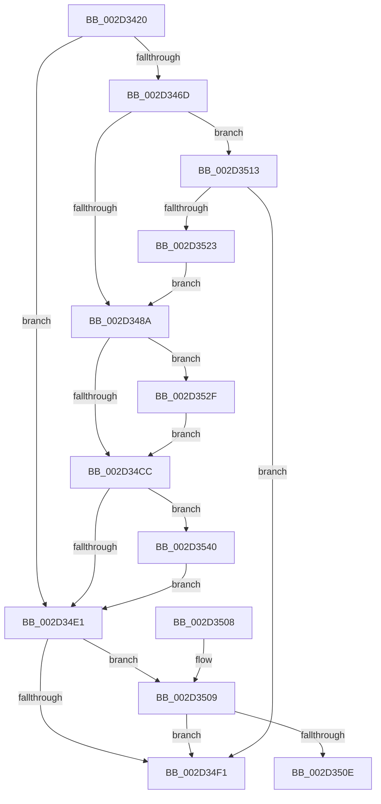

# HalpInterruptEnablePerformanceEvents

- RVA: `0x002D3420`–`0x002D3551` (길이 `305` bytes)
- VA: `0x00000001402D3420`
- 실행 섹션: `.text`
- PDB 이름 있음: `예`; PDB Function 태그: `예`
- unwind 정보 RVA: `0x0006FA0C`
- 디코드: `79`개 명령, `305/305` bytes 표시
- 미해석 바이트: `0` (있으면 어셈블리에 `.byte`로 보존)

> 이 문서는 커널 이미지의 기계어와 PDB 기호를 분석해 생성했습니다. 4번과 5번은 함수 원형과 자료형을 바이너리 사용 방식에서 추정한 C 해석이며 원본 소스 복구 결과는 아닙니다.

## 1. Dependencies

- 직접 호출 지점: **5**; 고유 호출 대상: **5**
- 직접 호출자로 확인된 함수: **4**
- RIP 상대 이미지 참조: **4**

### Outgoing calls
- `0x002D34BF` → [HalpInterruptGetPriority](HalpInterruptGetPriority_function_002D3558.md) (function, `0x002D3558`)
- `0x002D34D7` → [HalpInterruptSetLineStateInternal](HalpInterruptSetLineStateInternal_function_002D2104.md) (function, `0x002D2104`)
- `0x002D3519` → [HalpInterruptFindLines](HalpInterruptFindLines_function_002D2C88.md) (function, `0x002D2C88`)
- `0x002D3536` → [HalpAcquireHighLevelLock](HalpAcquireHighLevelLock_function_002D2390.md) (function, `0x002D2390`)
- `0x002D354A` → [HalpReleaseHighLevelLock](HalpReleaseHighLevelLock_function_002D1C58.md) (function, `0x002D1C58`)

### Direct callers
- [EmonPreOverflowHandler](EmonPreOverflowHandler_function_002D3D10.md) at `0x002D3D19`
- [HalpInterruptInitSystem](../../pagelk/B5/HalpInterruptInitSystem_function_00B5D550.md) at `0x00B5D6AA`
- [HalpPostSleepMP](../../pagelk/B5/HalpPostSleepMP_function_00B5ECC4.md) at `0x00B5ED2C`
- [HalpDpPostReplaceInitialization](../../pagelk/B5/HalpDpPostReplaceInitialization_function_00B5FE3C.md) at `0x00B5FEA7`

### Static image references
- `0x002D3438` → RVA `0x00E101F0` (`.data`; read)
- `0x002D346D` → RVA `0x00E101D5` (`.data`; read)
- `0x002D3523` → RVA `0x00E101D5` (`.data`; write)
- `0x002D352F` → RVA `0x00FC19A8` (`.data`; read)

## 2. Other-region calls and transfers

- 다른 실행 섹션으로 향하는 call: **0**
- call이 아닌 외부 분기/꼬리 이동: **1**
  - `0x002D350E` → [sub_006DD9A0](../6D/Unknown_function_006DD9A0.md) (`tail-transfer`)

## 3. Assembly (complete function range)

```asm
002D3420  48 89 5C 24 18                  mov qword ptr [rsp + 0x18], rbx
002D3425  55                              push rbp
002D3426  56                              push rsi
002D3427  57                              push rdi
002D3428  41 56                           push r14
002D342A  41 57                           push r15
002D342C  48 8D 6C 24 C9                  lea rbp, [rsp - 0x37]
002D3431  48 81 EC 90 00 00 00            sub rsp, 0x90
002D3438  48 8B 1D B1 CD B3 00            mov rbx, qword ptr [rip + 0xb3cdb1]
002D343F  33 F6                           xor esi, esi
002D3441  0F 57 C0                        xorps xmm0, xmm0
002D3444  48 89 75 67                     mov qword ptr [rbp + 0x67], rsi
002D3448  33 C0                           xor eax, eax
002D344A  4C 8B F1                        mov r14, rcx
002D344D  0F 11 45 FF                     movups xmmword ptr [rbp - 1], xmm0
002D3451  83 BB F0 00 00 00 02            cmp dword ptr [rbx + 0xf0], 2
002D3458  44 8D 7E 01                     lea r15d, [rsi + 1]
002D345C  0F 11 45 0F                     movups xmmword ptr [rbp + 0xf], xmm0
002D3460  48 89 45 2F                     mov qword ptr [rbp + 0x2f], rax
002D3464  40 8A FE                        mov dil, sil
002D3467  0F 11 45 1F                     movups xmmword ptr [rbp + 0x1f], xmm0
002D346B  75 74                           jne 0x1402d34e1
002D346D  40 38 35 61 CD B3 00            cmp byte ptr [rip + 0xb3cd61], sil
002D3474  8B 83 00 01 00 00               mov eax, dword ptr [rbx + 0x100]
002D347A  89 45 67                        mov dword ptr [rbp + 0x67], eax
002D347D  C7 45 6B FD FF FF FF            mov dword ptr [rbp + 0x6b], 0xfffffffd
002D3484  0F 84 89 00 00 00               je 0x1402d3513
002D348A  83 4D 0F FF                     or dword ptr [rbp + 0xf], 0xffffffff
002D348E  BA FE 00 00 00                  mov edx, 0xfe
002D3493  48 8B CB                        mov rcx, rbx
002D3496  4C 89 7D FF                     mov qword ptr [rbp - 1], r15
002D349A  F3 0F 7F 45 1B                  movdqu xmmword ptr [rbp + 0x1b], xmm0
002D349F  89 75 2B                        mov dword ptr [rbp + 0x2b], esi
002D34A2  44 89 7D 07                     mov dword ptr [rbp + 7], r15d
002D34A6  C7 45 0B 10 00 00 00            mov dword ptr [rbp + 0xb], 0x10
002D34AD  44 89 7D 13                     mov dword ptr [rbp + 0x13], r15d
002D34B1  C7 45 17 03 00 00 00            mov dword ptr [rbp + 0x17], 3
002D34B8  C7 45 2F FE 00 00 00            mov dword ptr [rbp + 0x2f], 0xfe
002D34BF  E8 94 00 00 00                  call 0x1402d3558
002D34C4  89 45 33                        mov dword ptr [rbp + 0x33], eax
002D34C7  4D 85 F6                        test r14, r14
002D34CA  74 63                           je 0x1402d352f
002D34CC  4C 8D 45 FF                     lea r8, [rbp - 1]
002D34D0  48 8B CB                        mov rcx, rbx
002D34D3  48 8D 55 67                     lea rdx, [rbp + 0x67]
002D34D7  E8 28 EC FF FF                  call 0x1402d2104
002D34DC  4D 85 F6                        test r14, r14
002D34DF  74 5F                           je 0x1402d3540
002D34E1  8B 8B F0 00 00 00               mov ecx, dword ptr [rbx + 0xf0]
002D34E7  8D 41 FD                        lea eax, [rcx - 3]
002D34EA  A9 FC FF FF FF                  test eax, 0xfffffffc
002D34EF  74 18                           je 0x1402d3509
002D34F1  48 8B 9C 24 D0 00 00 00         mov rbx, qword ptr [rsp + 0xd0]
002D34F9  48 81 C4 90 00 00 00            add rsp, 0x90
002D3500  41 5F                           pop r15
002D3502  41 5E                           pop r14
002D3504  5F                              pop rdi
002D3505  5E                              pop rsi
002D3506  5D                              pop rbp
002D3507  C3                              ret
002D3508  CC                              int3
002D3509  83 F9 05                        cmp ecx, 5
002D350C  74 E3                           je 0x1402d34f1
002D350E  E9 8D A4 40 00                  jmp 0x1406dd9a0
002D3513  33 D2                           xor edx, edx
002D3515  48 8D 4D 67                     lea rcx, [rbp + 0x67]
002D3519  E8 6A F7 FF FF                  call 0x1402d2c88
002D351E  48 85 C0                        test rax, rax
002D3521  74 CE                           je 0x1402d34f1
002D3523  44 88 3D AB CC B3 00            mov byte ptr [rip + 0xb3ccab], r15b
002D352A  E9 5B FF FF FF                  jmp 0x1402d348a
002D352F  48 8D 0D 72 E4 CE 00            lea rcx, [rip + 0xcee472]
002D3536  E8 55 EE FF FF                  call 0x1402d2390
002D353B  40 8A F8                        mov dil, al
002D353E  EB 8C                           jmp 0x1402d34cc
002D3540  40 8A D7                        mov dl, dil
002D3543  48 8D 0D 5E E4 CE 00            lea rcx, [rip + 0xcee45e]
002D354A  E8 09 E7 FF FF                  call 0x1402d1c58
002D354F  EB 90                           jmp 0x1402d34e1
```

## 4. C-style interpretation (structured pseudocode)

```c
__int64 __fastcall HalpInterruptEnablePerformanceEvents(__int64 a1)
{
    __int64 result;
    __int64 v_rsi;
    __int64 v_rsp;
    unsigned int v_stack_m2C;
    unsigned __int64 v_stack_m30;
    unsigned int v_stack_m34;
    unsigned __int64 v_stack_m40;
    unsigned __int64 v_stack_m44;
    unsigned int v_stack_m48;
    unsigned int v_stack_m4C;
    unsigned __int64 v_stack_m50;
    unsigned int v_stack_m54;
    unsigned int v_stack_m58;
    unsigned __int64 v_stack_m5F;
    unsigned __int64 v_stack_m60;
    unsigned __int64 v_stack_p18;
    unsigned __int64 v_stack_p8;
    unsigned int v_stack_pC;

    v_stack_p18 = v_rbx;
    v_rsp = (v_rsp) - (144);
    v_rsi = 0;
    v_stack_p8 = 0;
    result = 0;
    v_stack_m60 = v_xmm0;
    v_stack_m50 = v_xmm0;
    v_stack_m30 = 0;
    v_stack_m40 = v_xmm0;
    if ((*(unsigned int *)(*(unsigned __int64 *)(v_rip + 11783601) + 240)) != 2) goto loc_002D34E1;
    v_stack_p8 = (unsigned int)((unsigned int)(*(unsigned int *)(*(unsigned __int64 *)(v_rip + 11783601) + 256)));
    v_stack_pC = 0xFFFFFFFDULL;
    if ((*(unsigned __int8 *)(v_rip + 11783521)) == 0) goto loc_002D3513;
loc_002D348A:
    v_stack_m60 = v_rsi + 1;
    v_stack_m44 = v_xmm0;
    v_stack_m34 = 0;
    v_stack_m58 = (unsigned int)(v_rsi + 1);
    v_stack_m54 = 16;
    v_stack_m4C = (unsigned int)(v_rsi + 1);
    v_stack_m48 = 3;
    v_stack_m30 = 254;
    result = HalpInterruptGetPriority(*(unsigned __int64 *)(v_rip + 11783601), 254, a3, a4);
    v_stack_m2C = (unsigned int)(result);
    if (a1 == 0) goto loc_002D352F;
loc_002D34CC:
    result = HalpInterruptSetLineStateInternal(*(unsigned __int64 *)(v_rip + 11783601), v_stack_p8, v_stack_m60, a4);
    if (a1 == 0) goto loc_002D3540;
loc_002D34E1:
    if ((((unsigned int)((unsigned int)(*(unsigned int *)(*(unsigned __int64 *)(v_rip + 11783601) + 240)) - 3)) & (0xFFFFFFFCULL)) == 0) goto loc_002D3509;
loc_002D34F1:
    v_rsp = (v_rsp) + (144);
    return (unsigned int)(*(unsigned int *)(*(unsigned __int64 *)(v_rip + 11783601) + 240)) - 3;
loc_002D3509:
    if (((unsigned int)((unsigned int)(*(unsigned int *)(*(unsigned __int64 *)(v_rip + 11783601) + 240)))) == 5) goto loc_002D34F1;
loc_002D3513:
    a2 = 0;
    result = HalpInterruptFindLines(v_stack_p8, a2, v_stack_m60, a4);
    if (result == 0) goto loc_002D34F1;
    *(unsigned __int8 *)(v_rip + 11783339) = (unsigned __int8)(v_rsi + 1);
    goto loc_002D348A;
loc_002D352F:
    result = HalpAcquireHighLevelLock(v_rip + 13558898, a2, v_stack_m60, a4);
    goto loc_002D34CC;
loc_002D3540:
    result = HalpReleaseHighLevelLock(v_rip + 13558878, (unsigned __int8)((unsigned __int8)(result)), v_stack_m60, a4);
    goto loc_002D34E1;
}
```

## 5. (Beta) C Style

```c
int64_t HalpInterruptEnablePerformanceEvents(int64_t Arg1)
{
    int64_t result;
    int64_t local_rsi;
    int64_t local_rsp;
    uint32_t v_stack_m2C;
    uint64_t v_stack_m30;
    uint32_t v_stack_m34;
    uint64_t v_stack_m40;
    uint64_t v_stack_m44;
    uint32_t v_stack_m48;
    uint32_t v_stack_m4C;
    uint64_t v_stack_m50;
    uint32_t v_stack_m54;
    uint32_t v_stack_m58;
    uint64_t v_stack_m5F;
    uint64_t v_stack_m60;
    uint64_t v_stack_p18;
    uint64_t v_stack_p8;
    uint32_t v_stack_pC;

    v_stack_p18 = local_rbx;
    local_rsp = (local_rsp) - (144);
    local_rsi = 0;
    v_stack_p8 = 0;
    result = 0;
    v_stack_m60 = v_xmm0;
    v_stack_m50 = v_xmm0;
    v_stack_m30 = 0;
    v_stack_m40 = v_xmm0;
    if ((*(uint32_t *)(*(uint64_t *)(v_rip + 0xB3CDB1) + 0xF0)) != 2) goto loc_002D34E1;
    v_stack_p8 = (uint32_t)((uint32_t)(*(uint32_t *)(*(uint64_t *)(v_rip + 0xB3CDB1) + 0x100)));
    v_stack_pC = 0xFFFFFFFDULL;
    if ((*(uint8_t *)(v_rip + 0xB3CD61)) == 0) goto loc_002D3513;
loc_002D348A:
    v_stack_m60 = local_rsi + 1;
    v_stack_m44 = v_xmm0;
    v_stack_m34 = 0;
    v_stack_m58 = (uint32_t)(local_rsi + 1);
    v_stack_m54 = 16;
    v_stack_m4C = (uint32_t)(local_rsi + 1);
    v_stack_m48 = 3;
    v_stack_m30 = 254;
    result = HalpInterruptGetPriority(*(uint64_t *)(v_rip + 0xB3CDB1), 254, a3, a4);
    v_stack_m2C = (uint32_t)(result);
    if (Arg1 == 0) goto loc_002D352F;
loc_002D34CC:
    result = HalpInterruptSetLineStateInternal(*(uint64_t *)(v_rip + 0xB3CDB1), v_stack_p8, v_stack_m60, a4);
    if (Arg1 == 0) goto loc_002D3540;
loc_002D34E1:
    if ((((uint32_t)((uint32_t)(*(uint32_t *)(*(uint64_t *)(v_rip + 0xB3CDB1) + 0xF0)) - 3)) & (0xFFFFFFFCULL)) == 0) goto loc_002D3509;
loc_002D34F1:
    local_rsp = (local_rsp) + (144);
    return (uint32_t)(*(uint32_t *)(*(uint64_t *)(v_rip + 0xB3CDB1) + 0xF0)) - 3;
loc_002D3509:
    if (((uint32_t)((uint32_t)(*(uint32_t *)(*(uint64_t *)(v_rip + 0xB3CDB1) + 0xF0)))) == 5) goto loc_002D34F1;
loc_002D3513:
    a2 = 0;
    result = HalpInterruptFindLines(v_stack_p8, a2, v_stack_m60, a4);
    if (result == 0) goto loc_002D34F1;
    *(uint8_t *)(v_rip + 0xB3CCAB) = (uint8_t)(local_rsi + 1);
    goto loc_002D348A;
loc_002D352F:
    result = HalpAcquireHighLevelLock(v_rip + 13558898, a2, v_stack_m60, a4);
    goto loc_002D34CC;
loc_002D3540:
    result = HalpReleaseHighLevelLock(v_rip + 13558878, (uint8_t)((uint8_t)(result)), v_stack_m60, a4);
    goto loc_002D34E1;
}
```

## 6. Execution-region graph

[열기: 2D/3D 그래프와 함수 탐색 컨트롤 패널](../../../control-panel.html?section=text&rva=0x002D3420&view=graph)

- 2D 그래프는 위에서 아래로 흐르고, 3D 그래프는 빈 공간을 드래그해 회전합니다. Shift+드래그는 이동, 휠은 확대·축소, 함수 노드 선택은 대상 보고서 이동입니다.

### Static fallback


