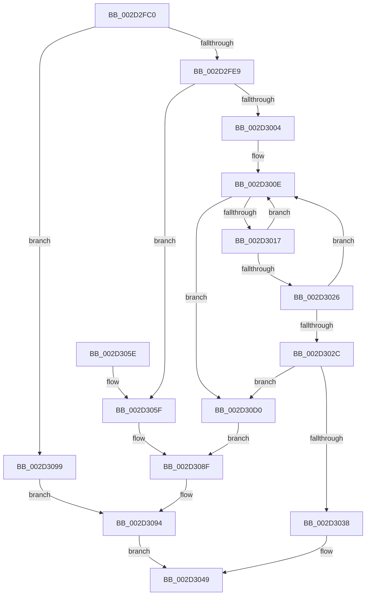

# HalpInterruptFindControllerAndLineState

- RVA: `0x002D2FC0`–`0x002D30F0` (길이 `304` bytes)
- VA: `0x00000001402D2FC0`
- 실행 섹션: `.text`
- PDB 이름 있음: `예`; PDB Function 태그: `아니요`
- unwind 정보 RVA: `0x0006F9BC`
- 디코드: `70`개 명령, `304/304` bytes 표시
- 미해석 바이트: `0` (있으면 어셈블리에 `.byte`로 보존)

> 이 문서는 커널 이미지의 기계어와 PDB 기호를 분석해 생성했습니다. 4번과 5번은 함수 원형과 자료형을 바이너리 사용 방식에서 추정한 C 해석이며 원본 소스 복구 결과는 아닙니다.

## 1. Dependencies

- 직접 호출 지점: **3**; 고유 호출 대상: **3**
- 직접 호출자로 확인된 함수: **2**
- RIP 상대 이미지 참조: **6**

### Outgoing calls
- `0x002D2FD8` → [HalpInterruptFindLinesForGsiRange](HalpInterruptFindLinesForGsiRange_function_002D204C.md) (function, `0x002D204C`)
- `0x002D2FF7` → [HalpInterruptLookupController](HalpInterruptLookupController_function_002D20D4.md) (function, `0x002D20D4`)
- `0x002D30E9` → [HalpInterruptSetProblemEx](../48/HalpInterruptSetProblemEx_function_0048AC8C.md) (function, `0x0048AC8C`)

### Direct callers
- [HalpInterruptSetRemappedDestinationHv](HalpInterruptSetRemappedDestinationHv_function_002D3248.md) at `0x002D32DD`
- [HalpInterruptGetRemappedLineState](../48/HalpInterruptGetRemappedLineState_function_0048A99C.md) at `0x0048AA11`

### Static image references
- `0x002D305F` → RVA `0x00010AA8` (`.rdata`; read)
- `0x002D3066` → RVA `0x00F906B8` (`.data`; write)
- `0x002D306D` → RVA `0x00F906C8` (`.data`; write)
- `0x002D3074` → RVA `0x00F90694` (`.data`; write)
- `0x002D307E` → RVA `0x00F906A0` (`.data`; write)
- `0x002D3085` → RVA `0x00F906D0` (`.data`; write)

## 2. Other-region calls and transfers

- 다른 실행 섹션으로 향하는 call: **0**
- 별도 외부 분기/꼬리 이동을 확인하지 못했습니다.

## 3. Assembly (complete function range)

```asm
002D2FC0  48 89 5C 24 08                  mov qword ptr [rsp + 8], rbx
002D2FC5  48 89 74 24 10                  mov qword ptr [rsp + 0x10], rsi
002D2FCA  57                              push rdi
002D2FCB  48 83 EC 30                     sub rsp, 0x30
002D2FCF  48 8B F2                        mov rsi, rdx
002D2FD2  49 8B D8                        mov rbx, r8
002D2FD5  8D 51 01                        lea edx, [rcx + 1]
002D2FD8  E8 6F F0 FF FF                  call 0x1402d204c
002D2FDD  45 33 D2                        xor r10d, r10d
002D2FE0  48 85 C0                        test rax, rax
002D2FE3  0F 84 B0 00 00 00               je 0x1402d3099
002D2FE9  44 8B 40 14                     mov r8d, dword ptr [rax + 0x14]
002D2FED  44 2B 40 1C                     sub r8d, dword ptr [rax + 0x1c]
002D2FF1  44 03 C1                        add r8d, ecx
002D2FF4  8B 48 10                        mov ecx, dword ptr [rax + 0x10]
002D2FF7  E8 D8 F0 FF FF                  call 0x1402d20d4
002D2FFC  4C 8B D8                        mov r11, rax
002D2FFF  48 85 C0                        test rax, rax
002D3002  74 5B                           je 0x1402d305f
002D3004  48 8D 88 08 01 00 00            lea rcx, [rax + 0x108]
002D300B  48 8B 01                        mov rax, qword ptr [rcx]
002D300E  48 3B C1                        cmp rax, rcx
002D3011  0F 84 B9 00 00 00               je 0x1402d30d0
002D3017  48 8B D0                        mov rdx, rax
002D301A  48 8B 00                        mov rax, qword ptr [rax]
002D301D  44 8B 4A 14                     mov r9d, dword ptr [rdx + 0x14]
002D3021  45 3B C8                        cmp r9d, r8d
002D3024  7F E8                           jg 0x1402d300e
002D3026  44 39 42 18                     cmp dword ptr [rdx + 0x18], r8d
002D302A  7E E2                           jle 0x1402d300e
002D302C  45 2B C1                        sub r8d, r9d
002D302F  48 85 D2                        test rdx, rdx
002D3032  0F 84 98 00 00 00               je 0x1402d30d0
002D3038  4C 89 1E                        mov qword ptr [rsi], r11
002D303B  41 8B CA                        mov ecx, r10d
002D303E  41 8B C0                        mov eax, r8d
002D3041  4C 6B D0 38                     imul r10, rax, 0x38
002D3045  4C 03 52 28                     add r10, qword ptr [rdx + 0x28]
002D3049  4C 89 13                        mov qword ptr [rbx], r10
002D304C  8B C1                           mov eax, ecx
002D304E  48 8B 5C 24 40                  mov rbx, qword ptr [rsp + 0x40]
002D3053  48 8B 74 24 48                  mov rsi, qword ptr [rsp + 0x48]
002D3058  48 83 C4 30                     add rsp, 0x30
002D305C  5F                              pop rdi
002D305D  C3                              ret
002D305E  CC                              int3
002D305F  4C 8D 0D 42 DA D3 FF            lea r9, [rip - 0x2c25be]
002D3066  4C 89 15 4B D6 CB 00            mov qword ptr [rip + 0xcbd64b], r10
002D306D  4C 89 0D 54 D6 CB 00            mov qword ptr [rip + 0xcbd654], r9
002D3074  C7 05 16 D6 CB 00 11 00 00 00   mov dword ptr [rip + 0xcbd616], 0x11
002D307E  44 89 15 1B D6 CB 00            mov dword ptr [rip + 0xcbd61b], r10d
002D3085  C7 05 41 D6 CB 00 81 02 00 00   mov dword ptr [rip + 0xcbd641], 0x281
002D308F  B9 25 02 00 C0                  mov ecx, 0xc0000225
002D3094  4C 89 16                        mov qword ptr [rsi], r10
002D3097  EB B0                           jmp 0x1402d3049
002D3099  4C 8D 0D 08 DA D3 FF            lea r9, [rip - 0x2c25f8]
002D30A0  4C 89 15 11 D6 CB 00            mov qword ptr [rip + 0xcbd611], r10
002D30A7  4C 89 0D 1A D6 CB 00            mov qword ptr [rip + 0xcbd61a], r9
002D30AE  B9 0D 00 00 C0                  mov ecx, 0xc000000d
002D30B3  C7 05 D7 D5 CB 00 12 00 00 00   mov dword ptr [rip + 0xcbd5d7], 0x12
002D30BD  44 89 15 DC D5 CB 00            mov dword ptr [rip + 0xcbd5dc], r10d
002D30C4  C7 05 02 D6 CB 00 74 02 00 00   mov dword ptr [rip + 0xcbd602], 0x274
002D30CE  EB C4                           jmp 0x1402d3094
002D30D0  45 33 C0                        xor r8d, r8d
002D30D3  C7 44 24 20 91 02 00 00         mov dword ptr [rsp + 0x20], 0x291
002D30DB  4C 8D 0D C6 D9 D3 FF            lea r9, [rip - 0x2c263a]
002D30E2  49 8B CB                        mov rcx, r11
002D30E5  41 8D 50 12                     lea edx, [r8 + 0x12]
002D30E9  E8 9E 7B 1B 00                  call 0x14048ac8c
002D30EE  EB 9F                           jmp 0x1402d308f
```

## 4. C-style interpretation (structured pseudocode)

```c
__int64 __fastcall HalpInterruptFindControllerAndLineState(__int64 a1, __int64 a2, __int64 a3)
{
    __int64 result;
    __int64 v_r10;
    __int64 v_rsp;
    unsigned __int64 v_stack_p10;
    unsigned int v_stack_p20;
    unsigned __int64 v_stack_p8;

    v_stack_p8 = v_rbx;
    v_stack_p10 = v_rsi;
    v_rsp = (v_rsp) - (48);
    result = HalpInterruptFindLinesForGsiRange(a1, a1 + 1, a3, a4);
    v_r10 = 0;
    if (result == 0) goto loc_002D3099;
    a3 = (unsigned int)(((unsigned int)(*(unsigned int *)(result + 20))) - (*(unsigned int *)(result + 28)));
    a3 = (unsigned int)((a3) + ((unsigned int)(a1)));
    result = HalpInterruptLookupController((unsigned int)(*(unsigned int *)(result + 16)), a1 + 1, a3, a4);
    if (result == 0) goto loc_002D305F;
loc_002D300E:
    if ((*(unsigned __int64 *)(result + 264)) == (result + 264)) goto loc_002D30D0;
    if (((unsigned int)((unsigned int)(*(unsigned int *)(*(unsigned __int64 *)(result + 264) + 20)))) > ((unsigned int)(a3))) goto loc_002D300E;
    if ((*(unsigned int *)(*(unsigned __int64 *)(result + 264) + 24)) <= ((unsigned int)(a3))) goto loc_002D300E;
    a3 = (unsigned int)((a3) - ((unsigned int)((unsigned int)(*(unsigned int *)(*(unsigned __int64 *)(result + 264) + 20)))));
    if (*(unsigned __int64 *)(result + 264) == 0) goto loc_002D30D0;
    *(unsigned __int64 *)(a2) = result;
    v_r10 = (v_r10) * ((unsigned int)((unsigned int)(a3)));
    v_r10 = (v_r10) + (*(unsigned __int64 *)(*(unsigned __int64 *)(result + 264) + 40));
loc_002D3049:
    *(unsigned __int64 *)(a3) = v_r10;
    v_rsp = (v_rsp) + (48);
    return 0;
loc_002D305F:
    *(unsigned __int64 *)(v_rip + 13358667) = v_r10;
    *(unsigned __int64 *)(v_rip + 13358676) = v_rip - 2893246;
    *(unsigned int *)(v_rip + 13358614) = 17;
    *(unsigned int *)(v_rip + 13358619) = (unsigned int)(v_r10);
    *(unsigned int *)(v_rip + 13358657) = 641;
loc_002D308F:
loc_002D3094:
    *(unsigned __int64 *)(v_stack_p10) = v_r10;
    goto loc_002D3049;
loc_002D3099:
    *(unsigned __int64 *)(v_rip + 13358609) = v_r10;
    *(unsigned __int64 *)(v_rip + 13358618) = v_rip - 2893304;
    *(unsigned int *)(v_rip + 13358551) = 18;
    *(unsigned int *)(v_rip + 13358556) = (unsigned int)(v_r10);
    *(unsigned int *)(v_rip + 13358594) = 628;
    goto loc_002D3094;
loc_002D30D0:
    a3 = 0;
    v_stack_p20 = 657;
    result = HalpInterruptSetProblemEx(result, a3 + 18, a3, v_rip - 2893370);
    goto loc_002D308F;
}
```

## 5. (Beta) C Style

```c
int64_t HalpInterruptFindControllerAndLineState(void *Arg1, void *Arg2, void *Arg3)
{
    uint8_t *arg1 = (uint8_t *)Arg1;
    uint8_t *arg2 = (uint8_t *)Arg2;
    uint8_t *arg3 = (uint8_t *)Arg3;

    int64_t result;
    int64_t local_r10;
    int64_t local_rsp;
    uint64_t v_stack_p10;
    uint32_t v_stack_p20;
    uint64_t v_stack_p8;

    v_stack_p8 = local_rbx;
    v_stack_p10 = local_rsi;
    local_rsp = (local_rsp) - (48);
    result = HalpInterruptFindLinesForGsiRange(Arg1, Arg1 + 1, Arg3, a4);
    local_r10 = 0;
    if (result == 0) goto loc_002D3099;
    Arg3 = (uint32_t)(((uint32_t)(*(uint32_t *)(result + 0x14))) - (*(uint32_t *)(result + 0x1C)));
    Arg3 = (uint32_t)((Arg3) + ((uint32_t)(Arg1)));
    result = HalpInterruptLookupController((uint32_t)(*(uint32_t *)(result + 0x10)), Arg1 + 1, Arg3, a4);
    if (result == 0) goto loc_002D305F;
loc_002D300E:
    if ((*(uint64_t *)(result + 0x108)) == (result + 264)) goto loc_002D30D0;
    if (((uint32_t)((uint32_t)(*(uint32_t *)(*(uint64_t *)(result + 0x108) + 0x14)))) > ((uint32_t)(Arg3))) goto loc_002D300E;
    if ((*(uint32_t *)(*(uint64_t *)(result + 0x108) + 0x18)) <= ((uint32_t)(Arg3))) goto loc_002D300E;
    Arg3 = (uint32_t)((Arg3) - ((uint32_t)((uint32_t)(*(uint32_t *)(*(uint64_t *)(result + 0x108) + 0x14)))));
    if (*(uint64_t *)(result + 0x108) == 0) goto loc_002D30D0;
    *(uint64_t *)(arg2) = result;
    local_r10 = (local_r10) * ((uint32_t)((uint32_t)(Arg3)));
    local_r10 = (local_r10) + (*(uint64_t *)(*(uint64_t *)(result + 0x108) + 0x28));
loc_002D3049:
    *(uint64_t *)(arg3) = local_r10;
    local_rsp = (local_rsp) + (48);
    return 0;
loc_002D305F:
    *(uint64_t *)(v_rip + 0xCBD64B) = local_r10;
    *(uint64_t *)(v_rip + 0xCBD654) = v_rip - 2893246;
    *(uint32_t *)(v_rip + 0xCBD616) = 17;
    *(uint32_t *)(v_rip + 0xCBD61B) = (uint32_t)(local_r10);
    *(uint32_t *)(v_rip + 0xCBD641) = 641;
loc_002D308F:
loc_002D3094:
    *(uint64_t *)(v_stack_p10) = local_r10;
    goto loc_002D3049;
loc_002D3099:
    *(uint64_t *)(v_rip + 0xCBD611) = local_r10;
    *(uint64_t *)(v_rip + 0xCBD61A) = v_rip - 2893304;
    *(uint32_t *)(v_rip + 0xCBD5D7) = 18;
    *(uint32_t *)(v_rip + 0xCBD5DC) = (uint32_t)(local_r10);
    *(uint32_t *)(v_rip + 0xCBD602) = 628;
    goto loc_002D3094;
loc_002D30D0:
    Arg3 = 0;
    v_stack_p20 = 657;
    result = HalpInterruptSetProblemEx(result, Arg3 + 18, Arg3, v_rip - 2893370);
    goto loc_002D308F;
}
```

### 관측된 메모리 오프셋

구조체 형식이 확인되지 않은 접근은 인자 기준의 오프셋으로만 기록했습니다.

| 기준 인자 | 오프셋 표현 | 폭 (bit) | 접근 |
|---|---:|---:|---|
| `Arg1` | `+ 0x1` | `32` | `R` |
| `Arg2` | `+ 0x0` | `64` | `W` |
| `Arg3` | `+ 0x0` | `64` | `W` |

## 6. Execution-region graph

[열기: 2D/3D 그래프와 함수 탐색 컨트롤 패널](../../../control-panel.html?section=text&rva=0x002D2FC0&view=graph)

- 2D 그래프는 위에서 아래로 흐르고, 3D 그래프는 빈 공간을 드래그해 회전합니다. Shift+드래그는 이동, 휠은 확대·축소, 함수 노드 선택은 대상 보고서 이동입니다.

### Static fallback


