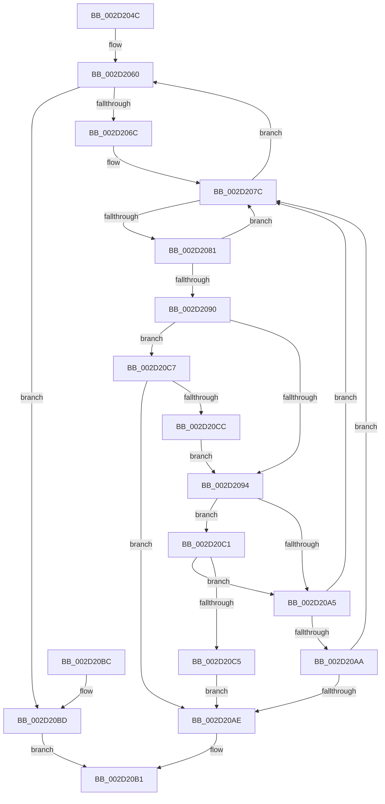

# HalpInterruptFindLinesForGsiRange

- RVA: `0x002D204C`–`0x002D20CE` (길이 `130` bytes)
- VA: `0x00000001402D204C`
- 실행 섹션: `.text`
- PDB 이름 있음: `예`; PDB Function 태그: `아니요`
- unwind 정보 RVA: `0x0006F8E8`
- 디코드: `43`개 명령, `130/130` bytes 표시
- 미해석 바이트: `0` (있으면 어셈블리에 `.byte`로 보존)

> 이 문서는 커널 이미지의 기계어와 PDB 기호를 분석해 생성했습니다. 4번과 5번은 함수 원형과 자료형을 바이너리 사용 방식에서 추정한 C 해석이며 원본 소스 복구 결과는 아닙니다.

## 1. Dependencies

- 직접 호출 지점: **0**; 고유 호출 대상: **0**
- 직접 호출자로 확인된 함수: **16**
- RIP 상대 이미지 참조: **1**

### Outgoing calls
- 직접 디코드된 call 명령이 없습니다.

### Direct callers
- [HalpMaskInterrupt](HalpMaskInterrupt_function_002D1DB0.md) at `0x002D1DCF`
- [HalpUnmaskInterrupt](HalpUnmaskInterrupt_function_002D1EE0.md) at `0x002D1EFF`
- [HalpInterruptApplyOverrides](HalpInterruptApplyOverrides_function_002D2CE0.md) at `0x002D2D98`
- [HalpInterruptGsiToLine](HalpInterruptGsiToLine_function_002D2DD0.md) at `0x002D2DE2`
- [HalpInterruptFindControllerAndLineState](HalpInterruptFindControllerAndLineState_function_002D2FC0.md) at `0x002D2FD8`
- [HalpInterruptSetDestination](HalpInterruptSetDestination_function_002D3100.md) at `0x002D317F`
- [HalpInterruptSetRemappedDestinationHv](HalpInterruptSetRemappedDestinationHv_function_002D3248.md) at `0x002D3313`
- [HalDisableInterrupt](HalDisableInterrupt_function_002D39F0.md) at `0x002D3A70`
- [HalEnableInterrupt](HalEnableInterrupt_function_002D4990.md) at `0x002D4A4F`
- [HalpInterruptSetLineState](../48/HalpInterruptSetLineState_function_0048A0C8.md) at `0x0048A1D2`
- [ExtEnvSetVpptTarget](../49/ExtEnvSetVpptTarget_function_0049D8FC.md) at `0x0049D9EE`
- [ExtEnvSetVpptTarget](../49/ExtEnvSetVpptTarget_function_0049D8FC.md) at `0x0049DA9E`
- [HalpInterruptGetApicVersion](../4D/HalpInterruptGetApicVersion_function_004D6800.md) at `0x004D6807`
- [HalpInterruptRequestInterrupt](../54/HalpInterruptRequestInterrupt_function_00544460.md) at `0x0054447E`
- [HalpInterruptPerformDirectedEndOfInterrupt](../54/HalpInterruptPerformDirectedEndOfInterrupt_function_00545C88.md) at `0x00545CB0`
- [HalpInterruptServiceActiveBoth](../54/HalpInterruptServiceActiveBoth_function_00545CFC.md) at `0x00545D20`
- [HalpInterruptRegisterLine](../56/HalpInterruptRegisterLine_function_005645B0.md) at `0x00564693`

### Static image references
- `0x002D2056` → RVA `0x00FC38F0` (`.data`; read)

## 2. Other-region calls and transfers

- 다른 실행 섹션으로 향하는 call: **0**
- 별도 외부 분기/꼬리 이동을 확인하지 못했습니다.

## 3. Assembly (complete function range)

```asm
002D204C  48 89 5C 24 08                  mov qword ptr [rsp + 8], rbx
002D2051  48 89 7C 24 10                  mov qword ptr [rsp + 0x10], rdi
002D2056  4C 8B 05 93 18 CF 00            mov r8, qword ptr [rip + 0xcf1893]
002D205D  44 8B DA                        mov r11d, edx
002D2060  48 8D 05 89 18 CF 00            lea rax, [rip + 0xcf1889]
002D2067  4C 3B C0                        cmp r8, rax
002D206A  74 51                           je 0x1402d20bd
002D206C  49 8B F8                        mov rdi, r8
002D206F  4D 8B 00                        mov r8, qword ptr [r8]
002D2072  48 81 C7 08 01 00 00            add rdi, 0x108
002D2079  4C 8B 17                        mov r10, qword ptr [rdi]
002D207C  4C 3B D7                        cmp r10, rdi
002D207F  74 DF                           je 0x1402d2060
002D2081  4D 8B CA                        mov r9, r10
002D2084  4D 8B 12                        mov r10, qword ptr [r10]
002D2087  41 8B 51 1C                     mov edx, dword ptr [r9 + 0x1c]
002D208B  83 FA FF                        cmp edx, -1
002D208E  74 EC                           je 0x1402d207c
002D2090  3B D1                           cmp edx, ecx
002D2092  73 33                           jae 0x1402d20c7
002D2094  41 8B 41 18                     mov eax, dword ptr [r9 + 0x18]
002D2098  41 2B 41 14                     sub eax, dword ptr [r9 + 0x14]
002D209C  FF C8                           dec eax
002D209E  03 C2                           add eax, edx
002D20A0  41 3B C3                        cmp eax, r11d
002D20A3  72 1C                           jb 0x1402d20c1
002D20A5  41 3B C3                        cmp eax, r11d
002D20A8  72 D2                           jb 0x1402d207c
002D20AA  3B D1                           cmp edx, ecx
002D20AC  73 CE                           jae 0x1402d207c
002D20AE  49 8B C1                        mov rax, r9
002D20B1  48 8B 5C 24 08                  mov rbx, qword ptr [rsp + 8]
002D20B6  48 8B 7C 24 10                  mov rdi, qword ptr [rsp + 0x10]
002D20BB  C3                              ret
002D20BC  CC                              int3
002D20BD  33 C0                           xor eax, eax
002D20BF  EB F0                           jmp 0x1402d20b1
002D20C1  3B C1                           cmp eax, ecx
002D20C3  72 E0                           jb 0x1402d20a5
002D20C5  EB E7                           jmp 0x1402d20ae
002D20C7  41 3B D3                        cmp edx, r11d
002D20CA  72 E2                           jb 0x1402d20ae
002D20CC  EB C6                           jmp 0x1402d2094
```

## 4. C-style interpretation (structured pseudocode)

```c
__int64 __fastcall HalpInterruptFindLinesForGsiRange(int a1, int a2)
{
    __int64 result;
    __int64 v_rdi;
    unsigned __int64 v_stack_p10;
    unsigned __int64 v_stack_p8;

    v_stack_p8 = v_rbx;
    v_stack_p10 = v_rdi;
loc_002D2060:
    if ((*(unsigned __int64 *)(v_rip + 13572243)) == (v_rip + 13572233)) goto loc_002D20BD;
    v_rdi = (*(unsigned __int64 *)(v_rip + 13572243)) + (264);
loc_002D207C:
    if ((*(unsigned __int64 *)(v_rdi)) == v_rdi) goto loc_002D2060;
    if (((unsigned int)((unsigned int)(*(unsigned int *)(*(unsigned __int64 *)(v_rdi) + 28)))) == -1) goto loc_002D207C;
    if (((unsigned int)((unsigned int)(*(unsigned int *)(*(unsigned __int64 *)(v_rdi) + 28)))) >= a1) goto loc_002D20C7;
loc_002D2094:
    result = (unsigned int)(((unsigned int)(*(unsigned int *)(*(unsigned __int64 *)(v_rdi) + 24))) - (*(unsigned int *)(*(unsigned __int64 *)(v_rdi) + 20)));
    result = (unsigned int)((result) - 1);
    result = (unsigned int)((result) + ((unsigned int)((unsigned int)(*(unsigned int *)(*(unsigned __int64 *)(v_rdi) + 28)))));
    if (((unsigned int)(result)) < ((unsigned int)((unsigned int)(a2)))) goto loc_002D20C1;
loc_002D20A5:
    if (((unsigned int)(result)) < ((unsigned int)((unsigned int)(a2)))) goto loc_002D207C;
    if (((unsigned int)((unsigned int)(*(unsigned int *)(*(unsigned __int64 *)(v_rdi) + 28)))) >= a1) goto loc_002D207C;
loc_002D20AE:
loc_002D20B1:
    return *(unsigned __int64 *)(v_rdi);
loc_002D20BD:
    result = 0;
    goto loc_002D20B1;
loc_002D20C1:
    if (0 < a1) goto loc_002D20A5;
    goto loc_002D20AE;
loc_002D20C7:
    if (((unsigned int)((unsigned int)(*(unsigned int *)(*(unsigned __int64 *)(v_rdi) + 28)))) < ((unsigned int)((unsigned int)(a2)))) goto loc_002D20AE;
    goto loc_002D2094;
}
```

## 5. (Beta) C Style

```c
int64_t HalpInterruptFindLinesForGsiRange(int32_t Arg1, int32_t Arg2)
{
    int64_t result;
    int64_t local_rdi;
    uint64_t v_stack_p10;
    uint64_t v_stack_p8;

    v_stack_p8 = local_rbx;
    v_stack_p10 = local_rdi;
loc_002D2060:
    if ((*(uint64_t *)(v_rip + 0xCF1893)) == (v_rip + 13572233)) goto loc_002D20BD;
    local_rdi = (*(uint64_t *)(v_rip + 0xCF1893)) + (264);
loc_002D207C:
    if ((*(uint64_t *)(local_rdi)) == local_rdi) goto loc_002D2060;
    if (((uint32_t)((uint32_t)(*(uint32_t *)(*(uint64_t *)(local_rdi) + 0x1C)))) == -1) goto loc_002D207C;
    if (((uint32_t)((uint32_t)(*(uint32_t *)(*(uint64_t *)(local_rdi) + 0x1C)))) >= Arg1) goto loc_002D20C7;
loc_002D2094:
    result = (uint32_t)(((uint32_t)(*(uint32_t *)(*(uint64_t *)(local_rdi) + 0x18))) - (*(uint32_t *)(*(uint64_t *)(local_rdi) + 0x14)));
    result = (uint32_t)((result) - 1);
    result = (uint32_t)((result) + ((uint32_t)((uint32_t)(*(uint32_t *)(*(uint64_t *)(local_rdi) + 0x1C)))));
    if (((uint32_t)(result)) < ((uint32_t)((uint32_t)(Arg2)))) goto loc_002D20C1;
loc_002D20A5:
    if (((uint32_t)(result)) < ((uint32_t)((uint32_t)(Arg2)))) goto loc_002D207C;
    if (((uint32_t)((uint32_t)(*(uint32_t *)(*(uint64_t *)(local_rdi) + 0x1C)))) >= Arg1) goto loc_002D207C;
loc_002D20AE:
loc_002D20B1:
    return *(uint64_t *)(local_rdi);
loc_002D20BD:
    result = 0;
    goto loc_002D20B1;
loc_002D20C1:
    if (0 < Arg1) goto loc_002D20A5;
    goto loc_002D20AE;
loc_002D20C7:
    if (((uint32_t)((uint32_t)(*(uint32_t *)(*(uint64_t *)(local_rdi) + 0x1C)))) < ((uint32_t)((uint32_t)(Arg2)))) goto loc_002D20AE;
    goto loc_002D2094;
}
```

## 6. Execution-region graph

[열기: 2D/3D 그래프와 함수 탐색 컨트롤 패널](../../../control-panel.html?section=text&rva=0x002D204C&view=graph)

- 2D 그래프는 위에서 아래로 흐르고, 3D 그래프는 빈 공간을 드래그해 회전합니다. Shift+드래그는 이동, 휠은 확대·축소, 함수 노드 선택은 대상 보고서 이동입니다.

### Static fallback


