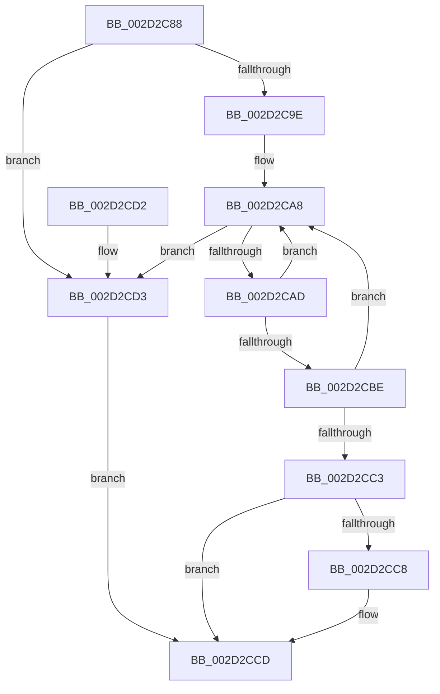

# HalpInterruptFindLines

- RVA: `0x002D2C88`–`0x002D2CD7` (길이 `79` bytes)
- VA: `0x00000001402D2C88`
- 실행 섹션: `.text`
- PDB 이름 있음: `예`; PDB Function 태그: `아니요`
- unwind 정보 RVA: `0x00069B1C`
- 디코드: `28`개 명령, `79/79` bytes 표시
- 미해석 바이트: `0` (있으면 어셈블리에 `.byte`로 보존)

> 이 문서는 커널 이미지의 기계어와 PDB 기호를 분석해 생성했습니다. 4번과 5번은 함수 원형과 자료형을 바이너리 사용 방식에서 추정한 C 해석이며 원본 소스 복구 결과는 아닙니다.

## 1. Dependencies

- 직접 호출 지점: **1**; 고유 호출 대상: **1**
- 직접 호출자로 확인된 함수: **13**
- RIP 상대 이미지 참조: **0**

### Outgoing calls
- `0x002D2C94` → [HalpInterruptLookupController](HalpInterruptLookupController_function_002D20D4.md) (function, `0x002D20D4`)

### Direct callers
- [HalpInterruptEnablePerformanceEvents](HalpInterruptEnablePerformanceEvents_function_002D3420.md) at `0x002D3519`
- [HalpInterruptSetRemappedLineStateInternal](../54/HalpInterruptSetRemappedLineStateInternal_function_00542F48.md) at `0x00542F6E`
- [HalpInterruptGetHighestPriorityInterrupt](../54/HalpInterruptGetHighestPriorityInterrupt_function_00543F90.md) at `0x00544032`
- [HalpInterruptIsCmciSupported](../54/HalpInterruptIsCmciSupported_function_0054415C.md) at `0x00544189`
- [HalpInterruptIsDeferredErrorSupported](../54/HalpInterruptIsDeferredErrorSupported_function_005441A4.md) at `0x005441F4`
- [HalpInterruptRestoreClock](../54/HalpInterruptRestoreClock_function_00544580.md) at `0x005445CE`
- [HalpConnectThermalInterrupt](../55/HalpConnectThermalInterrupt_function_00557310.md) at `0x0055737D`
- [HalpInitializeCmciVector](../55/HalpInitializeCmciVector_function_00557510.md) at `0x0055754F`
- [HalpInitializeDeferredErrorVector](../55/HalpInitializeDeferredErrorVector_function_005575C0.md) at `0x005575FF`
- [HalpApicInitializeIoUnit](../56/HalpApicInitializeIoUnit_function_00569CE0.md) at `0x00569E24`
- [sub_006FA83C](../6F/Unknown_function_006FA83C.md) at `0x006FA98D`
- [HalpInterruptUnmap](../../page/70/HalpInterruptUnmap_function_00707408.md) at `0x00707573`
- [HalpInterruptMaskAcpi](../../pagelk/B7/HalpInterruptMaskAcpi_function_00B7C128.md) at `0x00B7C165`

### Static image references
- 디코드된 RIP-relative 메모리 참조가 없습니다.

## 2. Other-region calls and transfers

- 다른 실행 섹션으로 향하는 call: **0**
- 별도 외부 분기/꼬리 이동을 확인하지 못했습니다.

## 3. Assembly (complete function range)

```asm
002D2C88  48 83 EC 28                     sub rsp, 0x28
002D2C8C  4C 8B D9                        mov r11, rcx
002D2C8F  4C 8B D2                        mov r10, rdx
002D2C92  8B 09                           mov ecx, dword ptr [rcx]
002D2C94  E8 3B F4 FF FF                  call 0x1402d20d4
002D2C99  48 85 C0                        test rax, rax
002D2C9C  74 35                           je 0x1402d2cd3
002D2C9E  4C 8D 88 08 01 00 00            lea r9, [rax + 0x108]
002D2CA5  4D 8B 01                        mov r8, qword ptr [r9]
002D2CA8  4D 3B C1                        cmp r8, r9
002D2CAB  74 26                           je 0x1402d2cd3
002D2CAD  41 8B 4B 04                     mov ecx, dword ptr [r11 + 4]
002D2CB1  49 8B C0                        mov rax, r8
002D2CB4  4D 8B 00                        mov r8, qword ptr [r8]
002D2CB7  8B 50 14                        mov edx, dword ptr [rax + 0x14]
002D2CBA  3B D1                           cmp edx, ecx
002D2CBC  7F EA                           jg 0x1402d2ca8
002D2CBE  39 48 18                        cmp dword ptr [rax + 0x18], ecx
002D2CC1  7E E5                           jle 0x1402d2ca8
002D2CC3  4D 85 D2                        test r10, r10
002D2CC6  74 05                           je 0x1402d2ccd
002D2CC8  2B CA                           sub ecx, edx
002D2CCA  41 89 0A                        mov dword ptr [r10], ecx
002D2CCD  48 83 C4 28                     add rsp, 0x28
002D2CD1  C3                              ret
002D2CD2  CC                              int3
002D2CD3  33 C0                           xor eax, eax
002D2CD5  EB F6                           jmp 0x1402d2ccd
```

## 4. C-style interpretation (structured pseudocode)

```c
__int64 __fastcall HalpInterruptFindLines(__int64 a1, __int64 a2)
{
    __int64 result;
    __int64 v_rsp;

    v_rsp = (v_rsp) - (40);
    result = HalpInterruptLookupController((unsigned int)(*(unsigned int *)(a1)), a2, a3, a4);
    if (result == 0) goto loc_002D2CD3;
loc_002D2CA8:
    if ((*(unsigned __int64 *)(result + 264)) == (result + 264)) goto loc_002D2CD3;
    if (((unsigned int)((unsigned int)(*(unsigned int *)(*(unsigned __int64 *)(result + 264) + 20)))) > ((unsigned int)((unsigned int)(*(unsigned int *)(a1 + 4))))) goto loc_002D2CA8;
    if ((*(unsigned int *)(*(unsigned __int64 *)(result + 264) + 24)) <= ((unsigned int)((unsigned int)(*(unsigned int *)(a1 + 4))))) goto loc_002D2CA8;
    if (a2 != 0) {
        a1 = (unsigned int)(((unsigned int)(*(unsigned int *)(a1 + 4))) - ((unsigned int)((unsigned int)(*(unsigned int *)(*(unsigned __int64 *)(result + 264) + 20)))));
        *(unsigned int *)(a2) = (unsigned int)(a1);
    }
    v_rsp = (v_rsp) + (40);
    return *(unsigned __int64 *)(result + 264);
loc_002D2CD3:
    result = 0;
    goto loc_002D2CCD;
}
```

## 5. (Beta) C Style

```c
int64_t HalpInterruptFindLines(void *Arg1, int64_t Arg2)
{
    uint8_t *arg1 = (uint8_t *)Arg1;

    int64_t result;
    int64_t local_rsp;

    local_rsp = (local_rsp) - (40);
    result = HalpInterruptLookupController((uint32_t)(*(uint32_t *)(arg1)), Arg2, a3, a4);
    if (result == 0) goto loc_002D2CD3;
loc_002D2CA8:
    if ((*(uint64_t *)(result + 0x108)) == (result + 264)) goto loc_002D2CD3;
    if (((uint32_t)((uint32_t)(*(uint32_t *)(*(uint64_t *)(result + 0x108) + 0x14)))) > ((uint32_t)((uint32_t)(*(uint32_t *)(arg1 + 0x4))))) goto loc_002D2CA8;
    if ((*(uint32_t *)(*(uint64_t *)(result + 0x108) + 0x18)) <= ((uint32_t)((uint32_t)(*(uint32_t *)(arg1 + 0x4))))) goto loc_002D2CA8;
    if (Arg2 != 0) {
        Arg1 = (uint32_t)(((uint32_t)(*(uint32_t *)(arg1 + 0x4))) - ((uint32_t)((uint32_t)(*(uint32_t *)(*(uint64_t *)(result + 0x108) + 0x14)))));
        *(uint32_t *)(Arg2) = (uint32_t)(Arg1);
    }
    local_rsp = (local_rsp) + (40);
    return *(uint64_t *)(result + 0x108);
loc_002D2CD3:
    result = 0;
    goto loc_002D2CCD;
}
```

### 관측된 메모리 오프셋

구조체 형식이 확인되지 않은 접근은 인자 기준의 오프셋으로만 기록했습니다.

| 기준 인자 | 오프셋 표현 | 폭 (bit) | 접근 |
|---|---:|---:|---|
| `Arg1` | `+ 0x0` | `32` | `R` |

## 6. Execution-region graph

[열기: 2D/3D 그래프와 함수 탐색 컨트롤 패널](../../../control-panel.html?section=text&rva=0x002D2C88&view=graph)

- 2D 그래프는 위에서 아래로 흐르고, 3D 그래프는 빈 공간을 드래그해 회전합니다. Shift+드래그는 이동, 휠은 확대·축소, 함수 노드 선택은 대상 보고서 이동입니다.

### Static fallback


