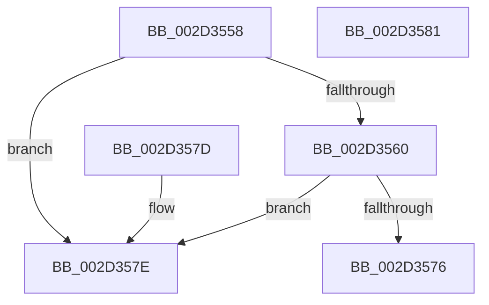

# HalpInterruptGetPriority

- RVA: `0x002D3558`–`0x002D3582` (길이 `42` bytes)
- VA: `0x00000001402D3558`
- 실행 섹션: `.text`
- PDB 이름 있음: `예`; PDB Function 태그: `아니요`
- unwind 정보 RVA: `0x000DB714`
- 디코드: `16`개 명령, `42/42` bytes 표시
- 미해석 바이트: `0` (있으면 어셈블리에 `.byte`로 보존)

> 이 문서는 커널 이미지의 기계어와 PDB 기호를 분석해 생성했습니다. 4번과 5번은 함수 원형과 자료형을 바이너리 사용 방식에서 추정한 C 해석이며 원본 소스 복구 결과는 아닙니다.

## 1. Dependencies

- 직접 호출 지점: **0**; 고유 호출 대상: **0**
- 직접 호출자로 확인된 함수: **6**
- RIP 상대 이미지 참조: **0**

### Outgoing calls
- 직접 디코드된 call 명령이 없습니다.

### Direct callers
- [HalpInterruptEnablePerformanceEvents](HalpInterruptEnablePerformanceEvents_function_002D3420.md) at `0x002D34BF`
- [HalpInterruptSetLineState](../48/HalpInterruptSetLineState_function_0048A0C8.md) at `0x0048A39F`
- [HalpInterruptSetRemappedLineStateInternal](../54/HalpInterruptSetRemappedLineStateInternal_function_00542F48.md) at `0x00542FDA`
- [HalpConnectThermalInterrupt](../55/HalpConnectThermalInterrupt_function_00557310.md) at `0x00557426`
- [HalpInitializeCmciVector](../55/HalpInitializeCmciVector_function_00557510.md) at `0x0055758F`
- [HalpInitializeDeferredErrorVector](../55/HalpInitializeDeferredErrorVector_function_005575C0.md) at `0x0055763F`

### Static image references
- 디코드된 RIP-relative 메모리 참조가 없습니다.

## 2. Other-region calls and transfers

- 다른 실행 섹션으로 향하는 call: **0**
- 별도 외부 분기/꼬리 이동을 확인하지 못했습니다.

## 3. Assembly (complete function range)

```asm
002D3558  C0 EA 04                        shr dl, 4
002D355B  80 FA 02                        cmp dl, 2
002D355E  76 1E                           jbe 0x1402d357e
002D3560  8B 89 FC 00 00 00               mov ecx, dword ptr [rcx + 0xfc]
002D3566  B8 0F 00 00 00                  mov eax, 0xf
002D356B  44 0F B6 C2                     movzx r8d, dl
002D356F  41 2B C0                        sub eax, r8d
002D3572  3B C1                           cmp eax, ecx
002D3574  77 08                           ja 0x1402d357e
002D3576  8D 41 F1                        lea eax, [rcx - 0xf]
002D3579  41 03 C0                        add eax, r8d
002D357C  C3                              ret
002D357D  CC                              int3
002D357E  33 C0                           xor eax, eax
002D3580  C3                              ret
002D3581  CC                              int3
```

## 4. C-style interpretation (structured pseudocode)

```c
__int64 __fastcall HalpInterruptGetPriority(__int64 a1, unsigned __int8 a2)
{
    __int64 result;

    a2 = (unsigned __int8)((a2) >> (4));
    if (a2 <= 2) goto loc_002D357E;
    result = (unsigned int)((15) - (a2));
    if (((unsigned int)(result)) > ((unsigned int)((unsigned int)(*(unsigned int *)(a1 + 252))))) goto loc_002D357E;
    result = (unsigned int)(((unsigned int)(*(unsigned int *)(a1 + 252)) - 15) + (a2));
    return result;
loc_002D357E:
    result = 0;
    return result;
}
```

## 5. (Beta) C Style

```c
int64_t HalpInterruptGetPriority(void *Arg1, uint8_t Arg2)
{
    uint8_t *arg1 = (uint8_t *)Arg1;

    int64_t result;

    Arg2 = (uint8_t)((Arg2) >> (4));
    if (Arg2 <= 2) goto loc_002D357E;
    result = (uint32_t)((15) - (Arg2));
    if (((uint32_t)(result)) > ((uint32_t)((uint32_t)(*(uint32_t *)(arg1 + 0xFC))))) goto loc_002D357E;
    result = (uint32_t)(((uint32_t)(*(uint32_t *)(arg1 + 0xFC)) - 15) + (Arg2));
    return result;
loc_002D357E:
    result = 0;
    return result;
}
```

### 관측된 메모리 오프셋

구조체 형식이 확인되지 않은 접근은 인자 기준의 오프셋으로만 기록했습니다.

| 기준 인자 | 오프셋 표현 | 폭 (bit) | 접근 |
|---|---:|---:|---|
| `Arg1` | `+ 0xFC` | `32` | `R` |

## 6. Execution-region graph

[열기: 2D/3D 그래프와 함수 탐색 컨트롤 패널](../../../control-panel.html?section=text&rva=0x002D3558&view=graph)

- 2D 그래프는 위에서 아래로 흐르고, 3D 그래프는 빈 공간을 드래그해 회전합니다. Shift+드래그는 이동, 휠은 확대·축소, 함수 노드 선택은 대상 보고서 이동입니다.

### Static fallback


