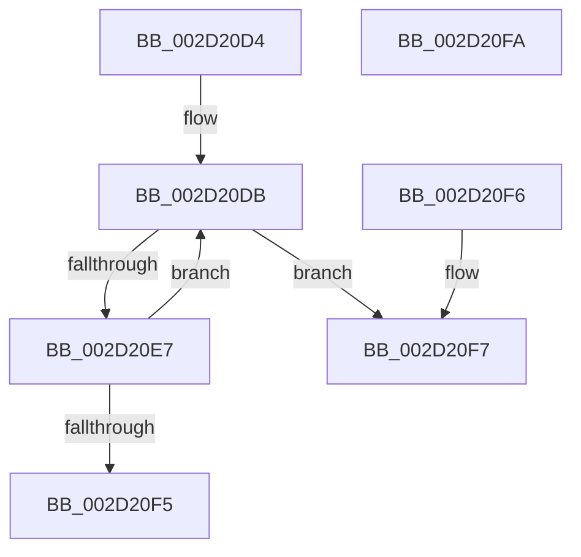

# HalpInterruptLookupController

- RVA: `0x002D20D4`–`0x002D20FB` (길이 `39` bytes)
- VA: `0x00000001402D20D4`
- 실행 섹션: `.text`
- PDB 이름 있음: `예`; PDB Function 태그: `아니요`
- unwind 정보 RVA: `0x000DB714`
- 디코드: `13`개 명령, `39/39` bytes 표시
- 미해석 바이트: `0` (있으면 어셈블리에 `.byte`로 보존)

> 이 문서는 커널 이미지의 기계어와 PDB 기호를 분석해 생성했습니다. 4번과 5번은 함수 원형과 자료형을 바이너리 사용 방식에서 추정한 C 해석이며 원본 소스 복구 결과는 아닙니다.

## 1. Dependencies

- 직접 호출 지점: **0**; 고유 호출 대상: **0**
- 직접 호출자로 확인된 함수: **21**
- RIP 상대 이미지 참조: **1**

### Outgoing calls
- 직접 디코드된 call 명령이 없습니다.

### Direct callers
- [HalpMaskInterrupt](HalpMaskInterrupt_function_002D1DB0.md) at `0x002D1DF3`
- [HalpUnmaskInterrupt](HalpUnmaskInterrupt_function_002D1EE0.md) at `0x002D1F23`
- [HalpInterruptFindLines](HalpInterruptFindLines_function_002D2C88.md) at `0x002D2C94`
- [HalpInterruptFindControllerAndLineState](HalpInterruptFindControllerAndLineState_function_002D2FC0.md) at `0x002D2FF7`
- [HalDisableInterrupt](HalDisableInterrupt_function_002D39F0.md) at `0x002D3AA9`
- [HalpInterruptSetLineState](../48/HalpInterruptSetLineState_function_0048A0C8.md) at `0x0048A1EF`
- [HalpInterruptSetLineState](../48/HalpInterruptSetLineState_function_0048A0C8.md) at `0x0048A20F`
- [HalpInterruptSetDestinationInternal](../48/HalpInterruptSetDestinationInternal_function_0048A530.md) at `0x0048A570`
- [HalpInterruptFindBestRouting](../48/HalpInterruptFindBestRouting_function_0048A784.md) at `0x0048A798`
- [ExtEnvSetVpptTarget](../49/ExtEnvSetVpptTarget_function_0049D8FC.md) at `0x0049DAB6`
- [HalpInterruptLineToGsi](../4A/HalpInterruptLineToGsi_function_004A94F8.md) at `0x004A9507`
- [HalpInterruptRemap](../54/HalpInterruptRemap_function_00542AE4.md) at `0x00542DDA`
- [HalpInterruptRequestInterrupt](../54/HalpInterruptRequestInterrupt_function_00544460.md) at `0x005444CF`
- [HalpInterruptRestoreClock](../54/HalpInterruptRestoreClock_function_00544580.md) at `0x005445DE`
- [HalpInterruptPerformDirectedEndOfInterrupt](../54/HalpInterruptPerformDirectedEndOfInterrupt_function_00545C88.md) at `0x00545CBD`
- [HalpInterruptServiceActiveBoth](../54/HalpInterruptServiceActiveBoth_function_00545CFC.md) at `0x00545D49`
- [HalpTimerInitializeHypervisorTimer](../54/HalpTimerInitializeHypervisorTimer_function_0054B8F4.md) at `0x0054BB34`
- [HalpInterruptRegisterController](../56/HalpInterruptRegisterController_function_005640F0.md) at `0x005641EC`
- [HalpInterruptRegisterLine](../56/HalpInterruptRegisterLine_function_005645B0.md) at `0x00564610`
- [sub_006FA83C](../6F/Unknown_function_006FA83C.md) at `0x006FA9B3`
- [HalpInterruptUnmap](../../page/70/HalpInterruptUnmap_function_00707408.md) at `0x0070754D`
- [HalpInterruptMaskAcpi](../../pagelk/B7/HalpInterruptMaskAcpi_function_00B7C128.md) at `0x00B7C18B`

### Static image references
- `0x002D20D4` → RVA `0x00FC38F0` (`.data`; read)

## 2. Other-region calls and transfers

- 다른 실행 섹션으로 향하는 call: **0**
- 별도 외부 분기/꼬리 이동을 확인하지 못했습니다.

## 3. Assembly (complete function range)

```asm
002D20D4  48 8B 15 15 18 CF 00            mov rdx, qword ptr [rip + 0xcf1815]
002D20DB  48 8D 05 0E 18 CF 00            lea rax, [rip + 0xcf180e]
002D20E2  48 3B D0                        cmp rdx, rax
002D20E5  74 10                           je 0x1402d20f7
002D20E7  48 8B C2                        mov rax, rdx
002D20EA  48 8B 12                        mov rdx, qword ptr [rdx]
002D20ED  39 88 00 01 00 00               cmp dword ptr [rax + 0x100], ecx
002D20F3  75 E6                           jne 0x1402d20db
002D20F5  C3                              ret
002D20F6  CC                              int3
002D20F7  33 C0                           xor eax, eax
002D20F9  C3                              ret
002D20FA  CC                              int3
```

## 4. C-style interpretation (structured pseudocode)

```c
__int64 __fastcall HalpInterruptLookupController(int a1)
{
    __int64 result;

loc_002D20DB:
    if ((*(unsigned __int64 *)(v_rip + 13572117)) == (v_rip + 13572110)) goto loc_002D20F7;
    if ((*(unsigned int *)(*(unsigned __int64 *)(v_rip + 13572117) + 256)) != a1) goto loc_002D20DB;
    return *(unsigned __int64 *)(v_rip + 13572117);
loc_002D20F7:
    result = 0;
    return result;
}
```

## 5. (Beta) C Style

```c
int64_t HalpInterruptLookupController(int32_t Arg1)
{
    int64_t result;

loc_002D20DB:
    if ((*(uint64_t *)(v_rip + 0xCF1815)) == (v_rip + 13572110)) goto loc_002D20F7;
    if ((*(uint32_t *)(*(uint64_t *)(v_rip + 0xCF1815) + 0x100)) != Arg1) goto loc_002D20DB;
    return *(uint64_t *)(v_rip + 0xCF1815);
loc_002D20F7:
    result = 0;
    return result;
}
```

## 6. Execution-region graph

[열기: 2D/3D 그래프와 함수 탐색 컨트롤 패널](../../../control-panel.html?section=text&rva=0x002D20D4&view=graph)

- 2D 그래프는 위에서 아래로 흐르고, 3D 그래프는 빈 공간을 드래그해 회전합니다. Shift+드래그는 이동, 휠은 확대·축소, 함수 노드 선택은 대상 보고서 이동입니다.

### Static fallback


