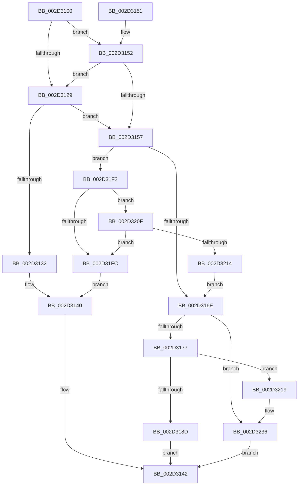

# HalpInterruptSetDestination

- RVA: `0x002D3100`–`0x002D3240` (길이 `320` bytes)
- VA: `0x00000001402D3100`
- 실행 섹션: `.text`
- PDB 이름 있음: `예`; PDB Function 태그: `아니요`
- unwind 정보 RVA: `0x0006F9D0`
- 디코드: `87`개 명령, `320/320` bytes 표시
- 미해석 바이트: `0` (있으면 어셈블리에 `.byte`로 보존)

> 이 문서는 커널 이미지의 기계어와 PDB 기호를 분석해 생성했습니다. 4번과 5번은 함수 원형과 자료형을 바이너리 사용 방식에서 추정한 C 해석이며 원본 소스 복구 결과는 아닙니다.

## 1. Dependencies

- 직접 호출 지점: **8**; 고유 호출 대상: **8**
- 직접 호출자로 확인된 함수: **1**
- RIP 상대 이미지 참조: **4**

### Outgoing calls
- `0x002D313B` → [HalpInterruptSetRemappedDestinationHv](HalpInterruptSetRemappedDestinationHv_function_002D3248.md) (function, `0x002D3248`)
- `0x002D317F` → [HalpInterruptFindLinesForGsiRange](HalpInterruptFindLinesForGsiRange_function_002D204C.md) (function, `0x002D204C`)
- `0x002D31C5` → [HalpAcquireHighLevelLock](HalpAcquireHighLevelLock_function_002D2390.md) (function, `0x002D2390`)
- `0x002D31D8` → [HalpInterruptSetDestinationInternal](../48/HalpInterruptSetDestinationInternal_function_0048A530.md) (function, `0x0048A530`)
- `0x002D31E8` → [HalpReleaseHighLevelLock](HalpReleaseHighLevelLock_function_002D1C58.md) (function, `0x002D1C58`)
- `0x002D31F2` → [HalpInterruptModel](../4A/HalpInterruptModel_function_004ACA38.md) (function, `0x004ACA38`)
- `0x002D3205` → [HalpInterruptSetRemappedDestination](../48/HalpInterruptSetRemappedDestination_function_0048A850.md) (function, `0x0048A850`)
- `0x002D3231` → [HalpInterruptSetProblemEx](../48/HalpInterruptSetProblemEx_function_0048AC8C.md) (function, `0x0048AC8C`)

### Direct callers
- [ExtEnvSetVpptTarget](../49/ExtEnvSetVpptTarget_function_0049D8FC.md) at `0x0049DB2E`

### Static image references
- `0x002D3129` → RVA `0x00FC1CA8` (`.data`; read)
- `0x002D3157` → RVA `0x00E101F0` (`.data`; read)
- `0x002D31AF` → RVA `0x00FC19A8` (`.data`; read)
- `0x002D3224` → RVA `0x00010AA8` (`.rdata`; read)

## 2. Other-region calls and transfers

- 다른 실행 섹션으로 향하는 call: **0**
- 별도 외부 분기/꼬리 이동을 확인하지 못했습니다.

## 3. Assembly (complete function range)

```asm
002D3100  48 89 5C 24 10                  mov qword ptr [rsp + 0x10], rbx
002D3105  55                              push rbp
002D3106  56                              push rsi
002D3107  57                              push rdi
002D3108  48 8B EC                        mov rbp, rsp
002D310B  48 83 EC 50                     sub rsp, 0x50
002D310F  33 C0                           xor eax, eax
002D3111  4D 8B C8                        mov r9, r8
002D3114  44 8B 01                        mov r8d, dword ptr [rcx]
002D3117  48 8B F2                        mov rsi, rdx
002D311A  89 45 E4                        mov dword ptr [rbp - 0x1c], eax
002D311D  48 8B D9                        mov rbx, rcx
002D3120  21 45 E4                        and dword ptr [rbp - 0x1c], eax
002D3123  41 83 F8 03                     cmp r8d, 3
002D3127  75 29                           jne 0x1402d3152
002D3129  48 39 05 78 EB CE 00            cmp qword ptr [rip + 0xceeb78], rax
002D3130  74 25                           je 0x1402d3157
002D3132  4C 8B C6                        mov r8, rsi
002D3135  48 8B D3                        mov rdx, rbx
002D3138  49 8B C9                        mov rcx, r9
002D313B  E8 08 01 00 00                  call 0x1402d3248
002D3140  8B F8                           mov edi, eax
002D3142  48 8B 5C 24 78                  mov rbx, qword ptr [rsp + 0x78]
002D3147  8B C7                           mov eax, edi
002D3149  48 83 C4 50                     add rsp, 0x50
002D314D  5F                              pop rdi
002D314E  5E                              pop rsi
002D314F  5D                              pop rbp
002D3150  C3                              ret
002D3151  CC                              int3
002D3152  45 85 C0                        test r8d, r8d
002D3155  74 D2                           je 0x1402d3129
002D3157  48 8B 05 92 D0 B3 00            mov rax, qword ptr [rip + 0xb3d092]
002D315E  F7 80 F4 00 00 00 00 01 00 00   test dword ptr [rax + 0xf4], 0x100
002D3168  0F 85 84 00 00 00               jne 0x1402d31f2
002D316E  4D 85 C9                        test r9, r9
002D3171  0F 84 BF 00 00 00               je 0x1402d3236
002D3177  41 8B 39                        mov edi, dword ptr [r9]
002D317A  8B CF                           mov ecx, edi
002D317C  8D 57 01                        lea edx, [rdi + 1]
002D317F  E8 C8 EE FF FF                  call 0x1402d204c
002D3184  48 85 C0                        test rax, rax
002D3187  0F 84 8C 00 00 00               je 0x1402d3219
002D318D  8B 48 10                        mov ecx, dword ptr [rax + 0x10]
002D3190  83 4D 20 FF                     or dword ptr [rbp + 0x20], 0xffffffff
002D3194  89 4D 38                        mov dword ptr [rbp + 0x38], ecx
002D3197  8B 48 1C                        mov ecx, dword ptr [rax + 0x1c]
002D319A  8B 40 14                        mov eax, dword ptr [rax + 0x14]
002D319D  2B C1                           sub eax, ecx
002D319F  C7 45 E0 01 00 00 00            mov dword ptr [rbp - 0x20], 1
002D31A6  03 C7                           add eax, edi
002D31A8  48 89 75 E8                     mov qword ptr [rbp - 0x18], rsi
002D31AC  89 45 3C                        mov dword ptr [rbp + 0x3c], eax
002D31AF  48 8D 0D F2 E7 CE 00            lea rcx, [rip + 0xcee7f2]
002D31B6  48 8D 43 28                     lea rax, [rbx + 0x28]
002D31BA  C7 45 24 01 00 00 00            mov dword ptr [rbp + 0x24], 1
002D31C1  48 89 45 F0                     mov qword ptr [rbp - 0x10], rax
002D31C5  E8 C6 F1 FF FF                  call 0x1402d2390
002D31CA  4C 8D 45 20                     lea r8, [rbp + 0x20]
002D31CE  8A D8                           mov bl, al
002D31D0  48 8D 55 E0                     lea rdx, [rbp - 0x20]
002D31D4  48 8D 4D 38                     lea rcx, [rbp + 0x38]
002D31D8  E8 53 73 1B 00                  call 0x14048a530
002D31DD  8A D3                           mov dl, bl
002D31DF  48 8D 0D C2 E7 CE 00            lea rcx, [rip + 0xcee7c2]
002D31E6  8B F8                           mov edi, eax
002D31E8  E8 6B EA FF FF                  call 0x1402d1c58
002D31ED  E9 50 FF FF FF                  jmp 0x1402d3142
002D31F2  E8 41 98 1D 00                  call 0x1404aca38
002D31F7  83 F8 01                        cmp eax, 1
002D31FA  75 13                           jne 0x1402d320f
002D31FC  4C 8B C6                        mov r8, rsi
002D31FF  48 8B D3                        mov rdx, rbx
002D3202  49 8B C9                        mov rcx, r9
002D3205  E8 46 76 1B 00                  call 0x14048a850
002D320A  E9 31 FF FF FF                  jmp 0x1402d3140
002D320F  45 85 C0                        test r8d, r8d
002D3212  75 E8                           jne 0x1402d31fc
002D3214  E9 55 FF FF FF                  jmp 0x1402d316e
002D3219  45 33 C0                        xor r8d, r8d
002D321C  C7 44 24 20 2F 02 00 00         mov dword ptr [rsp + 0x20], 0x22f
002D3224  4C 8D 0D 7D D8 D3 FF            lea r9, [rip - 0x2c2783]
002D322B  33 C9                           xor ecx, ecx
002D322D  41 8D 50 12                     lea edx, [r8 + 0x12]
002D3231  E8 56 7A 1B 00                  call 0x14048ac8c
002D3236  BF 0D 00 00 C0                  mov edi, 0xc000000d
002D323B  E9 02 FF FF FF                  jmp 0x1402d3142
```

## 4. C-style interpretation (structured pseudocode)

```c
__int64 __fastcall HalpInterruptSetDestination(__int64 a1, __int64 a2, __int64 a3)
{
    __int64 result;
    __int64 v_rsp;
    unsigned __int64 v_stack_m28;
    unsigned __int64 v_stack_m30;
    unsigned int v_stack_m34;
    unsigned int v_stack_m38;
    unsigned __int64 v_stack_p10;
    unsigned int v_stack_p20;
    unsigned int v_stack_p24;
    unsigned int v_stack_p8;
    unsigned int v_stack_pC;

    v_stack_p10 = v_rbx;
    v_rsp = (v_rsp) - (80);
    result = 0;
    v_stack_m34 = 0;
    if (((unsigned int)((unsigned int)(*(unsigned int *)(a1)))) != 3) goto loc_002D3152;
loc_002D3129:
    if ((*(unsigned __int64 *)(v_rip + 13560696)) == 0) goto loc_002D3157;
    result = HalpInterruptSetRemappedDestinationHv(a3, a1, a2, a3);
loc_002D3140:
loc_002D3142:
    v_rsp = (v_rsp) + (80);
    return (unsigned int)((unsigned int)((unsigned int)((unsigned int)(result))));
loc_002D3152:
    if ((unsigned int)(a2) == 0) goto loc_002D3129;
loc_002D3157:
    if (((*(unsigned int *)(*(unsigned __int64 *)(v_rip + 11784338) + 244)) & (256)) != 0) goto loc_002D31F2;
loc_002D316E:
    if (a3 == 0) goto loc_002D3236;
    result = HalpInterruptFindLinesForGsiRange((unsigned int)((unsigned int)((unsigned int)(*(unsigned int *)(a3)))), (unsigned int)(*(unsigned int *)(a3)) + 1, a2, a3);
    if (result == 0) goto loc_002D3219;
    v_stack_p20 = (unsigned int)((unsigned int)(*(unsigned int *)(result + 16)));
    result = (unsigned int)(((unsigned int)(*(unsigned int *)(result + 20))) - ((unsigned int)((unsigned int)(*(unsigned int *)(result + 28)))));
    v_stack_m38 = 1;
    result = (unsigned int)((result) + ((unsigned int)((unsigned int)(*(unsigned int *)(a3)))));
    v_stack_m30 = a2;
    v_stack_p24 = (unsigned int)(result);
    v_stack_pC = 1;
    v_stack_m28 = v_stack_p10 + 40;
    result = HalpAcquireHighLevelLock(v_rip + 13559794, (unsigned int)(*(unsigned int *)(a3)) + 1, a2, a3);
    result = HalpInterruptSetDestinationInternal(v_stack_p20, v_stack_m38, v_stack_p8, a3);
    result = HalpReleaseHighLevelLock(v_rip + 13559746, (unsigned __int8)((unsigned __int8)(result)), v_stack_p8, a3);
    goto loc_002D3142;
loc_002D31F2:
    result = HalpInterruptModel(v_rip + 13559746, (unsigned __int8)((unsigned __int8)(result)), v_stack_p8, a3);
    if (((unsigned int)(result)) != 1) goto loc_002D320F;
loc_002D31FC:
    result = HalpInterruptSetRemappedDestination(a3, (unsigned __int8)(result), a2, a3);
    goto loc_002D3140;
loc_002D320F:
    if ((unsigned int)(a2) != 0) goto loc_002D31FC;
    goto loc_002D316E;
loc_002D3219:
    a3 = 0;
    v_stack_p20 = 559;
    a1 = 0;
    result = HalpInterruptSetProblemEx(a1, a3 + 18, a3, v_rip - 2893699);
loc_002D3236:
    goto loc_002D3142;
}
```

## 5. (Beta) C Style

```c
int64_t HalpInterruptSetDestination(void *Arg1, int64_t Arg2, int64_t Arg3)
{
    uint8_t *arg1 = (uint8_t *)Arg1;

    int64_t result;
    int64_t local_rsp;
    uint64_t v_stack_m28;
    uint64_t v_stack_m30;
    uint32_t v_stack_m34;
    uint32_t v_stack_m38;
    uint64_t v_stack_p10;
    uint32_t v_stack_p20;
    uint32_t v_stack_p24;
    uint32_t v_stack_p8;
    uint32_t v_stack_pC;

    v_stack_p10 = local_rbx;
    local_rsp = (local_rsp) - (80);
    result = 0;
    v_stack_m34 = 0;
    if (((uint32_t)((uint32_t)(*(uint32_t *)(arg1)))) != 3) goto loc_002D3152;
loc_002D3129:
    if ((*(uint64_t *)(v_rip + 0xCEEB78)) == 0) goto loc_002D3157;
    result = HalpInterruptSetRemappedDestinationHv(Arg3, Arg1, Arg2, Arg3);
loc_002D3140:
loc_002D3142:
    local_rsp = (local_rsp) + (80);
    return (uint32_t)((uint32_t)((uint32_t)((uint32_t)(result))));
loc_002D3152:
    if ((uint32_t)(Arg2) == 0) goto loc_002D3129;
loc_002D3157:
    if (((*(uint32_t *)(*(uint64_t *)(v_rip + 0xB3D092) + 0xF4)) & (256)) != 0) goto loc_002D31F2;
loc_002D316E:
    if (Arg3 == 0) goto loc_002D3236;
    result = HalpInterruptFindLinesForGsiRange((uint32_t)((uint32_t)((uint32_t)(*(uint32_t *)(Arg3)))), (uint32_t)(*(uint32_t *)(Arg3)) + 1, Arg2, Arg3);
    if (result == 0) goto loc_002D3219;
    v_stack_p20 = (uint32_t)((uint32_t)(*(uint32_t *)(result + 0x10)));
    result = (uint32_t)(((uint32_t)(*(uint32_t *)(result + 0x14))) - ((uint32_t)((uint32_t)(*(uint32_t *)(result + 0x1C)))));
    v_stack_m38 = 1;
    result = (uint32_t)((result) + ((uint32_t)((uint32_t)(*(uint32_t *)(Arg3)))));
    v_stack_m30 = Arg2;
    v_stack_p24 = (uint32_t)(result);
    v_stack_pC = 1;
    v_stack_m28 = v_stack_p10 + 40;
    result = HalpAcquireHighLevelLock(v_rip + 13559794, (uint32_t)(*(uint32_t *)(Arg3)) + 1, Arg2, Arg3);
    result = HalpInterruptSetDestinationInternal(v_stack_p20, v_stack_m38, v_stack_p8, Arg3);
    result = HalpReleaseHighLevelLock(v_rip + 13559746, (uint8_t)((uint8_t)(result)), v_stack_p8, Arg3);
    goto loc_002D3142;
loc_002D31F2:
    result = HalpInterruptModel(v_rip + 13559746, (uint8_t)((uint8_t)(result)), v_stack_p8, Arg3);
    if (((uint32_t)(result)) != 1) goto loc_002D320F;
loc_002D31FC:
    result = HalpInterruptSetRemappedDestination(Arg3, (uint8_t)(result), Arg2, Arg3);
    goto loc_002D3140;
loc_002D320F:
    if ((uint32_t)(Arg2) != 0) goto loc_002D31FC;
    goto loc_002D316E;
loc_002D3219:
    Arg3 = 0;
    v_stack_p20 = 559;
    Arg1 = 0;
    result = HalpInterruptSetProblemEx(Arg1, Arg3 + 18, Arg3, v_rip - 2893699);
loc_002D3236:
    goto loc_002D3142;
}
```

### 관측된 메모리 오프셋

구조체 형식이 확인되지 않은 접근은 인자 기준의 오프셋으로만 기록했습니다.

| 기준 인자 | 오프셋 표현 | 폭 (bit) | 접근 |
|---|---:|---:|---|
| `Arg1` | `+ 0x0` | `32` | `R` |
| `Arg1` | `+ 0x28` | `64` | `R` |

## 6. Execution-region graph

[열기: 2D/3D 그래프와 함수 탐색 컨트롤 패널](../../../control-panel.html?section=text&rva=0x002D3100&view=graph)

- 2D 그래프는 위에서 아래로 흐르고, 3D 그래프는 빈 공간을 드래그해 회전합니다. Shift+드래그는 이동, 휠은 확대·축소, 함수 노드 선택은 대상 보고서 이동입니다.

### Static fallback


