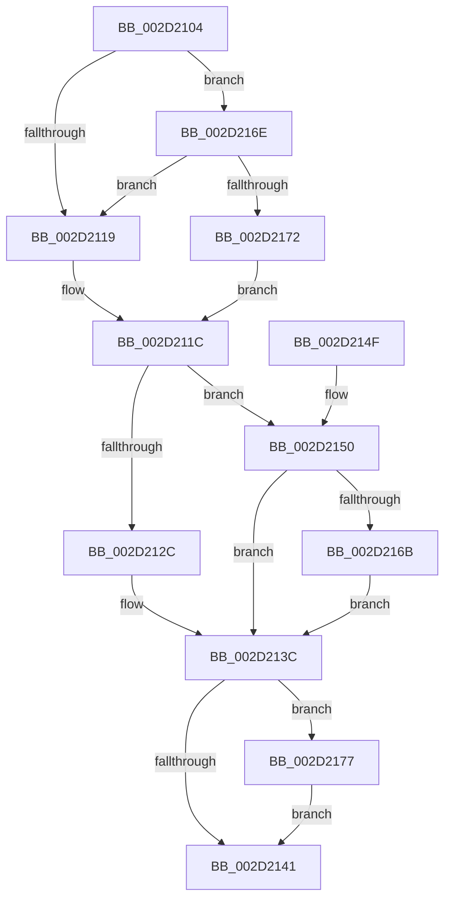

# HalpInterruptSetLineStateInternal

- RVA: `0x002D2104`–`0x002D2195` (길이 `145` bytes)
- VA: `0x00000001402D2104`
- 실행 섹션: `.text`
- PDB 이름 있음: `예`; PDB Function 태그: `아니요`
- unwind 정보 RVA: `0x0006F8F8`
- 디코드: `43`개 명령, `145/145` bytes 표시
- 미해석 바이트: `0` (있으면 어셈블리에 `.byte`로 보존)

> 이 문서는 커널 이미지의 기계어와 PDB 기호를 분석해 생성했습니다. 4번과 5번은 함수 원형과 자료형을 바이너리 사용 방식에서 추정한 C 해석이며 원본 소스 복구 결과는 아닙니다.

## 1. Dependencies

- 직접 호출 지점: **4**; 고유 호출 대상: **3**
- 직접 호출자로 확인된 함수: **16**
- RIP 상대 이미지 참조: **1**

### Outgoing calls
- `0x002D2134` → [guard_dispatch_icall](../6B/guard_dispatch_icall_function_006BAAD0.md) (function, `0x006BAAD0`)
- `0x002D2150` → [HalpDisableInterrupts](../25/HalpDisableInterrupts_function_002521A0.md) (function, `0x002521A0`)
- `0x002D215F` → [guard_dispatch_icall](../6B/guard_dispatch_icall_function_006BAAD0.md) (function, `0x006BAAD0`)
- `0x002D218E` → [HalpInterruptSetProblemEx](../48/HalpInterruptSetProblemEx_function_0048AC8C.md) (function, `0x0048AC8C`)

### Direct callers
- [HalpMaskInterrupt](HalpMaskInterrupt_function_002D1DB0.md) at `0x002D1E59`
- [HalpUnmaskInterrupt](HalpUnmaskInterrupt_function_002D1EE0.md) at `0x002D1FB8`
- [HalpInterruptSetRemappedDestinationHv](HalpInterruptSetRemappedDestinationHv_function_002D3248.md) at `0x002D3349`
- [HalpInterruptEnablePerformanceEvents](HalpInterruptEnablePerformanceEvents_function_002D3420.md) at `0x002D34D7`
- [HalDisableInterrupt](HalDisableInterrupt_function_002D39F0.md) at `0x002D3AE8`
- [HalpInterruptSetLineState](../48/HalpInterruptSetLineState_function_0048A0C8.md) at `0x0048A2CD`
- [HalpInterruptSetDestinationInternal](../48/HalpInterruptSetDestinationInternal_function_0048A530.md) at `0x0048A639`
- [HalpInterruptRestoreController](../4A/HalpInterruptRestoreController_function_004A75A8.md) at `0x004A7687`
- [HalpInterruptRemapFixedLines](../54/HalpInterruptRemapFixedLines_function_00544210.md) at `0x005443CA`
- [HalpInterruptRestoreClock](../54/HalpInterruptRestoreClock_function_00544580.md) at `0x005445FC`
- [HalpInterruptServiceActiveBoth](../54/HalpInterruptServiceActiveBoth_function_00545CFC.md) at `0x00545D85`
- [HalpConnectThermalInterrupt](../55/HalpConnectThermalInterrupt_function_00557310.md) at `0x00557439`
- [HalpInitializeCmciVector](../55/HalpInitializeCmciVector_function_00557510.md) at `0x005575A2`
- [HalpInitializeDeferredErrorVector](../55/HalpInitializeDeferredErrorVector_function_005575C0.md) at `0x00557652`
- [HalpInterruptMaskLevelTriggeredLines](../56/HalpInterruptMaskLevelTriggeredLines_function_00563590.md) at `0x00563675`
- [HalpInterruptMaskAcpi](../../pagelk/B7/HalpInterruptMaskAcpi_function_00B7C128.md) at `0x00B7C1A8`

### Static image references
- `0x002D2177` → RVA `0x000250A0` (`.rdata`; read)

## 2. Other-region calls and transfers

- 다른 실행 섹션으로 향하는 call: **0**
- 별도 외부 분기/꼬리 이동을 확인하지 못했습니다.

## 3. Assembly (complete function range)

```asm
002D2104  48 89 5C 24 08                  mov qword ptr [rsp + 8], rbx
002D2109  57                              push rdi
002D210A  48 83 EC 30                     sub rsp, 0x30
002D210E  41 8B 40 0C                     mov eax, dword ptr [r8 + 0xc]
002D2112  48 8B F9                        mov rdi, rcx
002D2115  A8 10                           test al, 0x10
002D2117  75 55                           jne 0x1402d216e
002D2119  83 E0 FE                        and eax, 0xfffffffe
002D211C  41 89 40 0C                     mov dword ptr [r8 + 0xc], eax
002D2120  F7 81 F4 00 00 00 00 02 00 00   test dword ptr [rcx + 0xf4], 0x200
002D212A  75 24                           jne 0x1402d2150
002D212C  48 8B 41 70                     mov rax, qword ptr [rcx + 0x70]
002D2130  48 8B 49 10                     mov rcx, qword ptr [rcx + 0x10]
002D2134  E8 97 89 3E 00                  call 0x1406baad0
002D2139  44 8B C0                        mov r8d, eax
002D213C  45 85 C0                        test r8d, r8d
002D213F  78 36                           js 0x1402d2177
002D2141  48 8B 5C 24 40                  mov rbx, qword ptr [rsp + 0x40]
002D2146  41 8B C0                        mov eax, r8d
002D2149  48 83 C4 30                     add rsp, 0x30
002D214D  5F                              pop rdi
002D214E  C3                              ret
002D214F  CC                              int3
002D2150  E8 4B 00 F8 FF                  call 0x1402521a0
002D2155  48 8B 4F 10                     mov rcx, qword ptr [rdi + 0x10]
002D2159  8A D8                           mov bl, al
002D215B  48 8B 47 70                     mov rax, qword ptr [rdi + 0x70]
002D215F  E8 6C 89 3E 00                  call 0x1406baad0
002D2164  44 8B C0                        mov r8d, eax
002D2167  84 DB                           test bl, bl
002D2169  74 D1                           je 0x1402d213c
002D216B  FB                              sti
002D216C  EB CE                           jmp 0x1402d213c
002D216E  A8 20                           test al, 0x20
002D2170  75 A7                           jne 0x1402d2119
002D2172  83 C8 01                        or eax, 1
002D2175  EB A5                           jmp 0x1402d211c
002D2177  4C 8D 0D 22 2F D5 FF            lea r9, [rip - 0x2ad0de]
002D217E  C7 44 24 20 7C 0C 00 00         mov dword ptr [rsp + 0x20], 0xc7c
002D2186  BA 07 00 00 00                  mov edx, 7
002D218B  48 8B CF                        mov rcx, rdi
002D218E  E8 F9 8A 1B 00                  call 0x14048ac8c
002D2193  EB AC                           jmp 0x1402d2141
```

## 4. C-style interpretation (structured pseudocode)

```c
__int64 __fastcall HalpInterruptSetLineStateInternal(__int64 a1, __int64 a2, __int64 a3)
{
    __int64 result;
    __int64 v_rsp;
    unsigned int v_stack_p20;
    unsigned __int64 v_stack_p8;

    v_stack_p8 = v_rbx;
    v_rsp = (v_rsp) - (48);
    if ((((unsigned __int8)((unsigned int)(*(unsigned int *)(a3 + 12)))) & (16)) != 0) goto loc_002D216E;
loc_002D2119:
    result = (unsigned int)(((unsigned int)(*(unsigned int *)(a3 + 12))) & (0xFFFFFFFEULL));
loc_002D211C:
    *(unsigned int *)(a3 + 12) = (unsigned int)(result);
    if (((*(unsigned int *)(a1 + 244)) & (512)) != 0) goto loc_002D2150;
    result = guard_dispatch_icall(*(unsigned __int64 *)(a1 + 16), a2, a3, a4);
loc_002D213C:
    if (sign_flag) goto loc_002D2177;
loc_002D2141:
    v_rsp = (v_rsp) + (48);
    return (unsigned int)((unsigned int)((unsigned int)((unsigned int)(result))));
loc_002D2150:
    result = HalpDisableInterrupts(*(unsigned __int64 *)(a1 + 16), a2, (unsigned int)((unsigned int)(result)), a4);
    result = guard_dispatch_icall(*(unsigned __int64 *)(a1 + 16), a2, (unsigned int)((unsigned int)(result)), a4);
    if ((unsigned __int8)((unsigned __int8)(result)) == 0) goto loc_002D213C;
    goto loc_002D213C;
loc_002D216E:
    if ((((unsigned __int8)(result)) & (32)) != 0) goto loc_002D2119;
    result = (unsigned int)((result) | (1));
    goto loc_002D211C;
loc_002D2177:
    v_stack_p20 = 0xC7CULL;
    result = HalpInterruptSetProblemEx(a1, 7, (unsigned int)((unsigned int)(result)), v_rip - 2805982);
    goto loc_002D2141;
}
```

## 5. (Beta) C Style

```c
int64_t HalpInterruptSetLineStateInternal(void *Arg1, int64_t Arg2, void *Arg3)
{
    uint8_t *arg1 = (uint8_t *)Arg1;
    uint8_t *arg3 = (uint8_t *)Arg3;

    int64_t result;
    int64_t local_rsp;
    uint32_t v_stack_p20;
    uint64_t v_stack_p8;

    v_stack_p8 = local_rbx;
    local_rsp = (local_rsp) - (48);
    if ((((uint8_t)((uint32_t)(*(uint32_t *)(arg3 + 0xC)))) & (16)) != 0) goto loc_002D216E;
loc_002D2119:
    result = (uint32_t)(((uint32_t)(*(uint32_t *)(arg3 + 0xC))) & (0xFFFFFFFEULL));
loc_002D211C:
    *(uint32_t *)(arg3 + 0xC) = (uint32_t)(result);
    if (((*(uint32_t *)(arg1 + 0xF4)) & (512)) != 0) goto loc_002D2150;
    result = guard_dispatch_icall(*(uint64_t *)(arg1 + 0x10), Arg2, Arg3, a4);
loc_002D213C:
    if (sign_flag) goto loc_002D2177;
loc_002D2141:
    local_rsp = (local_rsp) + (48);
    return (uint32_t)((uint32_t)((uint32_t)((uint32_t)(result))));
loc_002D2150:
    result = HalpDisableInterrupts(*(uint64_t *)(arg1 + 0x10), Arg2, (uint32_t)((uint32_t)(result)), a4);
    result = guard_dispatch_icall(*(uint64_t *)(arg1 + 0x10), Arg2, (uint32_t)((uint32_t)(result)), a4);
    if ((uint8_t)((uint8_t)(result)) == 0) goto loc_002D213C;
    goto loc_002D213C;
loc_002D216E:
    if ((((uint8_t)(result)) & (32)) != 0) goto loc_002D2119;
    result = (uint32_t)((result) | (1));
    goto loc_002D211C;
loc_002D2177:
    v_stack_p20 = 0xC7CULL;
    result = HalpInterruptSetProblemEx(Arg1, 7, (uint32_t)((uint32_t)(result)), v_rip - 2805982);
    goto loc_002D2141;
}
```

### 관측된 메모리 오프셋

구조체 형식이 확인되지 않은 접근은 인자 기준의 오프셋으로만 기록했습니다.

| 기준 인자 | 오프셋 표현 | 폭 (bit) | 접근 |
|---|---:|---:|---|
| `Arg1` | `+ 0x10` | `64` | `R` |
| `Arg1` | `+ 0x70` | `64` | `R` |
| `Arg1` | `+ 0xF4` | `32` | `R` |
| `Arg3` | `+ 0xC` | `32` | `R` |
| `Arg3` | `+ 0xC` | `32` | `W` |

## 6. Execution-region graph

[열기: 2D/3D 그래프와 함수 탐색 컨트롤 패널](../../../control-panel.html?section=text&rva=0x002D2104&view=graph)

- 2D 그래프는 위에서 아래로 흐르고, 3D 그래프는 빈 공간을 드래그해 회전합니다. Shift+드래그는 이동, 휠은 확대·축소, 함수 노드 선택은 대상 보고서 이동입니다.

### Static fallback


