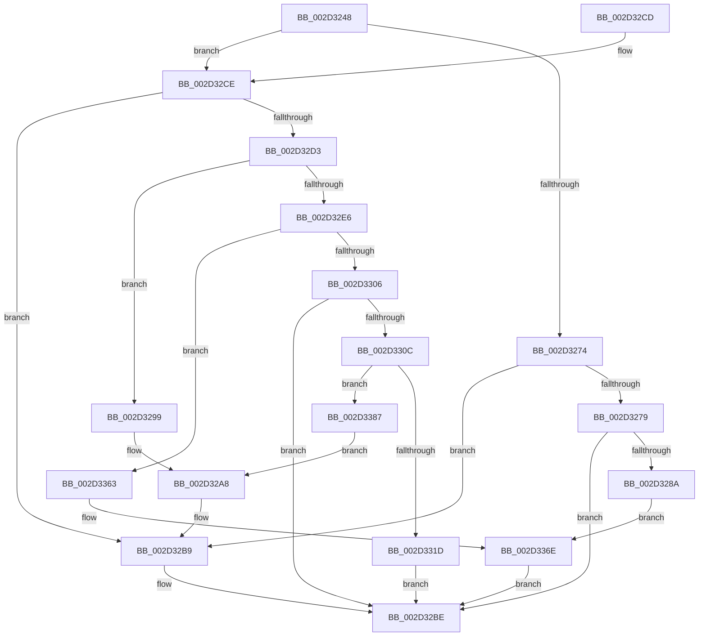

# HalpInterruptSetRemappedDestinationHv

- RVA: `0x002D3248`–`0x002D339D` (길이 `341` bytes)
- VA: `0x00000001402D3248`
- 실행 섹션: `.text`
- PDB 이름 있음: `예`; PDB Function 태그: `아니요`
- unwind 정보 RVA: `0x0006F9E4`
- 디코드: `96`개 명령, `341/341` bytes 표시
- 미해석 바이트: `0` (있으면 어셈블리에 `.byte`로 보존)

> 이 문서는 커널 이미지의 기계어와 PDB 기호를 분석해 생성했습니다. 4번과 5번은 함수 원형과 자료형을 바이너리 사용 방식에서 추정한 C 해석이며 원본 소스 복구 결과는 아닙니다.

## 1. Dependencies

- 직접 호출 지점: **9**; 고유 호출 대상: **8**
- 직접 호출자로 확인된 함수: **1**
- RIP 상대 이미지 참조: **2**

### Outgoing calls
- `0x002D327F` → [HalpHvRetargetDeviceMsiInterrupt](HalpHvRetargetDeviceMsiInterrupt_function_002D33A4.md) (function, `0x002D33A4`)
- `0x002D32B4` → [HalpInterruptSetProblemEx](../48/HalpInterruptSetProblemEx_function_0048AC8C.md) (function, `0x0048AC8C`)
- `0x002D32DD` → [HalpInterruptFindControllerAndLineState](HalpInterruptFindControllerAndLineState_function_002D2FC0.md) (function, `0x002D2FC0`)
- `0x002D32FB` → [HalpHvRetargetIoApicDeviceInterrupt](HalpHvRetargetIoApicDeviceInterrupt_function_002D3C48.md) (function, `0x002D3C48`)
- `0x002D3313` → [HalpInterruptFindLinesForGsiRange](HalpInterruptFindLinesForGsiRange_function_002D204C.md) (function, `0x002D204C`)
- `0x002D3337` → [HalpAcquireHighLevelLock](HalpAcquireHighLevelLock_function_002D2390.md) (function, `0x002D2390`)
- `0x002D3349` → [HalpInterruptSetLineStateInternal](HalpInterruptSetLineStateInternal_function_002D2104.md) (function, `0x002D2104`)
- `0x002D3359` → [HalpReleaseHighLevelLock](HalpReleaseHighLevelLock_function_002D1C58.md) (function, `0x002D1C58`)
- `0x002D337D` → [HalpInterruptSetProblemEx](../48/HalpInterruptSetProblemEx_function_0048AC8C.md) (function, `0x0048AC8C`)

### Direct callers
- [HalpInterruptSetDestination](HalpInterruptSetDestination_function_002D3100.md) at `0x002D313B`

### Static image references
- `0x002D32A8` → RVA `0x00010AA8` (`.rdata`; read)
- `0x002D332B` → RVA `0x00FC19A8` (`.data`; read)

## 2. Other-region calls and transfers

- 다른 실행 섹션으로 향하는 call: **0**
- 별도 외부 분기/꼬리 이동을 확인하지 못했습니다.

## 3. Assembly (complete function range)

```asm
002D3248  48 89 5C 24 08                  mov qword ptr [rsp + 8], rbx
002D324D  55                              push rbp
002D324E  56                              push rsi
002D324F  57                              push rdi
002D3250  48 8B EC                        mov rbp, rsp
002D3253  48 83 EC 40                     sub rsp, 0x40
002D3257  48 83 65 38 00                  and qword ptr [rbp + 0x38], 0
002D325C  49 8B F8                        mov rdi, r8
002D325F  48 83 65 F0 00                  and qword ptr [rbp - 0x10], 0
002D3264  4C 8B CA                        mov r9, rdx
002D3267  8B 02                           mov eax, dword ptr [rdx]
002D3269  48 8B D9                        mov rbx, rcx
002D326C  C6 45 28 00                     mov byte ptr [rbp + 0x28], 0
002D3270  85 C0                           test eax, eax
002D3272  74 5A                           je 0x1402d32ce
002D3274  83 F8 03                        cmp eax, 3
002D3277  75 40                           jne 0x1402d32b9
002D3279  49 8B D0                        mov rdx, r8
002D327C  49 8B C9                        mov rcx, r9
002D327F  E8 20 01 00 00                  call 0x1402d33a4
002D3284  8B F8                           mov edi, eax
002D3286  85 C0                           test eax, eax
002D3288  79 34                           jns 0x1402d32be
002D328A  C7 44 24 20 D3 02 00 00         mov dword ptr [rsp + 0x20], 0x2d3
002D3292  33 C9                           xor ecx, ecx
002D3294  E9 D5 00 00 00                  jmp 0x1402d336e
002D3299  48 8B 4D 38                     mov rcx, qword ptr [rbp + 0x38]
002D329D  44 8B C0                        mov r8d, eax
002D32A0  C7 44 24 20 E5 02 00 00         mov dword ptr [rsp + 0x20], 0x2e5
002D32A8  4C 8D 0D F9 D7 D3 FF            lea r9, [rip - 0x2c2807]
002D32AF  BA 12 00 00 00                  mov edx, 0x12
002D32B4  E8 D3 79 1B 00                  call 0x14048ac8c
002D32B9  BF 0D 00 00 C0                  mov edi, 0xc000000d
002D32BE  48 8B 5C 24 60                  mov rbx, qword ptr [rsp + 0x60]
002D32C3  8B C7                           mov eax, edi
002D32C5  48 83 C4 40                     add rsp, 0x40
002D32C9  5F                              pop rdi
002D32CA  5E                              pop rsi
002D32CB  5D                              pop rbp
002D32CC  C3                              ret
002D32CD  CC                              int3
002D32CE  48 85 DB                        test rbx, rbx
002D32D1  74 E6                           je 0x1402d32b9
002D32D3  8B 09                           mov ecx, dword ptr [rcx]
002D32D5  4C 8D 45 F0                     lea r8, [rbp - 0x10]
002D32D9  48 8D 55 38                     lea rdx, [rbp + 0x38]
002D32DD  E8 DE FC FF FF                  call 0x1402d2fc0
002D32E2  85 C0                           test eax, eax
002D32E4  78 B3                           js 0x1402d3299
002D32E6  48 8B 75 38                     mov rsi, qword ptr [rbp + 0x38]
002D32EA  4C 8D 4D 28                     lea r9, [rbp + 0x28]
002D32EE  48 8B 55 F0                     mov rdx, qword ptr [rbp - 0x10]
002D32F2  4C 8B C7                        mov r8, rdi
002D32F5  8B 8E 00 01 00 00               mov ecx, dword ptr [rsi + 0x100]
002D32FB  E8 48 09 00 00                  call 0x1402d3c48
002D3300  8B F8                           mov edi, eax
002D3302  85 C0                           test eax, eax
002D3304  78 5D                           js 0x1402d3363
002D3306  80 7D 28 00                     cmp byte ptr [rbp + 0x28], 0
002D330A  74 B2                           je 0x1402d32be
002D330C  8B 1B                           mov ebx, dword ptr [rbx]
002D330E  8B CB                           mov ecx, ebx
002D3310  8D 53 01                        lea edx, [rbx + 1]
002D3313  E8 34 ED FF FF                  call 0x1402d204c
002D3318  48 85 C0                        test rax, rax
002D331B  74 6A                           je 0x1402d3387
002D331D  8B 48 10                        mov ecx, dword ptr [rax + 0x10]
002D3320  89 4D F8                        mov dword ptr [rbp - 8], ecx
002D3323  8B 48 1C                        mov ecx, dword ptr [rax + 0x1c]
002D3326  8B 40 14                        mov eax, dword ptr [rax + 0x14]
002D3329  2B C1                           sub eax, ecx
002D332B  48 8D 0D 76 E6 CE 00            lea rcx, [rip + 0xcee676]
002D3332  03 C3                           add eax, ebx
002D3334  89 45 FC                        mov dword ptr [rbp - 4], eax
002D3337  E8 54 F0 FF FF                  call 0x1402d2390
002D333C  4C 8B 45 F0                     mov r8, qword ptr [rbp - 0x10]
002D3340  48 8D 55 F8                     lea rdx, [rbp - 8]
002D3344  48 8B CE                        mov rcx, rsi
002D3347  8A D8                           mov bl, al
002D3349  E8 B6 ED FF FF                  call 0x1402d2104
002D334E  8A D3                           mov dl, bl
002D3350  48 8D 0D 51 E6 CE 00            lea rcx, [rip + 0xcee651]
002D3357  8B F8                           mov edi, eax
002D3359  E8 FA E8 FF FF                  call 0x1402d1c58
002D335E  E9 5B FF FF FF                  jmp 0x1402d32be
002D3363  C7 44 24 20 F3 02 00 00         mov dword ptr [rsp + 0x20], 0x2f3
002D336B  48 8B CE                        mov rcx, rsi
002D336E  BA 25 00 00 00                  mov edx, 0x25
002D3373  4C 8D 0D 2E D7 D3 FF            lea r9, [rip - 0x2c28d2]
002D337A  44 8B C0                        mov r8d, eax
002D337D  E8 0A 79 1B 00                  call 0x14048ac8c
002D3382  E9 37 FF FF FF                  jmp 0x1402d32be
002D3387  C7 44 24 20 01 03 00 00         mov dword ptr [rsp + 0x20], 0x301
002D338F  41 B8 25 02 00 C0               mov r8d, 0xc0000225
002D3395  48 8B CE                        mov rcx, rsi
002D3398  E9 0B FF FF FF                  jmp 0x1402d32a8
```

## 4. C-style interpretation (structured pseudocode)

```c
__int64 __fastcall HalpInterruptSetRemappedDestinationHv(__int64 a1, __int64 a2, __int64 a3)
{
    __int64 result;
    __int64 v_rsp;
    unsigned int v_stack_m1C;
    unsigned int v_stack_m20;
    unsigned __int64 v_stack_m28;
    unsigned int v_stack_m38;
    unsigned __int8 v_stack_p10;
    unsigned __int64 v_stack_p20;
    unsigned __int64 v_stack_p8;

    v_stack_p8 = v_rbx;
    v_rsp = (v_rsp) - (64);
    v_stack_p10 = 0;
    if ((unsigned int)((unsigned int)(*(unsigned int *)(a2))) == 0) goto loc_002D32CE;
    if (((unsigned int)((unsigned int)(*(unsigned int *)(a2)))) != 3) goto loc_002D32B9;
    result = HalpHvRetargetDeviceMsiInterrupt(a2, a3, a3, a2);
    if (!sign_flag) goto loc_002D32BE;
    v_stack_m38 = 723;
    a1 = 0;
    goto loc_002D336E;
loc_002D3299:
    v_stack_m38 = 741;
loc_002D32A8:
    result = HalpInterruptSetProblemEx(v_stack_p20, 18, (unsigned int)((unsigned int)(result)), v_rip - 2893831);
loc_002D32B9:
loc_002D32BE:
    v_rsp = (v_rsp) + (64);
    return (unsigned int)((unsigned int)((unsigned int)(0xC000000DULL)));
loc_002D32CE:
    if (v_stack_p8 == 0) goto loc_002D32B9;
    result = HalpInterruptFindControllerAndLineState((unsigned int)(*(unsigned int *)(v_stack_p20)), v_stack_p20, v_stack_m28, v_rip - 2893831);
    if (sign_flag) goto loc_002D3299;
    result = HalpHvRetargetIoApicDeviceInterrupt((unsigned int)(*(unsigned int *)(v_stack_p20 + 256)), v_stack_m28, (unsigned int)(0xC000000DULL), v_stack_p10);
    if (sign_flag) goto loc_002D3363;
    if (v_stack_p10 == 0) goto loc_002D32BE;
    result = HalpInterruptFindLinesForGsiRange((unsigned int)((unsigned int)((unsigned int)(*(unsigned int *)(v_stack_p8)))), (unsigned int)(*(unsigned int *)(v_stack_p8)) + 1, (unsigned int)(0xC000000DULL), v_stack_p10);
    if (result == 0) goto loc_002D3387;
    v_stack_m20 = (unsigned int)((unsigned int)(*(unsigned int *)(result + 16)));
    result = (unsigned int)(((unsigned int)(*(unsigned int *)(result + 20))) - ((unsigned int)((unsigned int)(*(unsigned int *)(result + 28)))));
    result = (unsigned int)((result) + ((unsigned int)((unsigned int)(*(unsigned int *)(v_stack_p8)))));
    v_stack_m1C = (unsigned int)(result);
    result = HalpAcquireHighLevelLock(v_rip + 13559414, (unsigned int)(*(unsigned int *)(v_stack_p8)) + 1, (unsigned int)(0xC000000DULL), v_stack_p10);
    result = HalpInterruptSetLineStateInternal(v_stack_p20, v_stack_m20, v_stack_m28, v_stack_p10);
    result = HalpReleaseHighLevelLock(v_rip + 13559377, (unsigned __int8)((unsigned __int8)(result)), v_stack_m28, v_stack_p10);
    goto loc_002D32BE;
loc_002D3363:
    v_stack_p20 = 755;
loc_002D336E:
    result = HalpInterruptSetProblemEx(v_stack_p20, 37, (unsigned int)((unsigned int)(result)), v_rip - 2894034);
    goto loc_002D32BE;
loc_002D3387:
    v_stack_p20 = 769;
    goto loc_002D32A8;
}
```

## 5. (Beta) C Style

```c
int64_t HalpInterruptSetRemappedDestinationHv(void *Arg1, void *Arg2, int64_t Arg3)
{
    uint8_t *arg1 = (uint8_t *)Arg1;
    uint8_t *arg2 = (uint8_t *)Arg2;

    int64_t result;
    int64_t local_rsp;
    uint32_t v_stack_m1C;
    uint32_t v_stack_m20;
    uint64_t v_stack_m28;
    uint32_t v_stack_m38;
    uint8_t v_stack_p10;
    uint64_t v_stack_p20;
    uint64_t v_stack_p8;

    v_stack_p8 = local_rbx;
    local_rsp = (local_rsp) - (64);
    v_stack_p10 = 0;
    if ((uint32_t)((uint32_t)(*(uint32_t *)(arg2))) == 0) goto loc_002D32CE;
    if (((uint32_t)((uint32_t)(*(uint32_t *)(arg2)))) != 3) goto loc_002D32B9;
    result = HalpHvRetargetDeviceMsiInterrupt(Arg2, Arg3, Arg3, Arg2);
    if (!sign_flag) goto loc_002D32BE;
    v_stack_m38 = 723;
    Arg1 = 0;
    goto loc_002D336E;
loc_002D3299:
    v_stack_m38 = 741;
loc_002D32A8:
    result = HalpInterruptSetProblemEx(v_stack_p20, 18, (uint32_t)((uint32_t)(result)), v_rip - 2893831);
loc_002D32B9:
loc_002D32BE:
    local_rsp = (local_rsp) + (64);
    return (uint32_t)((uint32_t)((uint32_t)(0xC000000DULL)));
loc_002D32CE:
    if (v_stack_p8 == 0) goto loc_002D32B9;
    result = HalpInterruptFindControllerAndLineState((uint32_t)(*(uint32_t *)(v_stack_p20)), v_stack_p20, v_stack_m28, v_rip - 2893831);
    if (sign_flag) goto loc_002D3299;
    result = HalpHvRetargetIoApicDeviceInterrupt((uint32_t)(*(uint32_t *)(v_stack_p20 + 0x100)), v_stack_m28, (uint32_t)(0xC000000DULL), v_stack_p10);
    if (sign_flag) goto loc_002D3363;
    if (v_stack_p10 == 0) goto loc_002D32BE;
    result = HalpInterruptFindLinesForGsiRange((uint32_t)((uint32_t)((uint32_t)(*(uint32_t *)(v_stack_p8)))), (uint32_t)(*(uint32_t *)(v_stack_p8)) + 1, (uint32_t)(0xC000000DULL), v_stack_p10);
    if (result == 0) goto loc_002D3387;
    v_stack_m20 = (uint32_t)((uint32_t)(*(uint32_t *)(result + 0x10)));
    result = (uint32_t)(((uint32_t)(*(uint32_t *)(result + 0x14))) - ((uint32_t)((uint32_t)(*(uint32_t *)(result + 0x1C)))));
    result = (uint32_t)((result) + ((uint32_t)((uint32_t)(*(uint32_t *)(v_stack_p8)))));
    v_stack_m1C = (uint32_t)(result);
    result = HalpAcquireHighLevelLock(v_rip + 13559414, (uint32_t)(*(uint32_t *)(v_stack_p8)) + 1, (uint32_t)(0xC000000DULL), v_stack_p10);
    result = HalpInterruptSetLineStateInternal(v_stack_p20, v_stack_m20, v_stack_m28, v_stack_p10);
    result = HalpReleaseHighLevelLock(v_rip + 13559377, (uint8_t)((uint8_t)(result)), v_stack_m28, v_stack_p10);
    goto loc_002D32BE;
loc_002D3363:
    v_stack_p20 = 755;
loc_002D336E:
    result = HalpInterruptSetProblemEx(v_stack_p20, 37, (uint32_t)((uint32_t)(result)), v_rip - 2894034);
    goto loc_002D32BE;
loc_002D3387:
    v_stack_p20 = 769;
    goto loc_002D32A8;
}
```

### 관측된 메모리 오프셋

구조체 형식이 확인되지 않은 접근은 인자 기준의 오프셋으로만 기록했습니다.

| 기준 인자 | 오프셋 표현 | 폭 (bit) | 접근 |
|---|---:|---:|---|
| `Arg1` | `+ 0x0` | `32` | `R` |
| `Arg2` | `+ 0x0` | `32` | `R` |

## 6. Execution-region graph

[열기: 2D/3D 그래프와 함수 탐색 컨트롤 패널](../../../control-panel.html?section=text&rva=0x002D3248&view=graph)

- 2D 그래프는 위에서 아래로 흐르고, 3D 그래프는 빈 공간을 드래그해 회전합니다. Shift+드래그는 이동, 휠은 확대·축소, 함수 노드 선택은 대상 보고서 이동입니다.

### Static fallback


