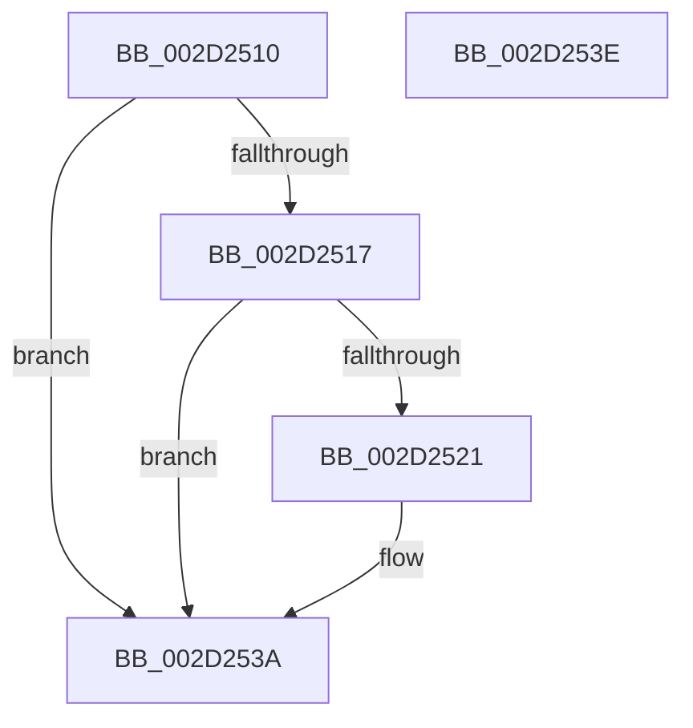

# HalpIsInterruptTypeSecondary

- RVA: `0x002D2510`–`0x002D253F` (길이 `47` bytes)
- VA: `0x00000001402D2510`
- 실행 섹션: `.text`
- PDB 이름 있음: `예`; PDB Function 태그: `아니요`
- unwind 정보 RVA: `0x000DB714`
- 디코드: `15`개 명령, `47/47` bytes 표시
- 미해석 바이트: `0` (있으면 어셈블리에 `.byte`로 보존)

> 이 문서는 커널 이미지의 기계어와 PDB 기호를 분석해 생성했습니다. 4번과 5번은 함수 원형과 자료형을 바이너리 사용 방식에서 추정한 C 해석이며 원본 소스 복구 결과는 아닙니다.

## 1. Dependencies

- 직접 호출 지점: **0**; 고유 호출 대상: **0**
- 직접 호출자로 확인된 함수: **5**
- RIP 상대 이미지 참조: **2**

### Outgoing calls
- 직접 디코드된 call 명령이 없습니다.

### Direct callers
- [HalpUnmaskInterrupt](HalpUnmaskInterrupt_function_002D1EE0.md) at `0x002D2000`
- [HalpCheckInterruptType](../4F/HalpCheckInterruptType_function_004FC2D8.md) at `0x004FC2E9`
- [HalacpiIrqTranslateResourceRequirementsIsa](../../page/70/HalacpiIrqTranslateResourceRequirementsIsa_function_0070C6C0.md) at `0x0070C75F`
- [HalacpiIrqTranslateResourceRequirementsIsa](../../page/70/HalacpiIrqTranslateResourceRequirementsIsa_function_0070C6C0.md) at `0x0070C76C`
- [HalacpiIrqTranslateResourcesIsa](../../page/70/HalacpiIrqTranslateResourcesIsa_function_0070CA20.md) at `0x0070CA6A`
- [HalpQueryPrimaryInterruptInformation](../../page/AB/HalpQueryPrimaryInterruptInformation_function_00AB888C.md) at `0x00AB88BC`

### Static image references
- `0x002D2517` → RVA `0x00F909DC` (`.data`; read)
- `0x002D2521` → RVA `0x00F90A30` (`.data`; read)

## 2. Other-region calls and transfers

- 다른 실행 섹션으로 향하는 call: **0**
- 별도 외부 분기/꼬리 이동을 확인하지 못했습니다.

## 3. Assembly (complete function range)

```asm
002D2510  45 33 C0                        xor r8d, r8d
002D2513  85 C9                           test ecx, ecx
002D2515  75 23                           jne 0x1402d253a
002D2517  8B 0D BF E4 CB 00               mov ecx, dword ptr [rip + 0xcbe4bf]
002D251D  3B D1                           cmp edx, ecx
002D251F  72 19                           jb 0x1402d253a
002D2521  03 0D 09 E5 CB 00               add ecx, dword ptr [rip + 0xcbe509]
002D2527  41 0F B6 C0                     movzx eax, r8b
002D252B  3B D1                           cmp edx, ecx
002D252D  41 B8 01 00 00 00               mov r8d, 1
002D2533  41 0F 42 C0                     cmovb eax, r8d
002D2537  44 8A C0                        mov r8b, al
002D253A  41 8A C0                        mov al, r8b
002D253D  C3                              ret
002D253E  CC                              int3
```

## 4. C-style interpretation (structured pseudocode)

```c
__int64 __fastcall HalpIsInterruptTypeSecondary(int a1, int a2, int a3)
{
    __int64 result;

    a3 = 0;
    if (a1 != 0) goto loc_002D253A;
    if (a2 >= ((unsigned int)((unsigned int)(*(unsigned int *)(v_rip + 13362367))))) {
        a1 = (unsigned int)(((unsigned int)(*(unsigned int *)(v_rip + 13362367))) + (*(unsigned int *)(v_rip + 13362441)));
        result = 0;
        a3 = 1;
        if (a2 < a1) { result = a3; }
        a3 = (unsigned __int8)(result);
    }
    return (unsigned __int8)(a3);
}
```

## 5. (Beta) C Style

```c
int64_t HalpIsInterruptTypeSecondary(int32_t Arg1, int32_t Arg2, int32_t Arg3)
{
    int64_t result;

    Arg3 = 0;
    if (Arg1 != 0) goto loc_002D253A;
    if (Arg2 >= ((uint32_t)((uint32_t)(*(uint32_t *)(v_rip + 0xCBE4BF))))) {
        Arg1 = (uint32_t)(((uint32_t)(*(uint32_t *)(v_rip + 0xCBE4BF))) + (*(uint32_t *)(v_rip + 0xCBE509)));
        result = 0;
        Arg3 = 1;
        if (Arg2 < Arg1) { result = Arg3; }
        Arg3 = (uint8_t)(result);
    }
    return (uint8_t)(Arg3);
}
```

## 6. Execution-region graph

[열기: 2D/3D 그래프와 함수 탐색 컨트롤 패널](../../../control-panel.html?section=text&rva=0x002D2510&view=graph)

- 2D 그래프는 위에서 아래로 흐르고, 3D 그래프는 빈 공간을 드래그해 회전합니다. Shift+드래그는 이동, 휠은 확대·축소, 함수 노드 선택은 대상 보고서 이동입니다.

### Static fallback


