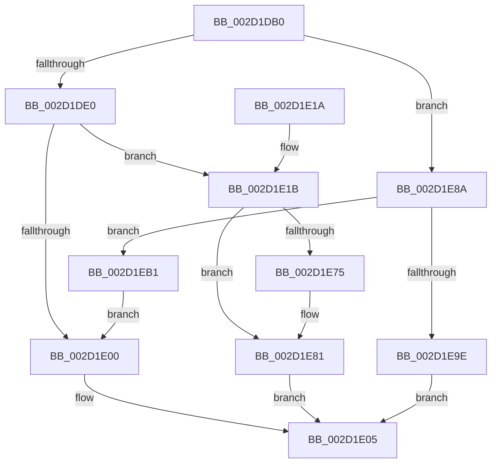

# HalpMaskInterrupt

- RVA: `0x002D1DB0`–`0x002D1ED3` (길이 `291` bytes)
- VA: `0x00000001402D1DB0`
- 실행 섹션: `.text`
- PDB 이름 있음: `예`; PDB Function 태그: `아니요`
- unwind 정보 RVA: `0x0006F8B8`
- 디코드: `80`개 명령, `291/291` bytes 표시
- 미해석 바이트: `0` (있으면 어셈블리에 `.byte`로 보존)

> 이 문서는 커널 이미지의 기계어와 PDB 기호를 분석해 생성했습니다. 4번과 5번은 함수 원형과 자료형을 바이너리 사용 방식에서 추정한 C 해석이며 원본 소스 복구 결과는 아닙니다.

## 1. Dependencies

- 직접 호출 지점: **9**; 고유 호출 대상: **9**
- 직접 호출자로 확인된 함수: **0**
- RIP 상대 이미지 참조: **4**

### Outgoing calls
- `0x002D1DCF` → [HalpInterruptFindLinesForGsiRange](HalpInterruptFindLinesForGsiRange_function_002D204C.md) (function, `0x002D204C`)
- `0x002D1DF3` → [HalpInterruptLookupController](HalpInterruptLookupController_function_002D20D4.md) (function, `0x002D20D4`)
- `0x002D1E22` → [HalpAcquireHighLevelLock](HalpAcquireHighLevelLock_function_002D2390.md) (function, `0x002D2390`)
- `0x002D1E59` → [HalpInterruptSetLineStateInternal](HalpInterruptSetLineStateInternal_function_002D2104.md) (function, `0x002D2104`)
- `0x002D1E67` → [KxReleaseSpinLock](../20/KxReleaseSpinLock_function_00206670.md) (function, `0x00206670`)
- `0x002D1E7C` → [KiLowerIrqlProcessIrqlFlags](../4F/KiLowerIrqlProcessIrqlFlags_function_004F5698.md) (function, `0x004F5698`)
- `0x002D1E95` → [guard_dispatch_icall](../6B/guard_dispatch_icall_function_006BAAD0.md) (function, `0x006BAAD0`)
- `0x002D1EA5` → [HalpHandleMaskUnmaskSecondaryInterrupt](HalpHandleMaskUnmaskSecondaryInterrupt_function_002D1C8C.md) (function, `0x002D1C8C`)
- `0x002D1EC9` → [HalpInterruptSetProblemEx](../48/HalpInterruptSetProblemEx_function_0048AC8C.md) (function, `0x0048AC8C`)

### Direct callers
- 이 함수 시작 RVA로 연결되는 직접 call은 확인되지 않았습니다. 간접 호출은 완전히 역산할 수 없습니다.

### Static image references
- `0x002D1E1B` → RVA `0x00FC19A8` (`.data`; read)
- `0x002D1E6C` → RVA `0x00FC6D20` (`ALMOSTRO`; read)
- `0x002D1E8A` → RVA `0x00E009E0` (`.data`; read)
- `0x002D1EBC` → RVA `0x00010AA8` (`.rdata`; read)

## 2. Other-region calls and transfers

- 다른 실행 섹션으로 향하는 call: **0**
- 별도 외부 분기/꼬리 이동을 확인하지 못했습니다.

## 3. Assembly (complete function range)

```asm
002D1DB0  48 89 5C 24 08                  mov qword ptr [rsp + 8], rbx
002D1DB5  48 89 6C 24 10                  mov qword ptr [rsp + 0x10], rbp
002D1DBA  56                              push rsi
002D1DBB  57                              push rdi
002D1DBC  41 56                           push r14
002D1DBE  48 83 EC 30                     sub rsp, 0x30
002D1DC2  48 83 64 24 60 00               and qword ptr [rsp + 0x60], 0
002D1DC8  8B EA                           mov ebp, edx
002D1DCA  8D 51 01                        lea edx, [rcx + 1]
002D1DCD  8B D9                           mov ebx, ecx
002D1DCF  E8 78 02 00 00                  call 0x1402d204c
002D1DD4  48 8B F8                        mov rdi, rax
002D1DD7  48 85 C0                        test rax, rax
002D1DDA  0F 84 AA 00 00 00               je 0x1402d1e8a
002D1DE0  8B 48 10                        mov ecx, dword ptr [rax + 0x10]
002D1DE3  89 4C 24 60                     mov dword ptr [rsp + 0x60], ecx
002D1DE7  8B 50 14                        mov edx, dword ptr [rax + 0x14]
002D1DEA  2B 50 1C                        sub edx, dword ptr [rax + 0x1c]
002D1DED  03 D3                           add edx, ebx
002D1DEF  89 54 24 64                     mov dword ptr [rsp + 0x64], edx
002D1DF3  E8 DC 02 00 00                  call 0x1402d20d4
002D1DF8  4C 8B F0                        mov r14, rax
002D1DFB  48 85 C0                        test rax, rax
002D1DFE  75 1B                           jne 0x1402d1e1b
002D1E00  BB 0D 00 00 C0                  mov ebx, 0xc000000d
002D1E05  48 8B 6C 24 58                  mov rbp, qword ptr [rsp + 0x58]
002D1E0A  8B C3                           mov eax, ebx
002D1E0C  48 8B 5C 24 50                  mov rbx, qword ptr [rsp + 0x50]
002D1E11  48 83 C4 30                     add rsp, 0x30
002D1E15  41 5E                           pop r14
002D1E17  5F                              pop rdi
002D1E18  5E                              pop rsi
002D1E19  C3                              ret
002D1E1A  CC                              int3
002D1E1B  48 8D 0D 86 FB CE 00            lea rcx, [rip + 0xcefb86]
002D1E22  E8 69 05 00 00                  call 0x1402d2390
002D1E27  2B 5F 1C                        sub ebx, dword ptr [rdi + 0x1c]
002D1E2A  8B CB                           mov ecx, ebx
002D1E2C  4C 6B C1 38                     imul r8, rcx, 0x38
002D1E30  49 8B CE                        mov rcx, r14
002D1E33  0F B6 F0                        movzx esi, al
002D1E36  4C 03 47 28                     add r8, qword ptr [rdi + 0x28]
002D1E3A  45 8B 48 0C                     mov r9d, dword ptr [r8 + 0xc]
002D1E3E  41 8B D1                        mov edx, r9d
002D1E41  83 E2 EF                        and edx, 0xffffffef
002D1E44  41 83 C9 20                     or r9d, 0x20
002D1E48  40 80 E5 01                     and bpl, 1
002D1E4C  44 0F 44 CA                     cmove r9d, edx
002D1E50  48 8D 54 24 60                  lea rdx, [rsp + 0x60]
002D1E55  45 89 48 0C                     mov dword ptr [r8 + 0xc], r9d
002D1E59  E8 A6 02 00 00                  call 0x1402d2104
002D1E5E  48 8D 0D 43 FB CE 00            lea rcx, [rip + 0xcefb43]
002D1E65  8B D8                           mov ebx, eax
002D1E67  E8 04 48 F3 FF                  call 0x140206670
002D1E6C  83 3D AD 4E CF 00 00            cmp dword ptr [rip + 0xcf4ead], 0
002D1E73  74 0C                           je 0x1402d1e81
002D1E75  44 0F 20 C1                     mov rcx, cr8
002D1E79  40 8A D6                        mov dl, sil
002D1E7C  E8 17 38 22 00                  call 0x1404f5698
002D1E81  44 0F 22 C6                     mov cr8, rsi
002D1E85  E9 7B FF FF FF                  jmp 0x1402d1e05
002D1E8A  48 8B 05 4F EB B2 00            mov rax, qword ptr [rip + 0xb2eb4f]
002D1E91  8B D3                           mov edx, ebx
002D1E93  33 C9                           xor ecx, ecx
002D1E95  E8 36 8C 3E 00                  call 0x1406baad0
002D1E9A  84 C0                           test al, al
002D1E9C  74 13                           je 0x1402d1eb1
002D1E9E  41 B0 01                        mov r8b, 1
002D1EA1  8B D5                           mov edx, ebp
002D1EA3  8B CB                           mov ecx, ebx
002D1EA5  E8 E2 FD FF FF                  call 0x1402d1c8c
002D1EAA  8B D8                           mov ebx, eax
002D1EAC  E9 54 FF FF FF                  jmp 0x1402d1e05
002D1EB1  45 33 C0                        xor r8d, r8d
002D1EB4  C7 44 24 20 AC 06 00 00         mov dword ptr [rsp + 0x20], 0x6ac
002D1EBC  4C 8D 0D E5 EB D3 FF            lea r9, [rip - 0x2c141b]
002D1EC3  33 C9                           xor ecx, ecx
002D1EC5  41 8D 50 13                     lea edx, [r8 + 0x13]
002D1EC9  E8 BE 8D 1B 00                  call 0x14048ac8c
002D1ECE  E9 2D FF FF FF                  jmp 0x1402d1e00
```

## 4. C-style interpretation (structured pseudocode)

```c
__int64 __fastcall HalpMaskInterrupt(__int64 a1, int a2)
{
    __int64 result;
    __int64 v_rbp;
    __int64 v_rbx;
    __int64 v_rsp;
    unsigned __int64 v_stack_p10;
    unsigned __int64 v_stack_p18;
    unsigned int v_stack_p1C;
    unsigned int v_stack_p20;
    unsigned __int64 v_stack_p60;
    unsigned __int64 v_stack_p8;

    v_stack_p8 = v_rbx;
    v_stack_p10 = v_rbp;
    v_rsp = (v_rsp) - (48);
    result = HalpInterruptFindLinesForGsiRange(a1, a1 + 1, a3, a4);
    if (result == 0) goto loc_002D1E8A;
    v_stack_p18 = (unsigned int)((unsigned int)(*(unsigned int *)(result + 16)));
    a2 = (unsigned int)(((unsigned int)(*(unsigned int *)(result + 20))) - (*(unsigned int *)(result + 28)));
    a2 = (unsigned int)((a2) + ((unsigned int)((unsigned int)((unsigned int)(a1)))));
    v_stack_p1C = a2;
    result = HalpInterruptLookupController((unsigned int)(*(unsigned int *)(result + 16)), a2, a3, a4);
    if (result != 0) goto loc_002D1E1B;
loc_002D1E00:
loc_002D1E05:
    v_rsp = (v_rsp) + (48);
    return (unsigned int)((unsigned int)((unsigned int)(0xC000000DULL)));
loc_002D1E1B:
    result = HalpAcquireHighLevelLock(v_rip + 13564806, a2, a3, a4);
    v_rbx = (unsigned int)((v_stack_p8) - (*(unsigned int *)(result + 28)));
    a3 = (a3) * ((unsigned int)((unsigned int)(v_rbx)));
    a3 = (a3) + (*(unsigned __int64 *)(result + 40));
    a2 = (unsigned int)(((unsigned int)((unsigned int)((unsigned int)(*(unsigned int *)(a3 + 12))))) & (0xFFFFFFEFULL));
    a4 = (unsigned int)(((unsigned int)(*(unsigned int *)(a3 + 12))) | (32));
    v_rbp = (unsigned __int8)((v_stack_p10) & (1));
    if (condition_is_equal) { a4 = a2; }
    *(unsigned int *)(a3 + 12) = (unsigned int)(a4);
    result = HalpInterruptSetLineStateInternal(result, v_stack_p60, a3, a4);
    result = KxReleaseSpinLock(v_rip + 13564739, v_stack_p60, a3, a4);
    if ((*(unsigned int *)(v_rip + 13586093)) != 0) {
        a1 = v_cr8;
        a2 = (unsigned __int8)((unsigned __int8)(result));
        result = KiLowerIrqlProcessIrqlFlags(a1, a2, a3, a4);
    }
    goto loc_002D1E05;
loc_002D1E8A:
    a1 = 0;
    result = guard_dispatch_icall(a1, (unsigned int)((unsigned int)((unsigned int)((unsigned int)(result)))), a3, a4);
    if ((unsigned __int8)(result) == 0) goto loc_002D1EB1;
    result = HalpHandleMaskUnmaskSecondaryInterrupt((unsigned int)((unsigned int)((unsigned int)((unsigned int)(result)))), (unsigned int)((unsigned int)(v_rbp)), 1, a4);
    goto loc_002D1E05;
loc_002D1EB1:
    a3 = 0;
    v_stack_p20 = 0x6ACULL;
    a1 = 0;
    result = HalpInterruptSetProblemEx(a1, a3 + 19, a3, v_rip - 2888731);
    goto loc_002D1E00;
}
```

## 5. (Beta) C Style

```c
int64_t HalpMaskInterrupt(void *Arg1, int32_t Arg2)
{
    uint8_t *arg1 = (uint8_t *)Arg1;

    int64_t result;
    int64_t local_rbp;
    int64_t local_rbx;
    int64_t local_rsp;
    uint64_t v_stack_p10;
    uint64_t v_stack_p18;
    uint32_t v_stack_p1C;
    uint32_t v_stack_p20;
    uint64_t v_stack_p60;
    uint64_t v_stack_p8;

    v_stack_p8 = local_rbx;
    v_stack_p10 = local_rbp;
    local_rsp = (local_rsp) - (48);
    result = HalpInterruptFindLinesForGsiRange(Arg1, Arg1 + 1, a3, a4);
    if (result == 0) goto loc_002D1E8A;
    v_stack_p18 = (uint32_t)((uint32_t)(*(uint32_t *)(result + 0x10)));
    Arg2 = (uint32_t)(((uint32_t)(*(uint32_t *)(result + 0x14))) - (*(uint32_t *)(result + 0x1C)));
    Arg2 = (uint32_t)((Arg2) + ((uint32_t)((uint32_t)((uint32_t)(Arg1)))));
    v_stack_p1C = Arg2;
    result = HalpInterruptLookupController((uint32_t)(*(uint32_t *)(result + 0x10)), Arg2, a3, a4);
    if (result != 0) goto loc_002D1E1B;
loc_002D1E00:
loc_002D1E05:
    local_rsp = (local_rsp) + (48);
    return (uint32_t)((uint32_t)((uint32_t)(0xC000000DULL)));
loc_002D1E1B:
    result = HalpAcquireHighLevelLock(v_rip + 13564806, Arg2, a3, a4);
    local_rbx = (uint32_t)((v_stack_p8) - (*(uint32_t *)(result + 0x1C)));
    a3 = (a3) * ((uint32_t)((uint32_t)(local_rbx)));
    a3 = (a3) + (*(uint64_t *)(result + 0x28));
    Arg2 = (uint32_t)(((uint32_t)((uint32_t)((uint32_t)(*(uint32_t *)(a3 + 0xC))))) & (0xFFFFFFEFULL));
    a4 = (uint32_t)(((uint32_t)(*(uint32_t *)(a3 + 0xC))) | (32));
    local_rbp = (uint8_t)((v_stack_p10) & (1));
    if (condition_is_equal) { a4 = Arg2; }
    *(uint32_t *)(a3 + 0xC) = (uint32_t)(a4);
    result = HalpInterruptSetLineStateInternal(result, v_stack_p60, a3, a4);
    result = KxReleaseSpinLock(v_rip + 13564739, v_stack_p60, a3, a4);
    if ((*(uint32_t *)(v_rip + 0xCF4EAD)) != 0) {
        Arg1 = v_cr8;
        Arg2 = (uint8_t)((uint8_t)(result));
        result = KiLowerIrqlProcessIrqlFlags(Arg1, Arg2, a3, a4);
    }
    goto loc_002D1E05;
loc_002D1E8A:
    Arg1 = 0;
    result = guard_dispatch_icall(Arg1, (uint32_t)((uint32_t)((uint32_t)((uint32_t)(result)))), a3, a4);
    if ((uint8_t)(result) == 0) goto loc_002D1EB1;
    result = HalpHandleMaskUnmaskSecondaryInterrupt((uint32_t)((uint32_t)((uint32_t)((uint32_t)(result)))), (uint32_t)((uint32_t)(local_rbp)), 1, a4);
    goto loc_002D1E05;
loc_002D1EB1:
    a3 = 0;
    v_stack_p20 = 0x6ACULL;
    Arg1 = 0;
    result = HalpInterruptSetProblemEx(Arg1, a3 + 19, a3, v_rip - 2888731);
    goto loc_002D1E00;
}
```

### 관측된 메모리 오프셋

구조체 형식이 확인되지 않은 접근은 인자 기준의 오프셋으로만 기록했습니다.

| 기준 인자 | 오프셋 표현 | 폭 (bit) | 접근 |
|---|---:|---:|---|
| `Arg1` | `+ 0x1` | `32` | `R` |

## 6. Execution-region graph

[열기: 2D/3D 그래프와 함수 탐색 컨트롤 패널](../../../control-panel.html?section=text&rva=0x002D1DB0&view=graph)

- 2D 그래프는 위에서 아래로 흐르고, 3D 그래프는 빈 공간을 드래그해 회전합니다. Shift+드래그는 이동, 휠은 확대·축소, 함수 노드 선택은 대상 보고서 이동입니다.

### Static fallback


