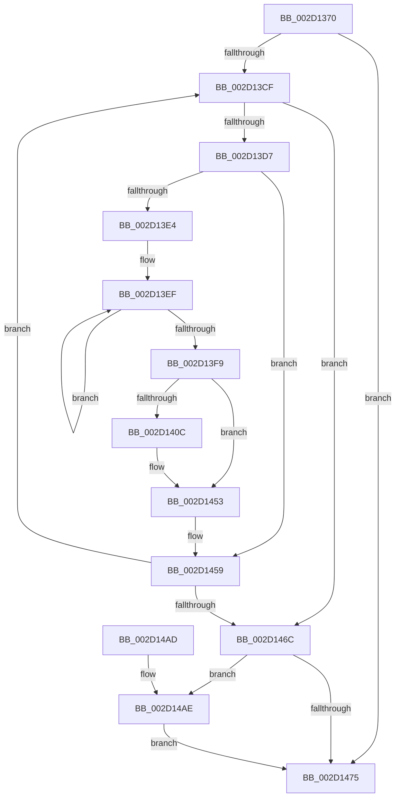

# HalpQueryProfileSourceList

- RVA: `0x002D1370`–`0x002D14B3` (길이 `323` bytes)
- VA: `0x00000001402D1370`
- 실행 섹션: `.text`
- PDB 이름 있음: `예`; PDB Function 태그: `아니요`
- unwind 정보 RVA: `0x0006F790`
- 디코드: `89`개 명령, `323/323` bytes 표시
- 미해석 바이트: `0` (있으면 어셈블리에 `.byte`로 보존)

> 이 문서는 커널 이미지의 기계어와 PDB 기호를 분석해 생성했습니다. 4번과 5번은 함수 원형과 자료형을 바이너리 사용 방식에서 추정한 C 해석이며 원본 소스 복구 결과는 아닙니다.

## 1. Dependencies

- 직접 호출 지점: **4**; 고유 호출 대상: **4**
- 직접 호출자로 확인된 함수: **1**
- RIP 상대 이미지 참조: **4**

### Outgoing calls
- `0x002D13AD` → [HalpAcquireHighLevelLock](HalpAcquireHighLevelLock_function_002D2390.md) (function, `0x002D2390`)
- `0x002D13DB` → [KeIsEmptyAffinityEx](KeIsEmptyAffinityEx_function_002D1580.md) (function, `0x002D1580`)
- `0x002D1443` → [wcscpy_s](../50/wcscpy_s_function_005064B0.md) (function, `0x005064B0`)
- `0x002D1489` → [HalpReleaseHighLevelLock](HalpReleaseHighLevelLock_function_002D1C58.md) (function, `0x002D1C58`)

### Direct callers
- [HalpQueryProfileInformation](../../page/AD/HalpQueryProfileInformation_function_00AD621C.md) at `0x00AD63BB`

### Static image references
- `0x002D138C` → RVA `0x00FC2C20` (`.data`; read)
- `0x002D139A` → RVA `0x00FC2BD0` (`.data`; read)
- `0x002D13B2` → RVA `0x00FC2C40` (`.data`; read)
- `0x002D140C` → RVA `0x00FC2BC8` (`.data`; read)

## 2. Other-region calls and transfers

- 다른 실행 섹션으로 향하는 call: **0**
- 별도 외부 분기/꼬리 이동을 확인하지 못했습니다.

## 3. Assembly (complete function range)

```asm
002D1370  48 89 5C 24 10                  mov qword ptr [rsp + 0x10], rbx
002D1375  48 89 6C 24 18                  mov qword ptr [rsp + 0x18], rbp
002D137A  48 89 74 24 20                  mov qword ptr [rsp + 0x20], rsi
002D137F  57                              push rdi
002D1380  41 54                           push r12
002D1382  41 55                           push r13
002D1384  41 56                           push r14
002D1386  41 57                           push r15
002D1388  48 83 EC 20                     sub rsp, 0x20
002D138C  8B 2D 8E 18 CF 00               mov ebp, dword ptr [rip + 0xcf188e]
002D1392  44 8B E1                        mov r12d, ecx
002D1395  33 FF                           xor edi, edi
002D1397  44 8B E9                        mov r13d, ecx
002D139A  48 8D 0D 2F 18 CF 00            lea rcx, [rip + 0xcf182f]
002D13A1  41 89 38                        mov dword ptr [r8], edi
002D13A4  44 8B F7                        mov r14d, edi
002D13A7  49 8B F0                        mov rsi, r8
002D13AA  4C 8B FA                        mov r15, rdx
002D13AD  E8 DE 0F 00 00                  call 0x1402d2390
002D13B2  48 8B 1D 87 18 CF 00            mov rbx, qword ptr [rip + 0xcf1887]
002D13B9  8A C8                           mov cl, al
002D13BB  88 44 24 50                     mov byte ptr [rsp + 0x50], al
002D13BF  48 8D 05 7A 18 CF 00            lea rax, [rip + 0xcf187a]
002D13C6  48 3B D8                        cmp rbx, rax
002D13C9  0F 84 A6 00 00 00               je 0x1402d1475
002D13CF  85 ED                           test ebp, ebp
002D13D1  0F 84 95 00 00 00               je 0x1402d146c
002D13D7  48 8D 4B 18                     lea rcx, [rbx + 0x18]
002D13DB  E8 A0 01 00 00                  call 0x1402d1580
002D13E0  85 C0                           test eax, eax
002D13E2  75 75                           jne 0x1402d1459
002D13E4  48 8B 83 20 01 00 00            mov rax, qword ptr [rbx + 0x120]
002D13EB  49 83 C8 FF                     or r8, 0xffffffffffffffff
002D13EF  49 FF C0                        inc r8
002D13F2  66 42 39 3C 40                  cmp word ptr [rax + r8*2], di
002D13F7  75 F6                           jne 0x1402d13ef
002D13F9  41 FF C0                        inc r8d
002D13FC  42 8D 3C 45 1F 00 00 00         lea edi, [r8*2 + 0x1f]
002D1404  83 E7 F8                        and edi, 0xfffffff8
002D1407  41 3B FD                        cmp edi, r13d
002D140A  77 47                           ja 0x1402d1453
002D140C  48 8B 0D B5 17 CF 00            mov rcx, qword ptr [rip + 0xcf17b5]
002D1413  41 89 3F                        mov dword ptr [r15], edi
002D1416  8B 43 F8                        mov eax, dword ptr [rbx - 8]
002D1419  41 89 47 04                     mov dword ptr [r15 + 4], eax
002D141D  0F B6 53 14                     movzx edx, byte ptr [rbx + 0x14]
002D1421  8B 44 D1 04                     mov eax, dword ptr [rcx + rdx*8 + 4]
002D1425  41 89 47 08                     mov dword ptr [r15 + 8], eax
002D1429  8B 04 D1                        mov eax, dword ptr [rcx + rdx*8]
002D142C  49 8D 4F 18                     lea rcx, [r15 + 0x18]
002D1430  49 83 67 10 00                  and qword ptr [r15 + 0x10], 0
002D1435  41 89 47 0C                     mov dword ptr [r15 + 0xc], eax
002D1439  41 8B D0                        mov edx, r8d
002D143C  4C 8B 83 20 01 00 00            mov r8, qword ptr [rbx + 0x120]
002D1443  E8 68 50 23 00                  call 0x1405064b0
002D1448  8B C7                           mov eax, edi
002D144A  4D 8B F7                        mov r14, r15
002D144D  4C 03 F8                        add r15, rax
002D1450  44 2B EF                        sub r13d, edi
002D1453  01 3E                           add dword ptr [rsi], edi
002D1455  FF CD                           dec ebp
002D1457  33 FF                           xor edi, edi
002D1459  48 8B 1B                        mov rbx, qword ptr [rbx]
002D145C  48 8D 05 DD 17 CF 00            lea rax, [rip + 0xcf17dd]
002D1463  48 3B D8                        cmp rbx, rax
002D1466  0F 85 63 FF FF FF               jne 0x1402d13cf
002D146C  8A 4C 24 50                     mov cl, byte ptr [rsp + 0x50]
002D1470  4D 85 F6                        test r14, r14
002D1473  75 39                           jne 0x1402d14ae
002D1475  44 3B 26                        cmp r12d, dword ptr [rsi]
002D1478  8A D1                           mov dl, cl
002D147A  48 8D 0D 4F 17 CF 00            lea rcx, [rip + 0xcf174f]
002D1481  1B DB                           sbb ebx, ebx
002D1483  81 E3 04 00 00 C0               and ebx, 0xc0000004
002D1489  E8 CA 07 00 00                  call 0x1402d1c58
002D148E  48 8B 6C 24 60                  mov rbp, qword ptr [rsp + 0x60]
002D1493  8B C3                           mov eax, ebx
002D1495  48 8B 5C 24 58                  mov rbx, qword ptr [rsp + 0x58]
002D149A  48 8B 74 24 68                  mov rsi, qword ptr [rsp + 0x68]
002D149F  48 83 C4 20                     add rsp, 0x20
002D14A3  41 5F                           pop r15
002D14A5  41 5E                           pop r14
002D14A7  41 5D                           pop r13
002D14A9  41 5C                           pop r12
002D14AB  5F                              pop rdi
002D14AC  C3                              ret
002D14AD  CC                              int3
002D14AE  41 89 3E                        mov dword ptr [r14], edi
002D14B1  EB C2                           jmp 0x1402d1475
```

## 4. C-style interpretation (structured pseudocode)

```c
__int64 __fastcall HalpQueryProfileSourceList(int a1, __int64 a2, __int64 a3)
{
    __int64 result;
    __int64 v_r13;
    __int64 v_r14;
    __int64 v_r15;
    __int64 v_rbp;
    __int64 v_rbx;
    __int64 v_rdi;
    __int64 v_rsp;
    unsigned __int64 v_stack_p10;
    unsigned __int64 v_stack_p18;
    unsigned __int64 v_stack_p20;
    unsigned __int8 v_stack_p8;

    v_stack_p10 = v_rbx;
    v_stack_p18 = v_rbp;
    v_stack_p20 = v_rsi;
    v_rsp = (v_rsp) - (32);
    v_rdi = 0;
    *(unsigned int *)(a3) = 0;
    result = HalpAcquireHighLevelLock(v_rip + 13572143, a2, a3, a4);
    v_stack_p8 = (unsigned __int8)(result);
    if ((*(unsigned __int64 *)(v_rip + 13572231)) == (v_rip + 13572218)) goto loc_002D1475;
loc_002D13CF:
    if ((unsigned int)((unsigned int)(*(unsigned int *)(v_rip + 13572238))) == 0) goto loc_002D146C;
    result = KeIsEmptyAffinityEx(*(unsigned __int64 *)(v_rip + 13572231) + 24, a2, a3, a4);
    if ((unsigned int)(result) != 0) goto loc_002D1459;
    a3 = (a3) | (-1);
loc_002D13EF:
    a3 = (a3) + 1;
    if ((*(unsigned __int16 *)(*(unsigned __int64 *)(*(unsigned __int64 *)(v_rip + 13572231) + 288) + a3 * 2)) != 0) goto loc_002D13EF;
    a3 = (unsigned int)((a3) + 1);
    v_rdi = (unsigned int)((a3 * 2 + 31) & (0xFFFFFFF8ULL));
    result = *(unsigned __int64 *)(*(unsigned __int64 *)(v_rip + 13572231) + 288);
    v_r13 = (unsigned int)(a1);
    v_r14 = 0;
    v_r15 = a2;
    if (((unsigned int)(v_rdi)) <= ((unsigned int)((unsigned int)(a1)))) {
        a1 = *(unsigned __int64 *)(v_rip + 13572021);
        *(unsigned int *)(a2) = (unsigned int)(v_rdi);
        result = *(unsigned int *)(*(unsigned __int64 *)(v_rip + 13572231) - 8);
        *(unsigned int *)(a2 + 4) = (unsigned int)(result);
        a2 = *(unsigned __int8 *)(*(unsigned __int64 *)(v_rip + 13572231) + 20);
        result = *(unsigned int *)(a1 + a2 * 8 + 4);
        *(unsigned int *)(a2 + 8) = (unsigned int)(result);
        result = *(unsigned int *)(a1 + a2 * 8);
        a1 = a2 + 24;
        *(unsigned int *)(a2 + 12) = (unsigned int)(result);
        a2 = (unsigned int)(a3);
        a3 = *(unsigned __int64 *)(*(unsigned __int64 *)(v_rip + 13572231) + 288);
        result = wcscpy_s(a1, a2, a3, a4);
        result = (unsigned int)(v_rdi);
        v_r14 = a2;
        v_r15 = (a2) + (result);
        v_r13 = (unsigned int)(((unsigned int)(a1)) - ((unsigned int)(v_rdi)));
    }
    v_rbp = (unsigned int)(((unsigned int)(*(unsigned int *)(v_rip + 13572238))) - 1);
    v_rdi = 0;
loc_002D1459:
    if ((*(unsigned __int64 *)(*(unsigned __int64 *)(v_rip + 13572231))) != (v_rip + 13572061)) goto loc_002D13CF;
loc_002D146C:
    if (v_r14 != 0) goto loc_002D14AE;
loc_002D1475:
    v_rbx = (unsigned int)((*(unsigned __int64 *)(*(unsigned __int64 *)(v_rip + 13572231))) & (0xC0000004ULL));
    result = HalpReleaseHighLevelLock(v_rip + 13571919, (unsigned __int8)(v_stack_p8), a3, a4);
    v_rsp = (v_rsp) + (32);
    return (unsigned int)((unsigned int)(v_rbx));
loc_002D14AE:
    *(unsigned int *)(v_r14) = 0;
    goto loc_002D1475;
}
```

## 5. (Beta) C Style

```c
int64_t HalpQueryProfileSourceList(int32_t Arg1, void *Arg2, void *Arg3)
{
    uint8_t *arg2 = (uint8_t *)Arg2;
    uint8_t *arg3 = (uint8_t *)Arg3;

    int64_t result;
    int64_t local_r13;
    int64_t local_r14;
    int64_t local_r15;
    int64_t local_rbp;
    int64_t local_rbx;
    int64_t local_rdi;
    int64_t local_rsp;
    uint64_t v_stack_p10;
    uint64_t v_stack_p18;
    uint64_t v_stack_p20;
    uint8_t v_stack_p8;

    v_stack_p10 = local_rbx;
    v_stack_p18 = local_rbp;
    v_stack_p20 = local_rsi;
    local_rsp = (local_rsp) - (32);
    local_rdi = 0;
    *(uint32_t *)(arg3) = 0;
    result = HalpAcquireHighLevelLock(v_rip + 13572143, Arg2, Arg3, a4);
    v_stack_p8 = (uint8_t)(result);
    if ((*(uint64_t *)(v_rip + 0xCF1887)) == (v_rip + 13572218)) goto loc_002D1475;
loc_002D13CF:
    if ((uint32_t)((uint32_t)(*(uint32_t *)(v_rip + 0xCF188E))) == 0) goto loc_002D146C;
    result = KeIsEmptyAffinityEx(*(uint64_t *)(v_rip + 0xCF1887) + 24, Arg2, Arg3, a4);
    if ((uint32_t)(result) != 0) goto loc_002D1459;
    Arg3 = (Arg3) | (-1);
loc_002D13EF:
    Arg3 = (Arg3) + 1;
    if ((*(uint16_t *)(*(uint64_t *)(*(uint64_t *)(v_rip + 0xCF1887) + 0x120) + arg3 * 2)) != 0) goto loc_002D13EF;
    Arg3 = (uint32_t)((Arg3) + 1);
    local_rdi = (uint32_t)((Arg3 * 2 + 31) & (0xFFFFFFF8ULL));
    result = *(uint64_t *)(*(uint64_t *)(v_rip + 0xCF1887) + 0x120);
    local_r13 = (uint32_t)(Arg1);
    local_r14 = 0;
    local_r15 = Arg2;
    if (((uint32_t)(local_rdi)) <= ((uint32_t)((uint32_t)(Arg1)))) {
        Arg1 = *(uint64_t *)(v_rip + 0xCF17B5);
        *(uint32_t *)(arg2) = (uint32_t)(local_rdi);
        result = *(uint32_t *)(*(uint64_t *)(v_rip + 0xCF1887) - 0x8);
        *(uint32_t *)(arg2 + 0x4) = (uint32_t)(result);
        Arg2 = *(uint8_t *)(*(uint64_t *)(v_rip + 0xCF1887) + 0x14);
        result = *(uint32_t *)(Arg1 + arg2 * 8 + 0x4);
        *(uint32_t *)(arg2 + 0x8) = (uint32_t)(result);
        result = *(uint32_t *)(Arg1 + arg2 * 8);
        Arg1 = Arg2 + 24;
        *(uint32_t *)(arg2 + 0xC) = (uint32_t)(result);
        Arg2 = (uint32_t)(Arg3);
        Arg3 = *(uint64_t *)(*(uint64_t *)(v_rip + 0xCF1887) + 0x120);
        result = wcscpy_s(Arg1, Arg2, Arg3, a4);
        result = (uint32_t)(local_rdi);
        local_r14 = Arg2;
        local_r15 = (Arg2) + (result);
        local_r13 = (uint32_t)(((uint32_t)(Arg1)) - ((uint32_t)(local_rdi)));
    }
    local_rbp = (uint32_t)(((uint32_t)(*(uint32_t *)(v_rip + 0xCF188E))) - 1);
    local_rdi = 0;
loc_002D1459:
    if ((*(uint64_t *)(*(uint64_t *)(v_rip + 0xCF1887))) != (v_rip + 13572061)) goto loc_002D13CF;
loc_002D146C:
    if (local_r14 != 0) goto loc_002D14AE;
loc_002D1475:
    local_rbx = (uint32_t)((*(uint64_t *)(*(uint64_t *)(v_rip + 0xCF1887))) & (0xC0000004ULL));
    result = HalpReleaseHighLevelLock(v_rip + 13571919, (uint8_t)(v_stack_p8), Arg3, a4);
    local_rsp = (local_rsp) + (32);
    return (uint32_t)((uint32_t)(local_rbx));
loc_002D14AE:
    *(uint32_t *)(local_r14) = 0;
    goto loc_002D1475;
}
```

### 관측된 메모리 오프셋

구조체 형식이 확인되지 않은 접근은 인자 기준의 오프셋으로만 기록했습니다.

| 기준 인자 | 오프셋 표현 | 폭 (bit) | 접근 |
|---|---:|---:|---|
| `Arg2` | `+ 0x0` | `32` | `W` |
| `Arg2` | `+ 0x4` | `32` | `W` |
| `Arg2` | `+ 0x8` | `32` | `W` |
| `Arg2` | `+ 0xC` | `32` | `W` |
| `Arg2` | `+ 0x10` | `64` | `R/W` |
| `Arg2` | `+ 0x18` | `64` | `R` |
| `Arg3` | `+ 0x0` | `32` | `R` |
| `Arg3` | `+ 0x0` | `32` | `R/W` |
| `Arg3` | `+ 0x0` | `32` | `W` |

## 6. Execution-region graph

[열기: 2D/3D 그래프와 함수 탐색 컨트롤 패널](../../../control-panel.html?section=text&rva=0x002D1370&view=graph)

- 2D 그래프는 위에서 아래로 흐르고, 3D 그래프는 빈 공간을 드래그해 회전합니다. Shift+드래그는 이동, 휠은 확대·축소, 함수 노드 선택은 대상 보고서 이동입니다.

### Static fallback


