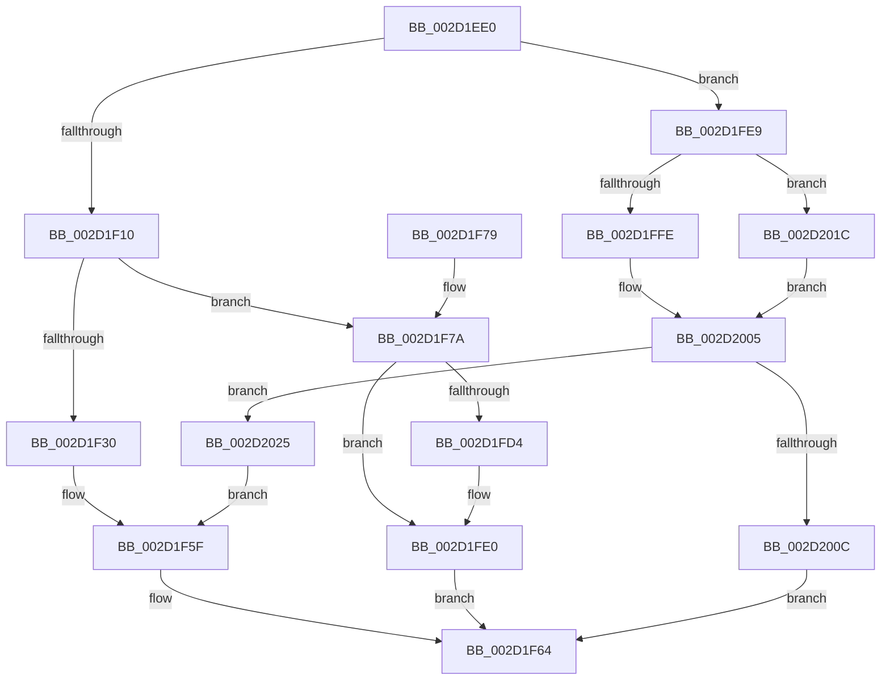

# HalpUnmaskInterrupt

- RVA: `0x002D1EE0`–`0x002D2045` (길이 `357` bytes)
- VA: `0x00000001402D1EE0`
- 실행 섹션: `.text`
- PDB 이름 있음: `예`; PDB Function 태그: `아니요`
- unwind 정보 RVA: `0x0006F8D0`
- 디코드: `91`개 명령, `357/357` bytes 표시
- 미해석 바이트: `0` (있으면 어셈블리에 `.byte`로 보존)

> 이 문서는 커널 이미지의 기계어와 PDB 기호를 분석해 생성했습니다. 4번과 5번은 함수 원형과 자료형을 바이너리 사용 방식에서 추정한 C 해석이며 원본 소스 복구 결과는 아닙니다.

## 1. Dependencies

- 직접 호출 지점: **10**; 고유 호출 대상: **10**
- 직접 호출자로 확인된 함수: **0**
- RIP 상대 이미지 참조: **10**

### Outgoing calls
- `0x002D1EFF` → [HalpInterruptFindLinesForGsiRange](HalpInterruptFindLinesForGsiRange_function_002D204C.md) (function, `0x002D204C`)
- `0x002D1F23` → [HalpInterruptLookupController](HalpInterruptLookupController_function_002D20D4.md) (function, `0x002D20D4`)
- `0x002D1F81` → [HalpAcquireHighLevelLock](HalpAcquireHighLevelLock_function_002D2390.md) (function, `0x002D2390`)
- `0x002D1FB8` → [HalpInterruptSetLineStateInternal](HalpInterruptSetLineStateInternal_function_002D2104.md) (function, `0x002D2104`)
- `0x002D1FC6` → [KxReleaseSpinLock](../20/KxReleaseSpinLock_function_00206670.md) (function, `0x00206670`)
- `0x002D1FDB` → [KiLowerIrqlProcessIrqlFlags](../4F/KiLowerIrqlProcessIrqlFlags_function_004F5698.md) (function, `0x004F5698`)
- `0x002D2000` → [HalpIsInterruptTypeSecondary](HalpIsInterruptTypeSecondary_function_002D2510.md) (function, `0x002D2510`)
- `0x002D2010` → [HalpHandleMaskUnmaskSecondaryInterrupt](HalpHandleMaskUnmaskSecondaryInterrupt_function_002D1C8C.md) (function, `0x002D1C8C`)
- `0x002D201E` → [guard_dispatch_icall](../6B/guard_dispatch_icall_function_006BAAD0.md) (function, `0x006BAAD0`)
- `0x002D203B` → [HalpInterruptSetProblemEx](../48/HalpInterruptSetProblemEx_function_0048AC8C.md) (function, `0x0048AC8C`)

### Direct callers
- 이 함수 시작 RVA로 연결되는 직접 call은 확인되지 않았습니다. 간접 호출은 완전히 역산할 수 없습니다.

### Static image references
- `0x002D1F30` → RVA `0x00F906B8` (`.data`; read/write)
- `0x002D1F37` → RVA `0x00010AA8` (`.rdata`; read)
- `0x002D1F3E` → RVA `0x00F906A0` (`.data`; read/write)
- `0x002D1F44` → RVA `0x00F906C8` (`.data`; write)
- `0x002D1F4B` → RVA `0x00F90694` (`.data`; write)
- `0x002D1F55` → RVA `0x00F906D0` (`.data`; write)
- `0x002D1F7A` → RVA `0x00FC19A8` (`.data`; read)
- `0x002D1FCB` → RVA `0x00FC6D20` (`ALMOSTRO`; read)
- `0x002D1FE9` → RVA `0x00E009E0` (`.data`; read)
- `0x002D1FF0` → RVA `0x002D2510` (`HalpIsInterruptTypeSecondary`; read)

## 2. Other-region calls and transfers

- 다른 실행 섹션으로 향하는 call: **0**
- 별도 외부 분기/꼬리 이동을 확인하지 못했습니다.

## 3. Assembly (complete function range)

```asm
002D1EE0  48 89 5C 24 08                  mov qword ptr [rsp + 8], rbx
002D1EE5  48 89 6C 24 10                  mov qword ptr [rsp + 0x10], rbp
002D1EEA  56                              push rsi
002D1EEB  57                              push rdi
002D1EEC  41 56                           push r14
002D1EEE  48 83 EC 30                     sub rsp, 0x30
002D1EF2  48 83 64 24 60 00               and qword ptr [rsp + 0x60], 0
002D1EF8  8B EA                           mov ebp, edx
002D1EFA  8D 51 01                        lea edx, [rcx + 1]
002D1EFD  8B D9                           mov ebx, ecx
002D1EFF  E8 48 01 00 00                  call 0x1402d204c
002D1F04  48 8B F8                        mov rdi, rax
002D1F07  48 85 C0                        test rax, rax
002D1F0A  0F 84 D9 00 00 00               je 0x1402d1fe9
002D1F10  8B 48 10                        mov ecx, dword ptr [rax + 0x10]
002D1F13  89 4C 24 60                     mov dword ptr [rsp + 0x60], ecx
002D1F17  8B 50 14                        mov edx, dword ptr [rax + 0x14]
002D1F1A  2B 50 1C                        sub edx, dword ptr [rax + 0x1c]
002D1F1D  03 D3                           add edx, ebx
002D1F1F  89 54 24 64                     mov dword ptr [rsp + 0x64], edx
002D1F23  E8 AC 01 00 00                  call 0x1402d20d4
002D1F28  4C 8B F0                        mov r14, rax
002D1F2B  48 85 C0                        test rax, rax
002D1F2E  75 4A                           jne 0x1402d1f7a
002D1F30  48 21 05 81 E7 CB 00            and qword ptr [rip + 0xcbe781], rax
002D1F37  4C 8D 0D 6A EB D3 FF            lea r9, [rip - 0x2c1496]
002D1F3E  21 05 5C E7 CB 00               and dword ptr [rip + 0xcbe75c], eax
002D1F44  4C 89 0D 7D E7 CB 00            mov qword ptr [rip + 0xcbe77d], r9
002D1F4B  C7 05 3F E7 CB 00 11 00 00 00   mov dword ptr [rip + 0xcbe73f], 0x11
002D1F55  C7 05 71 E7 CB 00 30 07 00 00   mov dword ptr [rip + 0xcbe771], 0x730
002D1F5F  BB 0D 00 00 C0                  mov ebx, 0xc000000d
002D1F64  48 8B 6C 24 58                  mov rbp, qword ptr [rsp + 0x58]
002D1F69  8B C3                           mov eax, ebx
002D1F6B  48 8B 5C 24 50                  mov rbx, qword ptr [rsp + 0x50]
002D1F70  48 83 C4 30                     add rsp, 0x30
002D1F74  41 5E                           pop r14
002D1F76  5F                              pop rdi
002D1F77  5E                              pop rsi
002D1F78  C3                              ret
002D1F79  CC                              int3
002D1F7A  48 8D 0D 27 FA CE 00            lea rcx, [rip + 0xcefa27]
002D1F81  E8 0A 04 00 00                  call 0x1402d2390
002D1F86  2B 5F 1C                        sub ebx, dword ptr [rdi + 0x1c]
002D1F89  8B CB                           mov ecx, ebx
002D1F8B  4C 6B C1 38                     imul r8, rcx, 0x38
002D1F8F  49 8B CE                        mov rcx, r14
002D1F92  0F B6 F0                        movzx esi, al
002D1F95  4C 03 47 28                     add r8, qword ptr [rdi + 0x28]
002D1F99  45 8B 48 0C                     mov r9d, dword ptr [r8 + 0xc]
002D1F9D  41 8B D1                        mov edx, r9d
002D1FA0  83 CA 10                        or edx, 0x10
002D1FA3  41 83 E1 DF                     and r9d, 0xffffffdf
002D1FA7  40 80 E5 02                     and bpl, 2
002D1FAB  44 0F 44 CA                     cmove r9d, edx
002D1FAF  48 8D 54 24 60                  lea rdx, [rsp + 0x60]
002D1FB4  45 89 48 0C                     mov dword ptr [r8 + 0xc], r9d
002D1FB8  E8 47 01 00 00                  call 0x1402d2104
002D1FBD  48 8D 0D E4 F9 CE 00            lea rcx, [rip + 0xcef9e4]
002D1FC4  8B D8                           mov ebx, eax
002D1FC6  E8 A5 46 F3 FF                  call 0x140206670
002D1FCB  83 3D 4E 4D CF 00 00            cmp dword ptr [rip + 0xcf4d4e], 0
002D1FD2  74 0C                           je 0x1402d1fe0
002D1FD4  44 0F 20 C1                     mov rcx, cr8
002D1FD8  40 8A D6                        mov dl, sil
002D1FDB  E8 B8 36 22 00                  call 0x1404f5698
002D1FE0  44 0F 22 C6                     mov cr8, rsi
002D1FE4  E9 7B FF FF FF                  jmp 0x1402d1f64
002D1FE9  48 8B 05 F0 E9 B2 00            mov rax, qword ptr [rip + 0xb2e9f0]
002D1FF0  48 8D 0D 19 05 00 00            lea rcx, [rip + 0x519]
002D1FF7  8B D3                           mov edx, ebx
002D1FF9  48 3B C1                        cmp rax, rcx
002D1FFC  75 1E                           jne 0x1402d201c
002D1FFE  33 C9                           xor ecx, ecx
002D2000  E8 0B 05 00 00                  call 0x1402d2510
002D2005  45 33 C0                        xor r8d, r8d
002D2008  84 C0                           test al, al
002D200A  74 19                           je 0x1402d2025
002D200C  8B D5                           mov edx, ebp
002D200E  8B CB                           mov ecx, ebx
002D2010  E8 77 FC FF FF                  call 0x1402d1c8c
002D2015  8B D8                           mov ebx, eax
002D2017  E9 48 FF FF FF                  jmp 0x1402d1f64
002D201C  33 C9                           xor ecx, ecx
002D201E  E8 AD 8A 3E 00                  call 0x1406baad0
002D2023  EB E0                           jmp 0x1402d2005
002D2025  4C 8D 0D 7C EA D3 FF            lea r9, [rip - 0x2c1584]
002D202C  C7 44 24 20 1C 07 00 00         mov dword ptr [rsp + 0x20], 0x71c
002D2034  BA 13 00 00 00                  mov edx, 0x13
002D2039  33 C9                           xor ecx, ecx
002D203B  E8 4C 8C 1B 00                  call 0x14048ac8c
002D2040  E9 1A FF FF FF                  jmp 0x1402d1f5f
```

## 4. C-style interpretation (structured pseudocode)

```c
__int64 __fastcall HalpUnmaskInterrupt(__int64 a1, int a2)
{
    __int64 result;
    __int64 v_rbp;
    __int64 v_rbx;
    __int64 v_rsp;
    unsigned __int64 v_stack_p10;
    unsigned __int64 v_stack_p18;
    unsigned int v_stack_p1C;
    unsigned int v_stack_p20;
    unsigned __int64 v_stack_p60;
    unsigned __int64 v_stack_p8;

    v_stack_p8 = v_rbx;
    v_stack_p10 = v_rbp;
    v_rsp = (v_rsp) - (48);
    result = HalpInterruptFindLinesForGsiRange(a1, a1 + 1, a3, a4);
    if (result == 0) goto loc_002D1FE9;
    v_stack_p18 = (unsigned int)((unsigned int)(*(unsigned int *)(result + 16)));
    a2 = (unsigned int)(((unsigned int)(*(unsigned int *)(result + 20))) - (*(unsigned int *)(result + 28)));
    a2 = (unsigned int)((a2) + ((unsigned int)((unsigned int)((unsigned int)(a1)))));
    v_stack_p1C = a2;
    result = HalpInterruptLookupController((unsigned int)(*(unsigned int *)(result + 16)), a2, a3, a4);
    if (result != 0) goto loc_002D1F7A;
    *(unsigned __int64 *)(v_rip + 13363069) = v_rip - 2888854;
    *(unsigned int *)(v_rip + 13363007) = 17;
    *(unsigned int *)(v_rip + 13363057) = 0x730ULL;
loc_002D1F5F:
loc_002D1F64:
    v_rsp = (v_rsp) + (48);
    return (unsigned int)((unsigned int)((unsigned int)(0xC000000DULL)));
loc_002D1F7A:
    result = HalpAcquireHighLevelLock(v_rip + 13564455, a2, a3, v_rip - 2888854);
    v_rbx = (unsigned int)((v_stack_p8) - (*(unsigned int *)(result + 28)));
    a3 = (a3) * ((unsigned int)((unsigned int)(v_rbx)));
    a3 = (a3) + (*(unsigned __int64 *)(result + 40));
    a2 = (unsigned int)(((unsigned int)((unsigned int)((unsigned int)(*(unsigned int *)(a3 + 12))))) | (16));
    a4 = (unsigned int)(((unsigned int)(*(unsigned int *)(a3 + 12))) & (0xFFFFFFDFULL));
    v_rbp = (unsigned __int8)((v_stack_p10) & (2));
    if (condition_is_equal) { a4 = a2; }
    *(unsigned int *)(a3 + 12) = (unsigned int)(a4);
    result = HalpInterruptSetLineStateInternal(result, v_stack_p60, a3, a4);
    result = KxReleaseSpinLock(v_rip + 13564388, v_stack_p60, a3, a4);
    if ((*(unsigned int *)(v_rip + 13585742)) != 0) {
        a1 = v_cr8;
        a2 = (unsigned __int8)((unsigned __int8)(result));
        result = KiLowerIrqlProcessIrqlFlags(a1, a2, a3, a4);
    }
    goto loc_002D1F64;
loc_002D1FE9:
    if ((*(unsigned __int64 *)(v_rip + 11725296)) != (v_rip + 1305)) goto loc_002D201C;
    a1 = 0;
    result = HalpIsInterruptTypeSecondary(a1, (unsigned int)((unsigned int)((unsigned int)((unsigned int)(result)))), a3, a4);
loc_002D2005:
    a3 = 0;
    if ((unsigned __int8)(result) == 0) goto loc_002D2025;
    result = HalpHandleMaskUnmaskSecondaryInterrupt((unsigned int)((unsigned int)((unsigned int)((unsigned int)(result)))), (unsigned int)((unsigned int)(v_rbp)), a3, a4);
    goto loc_002D1F64;
loc_002D201C:
    a1 = 0;
    result = guard_dispatch_icall(a1, (unsigned int)((unsigned int)(v_rbp)), a3, a4);
    goto loc_002D2005;
loc_002D2025:
    v_stack_p20 = 0x71CULL;
    a1 = 0;
    result = HalpInterruptSetProblemEx(a1, 19, a3, v_rip - 2889092);
    goto loc_002D1F5F;
}
```

## 5. (Beta) C Style

```c
int64_t HalpUnmaskInterrupt(void *Arg1, int32_t Arg2)
{
    uint8_t *arg1 = (uint8_t *)Arg1;

    int64_t result;
    int64_t local_rbp;
    int64_t local_rbx;
    int64_t local_rsp;
    uint64_t v_stack_p10;
    uint64_t v_stack_p18;
    uint32_t v_stack_p1C;
    uint32_t v_stack_p20;
    uint64_t v_stack_p60;
    uint64_t v_stack_p8;

    v_stack_p8 = local_rbx;
    v_stack_p10 = local_rbp;
    local_rsp = (local_rsp) - (48);
    result = HalpInterruptFindLinesForGsiRange(Arg1, Arg1 + 1, a3, a4);
    if (result == 0) goto loc_002D1FE9;
    v_stack_p18 = (uint32_t)((uint32_t)(*(uint32_t *)(result + 0x10)));
    Arg2 = (uint32_t)(((uint32_t)(*(uint32_t *)(result + 0x14))) - (*(uint32_t *)(result + 0x1C)));
    Arg2 = (uint32_t)((Arg2) + ((uint32_t)((uint32_t)((uint32_t)(Arg1)))));
    v_stack_p1C = Arg2;
    result = HalpInterruptLookupController((uint32_t)(*(uint32_t *)(result + 0x10)), Arg2, a3, a4);
    if (result != 0) goto loc_002D1F7A;
    *(uint64_t *)(v_rip + 0xCBE77D) = v_rip - 2888854;
    *(uint32_t *)(v_rip + 0xCBE73F) = 17;
    *(uint32_t *)(v_rip + 0xCBE771) = 0x730ULL;
loc_002D1F5F:
loc_002D1F64:
    local_rsp = (local_rsp) + (48);
    return (uint32_t)((uint32_t)((uint32_t)(0xC000000DULL)));
loc_002D1F7A:
    result = HalpAcquireHighLevelLock(v_rip + 13564455, Arg2, a3, v_rip - 2888854);
    local_rbx = (uint32_t)((v_stack_p8) - (*(uint32_t *)(result + 0x1C)));
    a3 = (a3) * ((uint32_t)((uint32_t)(local_rbx)));
    a3 = (a3) + (*(uint64_t *)(result + 0x28));
    Arg2 = (uint32_t)(((uint32_t)((uint32_t)((uint32_t)(*(uint32_t *)(a3 + 0xC))))) | (16));
    a4 = (uint32_t)(((uint32_t)(*(uint32_t *)(a3 + 0xC))) & (0xFFFFFFDFULL));
    local_rbp = (uint8_t)((v_stack_p10) & (2));
    if (condition_is_equal) { a4 = Arg2; }
    *(uint32_t *)(a3 + 0xC) = (uint32_t)(a4);
    result = HalpInterruptSetLineStateInternal(result, v_stack_p60, a3, a4);
    result = KxReleaseSpinLock(v_rip + 13564388, v_stack_p60, a3, a4);
    if ((*(uint32_t *)(v_rip + 0xCF4D4E)) != 0) {
        Arg1 = v_cr8;
        Arg2 = (uint8_t)((uint8_t)(result));
        result = KiLowerIrqlProcessIrqlFlags(Arg1, Arg2, a3, a4);
    }
    goto loc_002D1F64;
loc_002D1FE9:
    if ((*(uint64_t *)(v_rip + 0xB2E9F0)) != (v_rip + 1305)) goto loc_002D201C;
    Arg1 = 0;
    result = HalpIsInterruptTypeSecondary(Arg1, (uint32_t)((uint32_t)((uint32_t)((uint32_t)(result)))), a3, a4);
loc_002D2005:
    a3 = 0;
    if ((uint8_t)(result) == 0) goto loc_002D2025;
    result = HalpHandleMaskUnmaskSecondaryInterrupt((uint32_t)((uint32_t)((uint32_t)((uint32_t)(result)))), (uint32_t)((uint32_t)(local_rbp)), a3, a4);
    goto loc_002D1F64;
loc_002D201C:
    Arg1 = 0;
    result = guard_dispatch_icall(Arg1, (uint32_t)((uint32_t)(local_rbp)), a3, a4);
    goto loc_002D2005;
loc_002D2025:
    v_stack_p20 = 0x71CULL;
    Arg1 = 0;
    result = HalpInterruptSetProblemEx(Arg1, 19, a3, v_rip - 2889092);
    goto loc_002D1F5F;
}
```

### 관측된 메모리 오프셋

구조체 형식이 확인되지 않은 접근은 인자 기준의 오프셋으로만 기록했습니다.

| 기준 인자 | 오프셋 표현 | 폭 (bit) | 접근 |
|---|---:|---:|---|
| `Arg1` | `+ 0x1` | `32` | `R` |

## 6. Execution-region graph

[열기: 2D/3D 그래프와 함수 탐색 컨트롤 패널](../../../control-panel.html?section=text&rva=0x002D1EE0&view=graph)

- 2D 그래프는 위에서 아래로 흐르고, 3D 그래프는 빈 공간을 드래그해 회전합니다. Shift+드래그는 이동, 휠은 확대·축소, 함수 노드 선택은 대상 보고서 이동입니다.

### Static fallback


