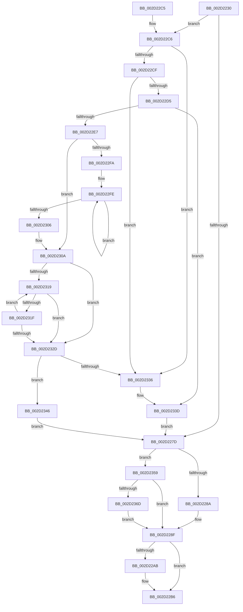

# HalpVpptAcknowledgeInterrupt

- RVA: `0x002D2230`–`0x002D2389` (길이 `345` bytes)
- VA: `0x00000001402D2230`
- 실행 섹션: `.text`
- PDB 이름 있음: `예`; PDB Function 태그: `아니요`
- unwind 정보 RVA: `0x0006F91C`
- 디코드: `85`개 명령, `345/345` bytes 표시
- 미해석 바이트: `0` (있으면 어셈블리에 `.byte`로 보존)

> 이 문서는 커널 이미지의 기계어와 PDB 기호를 분석해 생성했습니다. 4번과 5번은 함수 원형과 자료형을 바이너리 사용 방식에서 추정한 C 해석이며 원본 소스 복구 결과는 아닙니다.

## 1. Dependencies

- 직접 호출 지점: **9**; 고유 호출 대상: **7**
- 직접 호출자로 확인된 함수: **2**
- RIP 상대 이미지 참조: **7**

### Outgoing calls
- `0x002D2244` → [HalpAcquireHighLevelLock](HalpAcquireHighLevelLock_function_002D2390.md) (function, `0x002D2390`)
- `0x002D2259` → [HalpTimerGetInternalData](../20/HalpTimerGetInternalData_function_00209500.md) (function, `0x00209500`)
- `0x002D2265` → [guard_dispatch_icall](../6B/guard_dispatch_icall_function_006BAAD0.md) (function, `0x006BAAD0`)
- `0x002D228A` → [HalpVpptUpdatePhysicalTimer](HalpVpptUpdatePhysicalTimer_function_002D23D8.md) (function, `0x002D23D8`)
- `0x002D229D` → [KxReleaseSpinLock](../20/KxReleaseSpinLock_function_00206670.md) (function, `0x00206670`)
- `0x002D22B1` → [KiLowerIrqlProcessIrqlFlags](../4F/KiLowerIrqlProcessIrqlFlags_function_004F5698.md) (function, `0x004F5698`)
- `0x002D22EC` → [RtlGetInterruptTimePrecise](../20/RtlGetInterruptTimePrecise_function_0020A4C0.md) (function, `0x0020A4C0`)
- `0x002D2370` → [HalpTimerGetInternalData](../20/HalpTimerGetInternalData_function_00209500.md) (function, `0x00209500`)
- `0x002D237F` → [guard_dispatch_icall](../6B/guard_dispatch_icall_function_006BAAD0.md) (function, `0x006BAAD0`)

### Direct callers
- [HalpTimerClockInterrupt](../20/HalpTimerClockInterrupt_function_002086A0.md) at `0x002088E5`
- [sub_00208E4A](../20/Unknown_function_00208E4A.md) at `0x00208E59`

### Static image references
- `0x002D223D` → RVA `0x00FC2290` (`.data`; read)
- `0x002D2249` → RVA `0x00FC2248` (`.data`; read)
- `0x002D2253` → RVA `0x00FC2298` (`.data`; write)
- `0x002D226A` → RVA `0x00FC2260` (`.data`; read)
- `0x002D228F` → RVA `0x00FC2298` (`.data`; read)
- `0x002D22A2` → RVA `0x00FC6D20` (`ALMOSTRO`; read)
- `0x002D22D5` → RVA `0x00FC2260` (`.data`; write)

## 2. Other-region calls and transfers

- 다른 실행 섹션으로 향하는 call: **0**
- 별도 외부 분기/꼬리 이동을 확인하지 못했습니다.

## 3. Assembly (complete function range)

```asm
002D2230  48 89 5C 24 10                  mov qword ptr [rsp + 0x10], rbx
002D2235  57                              push rdi
002D2236  48 83 EC 20                     sub rsp, 0x20
002D223A  48 8B D9                        mov rbx, rcx
002D223D  48 8D 0D 4C 00 CF 00            lea rcx, [rip + 0xcf004c]
002D2244  E8 47 01 00 00                  call 0x1402d2390
002D2249  48 8B 15 F8 FF CE 00            mov rdx, qword ptr [rip + 0xcefff8]
002D2250  48 8B CA                        mov rcx, rdx
002D2253  88 05 3F 00 CF 00               mov byte ptr [rip + 0xcf003f], al
002D2259  E8 A2 72 F3 FF                  call 0x140209500
002D225E  48 8B C8                        mov rcx, rax
002D2261  48 8B 42 78                     mov rax, qword ptr [rdx + 0x78]
002D2265  E8 66 88 3E 00                  call 0x1406baad0
002D226A  48 8B 0D EF FF CE 00            mov rcx, qword ptr [rip + 0xceffef]
002D2271  48 8D 3D E8 FF CE 00            lea rdi, [rip + 0xceffe8]
002D2278  48 3B CB                        cmp rcx, rbx
002D227B  74 49                           je 0x1402d22c6
002D227D  48 39 3D DC FF CE 00            cmp qword ptr [rip + 0xceffdc], rdi
002D2284  0F 84 CF 00 00 00               je 0x1402d2359
002D228A  E8 49 01 00 00                  call 0x1402d23d8
002D228F  0F B6 1D 02 00 CF 00            movzx ebx, byte ptr [rip + 0xcf0002]
002D2296  48 8D 0D F3 FF CE 00            lea rcx, [rip + 0xcefff3]
002D229D  E8 CE 43 F3 FF                  call 0x140206670
002D22A2  83 3D 77 4A CF 00 00            cmp dword ptr [rip + 0xcf4a77], 0
002D22A9  74 0B                           je 0x1402d22b6
002D22AB  44 0F 20 C1                     mov rcx, cr8
002D22AF  8A D3                           mov dl, bl
002D22B1  E8 E2 33 22 00                  call 0x1404f5698
002D22B6  44 0F 22 C3                     mov cr8, rbx
002D22BA  48 8B 5C 24 38                  mov rbx, qword ptr [rsp + 0x38]
002D22BF  48 83 C4 20                     add rsp, 0x20
002D22C3  5F                              pop rdi
002D22C4  C3                              ret
002D22C5  CC                              int3
002D22C6  48 8B 01                        mov rax, qword ptr [rcx]
002D22C9  48 39 79 08                     cmp qword ptr [rcx + 8], rdi
002D22CD  75 67                           jne 0x1402d2336
002D22CF  48 39 48 08                     cmp qword ptr [rax + 8], rcx
002D22D3  75 61                           jne 0x1402d2336
002D22D5  48 89 05 84 FF CE 00            mov qword ptr [rip + 0xceff84], rax
002D22DC  48 89 78 08                     mov qword ptr [rax + 8], rdi
002D22E0  48 83 7B 28 00                  cmp qword ptr [rbx + 0x28], 0
002D22E5  74 56                           je 0x1402d233d
002D22E7  48 8D 4C 24 30                  lea rcx, [rsp + 0x30]
002D22EC  E8 CF 81 F3 FF                  call 0x14020a4c0
002D22F1  48 8B 4B 20                     mov rcx, qword ptr [rbx + 0x20]
002D22F5  48 3B C8                        cmp rcx, rax
002D22F8  77 10                           ja 0x1402d230a
002D22FA  48 8B 53 28                     mov rdx, qword ptr [rbx + 0x28]
002D22FE  48 03 CA                        add rcx, rdx
002D2301  48 3B C8                        cmp rcx, rax
002D2304  76 F8                           jbe 0x1402d22fe
002D2306  48 89 4B 20                     mov qword ptr [rbx + 0x20], rcx
002D230A  4C 8B 05 4F FF CE 00            mov r8, qword ptr [rip + 0xceff4f]
002D2311  48 8B D7                        mov rdx, rdi
002D2314  4C 3B C7                        cmp r8, rdi
002D2317  74 14                           je 0x1402d232d
002D2319  49 3B 48 20                     cmp rcx, qword ptr [r8 + 0x20]
002D231D  72 0E                           jb 0x1402d232d
002D231F  49 8B 00                        mov rax, qword ptr [r8]
002D2322  49 8B D0                        mov rdx, r8
002D2325  4C 8B C0                        mov r8, rax
002D2328  48 3B C7                        cmp rax, rdi
002D232B  75 EC                           jne 0x1402d2319
002D232D  48 8B 02                        mov rax, qword ptr [rdx]
002D2330  48 39 50 08                     cmp qword ptr [rax + 8], rdx
002D2334  74 10                           je 0x1402d2346
002D2336  B9 03 00 00 00                  mov ecx, 3
002D233B  CD 29                           int 0x29
002D233D  C6 43 18 00                     mov byte ptr [rbx + 0x18], 0
002D2341  E9 37 FF FF FF                  jmp 0x1402d227d
002D2346  48 89 03                        mov qword ptr [rbx], rax
002D2349  48 89 53 08                     mov qword ptr [rbx + 8], rdx
002D234D  48 89 58 08                     mov qword ptr [rax + 8], rbx
002D2351  48 89 1A                        mov qword ptr [rdx], rbx
002D2354  E9 24 FF FF FF                  jmp 0x1402d227d
002D2359  48 8B 15 E8 FE CE 00            mov rdx, qword ptr [rip + 0xcefee8]
002D2360  83 BA E4 00 00 00 03            cmp dword ptr [rdx + 0xe4], 3
002D2367  0F 84 22 FF FF FF               je 0x1402d228f
002D236D  48 8B CA                        mov rcx, rdx
002D2370  E8 8B 71 F3 FF                  call 0x140209500
002D2375  48 8B C8                        mov rcx, rax
002D2378  48 8B 82 88 00 00 00            mov rax, qword ptr [rdx + 0x88]
002D237F  E8 4C 87 3E 00                  call 0x1406baad0
002D2384  E9 06 FF FF FF                  jmp 0x1402d228f
```

## 4. C-style interpretation (structured pseudocode)

```c
__int64 __fastcall HalpVpptAcknowledgeInterrupt(__int64 a1)
{
    __int64 result;
    __int64 v_rsp;
    unsigned __int64 v_stack_p10;
    unsigned __int64 v_stack_p30;

    v_stack_p10 = v_rbx;
    v_rsp = (v_rsp) - (32);
    result = HalpAcquireHighLevelLock(v_rip + 13566028, a2, a3, a4);
    *(unsigned __int8 *)(v_rip + 13566015) = (unsigned __int8)(result);
    result = HalpTimerGetInternalData(*(unsigned __int64 *)(v_rip + 13565944), *(unsigned __int64 *)(v_rip + 13565944), a3, a4);
    result = guard_dispatch_icall(result, *(unsigned __int64 *)(v_rip + 13565944), a3, a4);
    if ((*(unsigned __int64 *)(v_rip + 13565935)) == a1) goto loc_002D22C6;
loc_002D227D:
    if ((*(unsigned __int64 *)(v_rip + 13565916)) == (v_rip + 13565928)) goto loc_002D2359;
    result = HalpVpptUpdatePhysicalTimer(*(unsigned __int64 *)(v_rip + 13565935), *(unsigned __int64 *)(v_rip + 13565944), a3, a4);
loc_002D228F:
    result = KxReleaseSpinLock(v_rip + 13565939, *(unsigned __int64 *)(v_rip + 13565944), a3, a4);
    if ((*(unsigned int *)(v_rip + 13585015)) != 0) {
        a1 = v_cr8;
        a2 = (unsigned __int8)(*(unsigned __int8 *)(v_rip + 13565954));
        result = KiLowerIrqlProcessIrqlFlags(a1, a2, a3, a4);
    }
    v_rsp = (v_rsp) + (32);
    return result;
loc_002D22C6:
    if ((*(unsigned __int64 *)(a1 + 8)) != (v_rip + 13565928)) goto loc_002D2336;
    if ((*(unsigned __int64 *)(*(unsigned __int64 *)(a1) + 8)) != a1) goto loc_002D2336;
    *(unsigned __int64 *)(v_rip + 13565828) = *(unsigned __int64 *)(a1);
    *(unsigned __int64 *)(*(unsigned __int64 *)(a1) + 8) = v_rip + 13565928;
    if ((*(unsigned __int64 *)(v_stack_p10 + 40)) == 0) goto loc_002D233D;
    result = RtlGetInterruptTimePrecise(v_stack_p30, a2, a3, a4);
    if ((*(unsigned __int64 *)(v_stack_p10 + 32)) > result) goto loc_002D230A;
loc_002D22FE:
    a1 = (*(unsigned __int64 *)(v_stack_p10 + 32)) + (*(unsigned __int64 *)(v_stack_p10 + 40));
    if (a1 <= result) goto loc_002D22FE;
    *(unsigned __int64 *)(v_stack_p10 + 32) = a1;
loc_002D230A:
    if ((*(unsigned __int64 *)(v_rip + 13565775)) == (v_rip + 13565928)) goto loc_002D232D;
loc_002D2319:
    if (a1 < (*(unsigned __int64 *)(*(unsigned __int64 *)(v_rip + 13565775) + 32))) goto loc_002D232D;
    if ((*(unsigned __int64 *)(*(unsigned __int64 *)(v_rip + 13565775))) != (v_rip + 13565928)) goto loc_002D2319;
loc_002D232D:
    if ((*(unsigned __int64 *)(*(unsigned __int64 *)(*(unsigned __int64 *)(v_rip + 13565775)) + 8)) == (*(unsigned __int64 *)(v_rip + 13565775))) goto loc_002D2346;
loc_002D2336:
loc_002D233D:
    *(unsigned __int8 *)(v_stack_p10 + 24) = 0;
    goto loc_002D227D;
loc_002D2346:
    *(unsigned __int64 *)(v_stack_p10) = *(unsigned __int64 *)(*(unsigned __int64 *)(v_rip + 13565775));
    *(unsigned __int64 *)(v_stack_p10 + 8) = *(unsigned __int64 *)(v_rip + 13565775);
    *(unsigned __int64 *)(*(unsigned __int64 *)(*(unsigned __int64 *)(v_rip + 13565775)) + 8) = v_stack_p10;
    *(unsigned __int64 *)(*(unsigned __int64 *)(v_rip + 13565775)) = v_stack_p10;
    goto loc_002D227D;
loc_002D2359:
    if ((*(unsigned int *)(*(unsigned __int64 *)(v_rip + 13565672) + 228)) == 3) goto loc_002D228F;
    result = HalpTimerGetInternalData(*(unsigned __int64 *)(v_rip + 13565672), *(unsigned __int64 *)(v_rip + 13565672), *(unsigned __int64 *)(*(unsigned __int64 *)(v_rip + 13565775)), a4);
    result = guard_dispatch_icall(result, *(unsigned __int64 *)(v_rip + 13565672), *(unsigned __int64 *)(*(unsigned __int64 *)(v_rip + 13565775)), a4);
    goto loc_002D228F;
}
```

## 5. (Beta) C Style

```c
int64_t HalpVpptAcknowledgeInterrupt(void *Arg1)
{
    uint8_t *arg1 = (uint8_t *)Arg1;

    int64_t result;
    int64_t local_rsp;
    uint64_t v_stack_p10;
    uint64_t v_stack_p30;

    v_stack_p10 = local_rbx;
    local_rsp = (local_rsp) - (32);
    result = HalpAcquireHighLevelLock(v_rip + 13566028, a2, a3, a4);
    *(uint8_t *)(v_rip + 0xCF003F) = (uint8_t)(result);
    result = HalpTimerGetInternalData(*(uint64_t *)(v_rip + 0xCEFFF8), *(uint64_t *)(v_rip + 0xCEFFF8), a3, a4);
    result = guard_dispatch_icall(result, *(uint64_t *)(v_rip + 0xCEFFF8), a3, a4);
    if ((*(uint64_t *)(v_rip + 0xCEFFEF)) == Arg1) goto loc_002D22C6;
loc_002D227D:
    if ((*(uint64_t *)(v_rip + 0xCEFFDC)) == (v_rip + 13565928)) goto loc_002D2359;
    result = HalpVpptUpdatePhysicalTimer(*(uint64_t *)(v_rip + 0xCEFFEF), *(uint64_t *)(v_rip + 0xCEFFF8), a3, a4);
loc_002D228F:
    result = KxReleaseSpinLock(v_rip + 13565939, *(uint64_t *)(v_rip + 0xCEFFF8), a3, a4);
    if ((*(uint32_t *)(v_rip + 0xCF4A77)) != 0) {
        Arg1 = v_cr8;
        a2 = (uint8_t)(*(uint8_t *)(v_rip + 0xCF0002));
        result = KiLowerIrqlProcessIrqlFlags(Arg1, a2, a3, a4);
    }
    local_rsp = (local_rsp) + (32);
    return result;
loc_002D22C6:
    if ((*(uint64_t *)(arg1 + 0x8)) != (v_rip + 13565928)) goto loc_002D2336;
    if ((*(uint64_t *)(*(uint64_t *)(arg1) + 0x8)) != Arg1) goto loc_002D2336;
    *(uint64_t *)(v_rip + 0xCEFF84) = *(uint64_t *)(arg1);
    *(uint64_t *)(*(uint64_t *)(arg1) + 0x8) = v_rip + 13565928;
    if ((*(uint64_t *)(v_stack_p10 + 0x28)) == 0) goto loc_002D233D;
    result = RtlGetInterruptTimePrecise(v_stack_p30, a2, a3, a4);
    if ((*(uint64_t *)(v_stack_p10 + 0x20)) > result) goto loc_002D230A;
loc_002D22FE:
    Arg1 = (*(uint64_t *)(v_stack_p10 + 0x20)) + (*(uint64_t *)(v_stack_p10 + 0x28));
    if (Arg1 <= result) goto loc_002D22FE;
    *(void **)(v_stack_p10 + 0x20) = Arg1;
loc_002D230A:
    if ((*(uint64_t *)(v_rip + 0xCEFF4F)) == (v_rip + 13565928)) goto loc_002D232D;
loc_002D2319:
    if (Arg1 < (*(uint64_t *)(*(uint64_t *)(v_rip + 0xCEFF4F) + 0x20))) goto loc_002D232D;
    if ((*(uint64_t *)(*(uint64_t *)(v_rip + 0xCEFF4F))) != (v_rip + 13565928)) goto loc_002D2319;
loc_002D232D:
    if ((*(uint64_t *)(*(uint64_t *)(*(uint64_t *)(v_rip + 0xCEFF4F)) + 0x8)) == (*(uint64_t *)(v_rip + 0xCEFF4F))) goto loc_002D2346;
loc_002D2336:
loc_002D233D:
    *(uint8_t *)(v_stack_p10 + 0x18) = 0;
    goto loc_002D227D;
loc_002D2346:
    *(uint64_t *)(v_stack_p10) = *(uint64_t *)(*(uint64_t *)(v_rip + 0xCEFF4F));
    *(uint64_t *)(v_stack_p10 + 0x8) = *(uint64_t *)(v_rip + 0xCEFF4F);
    *(uint64_t *)(*(uint64_t *)(*(uint64_t *)(v_rip + 0xCEFF4F)) + 0x8) = v_stack_p10;
    *(uint64_t *)(*(uint64_t *)(v_rip + 0xCEFF4F)) = v_stack_p10;
    goto loc_002D227D;
loc_002D2359:
    if ((*(uint32_t *)(*(uint64_t *)(v_rip + 0xCEFEE8) + 0xE4)) == 3) goto loc_002D228F;
    result = HalpTimerGetInternalData(*(uint64_t *)(v_rip + 0xCEFEE8), *(uint64_t *)(v_rip + 0xCEFEE8), *(uint64_t *)(*(uint64_t *)(v_rip + 0xCEFF4F)), a4);
    result = guard_dispatch_icall(result, *(uint64_t *)(v_rip + 0xCEFEE8), *(uint64_t *)(*(uint64_t *)(v_rip + 0xCEFF4F)), a4);
    goto loc_002D228F;
}
```

### 관측된 메모리 오프셋

구조체 형식이 확인되지 않은 접근은 인자 기준의 오프셋으로만 기록했습니다.

| 기준 인자 | 오프셋 표현 | 폭 (bit) | 접근 |
|---|---:|---:|---|
| `Arg1` | `+ 0x0` | `64` | `W` |
| `Arg1` | `+ 0x8` | `64` | `W` |
| `Arg1` | `+ 0x18` | `8` | `W` |
| `Arg1` | `+ 0x20` | `64` | `R` |
| `Arg1` | `+ 0x20` | `64` | `W` |
| `Arg1` | `+ 0x28` | `64` | `R` |

## 6. Execution-region graph

[열기: 2D/3D 그래프와 함수 탐색 컨트롤 패널](../../../control-panel.html?section=text&rva=0x002D2230&view=graph)

- 2D 그래프는 위에서 아래로 흐르고, 3D 그래프는 빈 공간을 드래그해 회전합니다. Shift+드래그는 이동, 휠은 확대·축소, 함수 노드 선택은 대상 보고서 이동입니다.

### Static fallback


