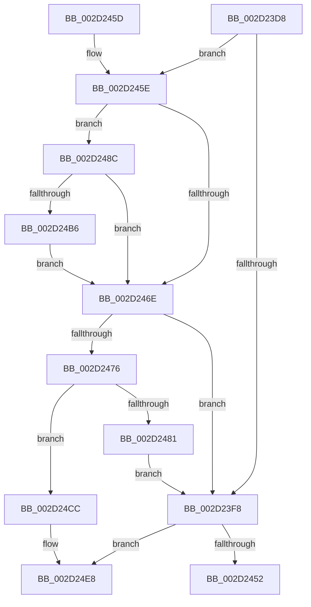

# HalpVpptUpdatePhysicalTimer

- RVA: `0x002D23D8`–`0x002D2504` (길이 `300` bytes)
- VA: `0x00000001402D23D8`
- 실행 섹션: `.text`
- PDB 이름 있음: `예`; PDB Function 태그: `아니요`
- unwind 정보 RVA: `0x0006F92C`
- 디코드: `74`개 명령, `300/300` bytes 표시
- 미해석 바이트: `0` (있으면 어셈블리에 `.byte`로 보존)

> 이 문서는 커널 이미지의 기계어와 PDB 기호를 분석해 생성했습니다. 4번과 5번은 함수 원형과 자료형을 바이너리 사용 방식에서 추정한 C 해석이며 원본 소스 복구 결과는 아닙니다.

## 1. Dependencies

- 직접 호출 지점: **9**; 고유 호출 대상: **6**
- 직접 호출자로 확인된 함수: **3**
- RIP 상대 이미지 참조: **4**

### Outgoing calls
- `0x002D23FD` → [RtlGetInterruptTimePrecise](../20/RtlGetInterruptTimePrecise_function_0020A4C0.md) (function, `0x0020A4C0`)
- `0x002D2445` → [HalpSetTimerAnyMode](../42/HalpSetTimerAnyMode_function_0042B868.md) (function, `0x0042B868`)
- `0x002D2478` → [ExtEnvSetVpptTarget](../49/ExtEnvSetVpptTarget_function_0049D8FC.md) (function, `0x0049D8FC`)
- `0x002D248F` → [HalpTimerGetInternalData](../20/HalpTimerGetInternalData_function_00209500.md) (function, `0x00209500`)
- `0x002D249E` → [guard_dispatch_icall](../6B/guard_dispatch_icall_function_006BAAD0.md) (function, `0x006BAAD0`)
- `0x002D24B9` → [HalpTimerGetInternalData](../20/HalpTimerGetInternalData_function_00209500.md) (function, `0x00209500`)
- `0x002D24C5` → [guard_dispatch_icall](../6B/guard_dispatch_icall_function_006BAAD0.md) (function, `0x006BAAD0`)
- `0x002D24E2` → [ExtEnvCriticalFailure](../56/ExtEnvCriticalFailure_function_00561300.md) (function, `0x00561300`)
- `0x002D24FE` → [ExtEnvCriticalFailure](../56/ExtEnvCriticalFailure_function_00561300.md) (function, `0x00561300`)

### Direct callers
- [HalpVpptAcknowledgeInterrupt](HalpVpptAcknowledgeInterrupt_function_002D2230.md) at `0x002D228A`
- [HalpVpptArmTimer](../4A/HalpVpptArmTimer_function_004AFFE0.md) at `0x004B013A`
- [HalpVpptStop](../54/HalpVpptStop_function_0054A380.md) at `0x0054A415`

### Static image references
- `0x002D23E2` → RVA `0x00FC2260` (`.data`; read)
- `0x002D23EC` → RVA `0x00FC2250` (`.data`; read)
- `0x002D241C` → RVA `0x00FC2248` (`.data`; read)
- `0x002D2481` → RVA `0x00FC2250` (`.data`; write)

## 2. Other-region calls and transfers

- 다른 실행 섹션으로 향하는 call: **0**
- 별도 외부 분기/꼬리 이동을 확인하지 못했습니다.

## 3. Assembly (complete function range)

```asm
002D23D8  48 89 5C 24 10                  mov qword ptr [rsp + 0x10], rbx
002D23DD  57                              push rdi
002D23DE  48 83 EC 30                     sub rsp, 0x30
002D23E2  48 8B 05 77 FE CE 00            mov rax, qword ptr [rip + 0xcefe77]
002D23E9  8B 58 10                        mov ebx, dword ptr [rax + 0x10]
002D23EC  39 1D 5E FE CE 00               cmp dword ptr [rip + 0xcefe5e], ebx
002D23F2  48 8B 78 20                     mov rdi, qword ptr [rax + 0x20]
002D23F6  75 66                           jne 0x1402d245e
002D23F8  48 8D 4C 24 40                  lea rcx, [rsp + 0x40]
002D23FD  E8 BE 80 F3 FF                  call 0x14020a4c0
002D2402  45 33 C0                        xor r8d, r8d
002D2405  4C 8D 4C 24 40                  lea r9, [rsp + 0x40]
002D240A  48 8B CF                        mov rcx, rdi
002D240D  48 2B C8                        sub rcx, rax
002D2410  48 3B C7                        cmp rax, rdi
002D2413  B8 80 96 98 00                  mov eax, 0x989680
002D2418  4C 0F 46 C1                     cmovbe r8, rcx
002D241C  48 8B 0D 25 FE CE 00            mov rcx, qword ptr [rip + 0xcefe25]
002D2423  33 D2                           xor edx, edx
002D2425  48 F7 B1 C0 00 00 00            div qword ptr [rcx + 0xc0]
002D242C  48 8B D8                        mov rbx, rax
002D242F  B8 88 13 00 00                  mov eax, 0x1388
002D2434  48 3B D8                        cmp rbx, rax
002D2437  48 0F 42 D8                     cmovb rbx, rax
002D243B  4C 3B C3                        cmp r8, rbx
002D243E  49 0F 43 D8                     cmovae rbx, r8
002D2442  48 8B D3                        mov rdx, rbx
002D2445  E8 1E 94 15 00                  call 0x14042b868
002D244A  85 C0                           test eax, eax
002D244C  0F 88 96 00 00 00               js 0x1402d24e8
002D2452  48 8B 5C 24 48                  mov rbx, qword ptr [rsp + 0x48]
002D2457  48 83 C4 30                     add rsp, 0x30
002D245B  5F                              pop rdi
002D245C  C3                              ret
002D245D  CC                              int3
002D245E  48 8B 15 E3 FD CE 00            mov rdx, qword ptr [rip + 0xcefde3]
002D2465  83 BA E4 00 00 00 03            cmp dword ptr [rdx + 0xe4], 3
002D246C  75 1E                           jne 0x1402d248c
002D246E  39 1D DC FD CE 00               cmp dword ptr [rip + 0xcefddc], ebx
002D2474  74 82                           je 0x1402d23f8
002D2476  8B D3                           mov edx, ebx
002D2478  E8 7F B4 1C 00                  call 0x14049d8fc
002D247D  85 C0                           test eax, eax
002D247F  78 4B                           js 0x1402d24cc
002D2481  89 1D C9 FD CE 00               mov dword ptr [rip + 0xcefdc9], ebx
002D2487  E9 6C FF FF FF                  jmp 0x1402d23f8
002D248C  48 8B CA                        mov rcx, rdx
002D248F  E8 6C 70 F3 FF                  call 0x140209500
002D2494  48 8B C8                        mov rcx, rax
002D2497  48 8B 82 88 00 00 00            mov rax, qword ptr [rdx + 0x88]
002D249E  E8 2D 86 3E 00                  call 0x1406baad0
002D24A3  48 8B 15 9E FD CE 00            mov rdx, qword ptr [rip + 0xcefd9e]
002D24AA  F7 82 E0 00 00 00 00 00 20 00   test dword ptr [rdx + 0xe0], 0x200000
002D24B4  75 B8                           jne 0x1402d246e
002D24B6  48 8B CA                        mov rcx, rdx
002D24B9  E8 42 70 F3 FF                  call 0x140209500
002D24BE  48 8B C8                        mov rcx, rax
002D24C1  48 8B 42 68                     mov rax, qword ptr [rdx + 0x68]
002D24C5  E8 06 86 3E 00                  call 0x1406baad0
002D24CA  EB A2                           jmp 0x1402d246e
002D24CC  44 8B 05 7D FD CE 00            mov r8d, dword ptr [rip + 0xcefd7d]
002D24D3  4C 8B CB                        mov r9, rbx
002D24D6  48 98                           cdqe
002D24D8  BA 14 01 00 00                  mov edx, 0x114
002D24DD  48 89 44 24 20                  mov qword ptr [rsp + 0x20], rax
002D24E2  E8 19 EE 28 00                  call 0x140561300
002D24E7  CC                              int3
002D24E8  4C 8B 05 59 FD CE 00            mov r8, qword ptr [rip + 0xcefd59]
002D24EF  4C 8B CB                        mov r9, rbx
002D24F2  48 98                           cdqe
002D24F4  BA 15 01 00 00                  mov edx, 0x115
002D24F9  48 89 44 24 20                  mov qword ptr [rsp + 0x20], rax
002D24FE  E8 FD ED 28 00                  call 0x140561300
002D2503  CC                              int3
```

## 4. C-style interpretation (structured pseudocode)

```c
__int64 __fastcall HalpVpptUpdatePhysicalTimer(__int64 a1, int a2, int a3)
{
    __int64 result;
    __int64 v_rbx;
    __int64 v_rsp;
    unsigned __int64 v_stack_p10;
    unsigned __int64 v_stack_p20;
    unsigned __int64 v_stack_p8;

    v_stack_p10 = v_rbx;
    v_rsp = (v_rsp) - (48);
    if ((*(unsigned int *)(v_rip + 13565534)) != ((unsigned int)((unsigned int)(*(unsigned int *)(*(unsigned __int64 *)(v_rip + 13565559) + 16))))) goto loc_002D245E;
loc_002D23F8:
    result = RtlGetInterruptTimePrecise(v_stack_p8, a2, a3, a4);
    a3 = 0;
    a1 = (*(unsigned __int64 *)(*(unsigned __int64 *)(v_rip + 13565559) + 32)) - (result);
    if (result <= (*(unsigned __int64 *)(*(unsigned __int64 *)(v_rip + 13565559) + 32))) { a3 = a1; }
    a2 = 0;
    v_rbx = (unsigned int)(0x989680ULL);
    if (((unsigned int)(0x989680ULL)) < ((unsigned int)(0x1388ULL))) { v_rbx = (unsigned int)(0x1388ULL); }
    if (a3 >= v_rbx) { v_rbx = a3; }
    result = HalpSetTimerAnyMode(*(unsigned __int64 *)(v_rip + 13565477), v_rbx, a3, v_stack_p8);
    if (sign_flag) goto loc_002D24E8;
    v_rsp = (v_rsp) + (48);
    return result;
loc_002D245E:
    if ((*(unsigned int *)(*(unsigned __int64 *)(v_rip + 13565411) + 228)) != 3) goto loc_002D248C;
loc_002D246E:
    if ((*(unsigned int *)(v_rip + 13565404)) == ((unsigned int)(v_stack_p10))) goto loc_002D23F8;
    result = ExtEnvSetVpptTarget(*(unsigned __int64 *)(v_rip + 13565477), (unsigned int)((unsigned int)(v_stack_p10)), a3, v_stack_p8);
    if (sign_flag) goto loc_002D24CC;
    *(unsigned int *)(v_rip + 13565385) = (unsigned int)(v_stack_p10);
    goto loc_002D23F8;
loc_002D248C:
    result = HalpTimerGetInternalData((unsigned int)((unsigned int)(v_stack_p10)), (unsigned int)((unsigned int)(v_stack_p10)), a3, v_stack_p8);
    result = guard_dispatch_icall(result, (unsigned int)((unsigned int)(v_stack_p10)), a3, v_stack_p8);
    if (((*(unsigned int *)(*(unsigned __int64 *)(v_rip + 13565342) + 224)) & (0x200000ULL)) != 0) goto loc_002D246E;
    result = HalpTimerGetInternalData(*(unsigned __int64 *)(v_rip + 13565342), *(unsigned __int64 *)(v_rip + 13565342), a3, v_stack_p8);
    result = guard_dispatch_icall(result, *(unsigned __int64 *)(v_rip + 13565342), a3, v_stack_p8);
    goto loc_002D246E;
loc_002D24CC:
    v_stack_p20 = result;
    result = ExtEnvCriticalFailure(result, 276, (unsigned int)(*(unsigned int *)(v_rip + 13565309)), v_stack_p10);
loc_002D24E8:
    v_stack_p20 = result;
    result = ExtEnvCriticalFailure(result, 277, *(unsigned __int64 *)(v_rip + 13565273), v_stack_p10);
    return result;
}
```

## 5. (Beta) C Style

```c
int64_t HalpVpptUpdatePhysicalTimer(int64_t Arg1, int32_t Arg2, int32_t Arg3)
{
    int64_t result;
    int64_t local_rbx;
    int64_t local_rsp;
    uint64_t v_stack_p10;
    uint64_t v_stack_p20;
    uint64_t v_stack_p8;

    v_stack_p10 = local_rbx;
    local_rsp = (local_rsp) - (48);
    if ((*(uint32_t *)(v_rip + 0xCEFE5E)) != ((uint32_t)((uint32_t)(*(uint32_t *)(*(uint64_t *)(v_rip + 0xCEFE77) + 0x10))))) goto loc_002D245E;
loc_002D23F8:
    result = RtlGetInterruptTimePrecise(v_stack_p8, Arg2, Arg3, a4);
    Arg3 = 0;
    Arg1 = (*(uint64_t *)(*(uint64_t *)(v_rip + 0xCEFE77) + 0x20)) - (result);
    if (result <= (*(uint64_t *)(*(uint64_t *)(v_rip + 0xCEFE77) + 0x20))) { Arg3 = Arg1; }
    Arg2 = 0;
    local_rbx = (uint32_t)(0x989680ULL);
    if (((uint32_t)(0x989680ULL)) < ((uint32_t)(0x1388ULL))) { local_rbx = (uint32_t)(0x1388ULL); }
    if (Arg3 >= local_rbx) { local_rbx = Arg3; }
    result = HalpSetTimerAnyMode(*(uint64_t *)(v_rip + 0xCEFE25), local_rbx, Arg3, v_stack_p8);
    if (sign_flag) goto loc_002D24E8;
    local_rsp = (local_rsp) + (48);
    return result;
loc_002D245E:
    if ((*(uint32_t *)(*(uint64_t *)(v_rip + 0xCEFDE3) + 0xE4)) != 3) goto loc_002D248C;
loc_002D246E:
    if ((*(uint32_t *)(v_rip + 0xCEFDDC)) == ((uint32_t)(v_stack_p10))) goto loc_002D23F8;
    result = ExtEnvSetVpptTarget(*(uint64_t *)(v_rip + 0xCEFE25), (uint32_t)((uint32_t)(v_stack_p10)), Arg3, v_stack_p8);
    if (sign_flag) goto loc_002D24CC;
    *(uint32_t *)(v_rip + 0xCEFDC9) = (uint32_t)(v_stack_p10);
    goto loc_002D23F8;
loc_002D248C:
    result = HalpTimerGetInternalData((uint32_t)((uint32_t)(v_stack_p10)), (uint32_t)((uint32_t)(v_stack_p10)), Arg3, v_stack_p8);
    result = guard_dispatch_icall(result, (uint32_t)((uint32_t)(v_stack_p10)), Arg3, v_stack_p8);
    if (((*(uint32_t *)(*(uint64_t *)(v_rip + 0xCEFD9E) + 0xE0)) & (0x200000ULL)) != 0) goto loc_002D246E;
    result = HalpTimerGetInternalData(*(uint64_t *)(v_rip + 0xCEFD9E), *(uint64_t *)(v_rip + 0xCEFD9E), Arg3, v_stack_p8);
    result = guard_dispatch_icall(result, *(uint64_t *)(v_rip + 0xCEFD9E), Arg3, v_stack_p8);
    goto loc_002D246E;
loc_002D24CC:
    v_stack_p20 = result;
    result = ExtEnvCriticalFailure(result, 276, (uint32_t)(*(uint32_t *)(v_rip + 0xCEFD7D)), v_stack_p10);
loc_002D24E8:
    v_stack_p20 = result;
    result = ExtEnvCriticalFailure(result, 277, *(uint64_t *)(v_rip + 0xCEFD59), v_stack_p10);
    return result;
}
```

## 6. Execution-region graph

[열기: 2D/3D 그래프와 함수 탐색 컨트롤 패널](../../../control-panel.html?section=text&rva=0x002D23D8&view=graph)

- 2D 그래프는 위에서 아래로 흐르고, 3D 그래프는 빈 공간을 드래그해 회전합니다. Shift+드래그는 이동, 휠은 확대·축소, 함수 노드 선택은 대상 보고서 이동입니다.

### Static fallback


