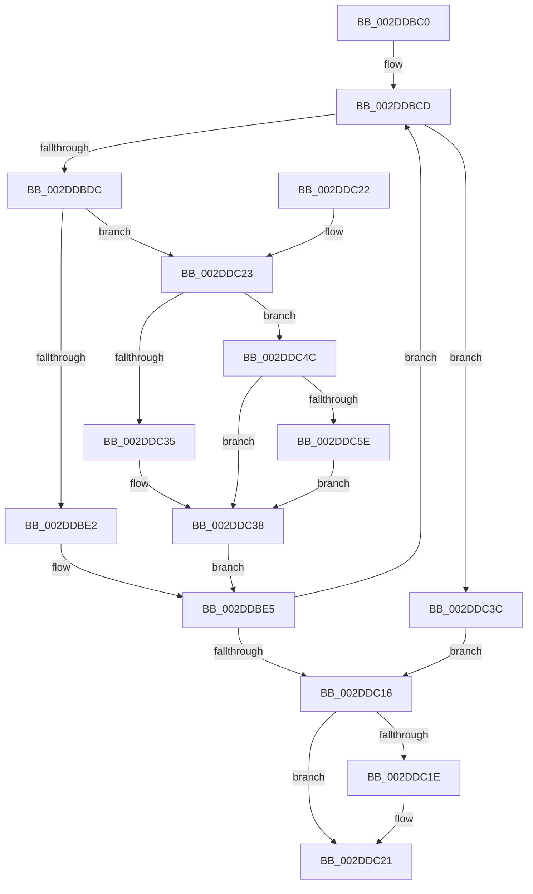

# HvlGetReferenceTimeUsingTscPage

- RVA: `0x002DDBC0`–`0x002DDC63` (길이 `163` bytes)
- VA: `0x00000001402DDBC0`
- 실행 섹션: `.text`
- PDB 이름 있음: `예`; PDB Function 태그: `아니요`
- unwind 정보 RVA: `0x000DB714`
- 디코드: `43`개 명령, `163/163` bytes 표시
- 미해석 바이트: `0` (있으면 어셈블리에 `.byte`로 보존)

> 이 문서는 커널 이미지의 기계어와 PDB 기호를 분석해 생성했습니다. 4번과 5번은 함수 원형과 자료형을 바이너리 사용 방식에서 추정한 C 해석이며 원본 소스 복구 결과는 아닙니다.

## 1. Dependencies

- 직접 호출 지점: **0**; 고유 호출 대상: **0**
- 직접 호출자로 확인된 함수: **2**
- RIP 상대 이미지 참조: **1**

### Outgoing calls
- 직접 디코드된 call 명령이 없습니다.

### Direct callers
- [HvlGetReferenceTime](HvlGetReferenceTime_function_002DDB88.md) at `0x002DDB9A`
- [PpmUpdatePerformanceFeedback](PpmUpdatePerformanceFeedback_function_002DE580.md) at `0x002DE6C4`
- [PpmUpdatePerformanceFeedback](PpmUpdatePerformanceFeedback_function_002DE580.md) at `0x002DE8FE`
- [PpmUpdatePerformanceFeedback](PpmUpdatePerformanceFeedback_function_002DE580.md) at `0x002DED6A`

### Static image references
- `0x002DDBCD` → RVA `0x00FC6D88` (`ALMOSTRO`; read)

## 2. Other-region calls and transfers

- 다른 실행 섹션으로 향하는 call: **0**
- 별도 외부 분기/꼬리 이동을 확인하지 못했습니다.

## 3. Assembly (complete function range)

```asm
002DDBC0  4C 8B D1                        mov r10, rcx
002DDBC3  49 BB 94 02 00 00 80 F7 FF FF   movabs r11, 0xfffff78000000294
002DDBCD  4C 8B 05 B4 91 CE 00            mov r8, qword ptr [rip + 0xce91b4]
002DDBD4  45 8B 00                        mov r8d, dword ptr [r8]
002DDBD7  45 85 C0                        test r8d, r8d
002DDBDA  74 60                           je 0x1402ddc3c
002DDBDC  41 80 3B 00                     cmp byte ptr [r11], 0
002DDBE0  74 41                           je 0x1402ddc23
002DDBE2  0F 01 F9                        rdtscp
002DDBE5  48 C1 E2 20                     shl rdx, 0x20
002DDBE9  48 0B D0                        or rdx, rax
002DDBEC  48 8B 05 95 91 CE 00            mov rax, qword ptr [rip + 0xce9195]
002DDBF3  48 8B 40 08                     mov rax, qword ptr [rax + 8]
002DDBF7  48 8B 0D 8A 91 CE 00            mov rcx, qword ptr [rip + 0xce918a]
002DDBFE  48 F7 E2                        mul rdx
002DDC01  4C 8B 49 10                     mov r9, qword ptr [rcx + 0x10]
002DDC05  48 8B 05 7C 91 CE 00            mov rax, qword ptr [rip + 0xce917c]
002DDC0C  49 03 D1                        add rdx, r9
002DDC0F  8B 08                           mov ecx, dword ptr [rax]
002DDC11  41 3B C8                        cmp ecx, r8d
002DDC14  75 B7                           jne 0x1402ddbcd
002DDC16  48 8B C2                        mov rax, rdx
002DDC19  4D 85 D2                        test r10, r10
002DDC1C  74 03                           je 0x1402ddc21
002DDC1E  45 89 02                        mov dword ptr [r10], r8d
002DDC21  C3                              ret
002DDC22  CC                              int3
002DDC23  65 48 8B 04 25 20 00 00 00      mov rax, qword ptr gs:[0x20]
002DDC2C  80 B8 8D 00 00 00 02            cmp byte ptr [rax + 0x8d], 2
002DDC33  75 17                           jne 0x1402ddc4c
002DDC35  0F AE E8                        lfence
002DDC38  0F 31                           rdtsc
002DDC3A  EB A9                           jmp 0x1402ddbe5
002DDC3C  B9 20 00 00 40                  mov ecx, 0x40000020
002DDC41  0F 32                           rdmsr
002DDC43  48 C1 E2 20                     shl rdx, 0x20
002DDC47  48 0B D0                        or rdx, rax
002DDC4A  EB CA                           jmp 0x1402ddc16
002DDC4C  65 48 8B 04 25 20 00 00 00      mov rax, qword ptr gs:[0x20]
002DDC55  80 B8 8D 00 00 00 01            cmp byte ptr [rax + 0x8d], 1
002DDC5C  75 DA                           jne 0x1402ddc38
002DDC5E  0F AE F0                        mfence
002DDC61  EB D5                           jmp 0x1402ddc38
```

## 4. C-style interpretation (structured pseudocode)

```c
__int64 __fastcall HvlGetReferenceTimeUsingTscPage(__int64 a1, __int64 a2)
{
loc_002DDBCD:
    if ((unsigned int)((unsigned int)(*(unsigned int *)(*(unsigned __int64 *)(v_rip + 13537716)))) == 0) goto loc_002DDC3C;
    if ((*(unsigned __int8 *)(v_r11)) == 0) goto loc_002DDC23;
loc_002DDBE5:
    a2 = (a2) << (32);
    a2 = (a2) | (result);
    a2 = (a2) + (*(unsigned __int64 *)(*(unsigned __int64 *)(v_rip + 13537674) + 16));
    if (((unsigned int)((unsigned int)(*(unsigned int *)(*(unsigned __int64 *)(v_rip + 13537660))))) != ((unsigned int)((unsigned int)(*(unsigned int *)(*(unsigned __int64 *)(v_rip + 13537716)))))) goto loc_002DDBCD;
loc_002DDC16:
    if (a1 != 0) {
        *(unsigned int *)(a1) = (unsigned int)((unsigned int)(*(unsigned int *)(*(unsigned __int64 *)(v_rip + 13537716))));
    }
    return a2;
loc_002DDC23:
    if ((*(unsigned __int8 *)(*(unsigned __int64 *)(gs_base + (0 + 32)) + 141)) != 2) goto loc_002DDC4C;
loc_002DDC38:
    goto loc_002DDBE5;
loc_002DDC3C:
    a2 = (a2) << (32);
    a2 = (a2) | (*(unsigned __int64 *)(gs_base + (0 + 32)));
    goto loc_002DDC16;
loc_002DDC4C:
    if ((*(unsigned __int8 *)(*(unsigned __int64 *)(gs_base + (0 + 32)) + 141)) != 1) goto loc_002DDC38;
    goto loc_002DDC38;
}
```

## 5. (Beta) C Style

```c
int64_t HvlGetReferenceTimeUsingTscPage(int64_t Arg1, int64_t Arg2)
{
loc_002DDBCD:
    if ((uint32_t)((uint32_t)(*(uint32_t *)(*(uint64_t *)(v_rip + 0xCE91B4)))) == 0) goto loc_002DDC3C;
    if ((*(uint8_t *)(local_r11)) == 0) goto loc_002DDC23;
loc_002DDBE5:
    Arg2 = (Arg2) << (32);
    Arg2 = (Arg2) | (result);
    Arg2 = (Arg2) + (*(uint64_t *)(*(uint64_t *)(v_rip + 0xCE918A) + 0x10));
    if (((uint32_t)((uint32_t)(*(uint32_t *)(*(uint64_t *)(v_rip + 0xCE917C))))) != ((uint32_t)((uint32_t)(*(uint32_t *)(*(uint64_t *)(v_rip + 0xCE91B4)))))) goto loc_002DDBCD;
loc_002DDC16:
    if (Arg1 != 0) {
        *(uint32_t *)(Arg1) = (uint32_t)((uint32_t)(*(uint32_t *)(*(uint64_t *)(v_rip + 0xCE91B4))));
    }
    return Arg2;
loc_002DDC23:
    if ((*(uint8_t *)(*(uint64_t *)(gs_base + (0 + 0x20)) + 0x8D)) != 2) goto loc_002DDC4C;
loc_002DDC38:
    goto loc_002DDBE5;
loc_002DDC3C:
    Arg2 = (Arg2) << (32);
    Arg2 = (Arg2) | (*(uint64_t *)(gs_base + (0 + 0x20)));
    goto loc_002DDC16;
loc_002DDC4C:
    if ((*(uint8_t *)(*(uint64_t *)(gs_base + (0 + 0x20)) + 0x8D)) != 1) goto loc_002DDC38;
    goto loc_002DDC38;
}
```

## 6. Execution-region graph

[열기: 2D/3D 그래프와 함수 탐색 컨트롤 패널](../../../control-panel.html?section=text&rva=0x002DDBC0&view=graph)

- 2D 그래프는 위에서 아래로 흐르고, 3D 그래프는 빈 공간을 드래그해 회전합니다. Shift+드래그는 이동, 휠은 확대·축소, 함수 노드 선택은 대상 보고서 이동입니다.

### Static fallback


