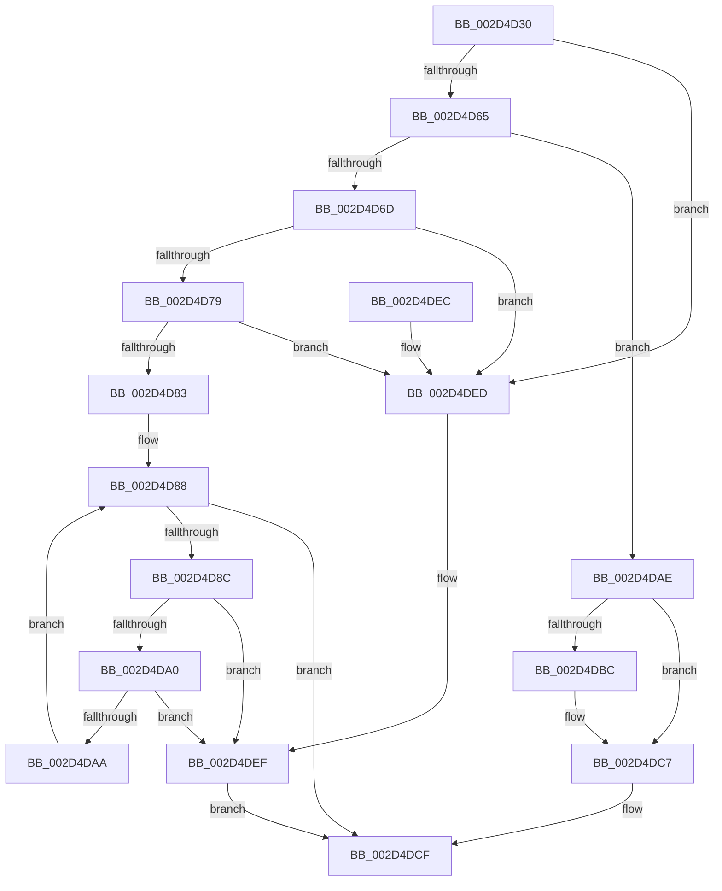

# IntPartIsInterruptSteerable

- RVA: `0x002D4D30`–`0x002D4DF3` (길이 `195` bytes)
- VA: `0x00000001402D4D30`
- 실행 섹션: `.text`
- PDB 이름 있음: `예`; PDB Function 태그: `아니요`
- unwind 정보 RVA: `0x0006FC04`
- 디코드: `60`개 명령, `195/195` bytes 표시
- 미해석 바이트: `0` (있으면 어셈블리에 `.byte`로 보존)

> 이 문서는 커널 이미지의 기계어와 PDB 기호를 분석해 생성했습니다. 4번과 5번은 함수 원형과 자료형을 바이너리 사용 방식에서 추정한 C 해석이며 원본 소스 복구 결과는 아닙니다.

## 1. Dependencies

- 직접 호출 지점: **1**; 고유 호출 대상: **1**
- 직접 호출자로 확인된 함수: **1**
- RIP 상대 이미지 참조: **4**

### Outgoing calls
- `0x002D4D95` → [KeQueryInterruptPartitionInformation](KeQueryInterruptPartitionInformation_function_002D54E0.md) (function, `0x002D54E0`)

### Direct callers
- [KeIntSteerGetSteeringMode](KeIntSteerGetSteeringMode_function_002D4CA4.md) at `0x002D4CD1`

### Static image references
- `0x002D4D65` → RVA `0x00F10E60` (`.data`; read)
- `0x002D4D6D` → RVA `0x00F10E68` (`.data`; read)
- `0x002D4DAE` → RVA `0x00FC7120` (`ALMOSTRO`; read)
- `0x002D4DBC` → RVA `0x00FC7128` (`ALMOSTRO`; read)

## 2. Other-region calls and transfers

- 다른 실행 섹션으로 향하는 call: **0**
- 별도 외부 분기/꼬리 이동을 확인하지 못했습니다.

## 3. Assembly (complete function range)

```asm
002D4D30  48 8B C4                        mov rax, rsp
002D4D33  48 89 58 08                     mov qword ptr [rax + 8], rbx
002D4D37  48 89 68 10                     mov qword ptr [rax + 0x10], rbp
002D4D3B  48 89 70 18                     mov qword ptr [rax + 0x18], rsi
002D4D3F  48 89 78 20                     mov qword ptr [rax + 0x20], rdi
002D4D43  41 56                           push r14
002D4D45  48 83 EC 30                     sub rsp, 0x30
002D4D49  0F 57 C0                        xorps xmm0, xmm0
002D4D4C  33 DB                           xor ebx, ebx
002D4D4E  0F 11 40 E8                     movups xmmword ptr [rax - 0x18], xmm0
002D4D52  0F B7 41 08                     movzx eax, word ptr [rcx + 8]
002D4D56  48 8B FA                        mov rdi, rdx
002D4D59  4C 8B F1                        mov r14, rcx
002D4D5C  66 85 C0                        test ax, ax
002D4D5F  0F 85 88 00 00 00               jne 0x1402d4ded
002D4D65  38 1D F5 C0 C3 00               cmp byte ptr [rip + 0xc3c0f5], bl
002D4D6B  74 41                           je 0x1402d4dae
002D4D6D  48 8B 05 F4 C0 C3 00            mov rax, qword ptr [rip + 0xc3c0f4]
002D4D74  48 85 C0                        test rax, rax
002D4D77  74 74                           je 0x1402d4ded
002D4D79  0F B6 68 02                     movzx ebp, byte ptr [rax + 2]
002D4D7D  8B D3                           mov edx, ebx
002D4D7F  85 ED                           test ebp, ebp
002D4D81  74 6A                           je 0x1402d4ded
002D4D83  C6 07 01                        mov byte ptr [rdi], 1
002D4D86  8B F3                           mov esi, ebx
002D4D88  3B F5                           cmp esi, ebp
002D4D8A  73 43                           jae 0x1402d4dcf
002D4D8C  33 C9                           xor ecx, ecx
002D4D8E  4C 8D 44 24 20                  lea r8, [rsp + 0x20]
002D4D93  8B D6                           mov edx, esi
002D4D95  E8 46 07 00 00                  call 0x1402d54e0
002D4D9A  8B D0                           mov edx, eax
002D4D9C  85 C0                           test eax, eax
002D4D9E  78 4F                           js 0x1402d4def
002D4DA0  49 8B 0E                        mov rcx, qword ptr [r14]
002D4DA3  48 85 4C 24 20                  test qword ptr [rsp + 0x20], rcx
002D4DA8  74 45                           je 0x1402d4def
002D4DAA  FF C6                           inc esi
002D4DAC  EB DA                           jmp 0x1402d4d88
002D4DAE  66 3B 05 6B 23 CF 00            cmp ax, word ptr [rip + 0xcf236b]
002D4DB5  BA 03 01 00 00                  mov edx, 0x103
002D4DBA  73 0B                           jae 0x1402d4dc7
002D4DBC  48 8D 1D 65 23 CF 00            lea rbx, [rip + 0xcf2365]
002D4DC3  48 8B 1C C3                     mov rbx, qword ptr [rbx + rax*8]
002D4DC7  48 3B 19                        cmp rbx, qword ptr [rcx]
002D4DCA  0F 94 C0                        sete al
002D4DCD  88 07                           mov byte ptr [rdi], al
002D4DCF  48 8B 5C 24 40                  mov rbx, qword ptr [rsp + 0x40]
002D4DD4  8B C2                           mov eax, edx
002D4DD6  48 8B 6C 24 48                  mov rbp, qword ptr [rsp + 0x48]
002D4DDB  48 8B 74 24 50                  mov rsi, qword ptr [rsp + 0x50]
002D4DE0  48 8B 7C 24 58                  mov rdi, qword ptr [rsp + 0x58]
002D4DE5  48 83 C4 30                     add rsp, 0x30
002D4DE9  41 5E                           pop r14
002D4DEB  C3                              ret
002D4DEC  CC                              int3
002D4DED  8B D3                           mov edx, ebx
002D4DEF  88 1F                           mov byte ptr [rdi], bl
002D4DF1  EB DC                           jmp 0x1402d4dcf
```

## 4. C-style interpretation (structured pseudocode)

```c
__int64 __fastcall IntPartIsInterruptSteerable(__int64 a1, __int64 a2)
{
    __int64 result;
    __int64 v_rbx;
    __int64 v_rsi;
    __int64 v_rsp;
    unsigned __int64 v_stack_m18;
    unsigned __int64 v_stack_p10;
    unsigned __int64 v_stack_p18;
    unsigned __int64 v_stack_p20;
    unsigned __int64 v_stack_p8;

    *(unsigned __int64 *)(v_rsp + 8) = v_rbx;
    *(unsigned __int64 *)(v_rsp + 16) = v_rbp;
    *(unsigned __int64 *)(v_rsp + 24) = v_rsi;
    *(unsigned __int64 *)(v_rsp + 32) = v_rdi;
    v_rsp = (v_rsp) - (48);
    v_rbx = 0;
    *(unsigned __int64 *)(v_rsp - 24) = v_xmm0;
    if ((unsigned __int16)(*(unsigned __int16 *)(a1 + 8)) != 0) goto loc_002D4DED;
    if ((*(unsigned __int8 *)(v_rip + 12828917)) == 0) goto loc_002D4DAE;
    if (*(unsigned __int64 *)(v_rip + 12828916) == 0) goto loc_002D4DED;
    if ((unsigned int)(*(unsigned __int8 *)(*(unsigned __int64 *)(v_rip + 12828916) + 2)) == 0) goto loc_002D4DED;
    *(unsigned __int8 *)(a2) = 1;
loc_002D4D88:
    if (0 >= ((unsigned int)(*(unsigned __int8 *)(*(unsigned __int64 *)(v_rip + 12828916) + 2)))) goto loc_002D4DCF;
    a1 = 0;
    result = KeQueryInterruptPartitionInformation(a1, 0, v_stack_m18, a4);
    if (sign_flag) goto loc_002D4DEF;
    if (((v_stack_m18) & (*(unsigned __int64 *)(a1))) == 0) goto loc_002D4DEF;
    v_rsi = (unsigned int)((0) + 1);
    goto loc_002D4D88;
loc_002D4DAE:
    if (((unsigned __int16)(result)) < (*(unsigned __int16 *)(v_rip + 13575019))) {
        v_rbx = v_rip + 13575013;
        v_rbx = *(unsigned __int64 *)(v_rbx + result * 8);
    }
    result = (v_rbx == (*(unsigned __int64 *)(*(unsigned __int64 *)(a1)))) ? 1 : 0;
    *(unsigned __int8 *)(a2) = (unsigned __int8)(result);
loc_002D4DCF:
    v_rsp = (v_rsp) + (48);
    return 259;
loc_002D4DED:
loc_002D4DEF:
    *(unsigned __int8 *)(v_stack_p20) = (unsigned __int8)(v_stack_p8);
    goto loc_002D4DCF;
}
```

## 5. (Beta) C Style

```c
int64_t IntPartIsInterruptSteerable(void *Arg1, void *Arg2)
{
    uint8_t *arg1 = (uint8_t *)Arg1;
    uint8_t *arg2 = (uint8_t *)Arg2;

    int64_t result;
    int64_t local_rbx;
    int64_t local_rsi;
    int64_t local_rsp;
    uint64_t v_stack_m18;
    uint64_t v_stack_p10;
    uint64_t v_stack_p18;
    uint64_t v_stack_p20;
    uint64_t v_stack_p8;

    *(uint64_t *)(local_rsp + 0x8) = local_rbx;
    *(uint64_t *)(local_rsp + 0x10) = local_rbp;
    *(uint64_t *)(local_rsp + 0x18) = local_rsi;
    *(uint64_t *)(local_rsp + 0x20) = local_rdi;
    local_rsp = (local_rsp) - (48);
    local_rbx = 0;
    *(uint64_t *)(local_rsp - 0x18) = v_xmm0;
    if ((uint16_t)(*(uint16_t *)(arg1 + 0x8)) != 0) goto loc_002D4DED;
    if ((*(uint8_t *)(v_rip + 0xC3C0F5)) == 0) goto loc_002D4DAE;
    if (*(uint64_t *)(v_rip + 0xC3C0F4) == 0) goto loc_002D4DED;
    if ((uint32_t)(*(uint8_t *)(*(uint64_t *)(v_rip + 0xC3C0F4) + 0x2)) == 0) goto loc_002D4DED;
    *(uint8_t *)(arg2) = 1;
loc_002D4D88:
    if (0 >= ((uint32_t)(*(uint8_t *)(*(uint64_t *)(v_rip + 0xC3C0F4) + 0x2)))) goto loc_002D4DCF;
    Arg1 = 0;
    result = KeQueryInterruptPartitionInformation(Arg1, 0, v_stack_m18, a4);
    if (sign_flag) goto loc_002D4DEF;
    if (((v_stack_m18) & (*(uint64_t *)(arg1))) == 0) goto loc_002D4DEF;
    local_rsi = (uint32_t)((0) + 1);
    goto loc_002D4D88;
loc_002D4DAE:
    if (((uint16_t)(result)) < (*(uint16_t *)(v_rip + 0xCF236B))) {
        local_rbx = v_rip + 13575013;
        local_rbx = *(uint64_t *)(local_rbx + result * 8);
    }
    result = (local_rbx == (*(uint64_t *)(*(uint64_t *)(arg1)))) ? 1 : 0;
    *(uint8_t *)(arg2) = (uint8_t)(result);
loc_002D4DCF:
    local_rsp = (local_rsp) + (48);
    return 259;
loc_002D4DED:
loc_002D4DEF:
    *(uint8_t *)(v_stack_p20) = (uint8_t)(v_stack_p8);
    goto loc_002D4DCF;
}
```

### 관측된 메모리 오프셋

구조체 형식이 확인되지 않은 접근은 인자 기준의 오프셋으로만 기록했습니다.

| 기준 인자 | 오프셋 표현 | 폭 (bit) | 접근 |
|---|---:|---:|---|
| `Arg1` | `+ 0x0` | `64` | `R` |
| `Arg1` | `+ 0x8` | `16` | `R` |
| `Arg2` | `+ 0x0` | `8` | `W` |

## 6. Execution-region graph

[열기: 2D/3D 그래프와 함수 탐색 컨트롤 패널](../../../control-panel.html?section=text&rva=0x002D4D30&view=graph)

- 2D 그래프는 위에서 아래로 흐르고, 3D 그래프는 빈 공간을 드래그해 회전합니다. Shift+드래그는 이동, 휠은 확대·축소, 함수 노드 선택은 대상 보고서 이동입니다.

### Static fallback


