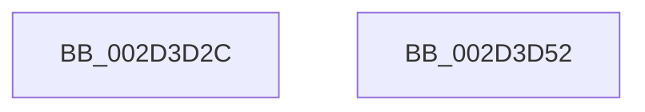

# IopMaskInterrupt

- RVA: `0x002D3D2C`–`0x002D3D53` (길이 `39` bytes)
- VA: `0x00000001402D3D2C`
- 실행 섹션: `.text`
- PDB 이름 있음: `예`; PDB Function 태그: `아니요`
- unwind 정보 RVA: `0x0005C788`
- 디코드: `9`개 명령, `39/39` bytes 표시
- 미해석 바이트: `0` (있으면 어셈블리에 `.byte`로 보존)

> 이 문서는 커널 이미지의 기계어와 PDB 기호를 분석해 생성했습니다. 4번과 5번은 함수 원형과 자료형을 바이너리 사용 방식에서 추정한 C 해석이며 원본 소스 복구 결과는 아닙니다.

## 1. Dependencies

- 직접 호출 지점: **1**; 고유 호출 대상: **1**
- 직접 호출자로 확인된 함수: **2**
- RIP 상대 이미지 참조: **0**

### Outgoing calls
- `0x002D3D48` → [KeMaskInterrupt](KeMaskInterrupt_function_002D42FC.md) (function, `0x002D42FC`)

### Direct callers
- [IoReportInterruptInactive](../4B/IoReportInterruptInactive_function_004B02E0.md) at `0x004B0306`
- [sub_006FB1D2](../6F/Unknown_function_006FB1D2.md) at `0x006FB1E0`
- [sub_006FB1D2](../6F/Unknown_function_006FB1D2.md) at `0x006FB1FF`

### Static image references
- 디코드된 RIP-relative 메모리 참조가 없습니다.

## 2. Other-region calls and transfers

- 다른 실행 섹션으로 향하는 call: **0**
- 별도 외부 분기/꼬리 이동을 확인하지 못했습니다.

## 3. Assembly (complete function range)

```asm
002D3D2C  48 83 EC 28                     sub rsp, 0x28
002D3D30  F3 48 0F B8 51 98               popcnt rdx, qword ptr [rcx - 0x68]
002D3D36  4C 8D 89 40 01 00 00            lea r9, [rcx + 0x140]
002D3D3D  4C 8D 41 A0                     lea r8, [rcx - 0x60]
002D3D41  48 81 C1 88 01 00 00            add rcx, 0x188
002D3D48  E8 AF 05 00 00                  call 0x1402d42fc
002D3D4D  48 83 C4 28                     add rsp, 0x28
002D3D51  C3                              ret
002D3D52  CC                              int3
```

## 4. C-style interpretation (structured pseudocode)

```c
__int64 __fastcall IopMaskInterrupt(__int64 a1)
{
    __int64 result;
    __int64 v_rsp;

    v_rsp = (v_rsp) - (40);
    a1 = (a1) + (392);
    result = KeMaskInterrupt(a1, a2, a1 - 96, a1 + 320);
    v_rsp = (v_rsp) + (40);
    return result;
}
```

## 5. (Beta) C Style

```c
int64_t IopMaskInterrupt(void *Arg1)
{
    uint8_t *arg1 = (uint8_t *)Arg1;

    int64_t result;
    int64_t local_rsp;

    local_rsp = (local_rsp) - (40);
    Arg1 = (Arg1) + (392);
    result = KeMaskInterrupt(Arg1, a2, Arg1 - 96, Arg1 + 320);
    local_rsp = (local_rsp) + (40);
    return result;
}
```

### 관측된 메모리 오프셋

구조체 형식이 확인되지 않은 접근은 인자 기준의 오프셋으로만 기록했습니다.

| 기준 인자 | 오프셋 표현 | 폭 (bit) | 접근 |
|---|---:|---:|---|
| `Arg1` | `- 0x68` | `64` | `R` |
| `Arg1` | `- 0x60` | `64` | `R` |
| `Arg1` | `+ 0x140` | `64` | `R` |

## 6. Execution-region graph

[열기: 2D/3D 그래프와 함수 탐색 컨트롤 패널](../../../control-panel.html?section=text&rva=0x002D3D2C&view=graph)

- 2D 그래프는 위에서 아래로 흐르고, 3D 그래프는 빈 공간을 드래그해 회전합니다. Shift+드래그는 이동, 휠은 확대·축소, 함수 노드 선택은 대상 보고서 이동입니다.

### Static fallback


