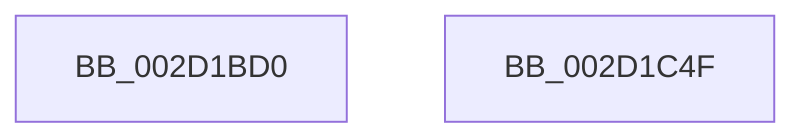

# IvtFlushDomainTb

- RVA: `0x002D1BD0`–`0x002D1C50` (길이 `128` bytes)
- VA: `0x00000001402D1BD0`
- 실행 섹션: `.text`
- PDB 이름 있음: `예`; PDB Function 태그: `아니요`
- unwind 정보 RVA: `0x0006F874`
- 디코드: `33`개 명령, `128/128` bytes 표시
- 미해석 바이트: `0` (있으면 어셈블리에 `.byte`로 보존)

> 이 문서는 커널 이미지의 기계어와 PDB 기호를 분석해 생성했습니다. 4번과 5번은 함수 원형과 자료형을 바이너리 사용 방식에서 추정한 C 해석이며 원본 소스 복구 결과는 아닙니다.

## 1. Dependencies

- 직접 호출 지점: **3**; 고유 호출 대상: **3**
- 직접 호출자로 확인된 함수: **0**
- RIP 상대 이미지 참조: **0**

### Outgoing calls
- `0x002D1BF1` → [HalpAcquireHighLevelLock](HalpAcquireHighLevelLock_function_002D2390.md) (function, `0x002D2390`)
- `0x002D1C29` → [IvtFlushTbInternal](IvtFlushTbInternal_function_002D2548.md) (function, `0x002D2548`)
- `0x002D1C35` → [HalpReleaseHighLevelLock](HalpReleaseHighLevelLock_function_002D1C58.md) (function, `0x002D1C58`)

### Direct callers
- 이 함수 시작 RVA로 연결되는 직접 call은 확인되지 않았습니다. 간접 호출은 완전히 역산할 수 없습니다.

### Static image references
- 디코드된 RIP-relative 메모리 참조가 없습니다.

## 2. Other-region calls and transfers

- 다른 실행 섹션으로 향하는 call: **0**
- 별도 외부 분기/꼬리 이동을 확인하지 못했습니다.

## 3. Assembly (complete function range)

```asm
002D1BD0  48 89 5C 24 08                  mov qword ptr [rsp + 8], rbx
002D1BD5  48 89 6C 24 10                  mov qword ptr [rsp + 0x10], rbp
002D1BDA  48 89 74 24 18                  mov qword ptr [rsp + 0x18], rsi
002D1BDF  57                              push rdi
002D1BE0  48 83 EC 50                     sub rsp, 0x50
002D1BE4  48 8B F9                        mov rdi, rcx
002D1BE7  41 8B D9                        mov ebx, r9d
002D1BEA  48 8D 4A 58                     lea rcx, [rdx + 0x58]
002D1BEE  48 8B EA                        mov rbp, rdx
002D1BF1  E8 9A 07 00 00                  call 0x1402d2390
002D1BF6  4C 8D 45 38                     lea r8, [rbp + 0x38]
002D1BFA  88 45 60                        mov byte ptr [rbp + 0x60], al
002D1BFD  48 8B 84 24 80 00 00 00         mov rax, qword ptr [rsp + 0x80]
002D1C05  4C 8B CD                        mov r9, rbp
002D1C08  48 89 44 24 40                  mov qword ptr [rsp + 0x40], rax
002D1C0D  33 D2                           xor edx, edx
002D1C0F  89 5C 24 38                     mov dword ptr [rsp + 0x38], ebx
002D1C13  48 8B CF                        mov rcx, rdi
002D1C16  4C 89 44 24 30                  mov qword ptr [rsp + 0x30], r8
002D1C1B  45 33 C0                        xor r8d, r8d
002D1C1E  48 83 64 24 28 00               and qword ptr [rsp + 0x28], 0
002D1C24  C6 44 24 20 01                  mov byte ptr [rsp + 0x20], 1
002D1C29  E8 1A 09 00 00                  call 0x1402d2548
002D1C2E  8A 55 60                        mov dl, byte ptr [rbp + 0x60]
002D1C31  48 8D 4D 58                     lea rcx, [rbp + 0x58]
002D1C35  E8 1E 00 00 00                  call 0x1402d1c58
002D1C3A  48 8B 5C 24 60                  mov rbx, qword ptr [rsp + 0x60]
002D1C3F  48 8B 6C 24 68                  mov rbp, qword ptr [rsp + 0x68]
002D1C44  48 8B 74 24 70                  mov rsi, qword ptr [rsp + 0x70]
002D1C49  48 83 C4 50                     add rsp, 0x50
002D1C4D  5F                              pop rdi
002D1C4E  C3                              ret
002D1C4F  CC                              int3
```

## 4. C-style interpretation (structured pseudocode)

```c
__int64 __fastcall IvtFlushDomainTb(__int64 a1, __int64 a2, __int64 a3, int a4, __int64 a5)
{
    __int64 result;
    __int64 v_rsp;
    unsigned __int64 v_stack_m18;
    unsigned int v_stack_m20;
    unsigned __int64 v_stack_m28;
    unsigned __int64 v_stack_m30;
    unsigned __int8 v_stack_m38;
    unsigned __int64 v_stack_p10;
    unsigned __int64 v_stack_p18;
    unsigned __int64 v_stack_p8;

    v_stack_p8 = v_rbx;
    v_stack_p10 = v_rbp;
    v_stack_p18 = v_rsi;
    v_rsp = (v_rsp) - (80);
    result = HalpAcquireHighLevelLock(a2 + 88, a2, a3, a4);
    *(unsigned __int8 *)(a2 + 96) = (unsigned __int8)(result);
    v_stack_m18 = a5;
    a2 = 0;
    v_stack_m20 = (unsigned int)((unsigned int)(a4));
    v_stack_m28 = a2 + 56;
    a3 = 0;
    v_stack_m38 = 1;
    result = IvtFlushTbInternal(a1, a2, a3, a2);
    result = HalpReleaseHighLevelLock(a2 + 88, *(unsigned __int8 *)(a2 + 96), a3, a2);
    v_rsp = (v_rsp) + (80);
    return result;
}
```

## 5. (Beta) C Style

```c
int64_t IvtFlushDomainTb(int64_t Arg1, void *Arg2, int64_t Arg3, int32_t Arg4, int64_t Arg5)
{
    uint8_t *arg2 = (uint8_t *)Arg2;

    int64_t result;
    int64_t local_rsp;
    uint64_t v_stack_m18;
    uint32_t v_stack_m20;
    uint64_t v_stack_m28;
    uint64_t v_stack_m30;
    uint8_t v_stack_m38;
    uint64_t v_stack_p10;
    uint64_t v_stack_p18;
    uint64_t v_stack_p8;

    v_stack_p8 = local_rbx;
    v_stack_p10 = local_rbp;
    v_stack_p18 = local_rsi;
    local_rsp = (local_rsp) - (80);
    result = HalpAcquireHighLevelLock(Arg2 + 88, Arg2, Arg3, Arg4);
    *(uint8_t *)(arg2 + 0x60) = (uint8_t)(result);
    v_stack_m18 = Arg5;
    Arg2 = 0;
    v_stack_m20 = (uint32_t)((uint32_t)(Arg4));
    v_stack_m28 = Arg2 + 56;
    Arg3 = 0;
    v_stack_m38 = 1;
    result = IvtFlushTbInternal(Arg1, Arg2, Arg3, Arg2);
    result = HalpReleaseHighLevelLock(Arg2 + 88, *(uint8_t *)(arg2 + 0x60), Arg3, Arg2);
    local_rsp = (local_rsp) + (80);
    return result;
}
```

### 관측된 메모리 오프셋

구조체 형식이 확인되지 않은 접근은 인자 기준의 오프셋으로만 기록했습니다.

| 기준 인자 | 오프셋 표현 | 폭 (bit) | 접근 |
|---|---:|---:|---|
| `Arg2` | `+ 0x38` | `64` | `R` |
| `Arg2` | `+ 0x58` | `64` | `R` |
| `Arg2` | `+ 0x60` | `8` | `R` |
| `Arg2` | `+ 0x60` | `8` | `W` |

## 6. Execution-region graph

[열기: 2D/3D 그래프와 함수 탐색 컨트롤 패널](../../../control-panel.html?section=text&rva=0x002D1BD0&view=graph)

- 2D 그래프는 위에서 아래로 흐르고, 3D 그래프는 빈 공간을 드래그해 회전합니다. Shift+드래그는 이동, 휠은 확대·축소, 함수 노드 선택은 대상 보고서 이동입니다.

### Static fallback


