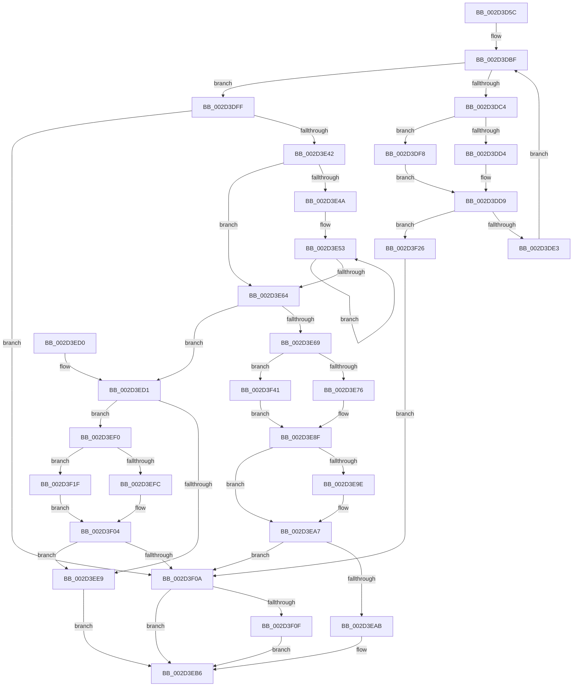

# KeConnectInterrupt

- RVA: `0x002D3D5C`–`0x002D3F4F` (길이 `499` bytes)
- VA: `0x00000001402D3D5C`
- 실행 섹션: `.text`
- PDB 이름 있음: `예`; PDB Function 태그: `아니요`
- unwind 정보 RVA: `0x0006FAE8`
- 디코드: `143`개 명령, `499/499` bytes 표시
- 미해석 바이트: `0` (있으면 어셈블리에 `.byte`로 보존)

> 이 문서는 커널 이미지의 기계어와 PDB 기호를 분석해 생성했습니다. 4번과 5번은 함수 원형과 자료형을 바이너리 사용 방식에서 추정한 C 해석이며 원본 소스 복구 결과는 아닙니다.

## 1. Dependencies

- 직접 호출 지점: **13**; 고유 호출 대상: **12**
- 직접 호출자로 확인된 함수: **1**
- RIP 상대 이미지 참조: **1**

### Outgoing calls
- `0x002D3D96` → [KiIsInterruptTypeSecondary](KiIsInterruptTypeSecondary_function_002D44BC.md) (function, `0x002D44BC`)
- `0x002D3DAE` → [KiSetSystemPriorityThread](KiSetSystemPriorityThread_function_002D9FF8.md) (function, `0x002D9FF8`)
- `0x002D3DD4` → [KiConnectInterrupt](KiConnectInterrupt_function_002D3F58.md) (function, `0x002D3F58`)
- `0x002D3DF8` → [KiConnectSecondaryInterrupt](KiConnectSecondaryInterrupt_function_002D4200.md) (function, `0x002D4200`)
- `0x002D3E13` → [KiClearSystemPriority](../2C/KiClearSystemPriority_function_002C05A8.md) (function, `0x002C05A8`)
- `0x002D3E33` → [KiIntSteerConnect](KiIntSteerConnect_function_002D44F0.md) (function, `0x002D44F0`)
- `0x002D3E92` → [HalEnableInterrupt](HalEnableInterrupt_function_002D4990.md) (function, `0x002D4990`)
- `0x002D3EB1` → [KiIntSteerEnable](KiIntSteerEnable_function_002D4900.md) (function, `0x002D4900`)
- `0x002D3EE0` → [guard_dispatch_icall](../6B/guard_dispatch_icall_function_006BAAD0.md) (function, `0x006BAAD0`)
- `0x002D3EFF` → [KiUnmaskSecondaryInterruptInternal](../47/KiUnmaskSecondaryInterruptInternal_function_00479CC8.md) (function, `0x00479CC8`)
- `0x002D3F18` → [KeDisconnectInterrupt](KeDisconnectInterrupt_function_002D3588.md) (function, `0x002D3588`)
- `0x002D3F1F` → [KiUnmaskInterruptInternal](../47/KiUnmaskInterruptInternal_function_00479CA8.md) (function, `0x00479CA8`)
- `0x002D3F3A` → [KiClearSystemPriority](../2C/KiClearSystemPriority_function_002C05A8.md) (function, `0x002C05A8`)

### Direct callers
- [IopConnectInterrupt](../../page/90/IopConnectInterrupt_function_00900B40.md) at `0x00900C83`

### Static image references
- `0x002D3ED1` → RVA `0x00E00B40` (`.data`; read)

## 2. Other-region calls and transfers

- 다른 실행 섹션으로 향하는 call: **0**
- 별도 외부 분기/꼬리 이동을 확인하지 못했습니다.

## 3. Assembly (complete function range)

```asm
002D3D5C  48 89 5C 24 08                  mov qword ptr [rsp + 8], rbx
002D3D61  55                              push rbp
002D3D62  56                              push rsi
002D3D63  57                              push rdi
002D3D64  41 54                           push r12
002D3D66  41 55                           push r13
002D3D68  41 56                           push r14
002D3D6A  41 57                           push r15
002D3D6C  48 8B EC                        mov rbp, rsp
002D3D6F  48 83 EC 70                     sub rsp, 0x70
002D3D73  83 65 C0 00                     and dword ptr [rbp - 0x40], 0
002D3D77  4C 8B F1                        mov r14, rcx
002D3D7A  0F 57 C0                        xorps xmm0, xmm0
002D3D7D  44 0F B6 E2                     movzx r12d, dl
002D3D81  0F 57 C9                        xorps xmm1, xmm1
002D3D84  C6 45 48 00                     mov byte ptr [rbp + 0x48], 0
002D3D88  49 8B C8                        mov rcx, r8
002D3D8B  49 8B F0                        mov rsi, r8
002D3D8E  0F 11 45 E0                     movups xmmword ptr [rbp - 0x20], xmm0
002D3D92  0F 11 4D F0                     movups xmmword ptr [rbp - 0x10], xmm1
002D3D96  E8 21 07 00 00                  call 0x1402d44bc
002D3D9B  65 48 8B 0C 25 88 01 00 00      mov rcx, qword ptr gs:[0x188]
002D3DA4  BA 1F 00 00 00                  mov edx, 0x1f
002D3DA9  8A D8                           mov bl, al
002D3DAB  88 45 58                        mov byte ptr [rbp + 0x58], al
002D3DAE  E8 45 62 00 00                  call 0x1402d9ff8
002D3DB3  45 32 FF                        xor r15b, r15b
002D3DB6  41 BD 01 00 00 00               mov r13d, 1
002D3DBC  40 32 FF                        xor dil, dil
002D3DBF  41 3A FC                        cmp dil, r12b
002D3DC2  73 3B                           jae 0x1402d3dff
002D3DC4  40 0F B6 C7                     movzx eax, dil
002D3DC8  49 8B 0C C6                     mov rcx, qword ptr [r14 + rax*8]
002D3DCC  44 09 69 68                     or dword ptr [rcx + 0x68], r13d
002D3DD0  84 DB                           test bl, bl
002D3DD2  75 24                           jne 0x1402d3df8
002D3DD4  E8 7F 01 00 00                  call 0x1402d3f58
002D3DD9  8B D8                           mov ebx, eax
002D3DDB  85 C0                           test eax, eax
002D3DDD  0F 88 43 01 00 00               js 0x1402d3f26
002D3DE3  8A 5D 58                        mov bl, byte ptr [rbp + 0x58]
002D3DE6  3D 27 01 00 00                  cmp eax, 0x127
002D3DEB  45 0F B6 FF                     movzx r15d, r15b
002D3DEF  45 0F 44 FD                     cmove r15d, r13d
002D3DF3  41 02 FD                        add dil, r13b
002D3DF6  EB C7                           jmp 0x1402d3dbf
002D3DF8  E8 03 04 00 00                  call 0x1402d4200
002D3DFD  EB DA                           jmp 0x1402d3dd9
002D3DFF  65 48 8B 0C 25 88 01 00 00      mov rcx, qword ptr gs:[0x188]
002D3E08  48 8D 55 D0                     lea rdx, [rbp - 0x30]
002D3E0C  C7 45 D0 1F 00 00 00            mov dword ptr [rbp - 0x30], 0x1f
002D3E13  E8 90 C7 FE FF                  call 0x1402c05a8
002D3E18  48 8D 4D E0                     lea rcx, [rbp - 0x20]
002D3E1C  44 89 65 D8                     mov dword ptr [rbp - 0x28], r12d
002D3E20  48 89 4C 24 20                  mov qword ptr [rsp + 0x20], rcx
002D3E25  4C 8D 46 08                     lea r8, [rsi + 8]
002D3E29  49 8B CE                        mov rcx, r14
002D3E2C  4C 8D 4D 48                     lea r9, [rbp + 0x48]
002D3E30  41 8B D4                        mov edx, r12d
002D3E33  E8 B8 06 00 00                  call 0x1402d44f0
002D3E38  8B D8                           mov ebx, eax
002D3E3A  85 C0                           test eax, eax
002D3E3C  0F 88 C8 00 00 00               js 0x1402d3f0a
002D3E42  40 32 FF                        xor dil, dil
002D3E45  45 84 E4                        test r12b, r12b
002D3E48  74 1A                           je 0x1402d3e64
002D3E4A  49 8B CE                        mov rcx, r14
002D3E4D  49 8B FC                        mov rdi, r12
002D3E50  49 8B D4                        mov rdx, r12
002D3E53  48 8B 01                        mov rax, qword ptr [rcx]
002D3E56  F0 83 60 68 FE                  lock and dword ptr [rax + 0x68], 0xfffffffe
002D3E5B  48 8D 49 08                     lea rcx, [rcx + 8]
002D3E5F  49 2B D5                        sub rdx, r13
002D3E62  75 EF                           jne 0x1402d3e53
002D3E64  45 84 FF                        test r15b, r15b
002D3E67  75 68                           jne 0x1402d3ed1
002D3E69  44 8A 7D 48                     mov r15b, byte ptr [rbp + 0x48]
002D3E6D  45 84 FF                        test r15b, r15b
002D3E70  0F 84 CB 00 00 00               je 0x1402d3f41
002D3E76  0F B7 45 E8                     movzx eax, word ptr [rbp - 0x18]
002D3E7A  44 0F B7 66 28                  movzx r12d, word ptr [rsi + 0x28]
002D3E7F  4C 8B 6E 20                     mov r13, qword ptr [rsi + 0x20]
002D3E83  66 89 46 28                     mov word ptr [rsi + 0x28], ax
002D3E87  48 8B 45 E0                     mov rax, qword ptr [rbp - 0x20]
002D3E8B  48 89 46 20                     mov qword ptr [rsi + 0x20], rax
002D3E8F  48 8B CE                        mov rcx, rsi
002D3E92  E8 F9 0A 00 00                  call 0x1402d4990
002D3E97  8B D8                           mov ebx, eax
002D3E99  45 84 FF                        test r15b, r15b
002D3E9C  74 09                           je 0x1402d3ea7
002D3E9E  66 44 89 66 28                  mov word ptr [rsi + 0x28], r12w
002D3EA3  4C 89 6E 20                     mov qword ptr [rsi + 0x20], r13
002D3EA7  85 C0                           test eax, eax
002D3EA9  78 5F                           js 0x1402d3f0a
002D3EAB  8B 55 D8                        mov edx, dword ptr [rbp - 0x28]
002D3EAE  49 8B CE                        mov rcx, r14
002D3EB1  E8 4A 0A 00 00                  call 0x1402d4900
002D3EB6  8B C3                           mov eax, ebx
002D3EB8  48 8B 9C 24 B0 00 00 00         mov rbx, qword ptr [rsp + 0xb0]
002D3EC0  48 83 C4 70                     add rsp, 0x70
002D3EC4  41 5F                           pop r15
002D3EC6  41 5E                           pop r14
002D3EC8  41 5D                           pop r13
002D3ECA  41 5C                           pop r12
002D3ECC  5F                              pop rdi
002D3ECD  5E                              pop rsi
002D3ECE  5D                              pop rbp
002D3ECF  C3                              ret
002D3ED0  CC                              int3
002D3ED1  48 8B 05 68 CC B2 00            mov rax, qword ptr [rip + 0xb2cc68]
002D3ED8  48 8D 55 C0                     lea rdx, [rbp - 0x40]
002D3EDC  48 8D 4E 08                     lea rcx, [rsi + 8]
002D3EE0  E8 EB 6B 3E 00                  call 0x1406baad0
002D3EE5  85 C0                           test eax, eax
002D3EE7  79 07                           jns 0x1402d3ef0
002D3EE9  BB 27 01 00 00                  mov ebx, 0x127
002D3EEE  EB C6                           jmp 0x1402d3eb6
002D3EF0  80 7D 58 00                     cmp byte ptr [rbp + 0x58], 0
002D3EF4  49 8B 0E                        mov rcx, qword ptr [r14]
002D3EF7  8B 55 C0                        mov edx, dword ptr [rbp - 0x40]
002D3EFA  74 23                           je 0x1402d3f1f
002D3EFC  8B 49 58                        mov ecx, dword ptr [rcx + 0x58]
002D3EFF  E8 C4 5D 1A 00                  call 0x140479cc8
002D3F04  8B D8                           mov ebx, eax
002D3F06  85 C0                           test eax, eax
002D3F08  79 DF                           jns 0x1402d3ee9
002D3F0A  40 84 FF                        test dil, dil
002D3F0D  74 A7                           je 0x1402d3eb6
002D3F0F  4C 8B C6                        mov r8, rsi
002D3F12  40 8A D7                        mov dl, dil
002D3F15  49 8B CE                        mov rcx, r14
002D3F18  E8 6B F6 FF FF                  call 0x1402d3588
002D3F1D  EB 97                           jmp 0x1402d3eb6
002D3F1F  E8 84 5D 1A 00                  call 0x140479ca8
002D3F24  EB DE                           jmp 0x1402d3f04
002D3F26  65 48 8B 0C 25 88 01 00 00      mov rcx, qword ptr gs:[0x188]
002D3F2F  48 8D 55 C8                     lea rdx, [rbp - 0x38]
002D3F33  C7 45 C8 1F 00 00 00            mov dword ptr [rbp - 0x38], 0x1f
002D3F3A  E8 69 C6 FE FF                  call 0x1402c05a8
002D3F3F  EB C9                           jmp 0x1402d3f0a
002D3F41  44 0F B7 65 F8                  movzx r12d, word ptr [rbp - 8]
002D3F46  4C 8B 6D F0                     mov r13, qword ptr [rbp - 0x10]
002D3F4A  E9 40 FF FF FF                  jmp 0x1402d3e8f
```

## 4. C-style interpretation (structured pseudocode)

```c
__int64 __fastcall KeConnectInterrupt(__int64 a1, unsigned __int8 a2, __int64 a3)
{
    __int64 result;
    __int64 v_r15;
    __int64 v_rdi;
    __int64 v_rsp;
    unsigned __int16 v_stack_m40;
    unsigned __int64 v_stack_m48;
    unsigned __int16 v_stack_m50;
    unsigned __int64 v_stack_m58;
    unsigned int v_stack_m60;
    unsigned __int64 v_stack_m68;
    unsigned __int64 v_stack_m70;
    unsigned int v_stack_m78;
    unsigned __int64 v_stack_m88;
    unsigned __int8 v_stack_p10;
    unsigned __int8 v_stack_p20;
    unsigned __int64 v_stack_p8;

    v_stack_p8 = v_rbx;
    v_rsp = (v_rsp) - (112);
    v_stack_p10 = 0;
    v_stack_m58 = v_xmm0;
    v_stack_m48 = v_xmm1;
    result = KiIsInterruptTypeSecondary(a3, a2, a3, a4);
    v_stack_p20 = (unsigned __int8)(result);
    result = KiSetSystemPriorityThread(*(unsigned __int64 *)(gs_base + (0 + 392)), 31, a3, a4);
    v_r15 = 0;
    v_rdi = 0;
loc_002D3DBF:
    if (0 >= a2) goto loc_002D3DFF;
    if ((unsigned __int8)((unsigned __int8)(result)) != 0) goto loc_002D3DF8;
    result = KiConnectInterrupt(*(unsigned __int64 *)(a1 + 0 * 8), 31, a3, a4);
loc_002D3DD9:
    if (sign_flag) goto loc_002D3F26;
    v_r15 = 0;
    if (((unsigned int)(result)) == 295) { v_r15 = 1; }
    v_rdi = (unsigned __int8)((v_rdi) + (1));
    goto loc_002D3DBF;
loc_002D3DF8:
    result = KiConnectSecondaryInterrupt(*(unsigned __int64 *)(a1 + 0 * 8), 31, a3, a4);
    goto loc_002D3DD9;
loc_002D3DFF:
    v_stack_m68 = 31;
    result = KiClearSystemPriority(*(unsigned __int64 *)(gs_base + (0 + 392)), v_stack_m68, a3, a4);
    v_stack_m60 = a2;
    v_stack_m88 = v_stack_m58;
    result = KiIntSteerConnect(a1, (unsigned int)(a2), a3 + 8, v_stack_p10);
    if (sign_flag) goto loc_002D3F0A;
    v_rdi = 0;
    if (a2 == 0) goto loc_002D3E64;
loc_002D3E53:
    a2 = (a2) - (1);
    if (condition_is_not_equal) goto loc_002D3E53;
loc_002D3E64:
    if ((unsigned __int8)(v_r15) != 0) goto loc_002D3ED1;
    if ((unsigned __int8)(v_stack_p10) == 0) goto loc_002D3F41;
    *(unsigned __int16 *)(a3 + 40) = (unsigned __int16)(v_stack_m50);
    *(unsigned __int64 *)(a3 + 32) = v_stack_m58;
loc_002D3E8F:
    result = HalEnableInterrupt(a3, a2, a3 + 8, v_stack_p10);
    if ((unsigned __int8)(v_stack_p10) != 0) {
        *(unsigned __int16 *)(a3 + 40) = (unsigned __int16)(*(unsigned __int16 *)(a3 + 40));
        *(unsigned __int64 *)(a3 + 32) = *(unsigned __int64 *)(a3 + 32);
    }
    if (sign_flag) goto loc_002D3F0A;
    result = KiIntSteerEnable(a1, (unsigned int)(v_stack_m60), a3 + 8, v_stack_p10);
loc_002D3EB6:
    v_rsp = (v_rsp) + (112);
    return (unsigned int)((unsigned int)((unsigned int)((unsigned int)(result))));
loc_002D3ED1:
    result = guard_dispatch_icall(a3 + 8, v_stack_m78, a3 + 8, v_stack_p10);
    if (!sign_flag) goto loc_002D3EF0;
loc_002D3EE9:
    goto loc_002D3EB6;
loc_002D3EF0:
    if (v_stack_p20 == 0) goto loc_002D3F1F;
    result = KiUnmaskSecondaryInterruptInternal((unsigned int)(*(unsigned int *)(*(unsigned __int64 *)(a1) + 88)), (unsigned int)(v_stack_m78), a3 + 8, v_stack_p10);
loc_002D3F04:
    if (!sign_flag) goto loc_002D3EE9;
loc_002D3F0A:
    if (a2 == 0) goto loc_002D3EB6;
    result = KeDisconnectInterrupt(a1, a2, a3, v_stack_p10);
    goto loc_002D3EB6;
loc_002D3F1F:
    result = KiUnmaskInterruptInternal(a1, a2, a3, v_stack_p10);
    goto loc_002D3F04;
loc_002D3F26:
    v_stack_m70 = 31;
    result = KiClearSystemPriority(*(unsigned __int64 *)(gs_base + (0 + 392)), v_stack_m70, a3, v_stack_p10);
    goto loc_002D3F0A;
loc_002D3F41:
    goto loc_002D3E8F;
}
```

## 5. (Beta) C Style

```c
int64_t KeConnectInterrupt(void *Arg1, uint8_t Arg2, void *Arg3)
{
    uint8_t *arg1 = (uint8_t *)Arg1;
    uint8_t *arg3 = (uint8_t *)Arg3;

    int64_t result;
    int64_t local_r15;
    int64_t local_rdi;
    int64_t local_rsp;
    uint16_t v_stack_m40;
    uint64_t v_stack_m48;
    uint16_t v_stack_m50;
    uint64_t v_stack_m58;
    uint32_t v_stack_m60;
    uint64_t v_stack_m68;
    uint64_t v_stack_m70;
    uint32_t v_stack_m78;
    uint64_t v_stack_m88;
    uint8_t v_stack_p10;
    uint8_t v_stack_p20;
    uint64_t v_stack_p8;

    v_stack_p8 = local_rbx;
    local_rsp = (local_rsp) - (112);
    v_stack_p10 = 0;
    v_stack_m58 = v_xmm0;
    v_stack_m48 = v_xmm1;
    result = KiIsInterruptTypeSecondary(Arg3, Arg2, Arg3, a4);
    v_stack_p20 = (uint8_t)(result);
    result = KiSetSystemPriorityThread(*(uint64_t *)(gs_base + (0 + 0x188)), 31, Arg3, a4);
    local_r15 = 0;
    local_rdi = 0;
loc_002D3DBF:
    if (0 >= Arg2) goto loc_002D3DFF;
    if ((uint8_t)((uint8_t)(result)) != 0) goto loc_002D3DF8;
    result = KiConnectInterrupt(*(uint64_t *)(arg1 + 0x0 * 8), 31, Arg3, a4);
loc_002D3DD9:
    if (sign_flag) goto loc_002D3F26;
    local_r15 = 0;
    if (((uint32_t)(result)) == 295) { local_r15 = 1; }
    local_rdi = (uint8_t)((local_rdi) + (1));
    goto loc_002D3DBF;
loc_002D3DF8:
    result = KiConnectSecondaryInterrupt(*(uint64_t *)(arg1 + 0x0 * 8), 31, Arg3, a4);
    goto loc_002D3DD9;
loc_002D3DFF:
    v_stack_m68 = 31;
    result = KiClearSystemPriority(*(uint64_t *)(gs_base + (0 + 0x188)), v_stack_m68, Arg3, a4);
    v_stack_m60 = Arg2;
    v_stack_m88 = v_stack_m58;
    result = KiIntSteerConnect(Arg1, (uint32_t)(Arg2), Arg3 + 8, v_stack_p10);
    if (sign_flag) goto loc_002D3F0A;
    local_rdi = 0;
    if (Arg2 == 0) goto loc_002D3E64;
loc_002D3E53:
    Arg2 = (Arg2) - (1);
    if (condition_is_not_equal) goto loc_002D3E53;
loc_002D3E64:
    if ((uint8_t)(local_r15) != 0) goto loc_002D3ED1;
    if ((uint8_t)(v_stack_p10) == 0) goto loc_002D3F41;
    *(uint16_t *)(arg3 + 0x28) = (uint16_t)(v_stack_m50);
    *(uint64_t *)(arg3 + 0x20) = v_stack_m58;
loc_002D3E8F:
    result = HalEnableInterrupt(Arg3, Arg2, Arg3 + 8, v_stack_p10);
    if ((uint8_t)(v_stack_p10) != 0) {
        *(uint16_t *)(arg3 + 0x28) = (uint16_t)(*(uint16_t *)(arg3 + 0x28));
        *(uint64_t *)(arg3 + 0x20) = *(uint64_t *)(arg3 + 0x20);
    }
    if (sign_flag) goto loc_002D3F0A;
    result = KiIntSteerEnable(Arg1, (uint32_t)(v_stack_m60), Arg3 + 8, v_stack_p10);
loc_002D3EB6:
    local_rsp = (local_rsp) + (112);
    return (uint32_t)((uint32_t)((uint32_t)((uint32_t)(result))));
loc_002D3ED1:
    result = guard_dispatch_icall(Arg3 + 8, v_stack_m78, Arg3 + 8, v_stack_p10);
    if (!sign_flag) goto loc_002D3EF0;
loc_002D3EE9:
    goto loc_002D3EB6;
loc_002D3EF0:
    if (v_stack_p20 == 0) goto loc_002D3F1F;
    result = KiUnmaskSecondaryInterruptInternal((uint32_t)(*(uint32_t *)(*(uint64_t *)(arg1) + 0x58)), (uint32_t)(v_stack_m78), Arg3 + 8, v_stack_p10);
loc_002D3F04:
    if (!sign_flag) goto loc_002D3EE9;
loc_002D3F0A:
    if (Arg2 == 0) goto loc_002D3EB6;
    result = KeDisconnectInterrupt(Arg1, Arg2, Arg3, v_stack_p10);
    goto loc_002D3EB6;
loc_002D3F1F:
    result = KiUnmaskInterruptInternal(Arg1, Arg2, Arg3, v_stack_p10);
    goto loc_002D3F04;
loc_002D3F26:
    v_stack_m70 = 31;
    result = KiClearSystemPriority(*(uint64_t *)(gs_base + (0 + 0x188)), v_stack_m70, Arg3, v_stack_p10);
    goto loc_002D3F0A;
loc_002D3F41:
    goto loc_002D3E8F;
}
```

### 관측된 메모리 오프셋

구조체 형식이 확인되지 않은 접근은 인자 기준의 오프셋으로만 기록했습니다.

| 기준 인자 | 오프셋 표현 | 폭 (bit) | 접근 |
|---|---:|---:|---|
| `Arg1` | `+ 0x0` | `64` | `R` |
| `Arg1` | `+ 0x0 + rax*8` | `64` | `R` |
| `Arg1` | `+ 0x8` | `64` | `R` |
| `Arg3` | `+ 0x8` | `64` | `R` |
| `Arg3` | `+ 0x20` | `64` | `R` |
| `Arg3` | `+ 0x20` | `64` | `W` |
| `Arg3` | `+ 0x28` | `16` | `R` |
| `Arg3` | `+ 0x28` | `16` | `W` |

## 6. Execution-region graph

[열기: 2D/3D 그래프와 함수 탐색 컨트롤 패널](../../../control-panel.html?section=text&rva=0x002D3D5C&view=graph)

- 2D 그래프는 위에서 아래로 흐르고, 3D 그래프는 빈 공간을 드래그해 회전합니다. Shift+드래그는 이동, 휠은 확대·축소, 함수 노드 선택은 대상 보고서 이동입니다.

### Static fallback


