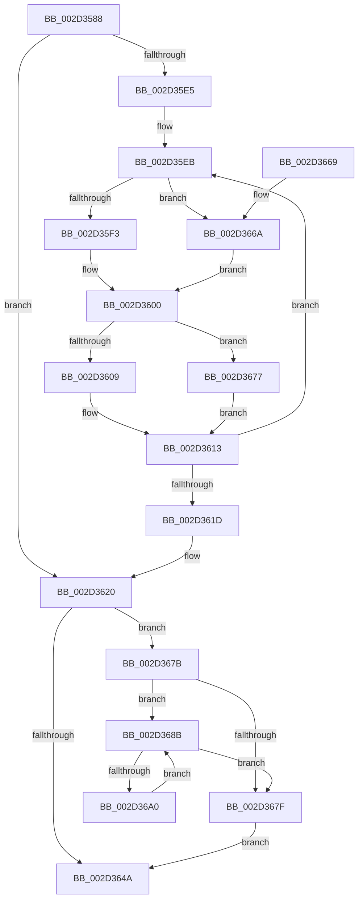

# KeDisconnectInterrupt

- RVA: `0x002D3588`–`0x002D36A2` (길이 `282` bytes)
- VA: `0x00000001402D3588`
- 실행 섹션: `.text`
- PDB 이름 있음: `예`; PDB Function 태그: `아니요`
- unwind 정보 RVA: `0x0006FA38`
- 디코드: `84`개 명령, `282/282` bytes 표시
- 미해석 바이트: `0` (있으면 어셈블리에 `.byte`로 보존)

> 이 문서는 커널 이미지의 기계어와 PDB 기호를 분석해 생성했습니다. 4번과 5번은 함수 원형과 자료형을 바이너리 사용 방식에서 추정한 C 해석이며 원본 소스 복구 결과는 아닙니다.

## 1. Dependencies

- 직접 호출 지점: **8**; 고유 호출 대상: **8**
- 직접 호출자로 확인된 함수: **2**
- RIP 상대 이미지 참조: **0**

### Outgoing calls
- `0x002D35B4` → [KeMaskInterrupt](KeMaskInterrupt_function_002D42FC.md) (function, `0x002D42FC`)
- `0x002D35BC` → [KiIsInterruptTypeSecondary](KiIsInterruptTypeSecondary_function_002D44BC.md) (function, `0x002D44BC`)
- `0x002D35CB` → [KiIntSteerDisable](../49/KiIntSteerDisable_function_00497144.md) (function, `0x00497144`)
- `0x002D35DC` → [KiSetSystemPriorityThread](KiSetSystemPriorityThread_function_002D9FF8.md) (function, `0x002D9FF8`)
- `0x002D35FB` → [KiDisconnectInterruptCommon](KiDisconnectInterruptCommon_function_002D36A8.md) (function, `0x002D36A8`)
- `0x002D3636` → [KiClearSystemPriority](../2C/KiClearSystemPriority_function_002C05A8.md) (function, `0x002C05A8`)
- `0x002D3670` → [KiDisconnectSecondaryInterrupt](KiDisconnectSecondaryInterrupt_function_002D3B88.md) (function, `0x002D3B88`)
- `0x002D3684` → [ExFreePoolWithTag](../../poolcode/B8/ExFreePoolWithTag_function_00B82870.md) (function, `0x00B82870`)

### Direct callers
- [KeConnectInterrupt](KeConnectInterrupt_function_002D3D5C.md) at `0x002D3F18`
- [IoDisconnectInterrupt](../../page/90/IoDisconnectInterrupt_function_00900890.md) at `0x00900928`

### Static image references
- 디코드된 RIP-relative 메모리 참조가 없습니다.

## 2. Other-region calls and transfers

- 다른 실행 섹션으로 향하는 call: **1**
  - `0x002D3684` → [ExFreePoolWithTag](../../poolcode/B8/ExFreePoolWithTag_function_00B82870.md) (`.text` → `POOLCODE`)
- 별도 외부 분기/꼬리 이동을 확인하지 못했습니다.

## 3. Assembly (complete function range)

```asm
002D3588  48 89 5C 24 08                  mov qword ptr [rsp + 8], rbx
002D358D  48 89 6C 24 18                  mov qword ptr [rsp + 0x18], rbp
002D3592  48 89 74 24 20                  mov qword ptr [rsp + 0x20], rsi
002D3597  57                              push rdi
002D3598  41 54                           push r12
002D359A  41 55                           push r13
002D359C  41 56                           push r14
002D359E  41 57                           push r15
002D35A0  48 83 EC 20                     sub rsp, 0x20
002D35A4  0F B6 DA                        movzx ebx, dl
002D35A7  45 33 C9                        xor r9d, r9d
002D35AA  8A D3                           mov dl, bl
002D35AC  4D 8B E0                        mov r12, r8
002D35AF  48 8B F9                        mov rdi, rcx
002D35B2  33 F6                           xor esi, esi
002D35B4  E8 43 0D 00 00                  call 0x1402d42fc
002D35B9  49 8B CC                        mov rcx, r12
002D35BC  E8 FB 0E 00 00                  call 0x1402d44bc
002D35C1  8B D3                           mov edx, ebx
002D35C3  48 8B CF                        mov rcx, rdi
002D35C6  44 8A E8                        mov r13b, al
002D35C9  8B EB                           mov ebp, ebx
002D35CB  E8 74 3B 1C 00                  call 0x140497144
002D35D0  65 48 8B 0C 25 88 01 00 00      mov rcx, qword ptr gs:[0x188]
002D35D9  8D 56 1F                        lea edx, [rsi + 0x1f]
002D35DC  E8 17 6A 00 00                  call 0x1402d9ff8
002D35E1  84 DB                           test bl, bl
002D35E3  74 3B                           je 0x1402d3620
002D35E5  4C 8B F7                        mov r14, rdi
002D35E8  44 8B FB                        mov r15d, ebx
002D35EB  49 8B 1E                        mov rbx, qword ptr [r14]
002D35EE  45 84 ED                        test r13b, r13b
002D35F1  75 77                           jne 0x1402d366a
002D35F3  4D 8B C4                        mov r8, r12
002D35F6  48 8B D3                        mov rdx, rbx
002D35F9  33 C9                           xor ecx, ecx
002D35FB  E8 A8 00 00 00                  call 0x1402d36a8
002D3600  F0 83 4B 68 01                  lock or dword ptr [rbx + 0x68], 1
002D3605  85 C0                           test eax, eax
002D3607  78 6E                           js 0x1402d3677
002D3609  B9 28 01 00 00                  mov ecx, 0x128
002D360E  3B C1                           cmp eax, ecx
002D3610  0F 44 F1                        cmove esi, ecx
002D3613  49 83 C6 08                     add r14, 8
002D3617  49 83 EF 01                     sub r15, 1
002D361B  75 CE                           jne 0x1402d35eb
002D361D  48 8B DD                        mov rbx, rbp
002D3620  65 48 8B 0C 25 88 01 00 00      mov rcx, qword ptr gs:[0x188]
002D3629  48 8D 54 24 58                  lea rdx, [rsp + 0x58]
002D362E  C7 44 24 58 1F 00 00 00         mov dword ptr [rsp + 0x58], 0x1f
002D3636  E8 6D CF FE FF                  call 0x1402c05a8
002D363B  48 8B 07                        mov rax, qword ptr [rdi]
002D363E  48 8B 88 10 01 00 00            mov rcx, qword ptr [rax + 0x110]
002D3645  48 85 C9                        test rcx, rcx
002D3648  75 31                           jne 0x1402d367b
002D364A  48 8B 5C 24 50                  mov rbx, qword ptr [rsp + 0x50]
002D364F  8B C6                           mov eax, esi
002D3651  48 8B 74 24 68                  mov rsi, qword ptr [rsp + 0x68]
002D3656  48 8B 6C 24 60                  mov rbp, qword ptr [rsp + 0x60]
002D365B  48 83 C4 20                     add rsp, 0x20
002D365F  41 5F                           pop r15
002D3661  41 5E                           pop r14
002D3663  41 5D                           pop r13
002D3665  41 5C                           pop r12
002D3667  5F                              pop rdi
002D3668  C3                              ret
002D3669  CC                              int3
002D366A  49 8B D4                        mov rdx, r12
002D366D  48 8B CB                        mov rcx, rbx
002D3670  E8 13 05 00 00                  call 0x1402d3b88
002D3675  EB 89                           jmp 0x1402d3600
002D3677  8B F0                           mov esi, eax
002D3679  EB 98                           jmp 0x1402d3613
002D367B  85 ED                           test ebp, ebp
002D367D  75 0C                           jne 0x1402d368b
002D367F  BA 4B 65 49 52                  mov edx, 0x5249654b
002D3684  E8 E7 F1 8A 00                  call 0x140b82870
002D3689  EB BF                           jmp 0x1402d364a
002D368B  48 8B 17                        mov rdx, qword ptr [rdi]
002D368E  48 8D 7F 08                     lea rdi, [rdi + 8]
002D3692  48 83 A2 10 01 00 00 00         and qword ptr [rdx + 0x110], 0
002D369A  48 83 EB 01                     sub rbx, 1
002D369E  74 DF                           je 0x1402d367f
002D36A0  EB E9                           jmp 0x1402d368b
```

## 4. C-style interpretation (structured pseudocode)

```c
__int64 __fastcall KeDisconnectInterrupt(__int64 a1, unsigned __int8 a2, __int64 a3, int a4)
{
    __int64 result;
    __int64 v_r14;
    __int64 v_r15;
    __int64 v_rbx;
    __int64 v_rsi;
    __int64 v_rsp;
    unsigned __int64 v_stack_p10;
    unsigned __int64 v_stack_p18;
    unsigned __int64 v_stack_p20;
    unsigned __int64 v_stack_p8;

    v_stack_p8 = v_rbx;
    v_stack_p18 = v_rbp;
    v_stack_p20 = v_rsi;
    v_rsp = (v_rsp) - (32);
    a4 = 0;
    v_rsi = 0;
    result = KeMaskInterrupt(a1, a2, a3, a4);
    result = KiIsInterruptTypeSecondary(a3, a2, a3, a4);
    result = KiIntSteerDisable(a1, (unsigned int)(a2), a3, a4);
    result = KiSetSystemPriorityThread(*(unsigned __int64 *)(gs_base + (0 + 392)), v_rsi + 31, a3, a4);
    if (a2 == 0) goto loc_002D3620;
loc_002D35EB:
    if ((unsigned __int8)((unsigned __int8)(result)) != 0) goto loc_002D366A;
    a1 = 0;
    result = KiDisconnectInterruptCommon(a1, *(unsigned __int64 *)(a1), a3, a4);
loc_002D3600:
    if (sign_flag) goto loc_002D3677;
    if (((unsigned int)(result)) == 296) { v_rsi = 296; }
loc_002D3613:
    v_r14 = (a1) + (8);
    v_r15 = ((unsigned int)(a2)) - (1);
    if (condition_is_not_equal) goto loc_002D35EB;
loc_002D3620:
    v_stack_p10 = 31;
    result = KiClearSystemPriority(*(unsigned __int64 *)(gs_base + (0 + 392)), v_stack_p10, a3, a4);
    if (*(unsigned __int64 *)(*(unsigned __int64 *)(a1) + 272) != 0) goto loc_002D367B;
loc_002D364A:
    v_rsp = (v_rsp) + (32);
    return (unsigned int)((unsigned int)(v_rsi));
loc_002D366A:
    result = KiDisconnectSecondaryInterrupt(v_stack_p8, a3, a3, a4);
    goto loc_002D3600;
loc_002D3677:
    goto loc_002D3613;
loc_002D367B:
    if ((unsigned int)(v_stack_p18) != 0) goto loc_002D368B;
loc_002D367F:
    result = ExFreePoolWithTag(v_stack_p8, (unsigned int)(0x5249654BULL), a3, a4);
    goto loc_002D364A;
loc_002D368B:
    v_rbx = (v_stack_p8) - (1);
    if (condition_is_equal) goto loc_002D367F;
    goto loc_002D368B;
}
```

## 5. (Beta) C Style

```c
int64_t KeDisconnectInterrupt(void *Arg1, uint8_t Arg2, int64_t Arg3, int32_t Arg4)
{
    uint8_t *arg1 = (uint8_t *)Arg1;

    int64_t result;
    int64_t local_r14;
    int64_t local_r15;
    int64_t local_rbx;
    int64_t local_rsi;
    int64_t local_rsp;
    uint64_t v_stack_p10;
    uint64_t v_stack_p18;
    uint64_t v_stack_p20;
    uint64_t v_stack_p8;

    v_stack_p8 = local_rbx;
    v_stack_p18 = local_rbp;
    v_stack_p20 = local_rsi;
    local_rsp = (local_rsp) - (32);
    Arg4 = 0;
    local_rsi = 0;
    result = KeMaskInterrupt(Arg1, Arg2, Arg3, Arg4);
    result = KiIsInterruptTypeSecondary(Arg3, Arg2, Arg3, Arg4);
    result = KiIntSteerDisable(Arg1, (uint32_t)(Arg2), Arg3, Arg4);
    result = KiSetSystemPriorityThread(*(uint64_t *)(gs_base + (0 + 0x188)), local_rsi + 31, Arg3, Arg4);
    if (Arg2 == 0) goto loc_002D3620;
loc_002D35EB:
    if ((uint8_t)((uint8_t)(result)) != 0) goto loc_002D366A;
    Arg1 = 0;
    result = KiDisconnectInterruptCommon(Arg1, *(uint64_t *)(arg1), Arg3, Arg4);
loc_002D3600:
    if (sign_flag) goto loc_002D3677;
    if (((uint32_t)(result)) == 296) { local_rsi = 296; }
loc_002D3613:
    local_r14 = (Arg1) + (8);
    local_r15 = ((uint32_t)(Arg2)) - (1);
    if (condition_is_not_equal) goto loc_002D35EB;
loc_002D3620:
    v_stack_p10 = 31;
    result = KiClearSystemPriority(*(uint64_t *)(gs_base + (0 + 0x188)), v_stack_p10, Arg3, Arg4);
    if (*(uint64_t *)(*(uint64_t *)(arg1) + 0x110) != 0) goto loc_002D367B;
loc_002D364A:
    local_rsp = (local_rsp) + (32);
    return (uint32_t)((uint32_t)(local_rsi));
loc_002D366A:
    result = KiDisconnectSecondaryInterrupt(v_stack_p8, Arg3, Arg3, Arg4);
    goto loc_002D3600;
loc_002D3677:
    goto loc_002D3613;
loc_002D367B:
    if ((uint32_t)(v_stack_p18) != 0) goto loc_002D368B;
loc_002D367F:
    result = ExFreePoolWithTag(v_stack_p8, (uint32_t)(0x5249654BULL), Arg3, Arg4);
    goto loc_002D364A;
loc_002D368B:
    local_rbx = (v_stack_p8) - (1);
    if (condition_is_equal) goto loc_002D367F;
    goto loc_002D368B;
}
```

### 관측된 메모리 오프셋

구조체 형식이 확인되지 않은 접근은 인자 기준의 오프셋으로만 기록했습니다.

| 기준 인자 | 오프셋 표현 | 폭 (bit) | 접근 |
|---|---:|---:|---|
| `Arg1` | `+ 0x0` | `64` | `R` |
| `Arg1` | `+ 0x8` | `64` | `R` |

## 6. Execution-region graph

[열기: 2D/3D 그래프와 함수 탐색 컨트롤 패널](../../../control-panel.html?section=text&rva=0x002D3588&view=graph)

- 2D 그래프는 위에서 아래로 흐르고, 3D 그래프는 빈 공간을 드래그해 회전합니다. Shift+드래그는 이동, 휠은 확대·축소, 함수 노드 선택은 대상 보고서 이동입니다.

### Static fallback


