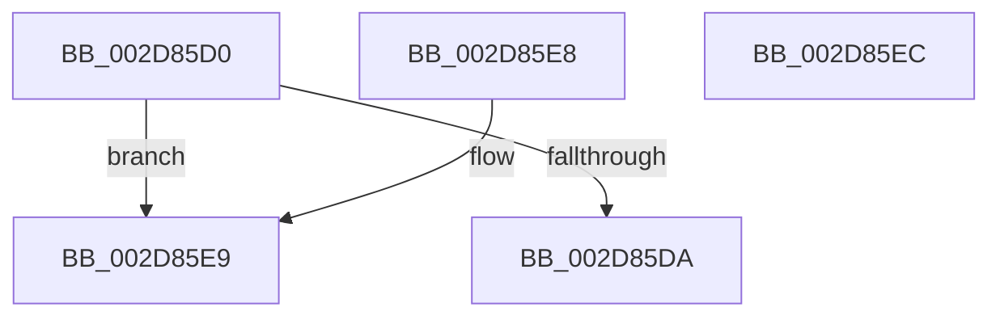

# KeGetPrcb

- RVA: `0x002D85D0`–`0x002D85ED` (길이 `29` bytes)
- VA: `0x00000001402D85D0`
- 실행 섹션: `.text`
- PDB 이름 있음: `예`; PDB Function 태그: `아니요`
- unwind 정보 RVA: `0x000DB714`
- 디코드: `11`개 명령, `29/29` bytes 표시
- 미해석 바이트: `0` (있으면 어셈블리에 `.byte`로 보존)

> 이 문서는 커널 이미지의 기계어와 PDB 기호를 분석해 생성했습니다. 4번과 5번은 함수 원형과 자료형을 바이너리 사용 방식에서 추정한 C 해석이며 원본 소스 복구 결과는 아닙니다.

## 1. Dependencies

- 직접 호출 지점: **0**; 고유 호출 대상: **0**
- 직접 호출자로 확인된 함수: **125**
- RIP 상대 이미지 참조: **2**

### Outgoing calls
- 직접 디코드된 call 명령이 없습니다.

### Direct callers
- [KiTraceSetTimer](../22/KiTraceSetTimer_function_0022FB08.md) at `0x0022FB60`
- [PpmUnlockProcessors](PpmUnlockProcessors_function_002D15B0.md) at `0x002D165B`
- [KiIntSteerUpdateDeviceInterruptMask](KiIntSteerUpdateDeviceInterruptMask_function_002D55B8.md) at `0x002D5611`
- [PpmParkReportUnparkedCores](PpmParkReportUnparkedCores_function_002D5BD0.md) at `0x002D5C77`
- [PpmParkReportParkedCores](PpmParkReportParkedCores_function_002D5CB0.md) at `0x002D60D2`
- [PpmParkReportParkedCores](PpmParkReportParkedCores_function_002D5CB0.md) at `0x002D612E`
- [PpmParkReportParkedCores](PpmParkReportParkedCores_function_002D5CB0.md) at `0x002D6185`
- [sub_002D6F9F](Unknown_function_002D6F9F.md) at `0x002D7004`
- [sub_002D702E](Unknown_function_002D702E.md) at `0x002D7098`
- [sub_002D7D27](Unknown_function_002D7D27.md) at `0x002D7D97`
- [PpmParkFindOverUtilizedProcessors](PpmParkFindOverUtilizedProcessors_function_002D86B8.md) at `0x002D870A`
- [MiAdjustCachedStacks](MiAdjustCachedStacks_function_002D8AAC.md) at `0x002D8AF8`
- [PpmHeteroRestrictToFavoredClass](PpmHeteroRestrictToFavoredClass_function_002D8CE4.md) at `0x002D8D93`
- [PpmHeteroRestrictToFavoredClass](PpmHeteroRestrictToFavoredClass_function_002D8CE4.md) at `0x002D8E09`
- [PpmPerfApplyProcessorStates](PpmPerfApplyProcessorStates_function_002D8EF0.md) at `0x002D901D`
- [PpmPerfApplyProcessorStates](PpmPerfApplyProcessorStates_function_002D8EF0.md) at `0x002D911F`
- [PpmIdleUpdateSystemLatencyLimit](PpmIdleUpdateSystemLatencyLimit_function_002D9204.md) at `0x002D9301`
- [PpmIdleUpdateSystemLatencyLimit](PpmIdleUpdateSystemLatencyLimit_function_002D9204.md) at `0x002D9364`
- [PpmIdleUpdateSystemLatencyLimit](PpmIdleUpdateSystemLatencyLimit_function_002D9204.md) at `0x002D93D6`
- [sub_002D9684](Unknown_function_002D9684.md) at `0x002D96D0`
- [PpmCheckMakeupSkippedChecks](PpmCheckMakeupSkippedChecks_function_002DA1D0.md) at `0x002DA26B`
- [PoExecuteIdleCheck](../39/PoExecuteIdleCheck_function_0039CF20.md) at `0x0039D045`
- [ExpSaPageGroupDescriptorAllocate](../3B/ExpSaPageGroupDescriptorAllocate_function_003B4224.md) at `0x003B43A0`
- [PpmEventHgsHardwareTable](../3B/PpmEventHgsHardwareTable_function_003BF110.md) at `0x003BF261`
- [PpmHeteroUpdateHgsConfiguration](../3B/PpmHeteroUpdateHgsConfiguration_function_003BF344.md) at `0x003BF60B`
- [PpmHeteroUpdateHgsConfiguration](../3B/PpmHeteroUpdateHgsConfiguration_function_003BF344.md) at `0x003BF95A`
- [PpmHeteroUpdateHgsConfiguration](../3B/PpmHeteroUpdateHgsConfiguration_function_003BF344.md) at `0x003BFB76`
- [PPmHeteroHgsUpdateOrderValue](../3B/PPmHeteroHgsUpdateOrderValue_function_003BFD24.md) at `0x003BFDB3`
- [PPmHeteroHgsUpdateOrderValue](../3B/PPmHeteroHgsUpdateOrderValue_function_003BFD24.md) at `0x003BFE9F`
- [PPmHeteroHgsUpdateOrderValue](../3B/PPmHeteroHgsUpdateOrderValue_function_003BFD24.md) at `0x003BFF50`
- [PPmHeteroHgsUpdateOrderValue](../3B/PPmHeteroHgsUpdateOrderValue_function_003BFD24.md) at `0x003BFFEC`
- [PPmHeteroHgsUpdateOrderValue](../3B/PPmHeteroHgsUpdateOrderValue_function_003BFD24.md) at `0x003C007F`
- [KiSelectIdealProcessorSetForGroup](../3C/KiSelectIdealProcessorSetForGroup_function_003C0E68.md) at `0x003C0EA9`
- [KiSelectIdealProcessorSetForGroup](../3C/KiSelectIdealProcessorSetForGroup_function_003C0E68.md) at `0x003C0F75`
- [PpmPerfRecordMostActiveWorkloadClass](../40/PpmPerfRecordMostActiveWorkloadClass_function_0040B1A4.md) at `0x0040B2D8`
- [PpmHeteroComputeCoreParkingUtilities](../41/PpmHeteroComputeCoreParkingUtilities_function_00412AE0.md) at `0x00412B85`
- [PpmHeteroComputeCoreParkingUtilities](../41/PpmHeteroComputeCoreParkingUtilities_function_00412AE0.md) at `0x00412BEF`
- [PpmHeteroComputeCoreParkingUtilities](../41/PpmHeteroComputeCoreParkingUtilities_function_00412AE0.md) at `0x00412CD6`
- [PpmParkDistributeUtility](../41/PpmParkDistributeUtility_function_00412DE0.md) at `0x00412F3F`
- [PpmParkDistributeUtility](../41/PpmParkDistributeUtility_function_00412DE0.md) at `0x004131F2`
- [PpmParkDistributeUtility](../41/PpmParkDistributeUtility_function_00412DE0.md) at `0x004132C1`
- [PpmParkDistributeUtility](../41/PpmParkDistributeUtility_function_00412DE0.md) at `0x0041331B`
- [PpmRegisterPerfCap](../42/PpmRegisterPerfCap_function_0042B0D0.md) at `0x0042B117`
- [PpmCheckComputeEnergy](../45/PpmCheckComputeEnergy_function_00452CD0.md) at `0x00452D7D`
- [PpmCheckComputeEnergy](../45/PpmCheckComputeEnergy_function_00452CD0.md) at `0x00452E8A`
- [PpmParkUnblockIdle](../46/PpmParkUnblockIdle_function_00460270.md) at `0x00460314`
- [PpmParkUnblockIdle](../46/PpmParkUnblockIdle_function_00460270.md) at `0x004603C4`
- [PpmParkComputeUnparkMask](../46/PpmParkComputeUnparkMask_function_0046F9C4.md) at `0x0046FD1B`
- [IopIrpStackProfilerDpcRoutine](../47/IopIrpStackProfilerDpcRoutine_function_00475420.md) at `0x004754A2`
- [IopIrpStackProfilerDpcRoutine](../47/IopIrpStackProfilerDpcRoutine_function_00475420.md) at `0x00475579`
- [KiDpcRuntimeHistoryHashTableCleanupTimerCallback](../48/KiDpcRuntimeHistoryHashTableCleanupTimerCallback_function_00482EA0.md) at `0x00482EF5`
- [PpmCapturePerformanceDistribution](../48/PpmCapturePerformanceDistribution_function_00489C88.md) at `0x00489D38`
- [KiForceIdleUpdateSchedulerParkState](../48/KiForceIdleUpdateSchedulerParkState_function_0048D874.md) at `0x0048DB58`
- [KiForceIdleUpdateSchedulerParkState](../48/KiForceIdleUpdateSchedulerParkState_function_0048D874.md) at `0x0048DBB4`
- [PpmHeteroDetectHgsCores](../48/PpmHeteroDetectHgsCores_function_0048E980.md) at `0x0048EA12`
- [PpmHeteroDetectHgsCores](../48/PpmHeteroDetectHgsCores_function_0048E980.md) at `0x0048EB05`
- [PpmHeteroDetectHgsCores](../48/PpmHeteroDetectHgsCores_function_0048E980.md) at `0x0048EC60`
- [KiIntSteerDisable](../49/KiIntSteerDisable_function_00497144.md) at `0x00497250`
- [PpmParkApplyPolicy](../4B/PpmParkApplyPolicy_function_004B613C.md) at `0x004B61BA`
- [PpmParkApplyPolicy](../4B/PpmParkApplyPolicy_function_004B613C.md) at `0x004B640E`
- [PpmParkEvalualteSmtUnparkPolicy](../4C/PpmParkEvalualteSmtUnparkPolicy_function_004C0868.md) at `0x004C08DE`
- [ExAllocateCacheAwarePushLock](../4C/ExAllocateCacheAwarePushLock_function_004C68C0.md) at `0x004C69A5`
- [PpmEstimateIdleDuration](../4C/PpmEstimateIdleDuration_function_004C79DC.md) at `0x004C7C30`
- [PpmInternalProcessorIdleVeto](../4E/PpmInternalProcessorIdleVeto_function_004E3F00.md) at `0x004E3F20`
- [PpmHeteroRestrictToFavoredClassEx](../4E/PpmHeteroRestrictToFavoredClassEx_function_004EF940.md) at `0x004EFA44`
- [PpmHeteroRestrictToFavoredClassEx](../4E/PpmHeteroRestrictToFavoredClassEx_function_004EF940.md) at `0x004EFB18`
- [PpmHeteroDistributeUtilityEx](../4E/PpmHeteroDistributeUtilityEx_function_004EFC00.md) at `0x004EFFD1`
- [PpmHeteroDistributeUtilityEx](../4E/PpmHeteroDistributeUtilityEx_function_004EFC00.md) at `0x004F004A`
- [PpmHeteroDistributeUtilityEx](../4E/PpmHeteroDistributeUtilityEx_function_004EFC00.md) at `0x004F0100`
- [PpmHeteroDistributeUtilityEx](../4E/PpmHeteroDistributeUtilityEx_function_004EFC00.md) at `0x004F0172`
- [PpmParkDistributeUtilityEx](../4F/PpmParkDistributeUtilityEx_function_004F020C.md) at `0x004F036E`
- [PpmParkDistributeUtilityEx](../4F/PpmParkDistributeUtilityEx_function_004F020C.md) at `0x004F047E`
- [PpmParkDistributeUtilityEx](../4F/PpmParkDistributeUtilityEx_function_004F020C.md) at `0x004F055E`
- [PpmParkDistributeUtilityEx](../4F/PpmParkDistributeUtilityEx_function_004F020C.md) at `0x004F065E`
- [PpmParkDistributeUtilityEx](../4F/PpmParkDistributeUtilityEx_function_004F020C.md) at `0x004F0741`
- [PpmParkDistributeUtilityEx](../4F/PpmParkDistributeUtilityEx_function_004F020C.md) at `0x004F0793`
- [PpmParkDistributeUtilityEx](../4F/PpmParkDistributeUtilityEx_function_004F020C.md) at `0x004F07ED`
- [PpmParkFindOverUtilizedProcessorsEx](../4F/PpmParkFindOverUtilizedProcessorsEx_function_004F1394.md) at `0x004F142E`
- [PpmHeteroComputeCoreParkingUtilitiesEx](../4F/PpmHeteroComputeCoreParkingUtilitiesEx_function_004F1E44.md) at `0x004F1F04`
- [PpmHeteroComputeCoreParkingUtilitiesEx](../4F/PpmHeteroComputeCoreParkingUtilitiesEx_function_004F1E44.md) at `0x004F1F14`
- [PpmHeteroComputeCoreParkingUtilitiesEx](../4F/PpmHeteroComputeCoreParkingUtilitiesEx_function_004F1E44.md) at `0x004F1F86`
- [PpmParkApplyPolicyEx](../4F/PpmParkApplyPolicyEx_function_004F3090.md) at `0x004F3144`
- [PpmParkApplyPolicyEx](../4F/PpmParkApplyPolicyEx_function_004F3090.md) at `0x004F348F`
- [DbgkpLkmdSnapGlobals](../57/DbgkpLkmdSnapGlobals_function_0057FE0C.md) at `0x0057FE65`
- [HvlpMarkHvlPagesForHibernation](../58/HvlpMarkHvlPagesForHibernation_function_0058AD34.md) at `0x0058ADC7`
- [IopUpdateMinidumpContext](../59/IopUpdateMinidumpContext_function_00596360.md) at `0x00596568`
- [KeEtwInitializeCpuStarvationProvider](../5B/KeEtwInitializeCpuStarvationProvider_function_005B5704.md) at `0x005B574B`
- [KeAllocateKernelHiberSwapShadowStacks](../5B/KeAllocateKernelHiberSwapShadowStacks_function_005BD658.md) at `0x005BD6D3`
- [KeAllocateKernelHiberSwapShadowStacks](../5B/KeAllocateKernelHiberSwapShadowStacks_function_005BD658.md) at `0x005BD711`
- [KiOptimizeSpecCtrlSettingsWorker](../5B/KiOptimizeSpecCtrlSettingsWorker_function_005BF5A0.md) at `0x005BFEF2`
- [KiCpuPartitionUpdatePrcbs](../5C/KiCpuPartitionUpdatePrcbs_function_005C15D4.md) at `0x005C1607`
- [KeFrozenProcessorCount](../5C/KeFrozenProcessorCount_function_005C2EC4.md) at `0x005C2EDE`
- [PopDetermineBucketFrequencies](../5C/PopDetermineBucketFrequencies_function_005CEBF8.md) at `0x005CEC8F`
- [PopDetermineBucketFrequencies](../5C/PopDetermineBucketFrequencies_function_005CEBF8.md) at `0x005CEE99`
- [PoInitiateProcessorWake](../5C/PoInitiateProcessorWake_function_005CF2D0.md) at `0x005CF312`
- [PpmIdleCheckCoordinatedDependencies](../5C/PpmIdleCheckCoordinatedDependencies_function_005CF5B8.md) at `0x005CF6B9`
- [PpmIdleCheckCoordinatedDependency](../5C/PpmIdleCheckCoordinatedDependency_function_005CF72C.md) at `0x005CF995`
- [PpmIdleRecheckSecondaryProcessors](../5D/PpmIdleRecheckSecondaryProcessors_function_005D0204.md) at `0x005D0248`
- [PpmIdleWaitForDependentTransitions](../5D/PpmIdleWaitForDependentTransitions_function_005D0594.md) at `0x005D05DB`
- [PpmUpdateProcessorIdleVeto](../5D/PpmUpdateProcessorIdleVeto_function_005D0C50.md) at `0x005D0C9F`
- [PopProcessorSetPep](../5D/PopProcessorSetPep_function_005D3FE0.md) at `0x005D4005`
- [PpmPerfQueryPackageId](../5D/PpmPerfQueryPackageId_function_005D44F0.md) at `0x005D44F4`
- [PpmPerfQueryPackageProcessorCount](../5D/PpmPerfQueryPackageProcessorCount_function_005D4510.md) at `0x005D4531`
- [PpmPerfQueryPhysicalCoreCount](../5D/PpmPerfQueryPhysicalCoreCount_function_005D4570.md) at `0x005D4591`
- [PpmPerfQueryPhysicalCoreId](../5D/PpmPerfQueryPhysicalCoreId_function_005D45D0.md) at `0x005D45D4`
- [PpmHeteroHgsDetectContainmentPresence](../5D/PpmHeteroHgsDetectContainmentPresence_function_005D8768.md) at `0x005D88BC`
- [PpmHeteroHgsDetectContainmentPresence](../5D/PpmHeteroHgsDetectContainmentPresence_function_005D8768.md) at `0x005D8956`
- [PpmHeteroHgsDetectContainmentPresence](../5D/PpmHeteroHgsDetectContainmentPresence_function_005D8768.md) at `0x005D89EE`
- [PpmHeteroHgsDetectContainmentPresence](../5D/PpmHeteroHgsDetectContainmentPresence_function_005D8768.md) at `0x005D8A7D`
- [PpmHeteroHgsDetectContainmentPresence](../5D/PpmHeteroHgsDetectContainmentPresence_function_005D8768.md) at `0x005D8AB3`
- [PpmHeteroHgsRegisterContainmentGroups](../5D/PpmHeteroHgsRegisterContainmentGroups_function_005D8D14.md) at `0x005D8DD0`
- [PpmHeteroHgsRegisterContainmentGroups](../5D/PpmHeteroHgsRegisterContainmentGroups_function_005D8D14.md) at `0x005D8E5C`
- [PpmParkRegisterParking](../5D/PpmParkRegisterParking_function_005DB508.md) at `0x005DB8B2`
- [PpmCheckComputeHeteroResponseEx](../5D/PpmCheckComputeHeteroResponseEx_function_005DECA0.md) at `0x005DEE73`
- [PpmParkCalculateCoreParkingMaskEx](../5D/PpmParkCalculateCoreParkingMaskEx_function_005DFBE0.md) at `0x005DFF1F`
- [PpmParkCalculateCoreParkingMaskEx](../5D/PpmParkCalculateCoreParkingMaskEx_function_005DFBE0.md) at `0x005DFFEA`
- [PpmParkCalculateCoreParkingMaskEx](../5D/PpmParkCalculateCoreParkingMaskEx_function_005DFBE0.md) at `0x005E00A4`
- [PpmParkCalculateCoreParkingMaskEx](../5D/PpmParkCalculateCoreParkingMaskEx_function_005DFBE0.md) at `0x005E0120`
- [PpmParkComputeUnparkMaskEx](../5E/PpmParkComputeUnparkMaskEx_function_005E05E0.md) at `0x005E0EC1`
- [PpmParkInitParkNode](../5E/PpmParkInitParkNode_function_005E1444.md) at `0x005E15B9`
- [EtwGetProcessorBuffer](../64/EtwGetProcessorBuffer_function_0064E630.md) at `0x0064E6C3`
- [ExpNodeUpdateProcessorSubQueueIndex](../65/ExpNodeUpdateProcessorSubQueueIndex_function_0065A728.md) at `0x0065A762`
- [ExpSaInitialize](../65/ExpSaInitialize_function_0065CADC.md) at `0x0065CBA3`
- [ExpSaInitialize](../65/ExpSaInitialize_function_0065CADC.md) at `0x0065CC14`
- [MiDbgPteWriteInProgress](../68/MiDbgPteWriteInProgress_function_00685528.md) at `0x006855D3`
- [sub_006EC7EE](../6E/Unknown_function_006EC7EE.md) at `0x006EC7F2`
- [sub_006F6620](../6F/Unknown_function_006F6620.md) at `0x006F67A7`
- [sub_006F6620](../6F/Unknown_function_006F6620.md) at `0x006F6805`
- [sub_006F6620](../6F/Unknown_function_006F6620.md) at `0x006F6853`
- [sub_006F6620](../6F/Unknown_function_006F6620.md) at `0x006F68F2`
- [sub_006F6620](../6F/Unknown_function_006F6620.md) at `0x006F6936`
- [sub_006F6C54](../6F/Unknown_function_006F6C54.md) at `0x006F6C59`
- [sub_006FA0AE](../6F/Unknown_function_006FA0AE.md) at `0x006FA13A`
- [sub_006FAB60](../6F/Unknown_function_006FAB60.md) at `0x006FADC8`
- [sub_006FAB60](../6F/Unknown_function_006FAB60.md) at `0x006FAE29`
- [sub_006FAB60](../6F/Unknown_function_006FAB60.md) at `0x006FAEBA`
- [sub_006FAB60](../6F/Unknown_function_006FAB60.md) at `0x006FAF11`
- [PpmUpdateIdleContext](../../page/70/PpmUpdateIdleContext_function_00701FB4.md) at `0x00701FBD`
- [PpmInstallCoordinatedIdleStates](../../page/75/PpmInstallCoordinatedIdleStates_function_007552A0.md) at `0x0075560A`
- [PpmInstallCoordinatedIdleStates](../../page/75/PpmInstallCoordinatedIdleStates_function_007552A0.md) at `0x0075580E`
- [PpmPerfAccumulateBrandedFrequency](../../page/75/PpmPerfAccumulateBrandedFrequency_function_0075ACE8.md) at `0x0075ACF1`
- [PpmPerfResizeHistoryAll](../../page/75/PpmPerfResizeHistoryAll_function_0075ADF8.md) at `0x0075AE3A`
- [PpmRegisterPerfStates](../../page/75/PpmRegisterPerfStates_function_0075B084.md) at `0x0075B397`
- [PpmRegisterPerfStates](../../page/75/PpmRegisterPerfStates_function_0075B084.md) at `0x0075B5DC`
- [PpmUpdatePerfStates](../../page/75/PpmUpdatePerfStates_function_0075BD90.md) at `0x0075BE15`
- [PpmPerfProcCapFloorSettingCallback](../../page/76/PpmPerfProcCapFloorSettingCallback_function_007641B0.md) at `0x0076422D`
- [PpmEnableWmiInterface](../../page/76/PpmEnableWmiInterface_function_00768604.md) at `0x00768624`
- [PpmPerfRegisterHvPerfStateCounters](../../page/77/PpmPerfRegisterHvPerfStateCounters_function_00770C40.md) at `0x00770CC6`
- [PpmHeteroRegisterWpsUpdatesAmd](../../page/77/PpmHeteroRegisterWpsUpdatesAmd_function_00772B10.md) at `0x00772BD7`
- [PpmHeteroRegisterWpsUpdatesAmd](../../page/77/PpmHeteroRegisterWpsUpdatesAmd_function_00772B10.md) at `0x00772BF0`
- [WmiQueryTraceInformation](../../page/7B/WmiQueryTraceInformation_function_007B9370.md) at `0x007B99D6`
- [EtwpCCSwapStop](../../page/7C/EtwpCCSwapStop_function_007C307C.md) at `0x007C30A3`
- [EtwpProcessEnumCallback](../../page/8A/EtwpProcessEnumCallback_function_008A5F40.md) at `0x008A6260`
- [EtwpProcessEnumCallback](../../page/8A/EtwpProcessEnumCallback_function_008A5F40.md) at `0x008A6277`
- [EtwpProcessEnumCallback](../../page/8A/EtwpProcessEnumCallback_function_008A5F40.md) at `0x008A62AF`
- [EtwpBufferingModeFlush](../../page/9B/EtwpBufferingModeFlush_function_009BD8F4.md) at `0x009BDCB5`
- [EtwpFlushActiveBuffers](../../page/9B/EtwpFlushActiveBuffers_function_009BDEF4.md) at `0x009BE11A`
- [EtwpFreeLoggerContext](../../page/9C/EtwpFreeLoggerContext_function_009C1688.md) at `0x009C1786`
- [EtwpFreeTraceBufferPool](../../page/9C/EtwpFreeTraceBufferPool_function_009C1A74.md) at `0x009C1B56`
- [EtwpEventTracingCounterSetCallback](../../page/A0/EtwpEventTracingCounterSetCallback_function_00A0E0C0.md) at `0x00A0E2AF`
- [PopProcessorInformation](../../page/A1/PopProcessorInformation_function_00A11CA0.md) at `0x00A11D47`
- [PpmInstallPlatformIdleStates](../../page/A4/PpmInstallPlatformIdleStates_function_00A46A80.md) at `0x00A46B16`
- [PpmInstallPlatformIdleStates](../../page/A4/PpmInstallPlatformIdleStates_function_00A46A80.md) at `0x00A46C65`
- [PpmEventTraceControlCallback](../../page/A5/PpmEventTraceControlCallback_function_00A51F60.md) at `0x00A52042`
- [PpmEventTraceControlCallback](../../page/A5/PpmEventTraceControlCallback_function_00A51F60.md) at `0x00A522F2`
- [PpmPerfGetFrequencyBandStats](../../page/A5/PpmPerfGetFrequencyBandStats_function_00A542B0.md) at `0x00A5431A`
- [FsRtlAddDiskIOCounterInstance](../../page/A6/FsRtlAddDiskIOCounterInstance_function_00A615C0.md) at `0x00A6160D`
- [PopDiagTracePerfTrackData](../../page/A7/PopDiagTracePerfTrackData_function_00A733CC.md) at `0x00A7343D`
- [PpmEventHeteroConfigUpdate](../../page/A7/PpmEventHeteroConfigUpdate_function_00A77430.md) at `0x00A774F9`
- [PpmHeteroComputeRelativePerformance](../../page/A7/PpmHeteroComputeRelativePerformance_function_00A7E038.md) at `0x00A7E0DB`
- [PpmCheckInitProcessors](../../page/A8/PpmCheckInitProcessors_function_00A84AE8.md) at `0x00A84BFC`
- [PpmHvEnableQosEnlightenment](../../page/A8/PpmHvEnableQosEnlightenment_function_00A84D00.md) at `0x00A84D73`
- [PpmSetSimulatedLoad](../../page/AC/PpmSetSimulatedLoad_function_00ACD710.md) at `0x00ACD7A8`
- [PpmClearSimulatedLoad](../../page/AC/PpmClearSimulatedLoad_function_00ACE938.md) at `0x00ACE9CD`
- [PpmPerfResetHistoryAll](../../page/AC/PpmPerfResetHistoryAll_function_00ACF5E4.md) at `0x00ACF648`
- [PpmHeteroDetectFavoredCores](../../page/AD/PpmHeteroDetectFavoredCores_function_00AD1760.md) at `0x00AD17F8`
- [EtwpCCSwapStart](../../page/AD/EtwpCCSwapStart_function_00AD88F8.md) at `0x00AD8937`
- [EtwpCCSwapStart](../../page/AD/EtwpCCSwapStart_function_00AD88F8.md) at `0x00AD8978`
- [sub_00B3B244](../../page/B3/Unknown_function_00B3B244.md) at `0x00B3B497`
- [sub_00B3B244](../../page/B3/Unknown_function_00B3B244.md) at `0x00B3B50E`
- [KiEnableKvaShadowing](../../pagelk/B6/KiEnableKvaShadowing_function_00B6ACBC.md) at `0x00B6AE15`
- [PopDiagComputeEarlyHiberStats](../../pagelk/B7/PopDiagComputeEarlyHiberStats_function_00B7D920.md) at `0x00B7D946`
- [sub_00BF16D0](../../init/BF/Unknown_function_00BF16D0.md) at `0x00BF4FB7`
- [sub_00BF16D0](../../init/BF/Unknown_function_00BF16D0.md) at `0x00C08216`
- [sub_00BF16D0](../../init/BF/Unknown_function_00BF16D0.md) at `0x00C09DBF`
- [KiInitializeDpcRuntimeHistoryHashTables](../../init/C3/KiInitializeDpcRuntimeHistoryHashTables_function_00C3A398.md) at `0x00C3A3DF`
- [PopDetectSimulatedHeteroProcessors](../../init/C4/PopDetectSimulatedHeteroProcessors_function_00C40DD8.md) at `0x00C41048`
- [PpmUpdateArchitecturalEfficiencyClass](../../init/C4/PpmUpdateArchitecturalEfficiencyClass_function_00C41DC0.md) at `0x00C41DFE`
- [PpmUpdateArchitecturalEfficiencyClass](../../init/C4/PpmUpdateArchitecturalEfficiencyClass_function_00C41DC0.md) at `0x00C41E39`
- [PpmUpdateArchitecturalEfficiencyClass](../../init/C4/PpmUpdateArchitecturalEfficiencyClass_function_00C41DC0.md) at `0x00C41E7D`
- [EtwpInitialize](../../init/C4/EtwpInitialize_function_00C4DBCC.md) at `0x00C4DD3C`
- [EtwpInitialize](../../init/C4/EtwpInitialize_function_00C4DBCC.md) at `0x00C4DD8A`
- [WheaInitialize](../../init/C5/WheaInitialize_function_00C54C08.md) at `0x00C54F66`
- [WheapCreatePerProcessorInfo](../../init/C5/WheapCreatePerProcessorInfo_function_00C55264.md) at `0x00C552CD`
- [VslConnectSwInterrupt](../../init/C7/VslConnectSwInterrupt_function_00C75C70.md) at `0x00C75E4B`

### Static image references
- `0x002D85D0` → RVA `0x00FC6A80` (`ALMOSTRO`; read)
- `0x002D85DC` → RVA `0x00FC8C40` (`ALMOSTRO`; read)

## 2. Other-region calls and transfers

- 다른 실행 섹션으로 향하는 call: **0**
- 별도 외부 분기/꼬리 이동을 확인하지 못했습니다.

## 3. Assembly (complete function range)

```asm
002D85D0  8B 05 AA E4 CE 00               mov eax, dword ptr [rip + 0xcee4aa]
002D85D6  3B C8                           cmp ecx, eax
002D85D8  73 0F                           jae 0x1402d85e9
002D85DA  8B C1                           mov eax, ecx
002D85DC  48 8D 0D 5D 06 CF 00            lea rcx, [rip + 0xcf065d]
002D85E3  48 8B 04 C1                     mov rax, qword ptr [rcx + rax*8]
002D85E7  C3                              ret
002D85E8  CC                              int3
002D85E9  33 C0                           xor eax, eax
002D85EB  C3                              ret
002D85EC  CC                              int3
```

## 4. C-style interpretation (structured pseudocode)

```c
__int64 __fastcall KeGetPrcb(int a1)
{
    __int64 result;

    if (a1 >= ((unsigned int)((unsigned int)(*(unsigned int *)(v_rip + 13558954))))) goto loc_002D85E9;
    return *(unsigned __int64 *)(v_rip + 13567581 + (unsigned int)(a1) * 8);
loc_002D85E9:
    result = 0;
    return result;
}
```

## 5. (Beta) C Style

```c
int64_t KeGetPrcb(int32_t Arg1)
{
    int64_t result;

    if (Arg1 >= ((uint32_t)((uint32_t)(*(uint32_t *)(v_rip + 0xCEE4AA))))) goto loc_002D85E9;
    return *(uint64_t *)(v_rip + 0xCF065D + (uint32_t)(Arg1) * 8);
loc_002D85E9:
    result = 0;
    return result;
}
```

## 6. Execution-region graph

[열기: 2D/3D 그래프와 함수 탐색 컨트롤 패널](../../../control-panel.html?section=text&rva=0x002D85D0&view=graph)

- 2D 그래프는 위에서 아래로 흐르고, 3D 그래프는 빈 공간을 드래그해 회전합니다. Shift+드래그는 이동, 휠은 확대·축소, 함수 노드 선택은 대상 보고서 이동입니다.

### Static fallback


