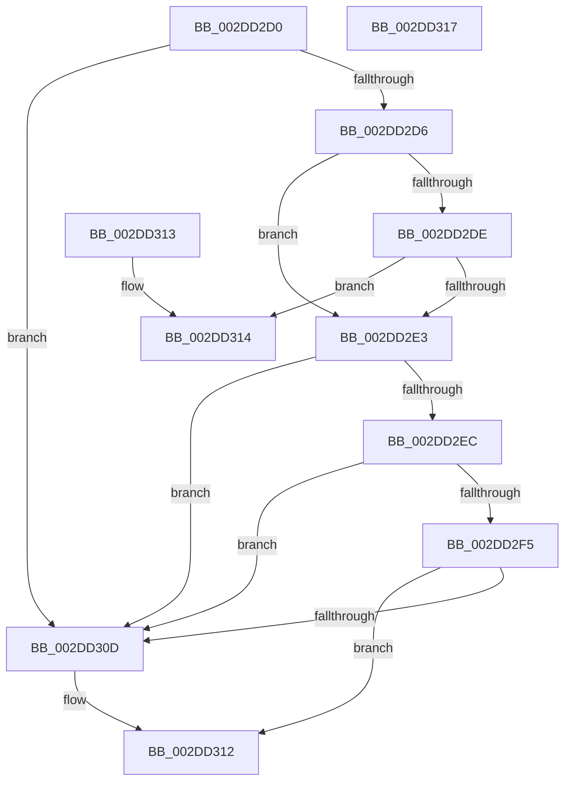

# KeGetProcessorIndexFromNumber

- RVA: `0x002DD2D0`–`0x002DD318` (길이 `72` bytes)
- VA: `0x00000001402DD2D0`
- 실행 섹션: `.text`
- PDB 이름 있음: `예`; PDB Function 태그: `아니요`
- unwind 정보 RVA: `0x000DB714`
- 디코드: `25`개 명령, `72/72` bytes 표시
- 미해석 바이트: `0` (있으면 어셈블리에 `.byte`로 보존)

> 이 문서는 커널 이미지의 기계어와 PDB 기호를 분석해 생성했습니다. 4번과 5번은 함수 원형과 자료형을 바이너리 사용 방식에서 추정한 C 해석이며 원본 소스 복구 결과는 아닙니다.

## 1. Dependencies

- 직접 호출 지점: **0**; 고유 호출 대상: **0**
- 직접 호출자로 확인된 함수: **26**
- RIP 상대 이미지 참조: **2**

### Outgoing calls
- 직접 디코드된 call 명령이 없습니다.

### Direct callers
- [KeQueryLogicalProcessorRelationship](../2C/KeQueryLogicalProcessorRelationship_function_002CEA60.md) at `0x002CF14E`
- [KeSetIdealProcessorThread](KeSetIdealProcessorThread_function_002DD150.md) at `0x002DD18B`
- [KeSetIdealProcessorThreadByNumber](KeSetIdealProcessorThreadByNumber_function_002DD200.md) at `0x002DD21D`
- [KeSetTargetProcessorDpcEx](KeSetTargetProcessorDpcEx_function_002DD280.md) at `0x002DD28C`
- [PoGetPerfStateAndParkingInfo](PoGetPerfStateAndParkingInfo_function_002DD484.md) at `0x002DD4D5`
- [PoGetPerfStateAndParkingInfo](PoGetPerfStateAndParkingInfo_function_002DD484.md) at `0x002DD746`
- [PoGetIdleTimes](PoGetIdleTimes_function_002DF570.md) at `0x002DF780`
- [HalpInterruptDestinationToTarget](../48/HalpInterruptDestinationToTarget_function_0048AA54.md) at `0x0048AAB3`
- [KeSetTargetProcessorDpc](../48/KeSetTargetProcessorDpc_function_0048B830.md) at `0x0048B870`
- [PpmSetSimulatedIdle](../4D/PpmSetSimulatedIdle_function_004D74C0.md) at `0x004D74F5`
- [PpmClearSimulatedIdle](../4D/PpmClearSimulatedIdle_function_004D8C9C.md) at `0x004D8CC5`
- [HalSendNMI](../54/HalSendNMI_function_00545E80.md) at `0x00546050`
- [HalpInterruptDpReplaceBegin](../56/HalpInterruptDpReplaceBegin_function_005631CC.md) at `0x005632B1`
- [IntPartGetProcessorEfficiencyClass](../5C/IntPartGetProcessorEfficiencyClass_function_005C0840.md) at `0x005C0852`
- [PpmUpdateProcessorIdleVeto](../5D/PpmUpdateProcessorIdleVeto_function_005D0C50.md) at `0x005D0C95`
- [IopConnectInterrupt](../../page/90/IopConnectInterrupt_function_00900B40.md) at `0x00900E83`
- [PspBuildCreateProcessContext](../../page/9E/PspBuildCreateProcessContext_function_009ED6E0.md) at `0x009EE42D`
- [PpmInstallPlatformIdleStates](../../page/A4/PpmInstallPlatformIdleStates_function_00A46A80.md) at `0x00A46D09`
- [ExpQuerySystemInformation](../../page/A5/ExpQuerySystemInformation_function_00A57858.md) at `0x00A58279`
- [ExpQuerySystemInformation](../../page/A5/ExpQuerySystemInformation_function_00A57858.md) at `0x00A58A05`
- [ExpQuerySystemInformation](../../page/A5/ExpQuerySystemInformation_function_00A57858.md) at `0x00A59099`
- [ExpQuerySystemInformation](../../page/A5/ExpQuerySystemInformation_function_00A57858.md) at `0x00A5964F`
- [ExpQuerySystemInformation](../../page/A5/ExpQuerySystemInformation_function_00A57858.md) at `0x00A59DC9`
- [ExpQuerySystemInformation](../../page/A5/ExpQuerySystemInformation_function_00A57858.md) at `0x00A5A5B1`
- [PpmUpdateIdleStates](../../page/A7/PpmUpdateIdleStates_function_00A7E370.md) at `0x00A7E3C7`
- [PpmSetSimulatedLoad](../../page/AC/PpmSetSimulatedLoad_function_00ACD710.md) at `0x00ACD79C`
- [PpmClearSimulatedLoad](../../page/AC/PpmClearSimulatedLoad_function_00ACE938.md) at `0x00ACE9C1`
- [PpmPerfGetBrandedFrequency](../../page/AD/PpmPerfGetBrandedFrequency_function_00AD4900.md) at `0x00AD4945`
- [sub_00B3B244](../../page/B3/Unknown_function_00B3B244.md) at `0x00B3B5FA`
- [HalpInterruptUpdateLocalUnitIdentifier](../../pagelk/B6/HalpInterruptUpdateLocalUnitIdentifier_function_00B607DC.md) at `0x00B60839`
- [HalpInterruptReinitialize](../../pagelk/B7/HalpInterruptReinitialize_function_00B79BEC.md) at `0x00B79D7E`
- [PopReadSimulatedProcessorClass](../../init/C4/PopReadSimulatedProcessorClass_function_00C41978.md) at `0x00C41A49`

### Static image references
- `0x002DD2E3` → RVA `0x00FC5018` (`ALMOSTRO`; read)
- `0x002DD2F8` → RVA `0x00F231B8` (`.data`; read)

## 2. Other-region calls and transfers

- 다른 실행 섹션으로 향하는 call: **0**
- 별도 외부 분기/꼬리 이동을 확인하지 못했습니다.

## 3. Assembly (complete function range)

```asm
002DD2D0  80 79 03 00                     cmp byte ptr [rcx + 3], 0
002DD2D4  75 37                           jne 0x1402dd30d
002DD2D6  0F B7 01                        movzx eax, word ptr [rcx]
002DD2D9  66 85 C0                        test ax, ax
002DD2DC  75 05                           jne 0x1402dd2e3
002DD2DE  38 41 02                        cmp byte ptr [rcx + 2], al
002DD2E1  74 31                           je 0x1402dd314
002DD2E3  66 3B 05 2E 7D CE 00            cmp ax, word ptr [rip + 0xce7d2e]
002DD2EA  73 21                           jae 0x1402dd30d
002DD2EC  0F B6 51 02                     movzx edx, byte ptr [rcx + 2]
002DD2F0  80 FA 40                        cmp dl, 0x40
002DD2F3  73 18                           jae 0x1402dd30d
002DD2F5  48 8B C8                        mov rcx, rax
002DD2F8  48 8B 05 B9 5E C4 00            mov rax, qword ptr [rip + 0xc45eb9]
002DD2FF  48 C1 E1 06                     shl rcx, 6
002DD303  48 03 CA                        add rcx, rdx
002DD306  8B 04 88                        mov eax, dword ptr [rax + rcx*4]
002DD309  85 C0                           test eax, eax
002DD30B  75 05                           jne 0x1402dd312
002DD30D  B8 FF FF FF FF                  mov eax, 0xffffffff
002DD312  C3                              ret
002DD313  CC                              int3
002DD314  33 C0                           xor eax, eax
002DD316  C3                              ret
002DD317  CC                              int3
```

## 4. C-style interpretation (structured pseudocode)

```c
__int64 __fastcall KeGetProcessorIndexFromNumber(__int64 a1)
{
    __int64 result;

    if ((*(unsigned __int8 *)(a1 + 3)) != 0) goto loc_002DD30D;
    if ((unsigned __int16)(*(unsigned __int16 *)(a1)) != 0) goto loc_002DD2E3;
    if ((*(unsigned __int8 *)(a1 + 2)) == ((unsigned __int8)(*(unsigned __int16 *)(a1)))) goto loc_002DD314;
loc_002DD2E3:
    if (((unsigned __int16)(*(unsigned __int16 *)(a1))) >= (*(unsigned __int16 *)(v_rip + 13532462))) goto loc_002DD30D;
    if (((unsigned __int8)(*(unsigned __int8 *)(a1 + 2))) >= 64) goto loc_002DD30D;
    a1 = (*(unsigned __int16 *)(a1)) << (6);
    a1 = (a1) + (*(unsigned __int8 *)(a1 + 2));
    result = (unsigned int)(*(unsigned int *)(*(unsigned __int64 *)(v_rip + 12869305) + a1 * 4));
    if ((unsigned int)((unsigned int)(*(unsigned int *)(*(unsigned __int64 *)(v_rip + 12869305) + a1 * 4))) == 0) {
        result = 0xFFFFFFFFULL;
    }
    return result;
loc_002DD314:
    result = 0;
    return result;
}
```

## 5. (Beta) C Style

```c
int64_t KeGetProcessorIndexFromNumber(void *Arg1)
{
    uint8_t *arg1 = (uint8_t *)Arg1;

    int64_t result;

    if ((*(uint8_t *)(arg1 + 0x3)) != 0) goto loc_002DD30D;
    if ((uint16_t)(*(uint16_t *)(arg1)) != 0) goto loc_002DD2E3;
    if ((*(uint8_t *)(arg1 + 0x2)) == ((uint8_t)(*(uint16_t *)(arg1)))) goto loc_002DD314;
loc_002DD2E3:
    if (((uint16_t)(*(uint16_t *)(arg1))) >= (*(uint16_t *)(v_rip + 0xCE7D2E))) goto loc_002DD30D;
    if (((uint8_t)(*(uint8_t *)(arg1 + 0x2))) >= 64) goto loc_002DD30D;
    Arg1 = (*(uint16_t *)(arg1)) << (6);
    Arg1 = (Arg1) + (*(uint8_t *)(arg1 + 0x2));
    result = (uint32_t)(*(uint32_t *)(*(uint64_t *)(v_rip + 0xC45EB9) + arg1 * 4));
    if ((uint32_t)((uint32_t)(*(uint32_t *)(*(uint64_t *)(v_rip + 0xC45EB9) + arg1 * 4))) == 0) {
        result = 0xFFFFFFFFULL;
    }
    return result;
loc_002DD314:
    result = 0;
    return result;
}
```

### 관측된 메모리 오프셋

구조체 형식이 확인되지 않은 접근은 인자 기준의 오프셋으로만 기록했습니다.

| 기준 인자 | 오프셋 표현 | 폭 (bit) | 접근 |
|---|---:|---:|---|
| `Arg1` | `+ 0x0` | `16` | `R` |
| `Arg1` | `+ 0x2` | `8` | `R` |
| `Arg1` | `+ 0x3` | `8` | `R` |

## 6. Execution-region graph

[열기: 2D/3D 그래프와 함수 탐색 컨트롤 패널](../../../control-panel.html?section=text&rva=0x002DD2D0&view=graph)

- 2D 그래프는 위에서 아래로 흐르고, 3D 그래프는 빈 공간을 드래그해 회전합니다. Shift+드래그는 이동, 휠은 확대·축소, 함수 노드 선택은 대상 보고서 이동입니다.

### Static fallback


