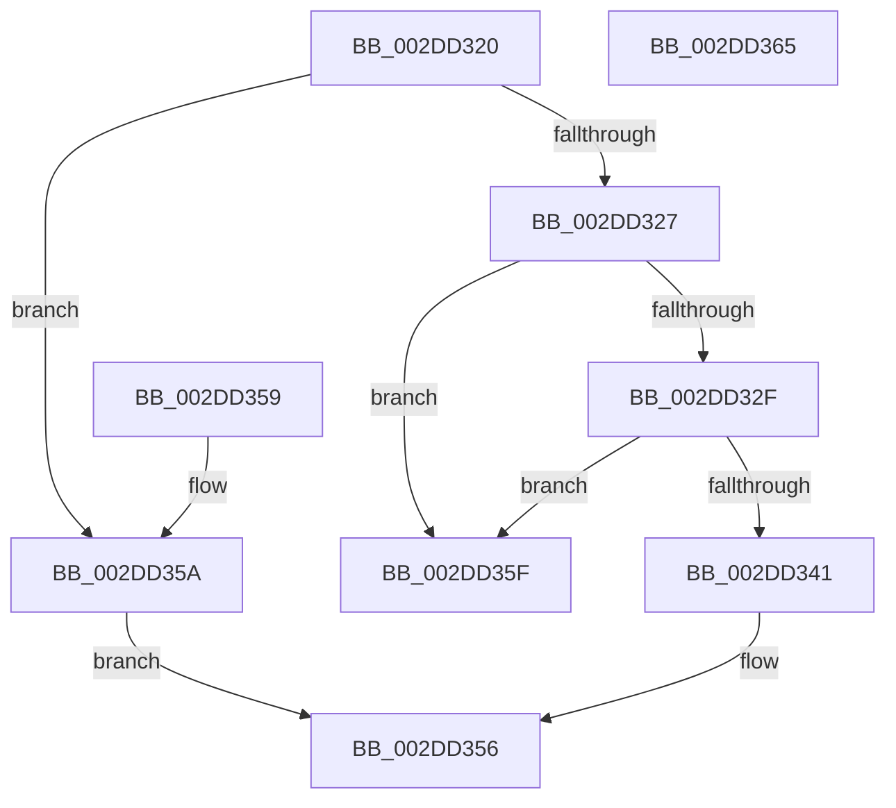

# KeGetProcessorNumberFromIndex

- RVA: `0x002DD320`–`0x002DD366` (길이 `70` bytes)
- VA: `0x00000001402DD320`
- 실행 섹션: `.text`
- PDB 이름 있음: `예`; PDB Function 태그: `아니요`
- unwind 정보 RVA: `0x000DB714`
- 디코드: `24`개 명령, `70/70` bytes 표시
- 미해석 바이트: `0` (있으면 어셈블리에 `.byte`로 보존)

> 이 문서는 커널 이미지의 기계어와 PDB 기호를 분석해 생성했습니다. 4번과 5번은 함수 원형과 자료형을 바이너리 사용 방식에서 추정한 C 해석이며 원본 소스 복구 결과는 아닙니다.

## 1. Dependencies

- 직접 호출 지점: **0**; 고유 호출 대상: **0**
- 직접 호출자로 확인된 함수: **11**
- RIP 상대 이미지 참조: **2**

### Outgoing calls
- 직접 디코드된 call 명령이 없습니다.

### Direct callers
- [KeIntSteerSnapPerf](KeIntSteerSnapPerf_function_002D76C0.md) at `0x002D7A5F`
- [KeSetIdealProcessorThreadByNumber](KeSetIdealProcessorThreadByNumber_function_002DD200.md) at `0x002DD243`
- [HalpInterruptInitializeIpis](../54/HalpInterruptInitializeIpis_function_005462AC.md) at `0x00546409`
- [HalpPmuReservedResourcesProcessorCallback](../54/HalpPmuReservedResourcesProcessorCallback_function_00547608.md) at `0x005476F8`
- [IoGetAffinityInterrupt](../5A/IoGetAffinityInterrupt_function_005A54D0.md) at `0x005A54ED`
- [KiAltContextWorkQueueAddItem](../5C/KiAltContextWorkQueueAddItem_function_005CB028.md) at `0x005CB0B3`
- [WheaFlushETWEventsAddWorkRtn](../66/WheaFlushETWEventsAddWorkRtn_function_0066031C.md) at `0x006603A0`
- [sub_006DDA8E](../6D/Unknown_function_006DDA8E.md) at `0x006DDA9B`
- [PnprAddProcessorResources](../../page/73/PnprAddProcessorResources_function_007392AC.md) at `0x00739374`
- [EtwpProcessorRundown](../../page/7C/EtwpProcessorRundown_function_007C0868.md) at `0x007C08F5`
- [PnprQuiesceProcessorDpc](../../pagelk/B6/PnprQuiesceProcessorDpc_function_00B64B50.md) at `0x00B64C25`

### Static image references
- `0x002DD327` → RVA `0x00FC6AE8` (`ALMOSTRO`; read)
- `0x002DD32F` → RVA `0x00F231B0` (`.data`; read)

## 2. Other-region calls and transfers

- 다른 실행 섹션으로 향하는 call: **0**
- 별도 외부 분기/꼬리 이동을 확인하지 못했습니다.

## 3. Assembly (complete function range)

```asm
002DD320  45 33 C9                        xor r9d, r9d
002DD323  85 C9                           test ecx, ecx
002DD325  74 33                           je 0x1402dd35a
002DD327  3B 0D BB 97 CE 00               cmp ecx, dword ptr [rip + 0xce97bb]
002DD32D  73 30                           jae 0x1402dd35f
002DD32F  48 8B 05 7A 5E C4 00            mov rax, qword ptr [rip + 0xc45e7a]
002DD336  8B C9                           mov ecx, ecx
002DD338  44 8B 04 88                     mov r8d, dword ptr [rax + rcx*4]
002DD33C  45 85 C0                        test r8d, r8d
002DD33F  74 1E                           je 0x1402dd35f
002DD341  41 8B C0                        mov eax, r8d
002DD344  44 88 4A 03                     mov byte ptr [rdx + 3], r9b
002DD348  C1 E8 06                        shr eax, 6
002DD34B  41 80 E0 3F                     and r8b, 0x3f
002DD34F  66 89 02                        mov word ptr [rdx], ax
002DD352  44 88 42 02                     mov byte ptr [rdx + 2], r8b
002DD356  33 C0                           xor eax, eax
002DD358  C3                              ret
002DD359  CC                              int3
002DD35A  44 89 0A                        mov dword ptr [rdx], r9d
002DD35D  EB F7                           jmp 0x1402dd356
002DD35F  B8 0D 00 00 C0                  mov eax, 0xc000000d
002DD364  C3                              ret
002DD365  CC                              int3
```

## 4. C-style interpretation (structured pseudocode)

```c
__int64 __fastcall KeGetProcessorNumberFromIndex(int a1, __int64 a2, __int64 a3, int a4)
{
    __int64 result;

    a4 = 0;
    if (a1 == 0) goto loc_002DD35A;
    if (a1 >= (*(unsigned int *)(v_rip + 13539259))) goto loc_002DD35F;
    if ((unsigned int)((unsigned int)(*(unsigned int *)(*(unsigned __int64 *)(v_rip + 12869242) + (unsigned int)(a1) * 4))) == 0) goto loc_002DD35F;
    *(unsigned __int8 *)(a2 + 3) = 0;
    result = (unsigned int)(((unsigned int)((unsigned int)((unsigned int)(*(unsigned int *)(*(unsigned __int64 *)(v_rip + 12869242) + (unsigned int)(a1) * 4))))) >> (6));
    a3 = (unsigned __int8)(((unsigned int)(*(unsigned int *)(*(unsigned __int64 *)(v_rip + 12869242) + (unsigned int)(a1) * 4))) & (63));
    *(unsigned __int16 *)(a2) = (unsigned __int16)(result);
    *(unsigned __int8 *)(a2 + 2) = (unsigned __int8)(a3);
loc_002DD356:
    result = 0;
    return result;
loc_002DD35A:
    *(unsigned int *)(a2) = 0;
    goto loc_002DD356;
loc_002DD35F:
    return (unsigned int)(0xC000000DULL);
}
```

## 5. (Beta) C Style

```c
int64_t KeGetProcessorNumberFromIndex(int32_t Arg1, void *Arg2, int64_t Arg3, int32_t Arg4)
{
    uint8_t *arg2 = (uint8_t *)Arg2;

    int64_t result;

    Arg4 = 0;
    if (Arg1 == 0) goto loc_002DD35A;
    if (Arg1 >= (*(uint32_t *)(v_rip + 0xCE97BB))) goto loc_002DD35F;
    if ((uint32_t)((uint32_t)(*(uint32_t *)(*(uint64_t *)(v_rip + 0xC45E7A) + (uint32_t)(Arg1) * 4))) == 0) goto loc_002DD35F;
    *(uint8_t *)(arg2 + 0x3) = 0;
    result = (uint32_t)(((uint32_t)((uint32_t)((uint32_t)(*(uint32_t *)(*(uint64_t *)(v_rip + 0xC45E7A) + (uint32_t)(Arg1) * 4))))) >> (6));
    Arg3 = (uint8_t)(((uint32_t)(*(uint32_t *)(*(uint64_t *)(v_rip + 0xC45E7A) + (uint32_t)(Arg1) * 4))) & (63));
    *(uint16_t *)(arg2) = (uint16_t)(result);
    *(uint8_t *)(arg2 + 0x2) = (uint8_t)(Arg3);
loc_002DD356:
    result = 0;
    return result;
loc_002DD35A:
    *(uint32_t *)(arg2) = 0;
    goto loc_002DD356;
loc_002DD35F:
    return (uint32_t)(0xC000000DULL);
}
```

### 관측된 메모리 오프셋

구조체 형식이 확인되지 않은 접근은 인자 기준의 오프셋으로만 기록했습니다.

| 기준 인자 | 오프셋 표현 | 폭 (bit) | 접근 |
|---|---:|---:|---|
| `Arg2` | `+ 0x0` | `16` | `W` |
| `Arg2` | `+ 0x0` | `32` | `W` |
| `Arg2` | `+ 0x2` | `8` | `W` |
| `Arg2` | `+ 0x3` | `8` | `W` |

## 6. Execution-region graph

[열기: 2D/3D 그래프와 함수 탐색 컨트롤 패널](../../../control-panel.html?section=text&rva=0x002DD320&view=graph)

- 2D 그래프는 위에서 아래로 흐르고, 3D 그래프는 빈 공간을 드래그해 회전합니다. Shift+드래그는 이동, 휠은 확대·축소, 함수 노드 선택은 대상 보고서 이동입니다.

### Static fallback


