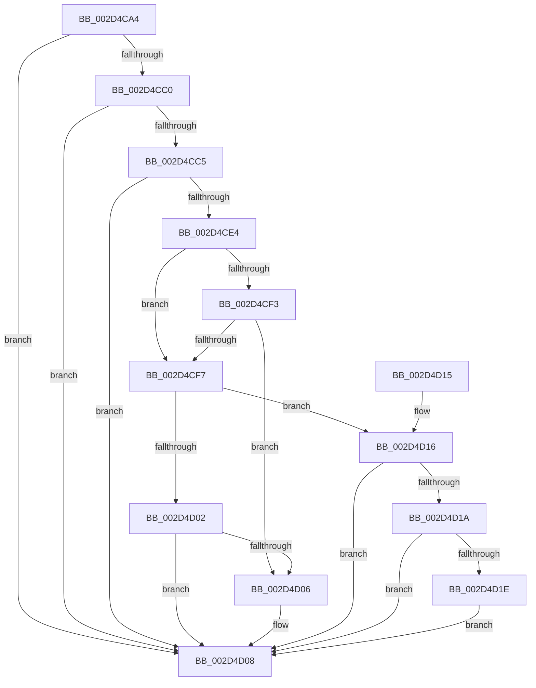

# KeIntSteerGetSteeringMode

- RVA: `0x002D4CA4`–`0x002D4D27` (길이 `131` bytes)
- VA: `0x00000001402D4CA4`
- 실행 섹션: `.text`
- PDB 이름 있음: `예`; PDB Function 태그: `아니요`
- unwind 정보 RVA: `0x0006FBF4`
- 디코드: `46`개 명령, `131/131` bytes 표시
- 미해석 바이트: `0` (있으면 어셈블리에 `.byte`로 보존)

> 이 문서는 커널 이미지의 기계어와 PDB 기호를 분석해 생성했습니다. 4번과 5번은 함수 원형과 자료형을 바이너리 사용 방식에서 추정한 C 해석이며 원본 소스 복구 결과는 아닙니다.

## 1. Dependencies

- 직접 호출 지점: **1**; 고유 호출 대상: **1**
- 직접 호출자로 확인된 함수: **2**
- RIP 상대 이미지 참조: **2**

### Outgoing calls
- `0x002D4CD1` → [IntPartIsInterruptSteerable](IntPartIsInterruptSteerable_function_002D4D30.md) (function, `0x002D4D30`)

### Direct callers
- [KiIntSteerChooseInitialTargetProcessors](KiIntSteerChooseInitialTargetProcessors_function_002D4B98.md) at `0x002D4BDC`
- [ExpQueryInterruptSteeringInformation](../../page/7C/ExpQueryInterruptSteeringInformation_function_007C4844.md) at `0x007C490F`

### Static image references
- `0x002D4CB8` → RVA `0x00F10BA8` (`.data`; read)
- `0x002D4CE4` → RVA `0x00F10A90` (`.data`; read)

## 2. Other-region calls and transfers

- 다른 실행 섹션으로 향하는 call: **0**
- 별도 외부 분기/꼬리 이동을 확인하지 못했습니다.

## 3. Assembly (complete function range)

```asm
002D4CA4  48 8B C4                        mov rax, rsp
002D4CA7  48 89 58 10                     mov qword ptr [rax + 0x10], rbx
002D4CAB  88 48 08                        mov byte ptr [rax + 8], cl
002D4CAE  57                              push rdi
002D4CAF  48 83 EC 20                     sub rsp, 0x20
002D4CB3  33 DB                           xor ebx, ebx
002D4CB5  41 8B F9                        mov edi, r9d
002D4CB8  38 1D EA BE C3 00               cmp byte ptr [rip + 0xc3beea], bl
002D4CBE  74 48                           je 0x1402d4d08
002D4CC0  45 84 C0                        test r8b, r8b
002D4CC3  74 43                           je 0x1402d4d08
002D4CC5  48 8B 4C 24 50                  mov rcx, qword ptr [rsp + 0x50]
002D4CCA  48 8D 50 08                     lea rdx, [rax + 8]
002D4CCE  88 58 08                        mov byte ptr [rax + 8], bl
002D4CD1  E8 5A 00 00 00                  call 0x1402d4d30
002D4CD6  0F B6 4C 24 30                  movzx ecx, byte ptr [rsp + 0x30]
002D4CDB  85 C0                           test eax, eax
002D4CDD  0F 48 CB                        cmovs ecx, ebx
002D4CE0  84 C9                           test cl, cl
002D4CE2  74 24                           je 0x1402d4d08
002D4CE4  8B 05 A6 BD C3 00               mov eax, dword ptr [rip + 0xc3bda6]
002D4CEA  8D 53 01                        lea edx, [rbx + 1]
002D4CED  8B C8                           mov ecx, eax
002D4CEF  23 CA                           and ecx, edx
002D4CF1  74 04                           je 0x1402d4cf7
002D4CF3  85 FF                           test edi, edi
002D4CF5  74 0F                           je 0x1402d4d06
002D4CF7  41 B8 02 00 00 00               mov r8d, 2
002D4CFD  41 84 C0                        test r8b, al
002D4D00  74 14                           je 0x1402d4d16
002D4D02  3B FA                           cmp edi, edx
002D4D04  75 02                           jne 0x1402d4d08
002D4D06  8B DA                           mov ebx, edx
002D4D08  8B C3                           mov eax, ebx
002D4D0A  48 8B 5C 24 38                  mov rbx, qword ptr [rsp + 0x38]
002D4D0F  48 83 C4 20                     add rsp, 0x20
002D4D13  5F                              pop rdi
002D4D14  C3                              ret
002D4D15  CC                              int3
002D4D16  3B FA                           cmp edi, edx
002D4D18  75 EE                           jne 0x1402d4d08
002D4D1A  85 C9                           test ecx, ecx
002D4D1C  74 EA                           je 0x1402d4d08
002D4D1E  41 84 C0                        test r8b, al
002D4D21  41 0F 44 D8                     cmove ebx, r8d
002D4D25  EB E1                           jmp 0x1402d4d08
```

## 4. C-style interpretation (structured pseudocode)

```c
__int64 __fastcall KeIntSteerGetSteeringMode(unsigned __int8 a1, __int64 a2, unsigned __int8 a3, int a4, __int64 a5)
{
    __int64 result;
    __int64 v_rbx;
    __int64 v_rsp;
    unsigned __int64 v_stack_p10;
    unsigned __int8 v_stack_p8;

    *(unsigned __int64 *)(v_rsp + 16) = v_rbx;
    *(unsigned __int8 *)(v_rsp + 8) = a1;
    v_rsp = (v_rsp) - (32);
    v_rbx = 0;
    if ((*(unsigned __int8 *)(v_rip + 12828394)) == 0) goto loc_002D4D08;
    if (a3 == 0) goto loc_002D4D08;
    *(unsigned __int8 *)(v_rsp + 8) = 0;
    result = IntPartIsInterruptSteerable(a5, v_rsp + 8, a3, a4);
    a1 = v_stack_p8;
    if (sign_flag) { a1 = 0; }
    if (a1 == 0) goto loc_002D4D08;
    a1 = (unsigned int)(((unsigned int)((unsigned int)((unsigned int)(*(unsigned int *)(v_rip + 12828070))))) & ((unsigned int)(v_rbx + 1)));
    if (condition_is_equal) goto loc_002D4CF7;
    if ((unsigned int)((unsigned int)(a4)) == 0) goto loc_002D4D06;
loc_002D4CF7:
    if (((2) & ((unsigned __int8)((unsigned int)(*(unsigned int *)(v_rip + 12828070))))) == 0) goto loc_002D4D16;
    if (((unsigned int)((unsigned int)(a4))) == ((unsigned int)(v_rbx + 1))) {
        v_rbx = (unsigned int)(v_rbx + 1);
    }
    v_rsp = (v_rsp) + (32);
    return (unsigned int)((unsigned int)(v_rbx));
loc_002D4D16:
    if (((unsigned int)((unsigned int)(a4))) != ((unsigned int)(v_rbx + 1))) goto loc_002D4D08;
    if (a1 == 0) goto loc_002D4D08;
    v_rbx = v_stack_p10;
    if (((2) & ((unsigned __int8)((unsigned int)((unsigned int)(v_rbx))))) == 0) { v_rbx = 2; }
    goto loc_002D4D08;
}
```

## 5. (Beta) C Style

```c
int64_t KeIntSteerGetSteeringMode(uint8_t Arg1, int64_t Arg2, uint8_t Arg3, int32_t Arg4, int64_t Arg5)
{
    int64_t result;
    int64_t local_rbx;
    int64_t local_rsp;
    uint64_t v_stack_p10;
    uint8_t v_stack_p8;

    *(uint64_t *)(local_rsp + 0x10) = local_rbx;
    *(uint8_t *)(local_rsp + 0x8) = Arg1;
    local_rsp = (local_rsp) - (32);
    local_rbx = 0;
    if ((*(uint8_t *)(v_rip + 0xC3BEEA)) == 0) goto loc_002D4D08;
    if (Arg3 == 0) goto loc_002D4D08;
    *(uint8_t *)(local_rsp + 0x8) = 0;
    result = IntPartIsInterruptSteerable(Arg5, local_rsp + 8, Arg3, Arg4);
    Arg1 = v_stack_p8;
    if (sign_flag) { Arg1 = 0; }
    if (Arg1 == 0) goto loc_002D4D08;
    Arg1 = (uint32_t)(((uint32_t)((uint32_t)((uint32_t)(*(uint32_t *)(v_rip + 0xC3BDA6))))) & ((uint32_t)(local_rbx + 1)));
    if (condition_is_equal) goto loc_002D4CF7;
    if ((uint32_t)((uint32_t)(Arg4)) == 0) goto loc_002D4D06;
loc_002D4CF7:
    if (((2) & ((uint8_t)((uint32_t)(*(uint32_t *)(v_rip + 0xC3BDA6))))) == 0) goto loc_002D4D16;
    if (((uint32_t)((uint32_t)(Arg4))) == ((uint32_t)(local_rbx + 1))) {
        local_rbx = (uint32_t)(local_rbx + 1);
    }
    local_rsp = (local_rsp) + (32);
    return (uint32_t)((uint32_t)(local_rbx));
loc_002D4D16:
    if (((uint32_t)((uint32_t)(Arg4))) != ((uint32_t)(local_rbx + 1))) goto loc_002D4D08;
    if (Arg1 == 0) goto loc_002D4D08;
    local_rbx = v_stack_p10;
    if (((2) & ((uint8_t)((uint32_t)((uint32_t)(local_rbx))))) == 0) { local_rbx = 2; }
    goto loc_002D4D08;
}
```

## 6. Execution-region graph

[열기: 2D/3D 그래프와 함수 탐색 컨트롤 패널](../../../control-panel.html?section=text&rva=0x002D4CA4&view=graph)

- 2D 그래프는 위에서 아래로 흐르고, 3D 그래프는 빈 공간을 드래그해 회전합니다. Shift+드래그는 이동, 휠은 확대·축소, 함수 노드 선택은 대상 보고서 이동입니다.

### Static fallback


