# KeIntSteerPeriodic

- RVA: `0x002D6D04`–`0x002D6F13` (길이 `527` bytes)
- VA: `0x00000001402D6D04`
- 실행 섹션: `.text`
- PDB 이름 있음: `예`; PDB Function 태그: `예`
- unwind 정보 RVA: `0x0006FEA4`
- 디코드: `133`개 명령, `527/527` bytes 표시
- 미해석 바이트: `0` (있으면 어셈블리에 `.byte`로 보존)

> 이 문서는 커널 이미지의 기계어와 PDB 기호를 분석해 생성했습니다. 4번과 5번은 함수 원형과 자료형을 바이너리 사용 방식에서 추정한 C 해석이며 원본 소스 복구 결과는 아닙니다.

## 1. Dependencies

- 직접 호출 지점: **9**; 고유 호출 대상: **9**
- 직접 호출자로 확인된 함수: **1**
- RIP 상대 이미지 참조: **13**

### Outgoing calls
- `0x002D6D44` → [KeAcquireSpinLockRaiseToDpc](../20/KeAcquireSpinLockRaiseToDpc_function_00208470.md) (function, `0x00208470`)
- `0x002D6E1E` → [KiIntSteerCalculateDistribution](KiIntSteerCalculateDistribution_function_002D7420.md) (function, `0x002D7420`)
- `0x002D6E25` → [KiIntSteerLogMask](KiIntSteerLogMask_function_002D71B8.md) (function, `0x002D71B8`)
- `0x002D6E2C` → [KiIntSteerLogProc](KiIntSteerLogProc_function_002D72D8.md) (function, `0x002D72D8`)
- `0x002D6E38` → [KiIntSteerEtwEventEnabled](KiIntSteerEtwEventEnabled_function_002D7128.md) (function, `0x002D7128`)
- `0x002D6E45` → [KiIntSteerDistributeInterrupts](KiIntSteerDistributeInterrupts_function_002D6F20.md) (function, `0x002D6F20`)
- `0x002D6E6B` → [KiLowerIrqlProcessIrqlFlags](../4F/KiLowerIrqlProcessIrqlFlags_function_004F5698.md) (function, `0x004F5698`)
- `0x002D6E7E` → [_security_check_cookie](../6A/_security_check_cookie_function_006AC640.md) (function, `0x006AC640`)
- `0x002D6EBB` → [KiReleaseSpinLockInstrumented](../39/KiReleaseSpinLockInstrumented_function_00392EF0.md) (function, `0x00392EF0`)

### Direct callers
- [sub_002D6584](Unknown_function_002D6584.md) at `0x002D6A52`

### Static image references
- `0x002D6D13` → RVA `0x00E0A740` (`.data`; read)
- `0x002D6D3D` → RVA `0x00F10CF0` (`.data`; read)
- `0x002D6D9E` → RVA `0x00F10BE2` (`.data`; read)
- `0x002D6DA5` → RVA `0x00F10BE0` (`.data`; read)
- `0x002D6DBF` → RVA `0x00F10BE2` (`.data`; write)
- `0x002D6DC6` → RVA `0x00F10BE4` (`.data`; write)
- `0x002D6DD2` → RVA `0x00F10BE0` (`.data`; write)
- `0x002D6E31` → RVA `0x00010AD8` (`.rdata`; read)
- `0x002D6E4A` → RVA `0x00FC6B06` (`ALMOSTRO`; read)
- `0x002D6E53` → RVA `0x00F10CF0` (`.data`; read/write)
- `0x002D6E5B` → RVA `0x00FC6D20` (`ALMOSTRO`; read)
- `0x002D6EA2` → RVA `0x00F0DE58` (`.data`; read)
- `0x002D6EDA` → RVA `0x00F10D50` (`.data`; read)

## 2. Other-region calls and transfers

- 다른 실행 섹션으로 향하는 call: **0**
- call이 아닌 외부 분기/꼬리 이동: **1**
  - `0x002D6F0E` → [sub_006DDC12 + 0x12](../6D/Unknown_function_006DDC12.md) (`tail-transfer`)

## 3. Assembly (complete function range)

```asm
002D6D04  40 53                           push rbx
002D6D06  55                              push rbp
002D6D07  56                              push rsi
002D6D08  57                              push rdi
002D6D09  41 54                           push r12
002D6D0B  41 56                           push r14
002D6D0D  41 57                           push r15
002D6D0F  48 83 EC 60                     sub rsp, 0x60
002D6D13  48 8B 05 26 3A B3 00            mov rax, qword ptr [rip + 0xb33a26]
002D6D1A  48 33 C4                        xor rax, rsp
002D6D1D  48 89 44 24 50                  mov qword ptr [rsp + 0x50], rax
002D6D22  45 33 E4                        xor r12d, r12d
002D6D25  49 8B E9                        mov rbp, r9
002D6D28  49 8B D8                        mov rbx, r8
002D6D2B  48 8B FA                        mov rdi, rdx
002D6D2E  4C 8B F9                        mov r15, rcx
002D6D31  48 85 D2                        test rdx, rdx
002D6D34  0F 84 59 01 00 00               je 0x1402d6e93
002D6D3A  48 8B F2                        mov rsi, rdx
002D6D3D  48 8D 0D AC 9F C3 00            lea rcx, [rip + 0xc39fac]
002D6D44  E8 27 17 F3 FF                  call 0x140208470
002D6D49  44 0F B6 F0                     movzx r14d, al
002D6D4D  0F 57 C0                        xorps xmm0, xmm0
002D6D50  0F 11 44 24 40                  movups xmmword ptr [rsp + 0x40], xmm0
002D6D55  48 85 FF                        test rdi, rdi
002D6D58  74 13                           je 0x1402d6d6d
002D6D5A  66 44 3B 27                     cmp r12w, word ptr [rdi]
002D6D5E  0F 83 66 01 00 00               jae 0x1402d6eca
002D6D64  48 8B 4F 08                     mov rcx, qword ptr [rdi + 8]
002D6D68  48 89 4C 24 40                  mov qword ptr [rsp + 0x40], rcx
002D6D6D  0F 11 44 24 30                  movups xmmword ptr [rsp + 0x30], xmm0
002D6D72  48 85 DB                        test rbx, rbx
002D6D75  74 13                           je 0x1402d6d8a
002D6D77  66 44 3B 23                     cmp r12w, word ptr [rbx]
002D6D7B  0F 83 51 01 00 00               jae 0x1402d6ed2
002D6D81  48 8B 43 08                     mov rax, qword ptr [rbx + 8]
002D6D85  48 89 44 24 30                  mov qword ptr [rsp + 0x30], rax
002D6D8A  0F 11 44 24 20                  movups xmmword ptr [rsp + 0x20], xmm0
002D6D8F  66 44 3B 65 00                  cmp r12w, word ptr [rbp]
002D6D94  0F 83 28 01 00 00               jae 0x1402d6ec2
002D6D9A  48 8B 45 08                     mov rax, qword ptr [rbp + 8]
002D6D9E  0F B7 0D 3D 9E C3 00            movzx ecx, word ptr [rip + 0xc39e3d]
002D6DA5  4C 8D 0D 34 9E C3 00            lea r9, [rip + 0xc39e34]
002D6DAC  48 89 44 24 20                  mov qword ptr [rsp + 0x20], rax
002D6DB1  44 0F B7 C1                     movzx r8d, cx
002D6DB5  0F B7 06                        movzx eax, word ptr [rsi]
002D6DB8  41 0F B7 D4                     movzx edx, r12w
002D6DBC  66 3B C1                        cmp ax, cx
002D6DBF  66 89 0D 1C 9E C3 00            mov word ptr [rip + 0xc39e1c], cx
002D6DC6  44 89 25 17 9E C3 00            mov dword ptr [rip + 0xc39e17], r12d
002D6DCD  66 44 0F 46 C0                  cmovbe r8w, ax
002D6DD2  66 44 89 05 06 9E C3 00         mov word ptr [rip + 0xc39e06], r8w
002D6DDA  66 45 3B E0                     cmp r12w, r8w
002D6DDE  73 23                           jae 0x1402d6e03
002D6DE0  0F B7 CA                        movzx ecx, dx
002D6DE3  66 FF C2                        inc dx
002D6DE6  48 8B 44 CE 08                  mov rax, qword ptr [rsi + rcx*8 + 8]
002D6DEB  49 89 44 C9 08                  mov qword ptr [r9 + rcx*8 + 8], rax
002D6DF0  66 41 3B D0                     cmp dx, r8w
002D6DF4  73 0D                           jae 0x1402d6e03
002D6DF6  EB E8                           jmp 0x1402d6de0
002D6DF8  0F B7 C2                        movzx eax, dx
002D6DFB  66 FF C2                        inc dx
002D6DFE  4D 89 64 C1 08                  mov qword ptr [r9 + rax*8 + 8], r12
002D6E03  66 3B 15 D8 9D C3 00            cmp dx, word ptr [rip + 0xc39dd8]
002D6E0A  72 EC                           jb 0x1402d6df8
002D6E0C  4C 8D 4C 24 20                  lea r9, [rsp + 0x20]
002D6E11  49 8B CF                        mov rcx, r15
002D6E14  4C 8D 44 24 30                  lea r8, [rsp + 0x30]
002D6E19  48 8D 54 24 40                  lea rdx, [rsp + 0x40]
002D6E1E  E8 FD 05 00 00                  call 0x1402d7420
002D6E23  33 C9                           xor ecx, ecx
002D6E25  E8 8E 03 00 00                  call 0x1402d71b8
002D6E2A  33 C9                           xor ecx, ecx
002D6E2C  E8 A7 04 00 00                  call 0x1402d72d8
002D6E31  48 8D 0D A0 9C D3 FF            lea rcx, [rip - 0x2c6360]
002D6E38  E8 EB 02 00 00                  call 0x1402d7128
002D6E3D  84 C0                           test al, al
002D6E3F  0F 85 95 00 00 00               jne 0x1402d6eda
002D6E45  E8 D6 00 00 00                  call 0x1402d6f20
002D6E4A  F6 05 B5 FC CE 00 01            test byte ptr [rip + 0xcefcb5], 1
002D6E51  75 4F                           jne 0x1402d6ea2
002D6E53  F0 4C 21 25 95 9E C3 00         lock and qword ptr [rip + 0xc39e95], r12
002D6E5B  44 39 25 BE FE CE 00            cmp dword ptr [rip + 0xcefebe], r12d
002D6E62  74 0C                           je 0x1402d6e70
002D6E64  44 0F 20 C1                     mov rcx, cr8
002D6E68  41 8A D6                        mov dl, r14b
002D6E6B  E8 28 E8 21 00                  call 0x1404f5698
002D6E70  45 0F 22 C6                     mov cr8, r14
002D6E74  33 C0                           xor eax, eax
002D6E76  48 8B 4C 24 50                  mov rcx, qword ptr [rsp + 0x50]
002D6E7B  48 33 CC                        xor rcx, rsp
002D6E7E  E8 BD 57 3D 00                  call 0x1406ac640
002D6E83  48 83 C4 60                     add rsp, 0x60
002D6E87  41 5F                           pop r15
002D6E89  41 5E                           pop r14
002D6E8B  41 5C                           pop r12
002D6E8D  5F                              pop rdi
002D6E8E  5E                              pop rsi
002D6E8F  5D                              pop rbp
002D6E90  5B                              pop rbx
002D6E91  C3                              ret
002D6E92  CC                              int3
002D6E93  48 85 DB                        test rbx, rbx
002D6E96  48 8B F5                        mov rsi, rbp
002D6E99  48 0F 45 F3                     cmovne rsi, rbx
002D6E9D  E9 9B FE FF FF                  jmp 0x1402d6d3d
002D6EA2  8B 05 B0 6F C3 00               mov eax, dword ptr [rip + 0xc36fb0]
002D6EA8  85 C0                           test eax, eax
002D6EAA  75 A7                           jne 0x1402d6e53
002D6EAC  48 8B 94 24 98 00 00 00         mov rdx, qword ptr [rsp + 0x98]
002D6EB4  48 8D 0D 35 9E C3 00            lea rcx, [rip + 0xc39e35]
002D6EBB  E8 30 C0 0B 00                  call 0x140392ef0
002D6EC0  EB 99                           jmp 0x1402d6e5b
002D6EC2  49 8B C4                        mov rax, r12
002D6EC5  E9 D4 FE FF FF                  jmp 0x1402d6d9e
002D6ECA  49 8B CC                        mov rcx, r12
002D6ECD  E9 96 FE FF FF                  jmp 0x1402d6d68
002D6ED2  49 8B C4                        mov rax, r12
002D6ED5  E9 AB FE FF FF                  jmp 0x1402d6d85
002D6EDA  48 8B 1D 6F 9E C3 00            mov rbx, qword ptr [rip + 0xc39e6f]
002D6EE1  48 8D 2D 68 9E C3 00            lea rbp, [rip + 0xc39e68]
002D6EE8  EB 13                           jmp 0x1402d6efd
002D6EEA  48 8B 83 A0 00 00 00            mov rax, qword ptr [rbx + 0xa0]
002D6EF1  48 39 83 B0 00 00 00            cmp qword ptr [rbx + 0xb0], rax
002D6EF8  75 0D                           jne 0x1402d6f07
002D6EFA  48 8B 1B                        mov rbx, qword ptr [rbx]
002D6EFD  48 3B DD                        cmp rbx, rbp
002D6F00  75 E8                           jne 0x1402d6eea
002D6F02  E9 3E FF FF FF                  jmp 0x1402d6e45
002D6F07  48 8D 73 10                     lea rsi, [rbx + 0x10]
002D6F0B  48 8B 3E                        mov rdi, qword ptr [rsi]
002D6F0E  E9 11 6D 40 00                  jmp 0x1406ddc24
```

## 4. C-style interpretation (structured pseudocode)

```c
__int64 __fastcall KeIntSteerPeriodic(__int64 a1, __int64 a2, __int64 a3, __int64 a4)
{
    __int64 result;
    __int64 v_r12;
    __int64 v_rsp;
    unsigned __int64 v_stack_m48;
    unsigned __int64 v_stack_m58;
    unsigned __int64 v_stack_m68;
    unsigned __int64 v_stack_m78;
    unsigned __int64 v_stack_p98;

    v_rsp = (v_rsp) - (96);
    result = (*(unsigned __int64 *)(v_rip + 11745830)) ^ (v_rsp);
    v_stack_m48 = result;
    v_r12 = 0;
    if (a2 == 0) goto loc_002D6E93;
loc_002D6D3D:
    result = KeAcquireSpinLockRaiseToDpc(v_rip + 12820396, a2, a3, a4);
    v_stack_m58 = v_xmm0;
    if (a2 == 0) goto loc_002D6D6D;
    if (0 >= (*(unsigned __int16 *)(a2))) goto loc_002D6ECA;
loc_002D6D68:
    v_stack_m58 = *(unsigned __int64 *)(a2 + 8);
loc_002D6D6D:
    v_stack_m68 = v_xmm0;
    if (a3 == 0) goto loc_002D6D8A;
    if (0 >= (*(unsigned __int16 *)(a3))) goto loc_002D6ED2;
loc_002D6D85:
    v_stack_m68 = *(unsigned __int64 *)(a3 + 8);
loc_002D6D8A:
    v_stack_m78 = v_xmm0;
    if (0 >= (*(unsigned __int16 *)(a4))) goto loc_002D6EC2;
loc_002D6D9E:
    v_stack_m78 = *(unsigned __int64 *)(a4 + 8);
    *(unsigned __int16 *)(v_rip + 12819996) = (unsigned __int16)(*(unsigned __int16 *)(v_rip + 12820029));
    *(unsigned int *)(v_rip + 12819991) = 0;
    a3 = (unsigned __int16)(*(unsigned __int16 *)(v_rip + 12820029));
    if (((unsigned __int16)(*(unsigned __int16 *)(a2))) <= ((unsigned __int16)(*(unsigned __int16 *)(v_rip + 12820029)))) { a3 = (unsigned __int16)(*(unsigned __int16 *)(a2)); }
    *(unsigned __int16 *)(v_rip + 12819974) = (unsigned __int16)(a3);
    if (0 >= ((unsigned __int16)(a3))) goto loc_002D6E03;
loc_002D6DE0:
    a2 = (unsigned __int16)((0) + 1);
    *(unsigned __int64 *)(v_rip + 12820020 + 0 * 8 + 8) = *(unsigned __int64 *)(a2 + 0 * 8 + 8);
    if (((unsigned __int16)(a2)) >= ((unsigned __int16)(a3))) goto loc_002D6E03;
    goto loc_002D6DE0;
loc_002D6DF8:
    a2 = (unsigned __int16)((a2) + 1);
    *(unsigned __int64 *)(v_rip + 12820020 + (unsigned __int16)(a2) * 8 + 8) = 0;
loc_002D6E03:
    if (((unsigned __int16)(a2)) < (*(unsigned __int16 *)(v_rip + 12819928))) goto loc_002D6DF8;
    result = KiIntSteerCalculateDistribution(a1, v_stack_m58, v_stack_m68, v_stack_m78);
    a1 = 0;
    result = KiIntSteerLogMask(a1, v_stack_m58, v_stack_m68, v_stack_m78);
    a1 = 0;
    result = KiIntSteerLogProc(a1, v_stack_m58, v_stack_m68, v_stack_m78);
    result = KiIntSteerEtwEventEnabled(v_rip - 2909024, v_stack_m58, v_stack_m68, v_stack_m78);
    if ((unsigned __int8)(result) != 0) goto loc_002D6EDA;
loc_002D6E45:
    result = KiIntSteerDistributeInterrupts(v_rip - 2909024, v_stack_m58, v_stack_m68, v_stack_m78);
    if (((*(unsigned __int8 *)(v_rip + 13565109)) & (1)) != 0) goto loc_002D6EA2;
loc_002D6E53:
loc_002D6E5B:
    if ((*(unsigned int *)(v_rip + 13565630)) != 0) {
        a1 = v_cr8;
        a2 = (unsigned __int8)((unsigned __int8)(result));
        result = KiLowerIrqlProcessIrqlFlags(a1, a2, v_stack_m68, v_stack_m78);
    }
    result = 0;
    a1 = (v_stack_m48) ^ (v_rsp);
    result = _security_check_cookie(a1, a2, v_stack_m68, v_stack_m78);
    v_rsp = (v_rsp) + (96);
    return result;
loc_002D6E93:
    if (a3 != 0) { a4 = a3; }
    goto loc_002D6D3D;
loc_002D6EA2:
    if ((unsigned int)((unsigned int)(*(unsigned int *)(v_rip + 12808112))) != 0) goto loc_002D6E53;
    result = KiReleaseSpinLockInstrumented(v_rip + 12820021, v_stack_p98, v_stack_m68, v_stack_m78);
    goto loc_002D6E5B;
loc_002D6EC2:
    goto loc_002D6D9E;
loc_002D6ECA:
    goto loc_002D6D68;
loc_002D6ED2:
    goto loc_002D6D85;
loc_002D6EDA:
    goto loc_002D6EFD;
loc_002D6EEA:
    if ((*(unsigned __int64 *)(*(unsigned __int64 *)(v_rip + 12820079) + 176)) != (*(unsigned __int64 *)(*(unsigned __int64 *)(v_rip + 12820079) + 160))) goto loc_002D6F07;
loc_002D6EFD:
    if ((*(unsigned __int64 *)(*(unsigned __int64 *)(v_rip + 12820079))) != (v_rip + 12820072)) goto loc_002D6EEA;
    goto loc_002D6E45;
loc_002D6F07:
}
```

## 5. (Beta) C Style

```c
int64_t KeIntSteerPeriodic(int64_t Arg1, int64_t Arg2, int64_t Arg3, void *Arg4)
{
    uint8_t *arg4 = (uint8_t *)Arg4;

    int64_t result;
    int64_t local_r12;
    int64_t local_rsp;
    uint64_t v_stack_m48;
    uint64_t v_stack_m58;
    uint64_t v_stack_m68;
    uint64_t v_stack_m78;
    uint64_t v_stack_p98;

    local_rsp = (local_rsp) - (96);
    result = (*(uint64_t *)(v_rip + 0xB33A26)) ^ (local_rsp);
    v_stack_m48 = result;
    local_r12 = 0;
    if (Arg2 == 0) goto loc_002D6E93;
loc_002D6D3D:
    result = KeAcquireSpinLockRaiseToDpc(v_rip + 12820396, Arg2, Arg3, Arg4);
    v_stack_m58 = v_xmm0;
    if (Arg2 == 0) goto loc_002D6D6D;
    if (0 >= (*(uint16_t *)(Arg2))) goto loc_002D6ECA;
loc_002D6D68:
    v_stack_m58 = *(uint64_t *)(Arg2 + 0x8);
loc_002D6D6D:
    v_stack_m68 = v_xmm0;
    if (Arg3 == 0) goto loc_002D6D8A;
    if (0 >= (*(uint16_t *)(Arg3))) goto loc_002D6ED2;
loc_002D6D85:
    v_stack_m68 = *(uint64_t *)(Arg3 + 0x8);
loc_002D6D8A:
    v_stack_m78 = v_xmm0;
    if (0 >= (*(uint16_t *)(arg4))) goto loc_002D6EC2;
loc_002D6D9E:
    v_stack_m78 = *(uint64_t *)(arg4 + 0x8);
    *(uint16_t *)(v_rip + 0xC39E1C) = (uint16_t)(*(uint16_t *)(v_rip + 0xC39E3D));
    *(uint32_t *)(v_rip + 0xC39E17) = 0;
    Arg3 = (uint16_t)(*(uint16_t *)(v_rip + 0xC39E3D));
    if (((uint16_t)(*(uint16_t *)(Arg2))) <= ((uint16_t)(*(uint16_t *)(v_rip + 0xC39E3D)))) { Arg3 = (uint16_t)(*(uint16_t *)(Arg2)); }
    *(uint16_t *)(v_rip + 0xC39E06) = (uint16_t)(Arg3);
    if (0 >= ((uint16_t)(Arg3))) goto loc_002D6E03;
loc_002D6DE0:
    Arg2 = (uint16_t)((0) + 1);
    *(uint64_t *)(v_rip + 0xC39E34 + 0x0 * 8 + 0x8) = *(uint64_t *)(Arg2 + 0x0 * 8 + 0x8);
    if (((uint16_t)(Arg2)) >= ((uint16_t)(Arg3))) goto loc_002D6E03;
    goto loc_002D6DE0;
loc_002D6DF8:
    Arg2 = (uint16_t)((Arg2) + 1);
    *(uint64_t *)(v_rip + 0xC39E34 + (uint16_t)(Arg2) * 8 + 0x8) = 0;
loc_002D6E03:
    if (((uint16_t)(Arg2)) < (*(uint16_t *)(v_rip + 0xC39DD8))) goto loc_002D6DF8;
    result = KiIntSteerCalculateDistribution(Arg1, v_stack_m58, v_stack_m68, v_stack_m78);
    Arg1 = 0;
    result = KiIntSteerLogMask(Arg1, v_stack_m58, v_stack_m68, v_stack_m78);
    Arg1 = 0;
    result = KiIntSteerLogProc(Arg1, v_stack_m58, v_stack_m68, v_stack_m78);
    result = KiIntSteerEtwEventEnabled(v_rip - 2909024, v_stack_m58, v_stack_m68, v_stack_m78);
    if ((uint8_t)(result) != 0) goto loc_002D6EDA;
loc_002D6E45:
    result = KiIntSteerDistributeInterrupts(v_rip - 2909024, v_stack_m58, v_stack_m68, v_stack_m78);
    if (((*(uint8_t *)(v_rip + 0xCEFCB5)) & (1)) != 0) goto loc_002D6EA2;
loc_002D6E53:
loc_002D6E5B:
    if ((*(uint32_t *)(v_rip + 0xCEFEBE)) != 0) {
        Arg1 = v_cr8;
        Arg2 = (uint8_t)((uint8_t)(result));
        result = KiLowerIrqlProcessIrqlFlags(Arg1, Arg2, v_stack_m68, v_stack_m78);
    }
    result = 0;
    Arg1 = (v_stack_m48) ^ (local_rsp);
    result = _security_check_cookie(Arg1, Arg2, v_stack_m68, v_stack_m78);
    local_rsp = (local_rsp) + (96);
    return result;
loc_002D6E93:
    if (Arg3 != 0) { Arg4 = Arg3; }
    goto loc_002D6D3D;
loc_002D6EA2:
    if ((uint32_t)((uint32_t)(*(uint32_t *)(v_rip + 0xC36FB0))) != 0) goto loc_002D6E53;
    result = KiReleaseSpinLockInstrumented(v_rip + 12820021, v_stack_p98, v_stack_m68, v_stack_m78);
    goto loc_002D6E5B;
loc_002D6EC2:
    goto loc_002D6D9E;
loc_002D6ECA:
    goto loc_002D6D68;
loc_002D6ED2:
    goto loc_002D6D85;
loc_002D6EDA:
    goto loc_002D6EFD;
loc_002D6EEA:
    if ((*(uint64_t *)(*(uint64_t *)(v_rip + 0xC39E6F) + 0xB0)) != (*(uint64_t *)(*(uint64_t *)(v_rip + 0xC39E6F) + 0xA0))) goto loc_002D6F07;
loc_002D6EFD:
    if ((*(uint64_t *)(*(uint64_t *)(v_rip + 0xC39E6F))) != (v_rip + 12820072)) goto loc_002D6EEA;
    goto loc_002D6E45;
loc_002D6F07:
}
```

### 관측된 메모리 오프셋

구조체 형식이 확인되지 않은 접근은 인자 기준의 오프셋으로만 기록했습니다.

| 기준 인자 | 오프셋 표현 | 폭 (bit) | 접근 |
|---|---:|---:|---|
| `Arg4` | `+ 0x0` | `16` | `R` |
| `Arg4` | `+ 0x8` | `64` | `R` |

## 6. Execution-region graph

[열기: 2D/3D 그래프와 함수 탐색 컨트롤 패널](../../../control-panel.html?section=text&rva=0x002D6D04&view=graph)

- 2D 그래프는 위에서 아래로 흐르고, 3D 그래프는 빈 공간을 드래그해 회전합니다. Shift+드래그는 이동, 휠은 확대·축소, 함수 노드 선택은 대상 보고서 이동입니다.

### Static fallback

```mermaid
flowchart TD
  bb_002D6D04[BB_002D6D04]
  bb_002D6D3A[BB_002D6D3A]
  bb_002D6D3D[BB_002D6D3D]
  bb_002D6D5A[BB_002D6D5A]
  bb_002D6D64[BB_002D6D64]
  bb_002D6D68[BB_002D6D68]
  bb_002D6D6D[BB_002D6D6D]
  bb_002D6D77[BB_002D6D77]
  bb_002D6D81[BB_002D6D81]
  bb_002D6D85[BB_002D6D85]
  bb_002D6D8A[BB_002D6D8A]
  bb_002D6D9A[BB_002D6D9A]
  bb_002D6D9E[BB_002D6D9E]
  bb_002D6DE0[BB_002D6DE0]
  bb_002D6DF6[BB_002D6DF6]
  bb_002D6DF8[BB_002D6DF8]
  bb_002D6E03[BB_002D6E03]
  bb_002D6E0C[BB_002D6E0C]
  bb_002D6E45[BB_002D6E45]
  bb_002D6E53[BB_002D6E53]
  bb_002D6E5B[BB_002D6E5B]
  bb_002D6E64[BB_002D6E64]
  bb_002D6E70[BB_002D6E70]
  bb_002D6E92[BB_002D6E92]
  bb_002D6E93[BB_002D6E93]
  bb_002D6EA2[BB_002D6EA2]
  bb_002D6EAC[BB_002D6EAC]
  bb_002D6EC2[BB_002D6EC2]
  bb_002D6ECA[BB_002D6ECA]
  bb_002D6ED2[BB_002D6ED2]
  bb_002D6EDA[BB_002D6EDA]
  bb_002D6EEA[BB_002D6EEA]
  bb_002D6EFA[BB_002D6EFA]
  bb_002D6EFD[BB_002D6EFD]
  bb_002D6F02[BB_002D6F02]
  bb_002D6F07[BB_002D6F07]
  bb_002D6D04 -->|branch| bb_002D6E93
  bb_002D6D04 -->|fallthrough| bb_002D6D3A
  bb_002D6D3A -->|flow| bb_002D6D3D
  bb_002D6D3D -->|branch| bb_002D6D6D
  bb_002D6D3D -->|fallthrough| bb_002D6D5A
  bb_002D6D5A -->|branch| bb_002D6ECA
  bb_002D6D5A -->|fallthrough| bb_002D6D64
  bb_002D6D64 -->|flow| bb_002D6D68
  bb_002D6D68 -->|flow| bb_002D6D6D
  bb_002D6D6D -->|branch| bb_002D6D8A
  bb_002D6D6D -->|fallthrough| bb_002D6D77
  bb_002D6D77 -->|branch| bb_002D6ED2
  bb_002D6D77 -->|fallthrough| bb_002D6D81
  bb_002D6D81 -->|flow| bb_002D6D85
  bb_002D6D85 -->|flow| bb_002D6D8A
  bb_002D6D8A -->|branch| bb_002D6EC2
  bb_002D6D8A -->|fallthrough| bb_002D6D9A
  bb_002D6D9A -->|flow| bb_002D6D9E
  bb_002D6D9E -->|branch| bb_002D6E03
  bb_002D6D9E -->|fallthrough| bb_002D6DE0
  bb_002D6DE0 -->|branch| bb_002D6E03
  bb_002D6DE0 -->|fallthrough| bb_002D6DF6
  bb_002D6DF6 -->|branch| bb_002D6DE0
  bb_002D6DF8 -->|flow| bb_002D6E03
  bb_002D6E03 -->|branch| bb_002D6DF8
  bb_002D6E03 -->|fallthrough| bb_002D6E0C
  bb_002D6E0C -->|branch| bb_002D6EDA
  bb_002D6E0C -->|fallthrough| bb_002D6E45
  bb_002D6E45 -->|branch| bb_002D6EA2
  bb_002D6E45 -->|fallthrough| bb_002D6E53
  bb_002D6E53 -->|flow| bb_002D6E5B
  bb_002D6E5B -->|branch| bb_002D6E70
  bb_002D6E5B -->|fallthrough| bb_002D6E64
  bb_002D6E64 -->|flow| bb_002D6E70
  bb_002D6E92 -->|flow| bb_002D6E93
  bb_002D6E93 -->|branch| bb_002D6D3D
  bb_002D6EA2 -->|branch| bb_002D6E53
  bb_002D6EA2 -->|fallthrough| bb_002D6EAC
  bb_002D6EAC -->|branch| bb_002D6E5B
  bb_002D6EC2 -->|branch| bb_002D6D9E
  bb_002D6ECA -->|branch| bb_002D6D68
  bb_002D6ED2 -->|branch| bb_002D6D85
  bb_002D6EDA -->|branch| bb_002D6EFD
  bb_002D6EEA -->|branch| bb_002D6F07
  bb_002D6EEA -->|fallthrough| bb_002D6EFA
  bb_002D6EFA -->|flow| bb_002D6EFD
  bb_002D6EFD -->|branch| bb_002D6EEA
  bb_002D6EFD -->|fallthrough| bb_002D6F02
  bb_002D6F02 -->|branch| bb_002D6E45
```


