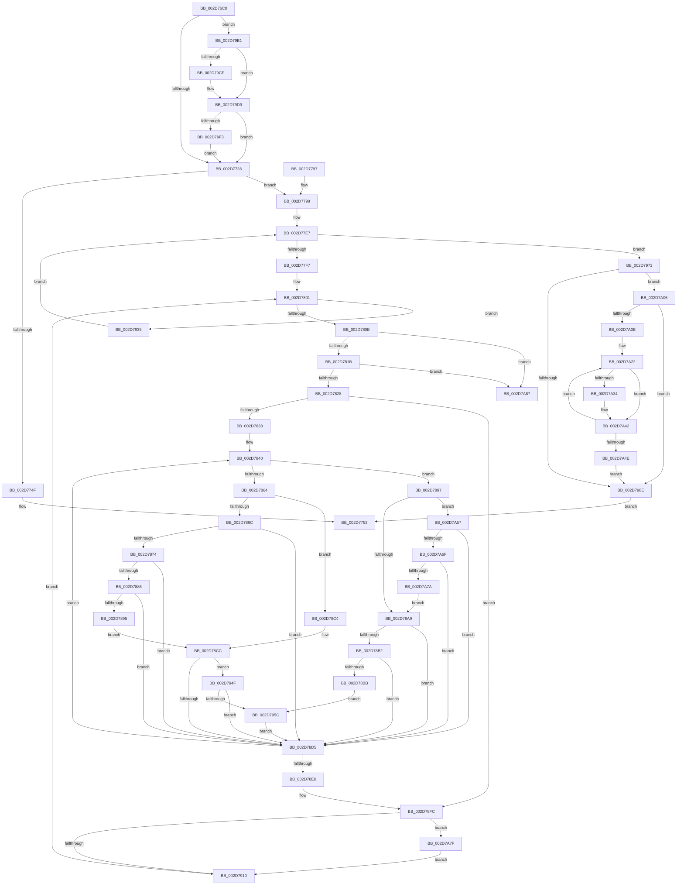

# KeIntSteerSnapPerf

- RVA: `0x002D76C0`–`0x002D7A8E` (길이 `974` bytes)
- VA: `0x00000001402D76C0`
- 실행 섹션: `.text`
- PDB 이름 있음: `예`; PDB Function 태그: `아니요`
- unwind 정보 RVA: `0x0006FFD8`
- 디코드: `240`개 명령, `974/974` bytes 표시
- 미해석 바이트: `0` (있으면 어셈블리에 `.byte`로 보존)

> 이 문서는 커널 이미지의 기계어와 PDB 기호를 분석해 생성했습니다. 4번과 5번은 함수 원형과 자료형을 바이너리 사용 방식에서 추정한 C 해석이며 원본 소스 복구 결과는 아닙니다.

## 1. Dependencies

- 직접 호출 지점: **11**; 고유 호출 대상: **10**
- 직접 호출자로 확인된 함수: **1**
- RIP 상대 이미지 참조: **16**

### Outgoing calls
- `0x002D772C` → [RtlGetInterruptTimePrecise](../20/RtlGetInterruptTimePrecise_function_0020A4C0.md) (function, `0x0020A4C0`)
- `0x002D776F` → [_security_check_cookie](../6A/_security_check_cookie_function_006AC640.md) (function, `0x006AC640`)
- `0x002D77B8` → [memset](../6C/memset_function_006C6C40.md) (function, `0x006C6C40`)
- `0x002D77D5` → [KeAcquireSpinLockRaiseToDpc](../20/KeAcquireSpinLockRaiseToDpc_function_00208470.md) (function, `0x00208470`)
- `0x002D7858` → [Feature_Servicing_KeIntSteerProcessorIndex__private_IsEnabledDeviceUsageNoInline](../4F/Feature_Servicing_KeIntSteerProcessorIndex__private_IsEnabledDeviceUsageNoInline_function_004F0844.md) (function, `0x004F0844`)
- `0x002D797D` → [KeReleaseSpinLock](../39/KeReleaseSpinLock_function_00392BA0.md) (function, `0x00392BA0`)
- `0x002D79B3` → [KeQueryActiveProcessorCountEx](../24/KeQueryActiveProcessorCountEx_function_00249EF0.md) (function, `0x00249EF0`)
- `0x002D79DD` → [_chkstk](../6B/_chkstk_function_006BA960.md) (function, `0x006BA960`)
- `0x002D79FC` → [memset](../6C/memset_function_006C6C40.md) (function, `0x006C6C40`)
- `0x002D7A3D` → [KiIntSteerAddLoadToProcessorAndCheckThreshold](../45/KiIntSteerAddLoadToProcessorAndCheckThreshold_function_0045F26C.md) (function, `0x0045F26C`)
- `0x002D7A5F` → [KeGetProcessorNumberFromIndex](KeGetProcessorNumberFromIndex_function_002DD320.md) (function, `0x002DD320`)

### Direct callers
- [sub_002D6584](Unknown_function_002D6584.md) at `0x002D663A`

### Static image references
- `0x002D76EB` → RVA `0x00E0A740` (`.data`; read)
- `0x002D76F9` → RVA `0x00E0C470` (`.data`; read)
- `0x002D7702` → RVA `0x00F10BA8` (`.data`; read)
- `0x002D7738` → RVA `0x00E66950` (`.data`; read)
- `0x002D7753` → RVA `0x00F10CE8` (`.data`; read)
- `0x002D7798` → RVA `0x00F10BB8` (`.data`; read)
- `0x002D77A4` → RVA `0x00E66950` (`.data`; write)
- `0x002D77B1` → RVA `0x00F10BC8` (`.data`; write)
- `0x002D77C0` → RVA `0x00F10CF0` (`.data`; read)
- `0x002D77DA` → RVA `0x00F10D50` (`.data`; read)
- `0x002D786C` → RVA `0x00FC6AE8` (`ALMOSTRO`; read)
- `0x002D7876` → RVA `0x00F231B0` (`.data`; read)
- `0x002D789C` → RVA `0x00FC5018` (`ALMOSTRO`; read)
- `0x002D798E` → RVA `0x00F10BB0` (`.data`; read)
- `0x002D79A6` → RVA `0x00F10CE8` (`.data`; write)
- `0x002D7A0E` → RVA `0x00F10BC0` (`.data`; read)

## 2. Other-region calls and transfers

- 다른 실행 섹션으로 향하는 call: **0**
- 별도 외부 분기/꼬리 이동을 확인하지 못했습니다.

## 3. Assembly (complete function range)

```asm
002D76C0  40 55                           push rbp
002D76C2  41 54                           push r12
002D76C4  41 55                           push r13
002D76C6  41 56                           push r14
002D76C8  41 57                           push r15
002D76CA  48 81 EC 80 00 00 00            sub rsp, 0x80
002D76D1  48 8D 6C 24 20                  lea rbp, [rsp + 0x20]
002D76D6  48 89 9D 90 00 00 00            mov qword ptr [rbp + 0x90], rbx
002D76DD  48 89 B5 98 00 00 00            mov qword ptr [rbp + 0x98], rsi
002D76E4  48 89 BD A0 00 00 00            mov qword ptr [rbp + 0xa0], rdi
002D76EB  48 8B 05 4E 30 B3 00            mov rax, qword ptr [rip + 0xb3304e]
002D76F2  48 33 C5                        xor rax, rbp
002D76F5  48 89 45 58                     mov qword ptr [rbp + 0x58], rax
002D76F9  44 8B 35 70 4D B3 00            mov r14d, dword ptr [rip + 0xb34d70]
002D7700  33 DB                           xor ebx, ebx
002D7702  38 1D A0 94 C3 00               cmp byte ptr [rip + 0xc394a0], bl
002D7708  4C 8B E2                        mov r12, rdx
002D770B  4C 89 4D 50                     mov qword ptr [rbp + 0x50], r9
002D770F  44 8B EB                        mov r13d, ebx
002D7712  4C 89 45 48                     mov qword ptr [rbp + 0x48], r8
002D7716  8B F3                           mov esi, ebx
002D7718  48 89 55 40                     mov qword ptr [rbp + 0x40], rdx
002D771C  89 5D 04                        mov dword ptr [rbp + 4], ebx
002D771F  89 5D 08                        mov dword ptr [rbp + 8], ebx
002D7722  0F 85 89 02 00 00               jne 0x1402d79b1
002D7728  48 8D 4D 30                     lea rcx, [rbp + 0x30]
002D772C  E8 8F 2D F3 FF                  call 0x14020a4c0
002D7731  48 8B F8                        mov rdi, rax
002D7734  48 89 45 30                     mov qword ptr [rbp + 0x30], rax
002D7738  48 2B 3D 11 F2 B8 00            sub rdi, qword ptr [rip + 0xb8f211]
002D773F  4C 8B F8                        mov r15, rax
002D7742  48 89 7D 38                     mov qword ptr [rbp + 0x38], rdi
002D7746  48 81 FF 60 E3 16 00            cmp rdi, 0x16e360
002D774D  73 49                           jae 0x1402d7798
002D774F  49 89 1C 24                     mov qword ptr [r12], rbx
002D7753  8B 05 8F 95 C3 00               mov eax, dword ptr [rip + 0xc3958f]
002D7759  48 8B 4D 48                     mov rcx, qword ptr [rbp + 0x48]
002D775D  89 01                           mov dword ptr [rcx], eax
002D775F  48 8B 45 50                     mov rax, qword ptr [rbp + 0x50]
002D7763  4C 89 38                        mov qword ptr [rax], r15
002D7766  33 C0                           xor eax, eax
002D7768  48 8B 4D 58                     mov rcx, qword ptr [rbp + 0x58]
002D776C  48 33 CD                        xor rcx, rbp
002D776F  E8 CC 4E 3D 00                  call 0x1406ac640
002D7774  48 8B 9D 90 00 00 00            mov rbx, qword ptr [rbp + 0x90]
002D777B  48 8B B5 98 00 00 00            mov rsi, qword ptr [rbp + 0x98]
002D7782  48 8B BD A0 00 00 00            mov rdi, qword ptr [rbp + 0xa0]
002D7789  48 8D 65 60                     lea rsp, [rbp + 0x60]
002D778D  41 5F                           pop r15
002D778F  41 5E                           pop r14
002D7791  41 5D                           pop r13
002D7793  41 5C                           pop r12
002D7795  5D                              pop rbp
002D7796  C3                              ret
002D7797  CC                              int3
002D7798  48 8B 1D 19 94 C3 00            mov rbx, qword ptr [rip + 0xc39419]
002D779F  33 D2                           xor edx, edx
002D77A1  48 8B CB                        mov rcx, rbx
002D77A4  48 89 05 A5 F1 B8 00            mov qword ptr [rip + 0xb8f1a5], rax
002D77AB  41 B8 04 02 00 00               mov r8d, 0x204
002D77B1  48 89 3D 10 94 C3 00            mov qword ptr [rip + 0xc39410], rdi
002D77B8  E8 83 F4 3E 00                  call 0x1406c6c40
002D77BD  44 89 33                        mov dword ptr [rbx], r14d
002D77C0  48 8D 0D 29 95 C3 00            lea rcx, [rip + 0xc39529]
002D77C7  45 33 F6                        xor r14d, r14d
002D77CA  49 89 1C 24                     mov qword ptr [r12], rbx
002D77CE  45 8B FE                        mov r15d, r14d
002D77D1  4C 89 75 20                     mov qword ptr [rbp + 0x20], r14
002D77D5  E8 96 0C F3 FF                  call 0x140208470
002D77DA  4C 8B 35 6F 95 C3 00            mov r14, qword ptr [rip + 0xc3956f]
002D77E1  45 33 C0                        xor r8d, r8d
002D77E4  88 45 00                        mov byte ptr [rbp], al
002D77E7  48 8D 05 62 95 C3 00            lea rax, [rip + 0xc39562]
002D77EE  4C 3B F0                        cmp r14, rax
002D77F1  0F 84 7C 01 00 00               je 0x1402d7973
002D77F7  49 8D 46 10                     lea rax, [r14 + 0x10]
002D77FB  4D 8B E0                        mov r12, r8
002D77FE  48 8B 18                        mov rbx, qword ptr [rax]
002D7801  4C 89 65 28                     mov qword ptr [rbp + 0x28], r12
002D7805  48 3B D8                        cmp rbx, rax
002D7808  0F 84 27 01 00 00               je 0x1402d7935
002D780E  48 8B 03                        mov rax, qword ptr [rbx]
002D7811  48 39 58 08                     cmp qword ptr [rax + 8], rbx
002D7815  0F 85 6C 02 00 00               jne 0x1402d7a87
002D781B  48 8B 43 08                     mov rax, qword ptr [rbx + 8]
002D781F  48 39 18                        cmp qword ptr [rax], rbx
002D7822  0F 85 5F 02 00 00               jne 0x1402d7a87
002D7828  49 8B D0                        mov rdx, r8
002D782B  49 8B C8                        mov rcx, r8
002D782E  44 39 43 18                     cmp dword ptr [rbx + 0x18], r8d
002D7832  0F 86 C4 00 00 00               jbe 0x1402d78fc
002D7838  8B F9                           mov edi, ecx
002D783A  4C 8B E9                        mov r13, rcx
002D783D  4C 8B E1                        mov r12, rcx
002D7840  48 8B 43 20                     mov rax, qword ptr [rbx + 0x20]
002D7844  8B CF                           mov ecx, edi
002D7846  4C 8B 3C C8                     mov r15, qword ptr [rax + rcx*8]
002D784A  4D 03 AF B0 00 00 00            add r13, qword ptr [r15 + 0xb0]
002D7851  4D 03 A7 C8 00 00 00            add r12, qword ptr [r15 + 0xc8]
002D7858  E8 E7 8F 21 00                  call 0x1404f0844
002D785D  45 33 C0                        xor r8d, r8d
002D7860  85 C0                           test eax, eax
002D7862  74 33                           je 0x1402d7897
002D7864  41 8B 47 60                     mov eax, dword ptr [r15 + 0x60]
002D7868  85 C0                           test eax, eax
002D786A  74 58                           je 0x1402d78c4
002D786C  3B 05 76 F2 CE 00               cmp eax, dword ptr [rip + 0xcef276]
002D7872  73 61                           jae 0x1402d78d5
002D7874  8B C8                           mov ecx, eax
002D7876  48 8B 05 33 B9 C4 00            mov rax, qword ptr [rip + 0xc4b933]
002D787D  8B 14 88                        mov edx, dword ptr [rax + rcx*4]
002D7880  8B CA                           mov ecx, edx
002D7882  85 D2                           test edx, edx
002D7884  74 4F                           je 0x1402d78d5
002D7886  C1 EA 06                        shr edx, 6
002D7889  83 E1 3F                        and ecx, 0x3f
002D788C  66 89 55 04                     mov word ptr [rbp + 4], dx
002D7890  66 85 D2                        test dx, dx
002D7893  75 40                           jne 0x1402d78d5
002D7895  EB 35                           jmp 0x1402d78cc
002D7897  B8 01 00 00 00                  mov eax, 1
002D789C  66 39 05 75 D7 CE 00            cmp word ptr [rip + 0xced775], ax
002D78A3  0F 87 AE 01 00 00               ja 0x1402d7a57
002D78A9  44 38 05 F8 92 C3 00            cmp byte ptr [rip + 0xc392f8], r8b
002D78B0  74 23                           je 0x1402d78d5
002D78B2  45 38 86 84 00 00 00            cmp byte ptr [r14 + 0x84], r8b
002D78B9  75 1A                           jne 0x1402d78d5
002D78BB  41 8B 4F 60                     mov ecx, dword ptr [r15 + 0x60]
002D78BF  E9 98 00 00 00                  jmp 0x1402d795c
002D78C4  66 44 89 45 04                  mov word ptr [rbp + 4], r8w
002D78C9  49 8B C8                        mov rcx, r8
002D78CC  44 38 05 D5 92 C3 00            cmp byte ptr [rip + 0xc392d5], r8b
002D78D3  75 7A                           jne 0x1402d794f
002D78D5  FF C7                           inc edi
002D78D7  3B 7B 18                        cmp edi, dword ptr [rbx + 0x18]
002D78DA  0F 82 60 FF FF FF               jb 0x1402d7840
002D78E0  48 8B 7D 38                     mov rdi, qword ptr [rbp + 0x38]
002D78E4  4C 89 65 18                     mov qword ptr [rbp + 0x18], r12
002D78E8  48 8B 55 18                     mov rdx, qword ptr [rbp + 0x18]
002D78EC  4C 8B 65 28                     mov r12, qword ptr [rbp + 0x28]
002D78F0  4C 89 6D 10                     mov qword ptr [rbp + 0x10], r13
002D78F4  48 8B 4D 10                     mov rcx, qword ptr [rbp + 0x10]
002D78F8  44 8B 6D 08                     mov r13d, dword ptr [rbp + 8]
002D78FC  48 8B C1                        mov rax, rcx
002D78FF  48 2B 43 28                     sub rax, qword ptr [rbx + 0x28]
002D7903  48 89 4B 28                     mov qword ptr [rbx + 0x28], rcx
002D7907  48 85 C0                        test rax, rax
002D790A  0F 8F 6F 01 00 00               jg 0x1402d7a7f
002D7910  48 8B CA                        mov rcx, rdx
002D7913  48 2B 4B 30                     sub rcx, qword ptr [rbx + 0x30]
002D7917  48 85 C9                        test rcx, rcx
002D791A  48 89 53 30                     mov qword ptr [rbx + 0x30], rdx
002D791E  48 8B 1B                        mov rbx, qword ptr [rbx]
002D7921  4A 8D 04 21                     lea rax, [rcx + r12]
002D7925  49 0F 4E C4                     cmovle rax, r12
002D7929  4C 8B E0                        mov r12, rax
002D792C  49 8D 46 10                     lea rax, [r14 + 0x10]
002D7930  E9 CC FE FF FF                  jmp 0x1402d7801
002D7935  4C 8B 7D 20                     mov r15, qword ptr [rbp + 0x20]
002D7939  4D 03 FC                        add r15, r12
002D793C  4D 89 A6 C0 00 00 00            mov qword ptr [r14 + 0xc0], r12
002D7943  4D 8B 36                        mov r14, qword ptr [r14]
002D7946  4C 89 7D 20                     mov qword ptr [rbp + 0x20], r15
002D794A  E9 98 FE FF FF                  jmp 0x1402d77e7
002D794F  45 38 86 84 00 00 00            cmp byte ptr [r14 + 0x84], r8b
002D7956  0F 85 79 FF FF FF               jne 0x1402d78d5
002D795C  49 8B 87 C8 00 00 00            mov rax, qword ptr [r15 + 0xc8]
002D7963  49 03 87 B0 00 00 00            add rax, qword ptr [r15 + 0xb0]
002D796A  48 01 04 CE                     add qword ptr [rsi + rcx*8], rax
002D796E  E9 62 FF FF FF                  jmp 0x1402d78d5
002D7973  8A 55 00                        mov dl, byte ptr [rbp]
002D7976  48 8D 0D 73 93 C3 00            lea rcx, [rip + 0xc39373]
002D797D  E8 1E B2 0B 00                  call 0x140392ba0
002D7982  45 33 F6                        xor r14d, r14d
002D7985  44 38 35 1C 92 C3 00            cmp byte ptr [rip + 0xc3921c], r14b
002D798C  75 78                           jne 0x1402d7a06
002D798E  48 0F AF 3D 1A 92 C3 00         imul rdi, qword ptr [rip + 0xc3921a]
002D7996  49 69 C7 10 27 00 00            imul rax, r15, 0x2710
002D799D  4C 8B 7D 30                     mov r15, qword ptr [rbp + 0x30]
002D79A1  33 D2                           xor edx, edx
002D79A3  48 F7 F7                        div rdi
002D79A6  89 05 3C 93 C3 00               mov dword ptr [rip + 0xc3933c], eax
002D79AC  E9 A2 FD FF FF                  jmp 0x1402d7753
002D79B1  33 C9                           xor ecx, ecx
002D79B3  E8 38 25 F7 FF                  call 0x140249ef0
002D79B8  44 8B C0                        mov r8d, eax
002D79BB  49 C1 E0 03                     shl r8, 3
002D79BF  44 8B E8                        mov r13d, eax
002D79C2  44 89 6D 08                     mov dword ptr [rbp + 8], r13d
002D79C6  49 8D 40 0F                     lea rax, [r8 + 0xf]
002D79CA  49 3B C0                        cmp rax, r8
002D79CD  77 0A                           ja 0x1402d79d9
002D79CF  48 B8 F0 FF FF FF FF FF FF 0F   movabs rax, 0xffffffffffffff0
002D79D9  48 83 E0 F0                     and rax, 0xfffffffffffffff0
002D79DD  E8 7E 2F 3E 00                  call 0x1406ba960
002D79E2  48 2B E0                        sub rsp, rax
002D79E5  48 8D 74 24 20                  lea rsi, [rsp + 0x20]
002D79EA  45 85 ED                        test r13d, r13d
002D79ED  0F 84 35 FD FF FF               je 0x1402d7728
002D79F3  49 83 E0 F8                     and r8, 0xfffffffffffffff8
002D79F7  33 D2                           xor edx, edx
002D79F9  48 8B CE                        mov rcx, rsi
002D79FC  E8 3F F2 3E 00                  call 0x1406c6c40
002D7A01  E9 22 FD FF FF                  jmp 0x1402d7728
002D7A06  41 8B DE                        mov ebx, r14d
002D7A09  45 85 ED                        test r13d, r13d
002D7A0C  74 80                           je 0x1402d798e
002D7A0E  4C 8B 1D AB 91 C3 00            mov r11, qword ptr [rip + 0xc391ab]
002D7A15  41 BF 01 00 00 00               mov r15d, 1
002D7A1B  4C 8B 65 40                     mov r12, qword ptr [rbp + 0x40]
002D7A1F  49 2B F3                        sub rsi, r11
002D7A22  49 8B 04 33                     mov rax, qword ptr [r11 + rsi]
002D7A26  48 8B C8                        mov rcx, rax
002D7A29  49 2B 0B                        sub rcx, qword ptr [r11]
002D7A2C  49 89 03                        mov qword ptr [r11], rax
002D7A2F  48 85 C9                        test rcx, rcx
002D7A32  7E 0E                           jle 0x1402d7a42
002D7A34  4D 8B 0C 24                     mov r9, qword ptr [r12]
002D7A38  44 8B C3                        mov r8d, ebx
002D7A3B  33 D2                           xor edx, edx
002D7A3D  E8 2A 78 18 00                  call 0x14045f26c
002D7A42  41 03 DF                        add ebx, r15d
002D7A45  49 83 C3 08                     add r11, 8
002D7A49  41 3B DD                        cmp ebx, r13d
002D7A4C  72 D4                           jb 0x1402d7a22
002D7A4E  4C 8B 7D 20                     mov r15, qword ptr [rbp + 0x20]
002D7A52  E9 37 FF FF FF                  jmp 0x1402d798e
002D7A57  41 8B 4F 60                     mov ecx, dword ptr [r15 + 0x60]
002D7A5B  48 8D 55 04                     lea rdx, [rbp + 4]
002D7A5F  E8 BC 58 00 00                  call 0x1402dd320
002D7A64  45 33 C0                        xor r8d, r8d
002D7A67  85 C0                           test eax, eax
002D7A69  0F 88 66 FE FF FF               js 0x1402d78d5
002D7A6F  66 44 39 45 04                  cmp word ptr [rbp + 4], r8w
002D7A74  0F 87 5B FE FF FF               ja 0x1402d78d5
002D7A7A  E9 2A FE FF FF                  jmp 0x1402d78a9
002D7A7F  4C 03 E0                        add r12, rax
002D7A82  E9 89 FE FF FF                  jmp 0x1402d7910
002D7A87  B9 03 00 00 00                  mov ecx, 3
002D7A8C  CD 29                           int 0x29
```

## 4. C-style interpretation (structured pseudocode)

```c
__int64 __fastcall KeIntSteerSnapPerf(__int64 a1, __int64 a2, __int64 a3, __int64 a4)
{
    __int64 result;
    __int64 v_r11;
    __int64 v_r12;
    __int64 v_r13;
    __int64 v_r14;
    __int64 v_r15;
    __int64 v_rbx;
    __int64 v_rdi;
    __int64 v_rsi;
    __int64 v_rsp;
    unsigned __int64 v_stack_m28;
    unsigned __int64 v_stack_m30;
    unsigned __int64 v_stack_m38;
    unsigned __int64 v_stack_m40;
    unsigned __int64 v_stack_m48;
    unsigned __int64 v_stack_m50;
    unsigned __int64 v_stack_m58;
    unsigned __int64 v_stack_m60;
    unsigned __int64 v_stack_m68;
    unsigned __int64 v_stack_m70;
    unsigned __int64 v_stack_m78;
    unsigned int v_stack_m80;
    unsigned int v_stack_m84;
    unsigned __int64 v_stack_m88;
    unsigned __int64 v_stack_p10;
    unsigned __int64 v_stack_p18;
    unsigned __int64 v_stack_p20;
    unsigned __int64 v_stack_p8;

    v_rsp = (v_rsp) - (128);
    v_stack_p8 = v_rbx;
    v_stack_p10 = v_rsi;
    v_stack_p18 = v_rdi;
    result = (*(unsigned __int64 *)(v_rip + 11743310)) ^ (v_stack_m88);
    v_stack_m30 = result;
    v_rbx = 0;
    v_stack_m38 = a4;
    v_stack_m40 = a3;
    v_stack_m48 = a2;
    v_stack_m84 = 0;
    v_stack_m80 = 0;
    if ((*(unsigned __int8 *)(v_rip + 12817568)) != 0) goto loc_002D79B1;
loc_002D7728:
    result = RtlGetInterruptTimePrecise(v_stack_m58, a2, a3, a4);
    v_stack_m58 = result;
    v_rdi = (result) - (*(unsigned __int64 *)(v_rip + 12120593));
    v_stack_m50 = v_rdi;
    if (v_rdi >= 0x16E360ULL) goto loc_002D7798;
    *(unsigned __int64 *)(a2) = 0;
loc_002D7753:
    *(unsigned int *)(v_stack_m40) = (unsigned int)((unsigned int)(*(unsigned int *)(v_rip + 12817807)));
    *(unsigned __int64 *)(v_stack_m38) = result;
    result = 0;
    a1 = (v_stack_m30) ^ (v_stack_m88);
    result = _security_check_cookie(a1, a2, a3, a4);
    return result;
loc_002D7798:
    a2 = 0;
    *(unsigned __int64 *)(v_rip + 12120485) = result;
    *(unsigned __int64 *)(v_rip + 12817424) = v_stack_p18;
    result = memset(*(unsigned __int64 *)(v_rip + 12817433), a2, 516, a4);
    *(unsigned int *)(*(unsigned __int64 *)(v_rip + 12817433)) = (unsigned int)((unsigned int)(*(unsigned int *)(v_rip + 11750768)));
    v_r14 = 0;
    *(unsigned __int64 *)(a2) = *(unsigned __int64 *)(v_rip + 12817433);
    v_stack_m68 = 0;
    result = KeAcquireSpinLockRaiseToDpc(v_rip + 12817705, a2, 516, a4);
    a3 = 0;
    v_stack_m88 = (unsigned __int8)(result);
loc_002D77E7:
    if ((*(unsigned __int64 *)(v_rip + 12817775)) == (v_rip + 12817762)) goto loc_002D7973;
loc_002D7801:
    v_stack_m60 = 0;
    if ((*(unsigned __int64 *)(*(unsigned __int64 *)(v_rip + 12817775) + 16)) == (*(unsigned __int64 *)(v_rip + 12817775) + 16)) goto loc_002D7935;
    if ((*(unsigned __int64 *)(*(unsigned __int64 *)(*(unsigned __int64 *)(*(unsigned __int64 *)(v_rip + 12817775) + 16)) + 8)) != (*(unsigned __int64 *)(*(unsigned __int64 *)(v_rip + 12817775) + 16))) goto loc_002D7A87;
    if ((*(unsigned __int64 *)(*(unsigned __int64 *)(*(unsigned __int64 *)(*(unsigned __int64 *)(v_rip + 12817775) + 16) + 8))) != (*(unsigned __int64 *)(*(unsigned __int64 *)(v_rip + 12817775) + 16))) goto loc_002D7A87;
    if ((*(unsigned int *)(*(unsigned __int64 *)(*(unsigned __int64 *)(v_rip + 12817775) + 16) + 24)) <= 0) goto loc_002D78FC;
loc_002D7840:
    v_r13 = (0) + (*(unsigned __int64 *)(*(unsigned __int64 *)(*(unsigned __int64 *)(*(unsigned __int64 *)(*(unsigned __int64 *)(v_rip + 12817775) + 16) + 32) + 0 * 8) + 176));
    v_r12 = (0) + (*(unsigned __int64 *)(*(unsigned __int64 *)(*(unsigned __int64 *)(*(unsigned __int64 *)(*(unsigned __int64 *)(v_rip + 12817775) + 16) + 32) + 0 * 8) + 200));
    result = Feature_Servicing_KeIntSteerProcessorIndex__private_IsEnabledDeviceUsageNoInline(0, 0, a3, a4);
    a3 = 0;
    if ((unsigned int)(result) == 0) goto loc_002D7897;
    if ((unsigned int)((unsigned int)(*(unsigned int *)(*(unsigned __int64 *)(*(unsigned __int64 *)(*(unsigned __int64 *)(*(unsigned __int64 *)(v_rip + 12817775) + 16) + 32) + 0 * 8) + 96))) == 0) goto loc_002D78C4;
    if (((unsigned int)((unsigned int)(*(unsigned int *)(*(unsigned __int64 *)(*(unsigned __int64 *)(*(unsigned __int64 *)(*(unsigned __int64 *)(v_rip + 12817775) + 16) + 32) + 0 * 8) + 96)))) >= (*(unsigned int *)(v_rip + 13562486))) goto loc_002D78D5;
    if ((unsigned int)((unsigned int)(*(unsigned int *)(*(unsigned __int64 *)(v_rip + 12892467) + (unsigned int)((unsigned int)((unsigned int)(*(unsigned int *)(*(unsigned __int64 *)(*(unsigned __int64 *)(*(unsigned __int64 *)(*(unsigned __int64 *)(v_rip + 12817775) + 16) + 32) + 0 * 8) + 96)))) * 4))) == 0) goto loc_002D78D5;
    a2 = (unsigned int)(((unsigned int)(*(unsigned int *)(*(unsigned __int64 *)(v_rip + 12892467) + (unsigned int)((unsigned int)((unsigned int)(*(unsigned int *)(*(unsigned __int64 *)(*(unsigned __int64 *)(*(unsigned __int64 *)(*(unsigned __int64 *)(v_rip + 12817775) + 16) + 32) + 0 * 8) + 96)))) * 4))) >> (6));
    a1 = (unsigned int)(((unsigned int)((unsigned int)((unsigned int)(*(unsigned int *)(*(unsigned __int64 *)(v_rip + 12892467) + (unsigned int)((unsigned int)((unsigned int)(*(unsigned int *)(*(unsigned __int64 *)(*(unsigned __int64 *)(*(unsigned __int64 *)(*(unsigned __int64 *)(v_rip + 12817775) + 16) + 32) + 0 * 8) + 96)))) * 4))))) & (63));
    v_stack_m84 = (unsigned __int16)(a2);
    if ((unsigned __int16)(a2) != 0) goto loc_002D78D5;
    goto loc_002D78CC;
loc_002D7897:
    if ((*(unsigned __int16 *)(v_rip + 13555573)) > 1) goto loc_002D7A57;
loc_002D78A9:
    if ((*(unsigned __int8 *)(v_rip + 12817144)) == 0) goto loc_002D78D5;
    if ((*(unsigned __int8 *)(*(unsigned __int64 *)(v_rip + 12817775) + 132)) != 0) goto loc_002D78D5;
    goto loc_002D795C;
loc_002D78C4:
    v_stack_m84 = 0;
loc_002D78CC:
    if ((*(unsigned __int8 *)(v_rip + 12817109)) != 0) goto loc_002D794F;
loc_002D78D5:
    v_rdi = (unsigned int)((0) + 1);
    if (((unsigned int)(v_rdi)) < (*(unsigned int *)(*(unsigned __int64 *)(*(unsigned __int64 *)(v_rip + 12817775) + 16) + 24))) goto loc_002D7840;
    v_stack_m70 = v_r12;
    v_stack_m78 = v_r13;
loc_002D78FC:
    result = (v_stack_m78) - (*(unsigned __int64 *)(*(unsigned __int64 *)(*(unsigned __int64 *)(v_rip + 12817775) + 16) + 40));
    *(unsigned __int64 *)(*(unsigned __int64 *)(*(unsigned __int64 *)(v_rip + 12817775) + 16) + 40) = v_stack_m78;
    if (condition_is_greater) goto loc_002D7A7F;
loc_002D7910:
    a1 = (v_stack_m70) - (*(unsigned __int64 *)(*(unsigned __int64 *)(*(unsigned __int64 *)(v_rip + 12817775) + 16) + 48));
    *(unsigned __int64 *)(*(unsigned __int64 *)(*(unsigned __int64 *)(v_rip + 12817775) + 16) + 48) = v_stack_m70;
    result = a1 + v_stack_m60 * 1;
    if (condition_is_less_or_equal) { result = v_stack_m60; }
    goto loc_002D7801;
loc_002D7935:
    v_r15 = (v_stack_m68) + (result);
    *(unsigned __int64 *)(*(unsigned __int64 *)(v_rip + 12817775) + 192) = result;
    v_stack_m68 = v_r15;
    goto loc_002D77E7;
loc_002D794F:
    if ((*(unsigned __int8 *)(*(unsigned __int64 *)(*(unsigned __int64 *)(v_rip + 12817775)) + 132)) != 0) goto loc_002D78D5;
loc_002D795C:
    result = (*(unsigned __int64 *)(v_r15 + 200)) + (*(unsigned __int64 *)(v_r15 + 176));
    goto loc_002D78D5;
loc_002D7973:
    result = KeReleaseSpinLock(v_rip + 12817267, v_stack_m88, a3, a4);
    v_r14 = 0;
    if ((*(unsigned __int8 *)(v_rip + 12816924)) != 0) goto loc_002D7A06;
loc_002D798E:
    v_rdi = (v_stack_m50) * (*(unsigned __int64 *)(v_rip + 12816922));
    result = (result) * (v_r15);
    a2 = 0;
    *(unsigned int *)(v_rip + 12817212) = (unsigned int)(result);
    goto loc_002D7753;
loc_002D79B1:
    a1 = 0;
    result = KeQueryActiveProcessorCountEx(a1, a2, a3, a4);
    a3 = ((unsigned int)((unsigned int)(result))) << (3);
    v_stack_m80 = (unsigned int)((unsigned int)((unsigned int)(result)));
    if ((a3 + 15) <= a3) {
    }
    result = (a3 + 15) & (-16);
    result = _chkstk(a1, a2, a3, a4);
    v_rsp = (v_stack_m28) - (result);
    if ((unsigned int)((unsigned int)((unsigned int)(result))) == 0) goto loc_002D7728;
    a3 = (a3) & (-8);
    a2 = 0;
    result = memset(v_stack_p20, a2, a3, a4);
    goto loc_002D7728;
loc_002D7A06:
    if ((unsigned int)((unsigned int)((unsigned int)(result))) == 0) goto loc_002D798E;
    v_rsi = (v_stack_p20) - (*(unsigned __int64 *)(v_rip + 12816811));
loc_002D7A22:
    a1 = (*(unsigned __int64 *)(*(unsigned __int64 *)(v_rip + 12816811) + v_rsi * 1)) - (*(unsigned __int64 *)(*(unsigned __int64 *)(v_rip + 12816811)));
    *(unsigned __int64 *)(*(unsigned __int64 *)(v_rip + 12816811)) = *(unsigned __int64 *)(*(unsigned __int64 *)(v_rip + 12816811) + v_rsi * 1);
    result = *(unsigned __int64 *)(*(unsigned __int64 *)(v_rip + 12816811) + v_rsi * 1);
    if (!(condition_is_less_or_equal)) {
        a4 = *(unsigned __int64 *)(v_stack_m48);
        a3 = 0;
        a2 = 0;
        result = KiIntSteerAddLoadToProcessorAndCheckThreshold(a1, a2, a3, a4);
    }
    v_rbx = (unsigned int)((0) + (1));
    v_r11 = (*(unsigned __int64 *)(v_rip + 12816811)) + (8);
    if (((unsigned int)(v_rbx)) < ((unsigned int)((unsigned int)((unsigned int)(result))))) goto loc_002D7A22;
    goto loc_002D798E;
loc_002D7A57:
    result = KeGetProcessorNumberFromIndex((unsigned int)(*(unsigned int *)(v_stack_m68 + 96)), v_stack_m84, a3, a4);
    a3 = 0;
    if (sign_flag) goto loc_002D78D5;
    if (v_stack_m84 > 0) goto loc_002D78D5;
    goto loc_002D78A9;
loc_002D7A7F:
    v_r12 = (v_stack_m48) + (result);
    goto loc_002D7910;
loc_002D7A87:
    return result;
}
```

## 5. (Beta) C Style

```c
int64_t KeIntSteerSnapPerf(int64_t Arg1, void *Arg2, int64_t Arg3, int64_t Arg4)
{
    uint8_t *arg2 = (uint8_t *)Arg2;

    int64_t result;
    int64_t local_r11;
    int64_t local_r12;
    int64_t local_r13;
    int64_t local_r14;
    int64_t local_r15;
    int64_t local_rbx;
    int64_t local_rdi;
    int64_t local_rsi;
    int64_t local_rsp;
    uint64_t v_stack_m28;
    uint64_t v_stack_m30;
    uint64_t v_stack_m38;
    uint64_t v_stack_m40;
    uint64_t v_stack_m48;
    uint64_t v_stack_m50;
    uint64_t v_stack_m58;
    uint64_t v_stack_m60;
    uint64_t v_stack_m68;
    uint64_t v_stack_m70;
    uint64_t v_stack_m78;
    uint32_t v_stack_m80;
    uint32_t v_stack_m84;
    uint64_t v_stack_m88;
    uint64_t v_stack_p10;
    uint64_t v_stack_p18;
    uint64_t v_stack_p20;
    uint64_t v_stack_p8;

    local_rsp = (local_rsp) - (128);
    v_stack_p8 = local_rbx;
    v_stack_p10 = local_rsi;
    v_stack_p18 = local_rdi;
    result = (*(uint64_t *)(v_rip + 0xB3304E)) ^ (v_stack_m88);
    v_stack_m30 = result;
    local_rbx = 0;
    v_stack_m38 = Arg4;
    v_stack_m40 = Arg3;
    v_stack_m48 = Arg2;
    v_stack_m84 = 0;
    v_stack_m80 = 0;
    if ((*(uint8_t *)(v_rip + 0xC394A0)) != 0) goto loc_002D79B1;
loc_002D7728:
    result = RtlGetInterruptTimePrecise(v_stack_m58, Arg2, Arg3, Arg4);
    v_stack_m58 = result;
    local_rdi = (result) - (*(uint64_t *)(v_rip + 0xB8F211));
    v_stack_m50 = local_rdi;
    if (local_rdi >= 0x16E360ULL) goto loc_002D7798;
    *(uint64_t *)(arg2) = 0;
loc_002D7753:
    *(uint32_t *)(v_stack_m40) = (uint32_t)((uint32_t)(*(uint32_t *)(v_rip + 0xC3958F)));
    *(uint64_t *)(v_stack_m38) = result;
    result = 0;
    Arg1 = (v_stack_m30) ^ (v_stack_m88);
    result = _security_check_cookie(Arg1, Arg2, Arg3, Arg4);
    return result;
loc_002D7798:
    Arg2 = 0;
    *(uint64_t *)(v_rip + 0xB8F1A5) = result;
    *(uint64_t *)(v_rip + 0xC39410) = v_stack_p18;
    result = memset(*(uint64_t *)(v_rip + 0xC39419), Arg2, 516, Arg4);
    *(uint32_t *)(*(uint64_t *)(v_rip + 0xC39419)) = (uint32_t)((uint32_t)(*(uint32_t *)(v_rip + 0xB34D70)));
    local_r14 = 0;
    *(uint64_t *)(arg2) = *(uint64_t *)(v_rip + 0xC39419);
    v_stack_m68 = 0;
    result = KeAcquireSpinLockRaiseToDpc(v_rip + 12817705, Arg2, 516, Arg4);
    Arg3 = 0;
    v_stack_m88 = (uint8_t)(result);
loc_002D77E7:
    if ((*(uint64_t *)(v_rip + 0xC3956F)) == (v_rip + 12817762)) goto loc_002D7973;
loc_002D7801:
    v_stack_m60 = 0;
    if ((*(uint64_t *)(*(uint64_t *)(v_rip + 0xC3956F) + 0x10)) == (*(uint64_t *)(v_rip + 0xC3956F) + 16)) goto loc_002D7935;
    if ((*(uint64_t *)(*(uint64_t *)(*(uint64_t *)(*(uint64_t *)(v_rip + 0xC3956F) + 0x10)) + 0x8)) != (*(uint64_t *)(*(uint64_t *)(v_rip + 0xC3956F) + 0x10))) goto loc_002D7A87;
    if ((*(uint64_t *)(*(uint64_t *)(*(uint64_t *)(*(uint64_t *)(v_rip + 0xC3956F) + 0x10) + 0x8))) != (*(uint64_t *)(*(uint64_t *)(v_rip + 0xC3956F) + 0x10))) goto loc_002D7A87;
    if ((*(uint32_t *)(*(uint64_t *)(*(uint64_t *)(v_rip + 0xC3956F) + 0x10) + 0x18)) <= 0) goto loc_002D78FC;
loc_002D7840:
    local_r13 = (0) + (*(uint64_t *)(*(uint64_t *)(*(uint64_t *)(*(uint64_t *)(*(uint64_t *)(v_rip + 0xC3956F) + 0x10) + 0x20) + 0x0 * 8) + 0xB0));
    local_r12 = (0) + (*(uint64_t *)(*(uint64_t *)(*(uint64_t *)(*(uint64_t *)(*(uint64_t *)(v_rip + 0xC3956F) + 0x10) + 0x20) + 0x0 * 8) + 0xC8));
    result = Feature_Servicing_KeIntSteerProcessorIndex__private_IsEnabledDeviceUsageNoInline(0, 0, Arg3, Arg4);
    Arg3 = 0;
    if ((uint32_t)(result) == 0) goto loc_002D7897;
    if ((uint32_t)((uint32_t)(*(uint32_t *)(*(uint64_t *)(*(uint64_t *)(*(uint64_t *)(*(uint64_t *)(v_rip + 0xC3956F) + 0x10) + 0x20) + 0x0 * 8) + 0x60))) == 0) goto loc_002D78C4;
    if (((uint32_t)((uint32_t)(*(uint32_t *)(*(uint64_t *)(*(uint64_t *)(*(uint64_t *)(*(uint64_t *)(v_rip + 0xC3956F) + 0x10) + 0x20) + 0x0 * 8) + 0x60)))) >= (*(uint32_t *)(v_rip + 0xCEF276))) goto loc_002D78D5;
    if ((uint32_t)((uint32_t)(*(uint32_t *)(*(uint64_t *)(v_rip + 0xC4B933) + (uint32_t)((uint32_t)((uint32_t)(*(uint32_t *)(*(uint64_t *)(*(uint64_t *)(*(uint64_t *)(*(uint64_t *)(v_rip + 0xC3956F) + 0x10) + 0x20) + 0x0 * 8) + 0x60)))) * 4))) == 0) goto loc_002D78D5;
    Arg2 = (uint32_t)(((uint32_t)(*(uint32_t *)(*(uint64_t *)(v_rip + 0xC4B933) + (uint32_t)((uint32_t)((uint32_t)(*(uint32_t *)(*(uint64_t *)(*(uint64_t *)(*(uint64_t *)(*(uint64_t *)(v_rip + 0xC3956F) + 0x10) + 0x20) + 0x0 * 8) + 0x60)))) * 4))) >> (6));
    Arg1 = (uint32_t)(((uint32_t)((uint32_t)((uint32_t)(*(uint32_t *)(*(uint64_t *)(v_rip + 0xC4B933) + (uint32_t)((uint32_t)((uint32_t)(*(uint32_t *)(*(uint64_t *)(*(uint64_t *)(*(uint64_t *)(*(uint64_t *)(v_rip + 0xC3956F) + 0x10) + 0x20) + 0x0 * 8) + 0x60)))) * 4))))) & (63));
    v_stack_m84 = (uint16_t)(Arg2);
    if ((uint16_t)(Arg2) != 0) goto loc_002D78D5;
    goto loc_002D78CC;
loc_002D7897:
    if ((*(uint16_t *)(v_rip + 0xCED775)) > 1) goto loc_002D7A57;
loc_002D78A9:
    if ((*(uint8_t *)(v_rip + 0xC392F8)) == 0) goto loc_002D78D5;
    if ((*(uint8_t *)(*(uint64_t *)(v_rip + 0xC3956F) + 0x84)) != 0) goto loc_002D78D5;
    goto loc_002D795C;
loc_002D78C4:
    v_stack_m84 = 0;
loc_002D78CC:
    if ((*(uint8_t *)(v_rip + 0xC392D5)) != 0) goto loc_002D794F;
loc_002D78D5:
    local_rdi = (uint32_t)((0) + 1);
    if (((uint32_t)(local_rdi)) < (*(uint32_t *)(*(uint64_t *)(*(uint64_t *)(v_rip + 0xC3956F) + 0x10) + 0x18))) goto loc_002D7840;
    v_stack_m70 = local_r12;
    v_stack_m78 = local_r13;
loc_002D78FC:
    result = (v_stack_m78) - (*(uint64_t *)(*(uint64_t *)(*(uint64_t *)(v_rip + 0xC3956F) + 0x10) + 0x28));
    *(uint64_t *)(*(uint64_t *)(*(uint64_t *)(v_rip + 0xC3956F) + 0x10) + 0x28) = v_stack_m78;
    if (condition_is_greater) goto loc_002D7A7F;
loc_002D7910:
    Arg1 = (v_stack_m70) - (*(uint64_t *)(*(uint64_t *)(*(uint64_t *)(v_rip + 0xC3956F) + 0x10) + 0x30));
    *(uint64_t *)(*(uint64_t *)(*(uint64_t *)(v_rip + 0xC3956F) + 0x10) + 0x30) = v_stack_m70;
    result = Arg1 + v_stack_m60 * 1;
    if (condition_is_less_or_equal) { result = v_stack_m60; }
    goto loc_002D7801;
loc_002D7935:
    local_r15 = (v_stack_m68) + (result);
    *(uint64_t *)(*(uint64_t *)(v_rip + 0xC3956F) + 0xC0) = result;
    v_stack_m68 = local_r15;
    goto loc_002D77E7;
loc_002D794F:
    if ((*(uint8_t *)(*(uint64_t *)(*(uint64_t *)(v_rip + 0xC3956F)) + 0x84)) != 0) goto loc_002D78D5;
loc_002D795C:
    result = (*(uint64_t *)(local_r15 + 0xC8)) + (*(uint64_t *)(local_r15 + 0xB0));
    goto loc_002D78D5;
loc_002D7973:
    result = KeReleaseSpinLock(v_rip + 12817267, v_stack_m88, Arg3, Arg4);
    local_r14 = 0;
    if ((*(uint8_t *)(v_rip + 0xC3921C)) != 0) goto loc_002D7A06;
loc_002D798E:
    local_rdi = (v_stack_m50) * (*(uint64_t *)(v_rip + 0xC3921A));
    result = (result) * (local_r15);
    Arg2 = 0;
    *(uint32_t *)(v_rip + 0xC3933C) = (uint32_t)(result);
    goto loc_002D7753;
loc_002D79B1:
    Arg1 = 0;
    result = KeQueryActiveProcessorCountEx(Arg1, Arg2, Arg3, Arg4);
    Arg3 = ((uint32_t)((uint32_t)(result))) << (3);
    v_stack_m80 = (uint32_t)((uint32_t)((uint32_t)(result)));
    if ((Arg3 + 15) <= Arg3) {
    }
    result = (Arg3 + 15) & (-16);
    result = _chkstk(Arg1, Arg2, Arg3, Arg4);
    local_rsp = (v_stack_m28) - (result);
    if ((uint32_t)((uint32_t)((uint32_t)(result))) == 0) goto loc_002D7728;
    Arg3 = (Arg3) & (-8);
    Arg2 = 0;
    result = memset(v_stack_p20, Arg2, Arg3, Arg4);
    goto loc_002D7728;
loc_002D7A06:
    if ((uint32_t)((uint32_t)((uint32_t)(result))) == 0) goto loc_002D798E;
    local_rsi = (v_stack_p20) - (*(uint64_t *)(v_rip + 0xC391AB));
loc_002D7A22:
    Arg1 = (*(uint64_t *)(*(uint64_t *)(v_rip + 0xC391AB) + local_rsi * 1)) - (*(uint64_t *)(*(uint64_t *)(v_rip + 0xC391AB)));
    *(uint64_t *)(*(uint64_t *)(v_rip + 0xC391AB)) = *(uint64_t *)(*(uint64_t *)(v_rip + 0xC391AB) + local_rsi * 1);
    result = *(uint64_t *)(*(uint64_t *)(v_rip + 0xC391AB) + local_rsi * 1);
    if (!(condition_is_less_or_equal)) {
        Arg4 = *(uint64_t *)(v_stack_m48);
        Arg3 = 0;
        Arg2 = 0;
        result = KiIntSteerAddLoadToProcessorAndCheckThreshold(Arg1, Arg2, Arg3, Arg4);
    }
    local_rbx = (uint32_t)((0) + (1));
    local_r11 = (*(uint64_t *)(v_rip + 0xC391AB)) + (8);
    if (((uint32_t)(local_rbx)) < ((uint32_t)((uint32_t)((uint32_t)(result))))) goto loc_002D7A22;
    goto loc_002D798E;
loc_002D7A57:
    result = KeGetProcessorNumberFromIndex((uint32_t)(*(uint32_t *)(v_stack_m68 + 0x60)), v_stack_m84, Arg3, Arg4);
    Arg3 = 0;
    if (sign_flag) goto loc_002D78D5;
    if (v_stack_m84 > 0) goto loc_002D78D5;
    goto loc_002D78A9;
loc_002D7A7F:
    local_r12 = (v_stack_m48) + (result);
    goto loc_002D7910;
loc_002D7A87:
    return result;
}
```

### 관측된 메모리 오프셋

구조체 형식이 확인되지 않은 접근은 인자 기준의 오프셋으로만 기록했습니다.

| 기준 인자 | 오프셋 표현 | 폭 (bit) | 접근 |
|---|---:|---:|---|
| `Arg2` | `+ 0x0` | `64` | `W` |

## 6. Execution-region graph

[열기: 2D/3D 그래프와 함수 탐색 컨트롤 패널](../../../control-panel.html?section=text&rva=0x002D76C0&view=graph)

- 2D 그래프는 위에서 아래로 흐르고, 3D 그래프는 빈 공간을 드래그해 회전합니다. Shift+드래그는 이동, 휠은 확대·축소, 함수 노드 선택은 대상 보고서 이동입니다.

### Static fallback


