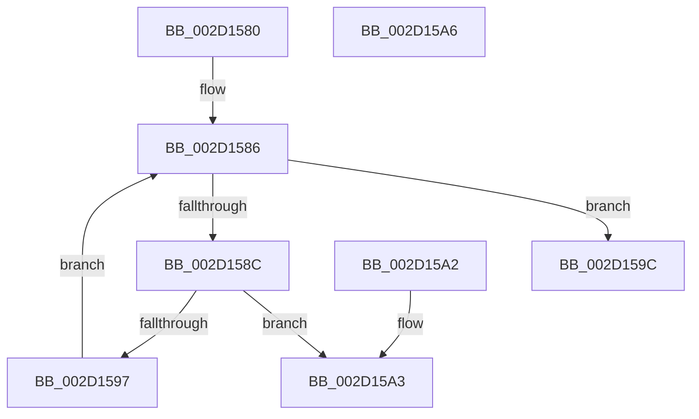

# KeIsEmptyAffinityEx

- RVA: `0x002D1580`–`0x002D15A7` (길이 `39` bytes)
- VA: `0x00000001402D1580`
- 실행 섹션: `.text`
- PDB 이름 있음: `예`; PDB Function 태그: `아니요`
- unwind 정보 RVA: `0x000DB714`
- 디코드: `15`개 명령, `39/39` bytes 표시
- 미해석 바이트: `0` (있으면 어셈블리에 `.byte`로 보존)

> 이 문서는 커널 이미지의 기계어와 PDB 기호를 분석해 생성했습니다. 4번과 5번은 함수 원형과 자료형을 바이너리 사용 방식에서 추정한 C 해석이며 원본 소스 복구 결과는 아닙니다.

## 1. Dependencies

- 직접 호출 지점: **0**; 고유 호출 대상: **0**
- 직접 호출자로 확인된 함수: **43**
- RIP 상대 이미지 참조: **0**

### Outgoing calls
- 직접 디코드된 call 명령이 없습니다.

### Direct callers
- [KiSendClockInterruptToTargetProcessor](../23/KiSendClockInterruptToTargetProcessor_function_00234700.md) at `0x002347A2`
- [KiProcessThreadWaitList](../25/KiProcessThreadWaitList_function_00252CC0.md) at `0x00252E89`
- [KeSetUserAffinityThread](../2C/KeSetUserAffinityThread_function_002CFA2C.md) at `0x002CFA91`
- [PpmIdleExecuteTransition](PpmIdleExecuteTransition_function_002D0A1C.md) at `0x002D0AFC`
- [KiIntRedirectQueueRequestOnProcessor](KiIntRedirectQueueRequestOnProcessor_function_002D1240.md) at `0x002D12E2`
- [HalpQueryProfileSourceList](HalpQueryProfileSourceList_function_002D1370.md) at `0x002D13DB`
- [HalRequestClockInterrupt](HalRequestClockInterrupt_function_002D14C0.md) at `0x002D14ED`
- [KiConfigureCpuSetSchedulingInformation](KiConfigureCpuSetSchedulingInformation_function_002D2E1C.md) at `0x002D2ED6`
- [KiStopProfileTarget](../30/KiStopProfileTarget_function_00304510.md) at `0x003046C0`
- [KiIpiSendRequest](../31/KiIpiSendRequest_function_003113C0.md) at `0x00311926`
- [KiComputeCpuSetAffinity](../39/KiComputeCpuSetAffinity_function_0039A1C0.md) at `0x0039A7E0`
- [KiForwardTick](../39/KiForwardTick_function_0039D40C.md) at `0x0039D556`
- [PpmHeteroUpdateHgsConfiguration](../3B/PpmHeteroUpdateHgsConfiguration_function_003BF344.md) at `0x003BF429`
- [PPmHeteroHgsUpdateOrderValue](../3B/PPmHeteroHgsUpdateOrderValue_function_003BFD24.md) at `0x003BFD54`
- [PPmHeteroHgsUpdateOrderValue](../3B/PPmHeteroHgsUpdateOrderValue_function_003BFD24.md) at `0x003BFD64`
- [KeStartThread](../3C/KeStartThread_function_003C21B8.md) at `0x003C243C`
- [KiIpiEnlightenedGuestPriorityKick](../45/KiIpiEnlightenedGuestPriorityKick_function_004536B0.md) at `0x004536F2`
- [KiComputeHeteroSet](../4B/KiComputeHeteroSet_function_004B7310.md) at `0x004B744D`
- [HalpQueryProfileSource](../4C/HalpQueryProfileSource_function_004C6DBC.md) at `0x004C6E2B`
- [KeRevertToUserMultipleGroupAffinityThread](../4D/KeRevertToUserMultipleGroupAffinityThread_function_004D8A90.md) at `0x004D8C0E`
- [EmonReleaseProfileResourcesInternal](../55/EmonReleaseProfileResourcesInternal_function_0055EF54.md) at `0x0055EFEE`
- [KeBugCheck2](../5B/KeBugCheck2_function_005B27D0.md) at `0x005B31A2`
- [KiGetNextTimerExpirationDueTime](../5B/KiGetNextTimerExpirationDueTime_function_005BCF60.md) at `0x005BD075`
- [PoInitiateProcessorWake](../5C/PoInitiateProcessorWake_function_005CF2D0.md) at `0x005CF3A7`
- [PpmParkCalculateCoreParkingMaskEx](../5D/PpmParkCalculateCoreParkingMaskEx_function_005DFBE0.md) at `0x005DFEC4`
- [PpmParkCalculateCoreParkingMaskEx](../5D/PpmParkCalculateCoreParkingMaskEx_function_005DFBE0.md) at `0x005DFF6E`
- [PpmParkCalculateCoreParkingMaskEx](../5D/PpmParkCalculateCoreParkingMaskEx_function_005DFBE0.md) at `0x005E018F`
- [PpmParkComputeUnparkMaskEx](../5E/PpmParkComputeUnparkMaskEx_function_005E05E0.md) at `0x005E0CE7`
- [PpmParkComputeUnparkMaskEx](../5E/PpmParkComputeUnparkMaskEx_function_005E05E0.md) at `0x005E0D0A`
- [PpmParkComputeUnparkMaskEx](../5E/PpmParkComputeUnparkMaskEx_function_005E05E0.md) at `0x005E0E1B`
- [PpmParkComputeUnparkMaskEx](../5E/PpmParkComputeUnparkMaskEx_function_005E05E0.md) at `0x005E0E60`
- [PpmParkComputeUnparkMaskEx](../5E/PpmParkComputeUnparkMaskEx_function_005E05E0.md) at `0x005E0F88`
- [PpmParkComputeUnparkMaskEx](../5E/PpmParkComputeUnparkMaskEx_function_005E05E0.md) at `0x005E0FE3`
- [PpmParkComputeUnparkMaskEx](../5E/PpmParkComputeUnparkMaskEx_function_005E05E0.md) at `0x005E12E2`
- [PpmParkComputeUnparkMaskEx](../5E/PpmParkComputeUnparkMaskEx_function_005E05E0.md) at `0x005E12F2`
- [PpmParkComputeUnparkMaskEx](../5E/PpmParkComputeUnparkMaskEx_function_005E05E0.md) at `0x005E1302`
- [PpmParkRegisterParkingEx](../5E/PpmParkRegisterParkingEx_function_005E183C.md) at `0x005E198F`
- [PpmParkRegisterParkingEx](../5E/PpmParkRegisterParkingEx_function_005E183C.md) at `0x005E1AA0`
- [sub_006D831E](../6D/Unknown_function_006D831E.md) at `0x006D87B3`
- [sub_006D831E](../6D/Unknown_function_006D831E.md) at `0x006D8B50`
- [sub_006D831E](../6D/Unknown_function_006D831E.md) at `0x006D8BFE`
- [sub_006E82CE](../6E/Unknown_function_006E82CE.md) at `0x006E8396`
- [sub_006F322E](../6F/Unknown_function_006F322E.md) at `0x006F33E3`
- [PnpReplacePartitionUnit](../../page/73/PnpReplacePartitionUnit_function_00738550.md) at `0x00738DF5`
- [KiPrepareUpdateCoresHeteroMask](../../page/74/KiPrepareUpdateCoresHeteroMask_function_0074508C.md) at `0x00745282`
- [KiPrepareUpdateCoresHeteroMask](../../page/74/KiPrepareUpdateCoresHeteroMask_function_0074508C.md) at `0x007453A8`
- [KeDeleteCpuPartition](../../page/74/KeDeleteCpuPartition_function_00747158.md) at `0x00747186`
- [PpmRegisterPerfStates](../../page/75/PpmRegisterPerfStates_function_0075B084.md) at `0x0075B57E`
- [PspSetProcessAffinityUpdateMode](../../page/78/PspSetProcessAffinityUpdateMode_function_007828D8.md) at `0x007829E4`
- [EtwpLoadMicroarchitecturalProfileGroup](../../page/7B/EtwpLoadMicroarchitecturalProfileGroup_function_007B6F74.md) at `0x007B712C`
- [NtSetInformationJobObject](../../page/9F/NtSetInformationJobObject_function_009F84C0.md) at `0x009F999B`
- [PpmHeteroComputeRelativePerformance](../../page/A7/PpmHeteroComputeRelativePerformance_function_00A7E038.md) at `0x00A7E053`
- [PpmParkParkingAvailable](../../page/A8/PpmParkParkingAvailable_function_00A84F58.md) at `0x00A84FD9`
- [PpmParkParkingAvailable](../../page/A8/PpmParkParkingAvailable_function_00A84F58.md) at `0x00A84FE9`
- [sub_00B18AF6](../../page/B1/Unknown_function_00B18AF6.md) at `0x00B18B09`
- [sub_00B18AF6](../../page/B1/Unknown_function_00B18AF6.md) at `0x00B18B5A`
- [sub_00B3B096](../../page/B3/Unknown_function_00B3B096.md) at `0x00B3B0F2`
- [sub_00B441F0](../../page/B4/Unknown_function_00B441F0.md) at `0x00B441F7`
- [PsInitializeBootCpuPartitions](../../init/C4/PsInitializeBootCpuPartitions_function_00C44D94.md) at `0x00C4507F`
- [PspCopyNodeRelativeMaskToAffinityEx](../../init/C4/PspCopyNodeRelativeMaskToAffinityEx_function_00C451AC.md) at `0x00C4524B`

### Static image references
- 디코드된 RIP-relative 메모리 참조가 없습니다.

## 2. Other-region calls and transfers

- 다른 실행 섹션으로 향하는 call: **0**
- 별도 외부 분기/꼬리 이동을 확인하지 못했습니다.

## 3. Assembly (complete function range)

```asm
002D1580  44 0F B7 01                     movzx r8d, word ptr [rcx]
002D1584  33 C0                           xor eax, eax
002D1586  66 41 3B C0                     cmp ax, r8w
002D158A  73 10                           jae 0x1402d159c
002D158C  0F B7 D0                        movzx edx, ax
002D158F  48 83 7C D1 08 00               cmp qword ptr [rcx + rdx*8 + 8], 0
002D1595  75 0C                           jne 0x1402d15a3
002D1597  66 FF C0                        inc ax
002D159A  EB EA                           jmp 0x1402d1586
002D159C  B8 01 00 00 00                  mov eax, 1
002D15A1  C3                              ret
002D15A2  CC                              int3
002D15A3  33 C0                           xor eax, eax
002D15A5  C3                              ret
002D15A6  CC                              int3
```

## 4. C-style interpretation (structured pseudocode)

```c
__int64 __fastcall KeIsEmptyAffinityEx(__int64 a1)
{
    __int64 result;

    result = 0;
loc_002D1586:
    if (0 >= ((unsigned __int16)(*(unsigned __int16 *)(a1)))) goto loc_002D159C;
    if ((*(unsigned __int64 *)(a1 + 0 * 8 + 8)) != 0) goto loc_002D15A3;
    result = (unsigned __int16)((result) + 1);
    goto loc_002D1586;
loc_002D159C:
    return 1;
loc_002D15A3:
    result = 0;
    return result;
}
```

## 5. (Beta) C Style

```c
int64_t KeIsEmptyAffinityEx(void *Arg1)
{
    uint8_t *arg1 = (uint8_t *)Arg1;

    int64_t result;

    result = 0;
loc_002D1586:
    if (0 >= ((uint16_t)(*(uint16_t *)(arg1)))) goto loc_002D159C;
    if ((*(uint64_t *)(arg1 + 0x0 * 8 + 0x8)) != 0) goto loc_002D15A3;
    result = (uint16_t)((result) + 1);
    goto loc_002D1586;
loc_002D159C:
    return 1;
loc_002D15A3:
    result = 0;
    return result;
}
```

### 관측된 메모리 오프셋

구조체 형식이 확인되지 않은 접근은 인자 기준의 오프셋으로만 기록했습니다.

| 기준 인자 | 오프셋 표현 | 폭 (bit) | 접근 |
|---|---:|---:|---|
| `Arg1` | `+ 0x0` | `16` | `R` |
| `Arg1` | `+ 0x8 + rdx*8` | `64` | `R` |

## 6. Execution-region graph

[열기: 2D/3D 그래프와 함수 탐색 컨트롤 패널](../../../control-panel.html?section=text&rva=0x002D1580&view=graph)

- 2D 그래프는 위에서 아래로 흐르고, 3D 그래프는 빈 공간을 드래그해 회전합니다. Shift+드래그는 이동, 휠은 확대·축소, 함수 노드 선택은 대상 보고서 이동입니다.

### Static fallback


