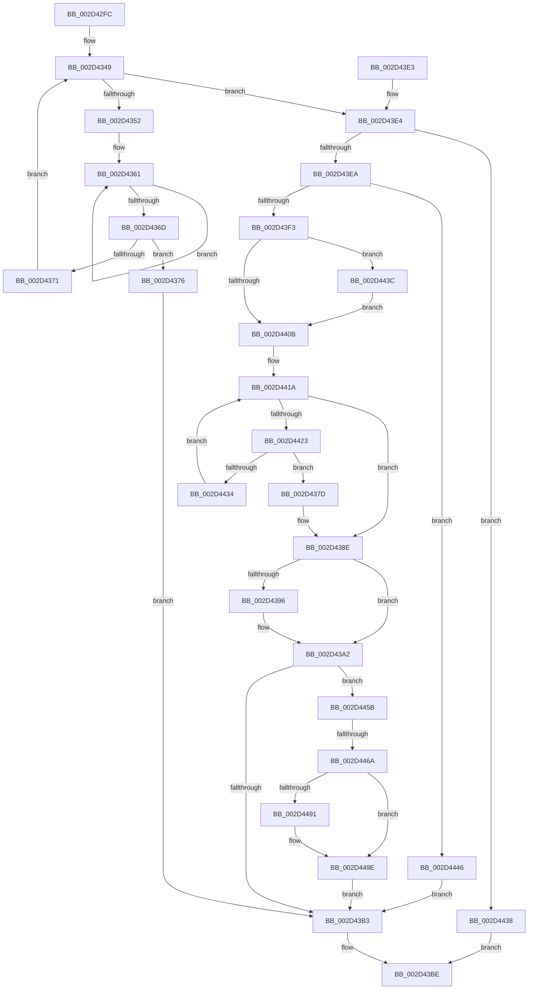

# KeMaskInterrupt

- RVA: `0x002D42FC`–`0x002D44B6` (길이 `442` bytes)
- VA: `0x00000001402D42FC`
- 실행 섹션: `.text`
- PDB 이름 있음: `예`; PDB Function 태그: `예`
- unwind 정보 RVA: `0x0006FB50`
- 디코드: `127`개 명령, `442/442` bytes 표시
- 미해석 바이트: `0` (있으면 어셈블리에 `.byte`로 보존)

> 이 문서는 커널 이미지의 기계어와 PDB 기호를 분석해 생성했습니다. 4번과 5번은 함수 원형과 자료형을 바이너리 사용 방식에서 추정한 C 해석이며 원본 소스 복구 결과는 아닙니다.

## 1. Dependencies

- 직접 호출 지점: **10**; 고유 호출 대상: **8**
- 직접 호출자로 확인된 함수: **2**
- RIP 상대 이미지 참조: **2**

### Outgoing calls
- `0x002D433C` → [KiIsInterruptTypeSecondary](KiIsInterruptTypeSecondary_function_002D44BC.md) (function, `0x002D44BC`)
- `0x002D4384` → [KiMaskInterruptInternal](../4A/KiMaskInterruptInternal_function_004A74B4.md) (function, `0x004A74B4`)
- `0x002D439D` → [KiLowerIrqlProcessIrqlFlags](../4F/KiLowerIrqlProcessIrqlFlags_function_004F5698.md) (function, `0x004F5698`)
- `0x002D43C6` → [_security_check_cookie](../6A/_security_check_cookie_function_006AC640.md) (function, `0x006AC640`)
- `0x002D443F` → [KiRaiseIrqlProcessIrqlFlags](../4F/KiRaiseIrqlProcessIrqlFlags_function_004F56FC.md) (function, `0x004F56FC`)
- `0x002D444F` → [KiMaskSecondaryInterruptInternal](../47/KiMaskSecondaryInterruptInternal_function_00479D94.md) (function, `0x00479D94`)
- `0x002D4477` → [KiAcquireInterruptConnectLock](../48/KiAcquireInterruptConnectLock_function_00489850.md) (function, `0x00489850`)
- `0x002D4482` → [KiMaskInterruptInternal](../4A/KiMaskInterruptInternal_function_004A74B4.md) (function, `0x004A74B4`)
- `0x002D4499` → [KiLowerIrqlProcessIrqlFlags](../4F/KiLowerIrqlProcessIrqlFlags_function_004F5698.md) (function, `0x004F5698`)
- `0x002D44AC` → [KeRevertToUserGroupAffinityThread](../39/KeRevertToUserGroupAffinityThread_function_00398EC0.md) (function, `0x00398EC0`)

### Direct callers
- [KeDisconnectInterrupt](KeDisconnectInterrupt_function_002D3588.md) at `0x002D35B4`
- [IopMaskInterrupt](IopMaskInterrupt_function_002D3D2C.md) at `0x002D3D48`

### Static image references
- `0x002D4310` → RVA `0x00E0A740` (`.data`; read)
- `0x002D438E` → RVA `0x00FC6D20` (`ALMOSTRO`; read)

## 2. Other-region calls and transfers

- 다른 실행 섹션으로 향하는 call: **0**
- call이 아닌 외부 분기/꼬리 이동: **1**
  - `0x002D4464` → [sub_006DDA8E](../6D/Unknown_function_006DDA8E.md) (`tail-transfer`)

## 3. Assembly (complete function range)

```asm
002D42FC  48 89 5C 24 10                  mov qword ptr [rsp + 0x10], rbx
002D4301  55                              push rbp
002D4302  56                              push rsi
002D4303  57                              push rdi
002D4304  41 54                           push r12
002D4306  41 55                           push r13
002D4308  41 56                           push r14
002D430A  41 57                           push r15
002D430C  48 83 EC 40                     sub rsp, 0x40
002D4310  48 8B 05 29 64 B3 00            mov rax, qword ptr [rip + 0xb36429]
002D4317  48 33 C4                        xor rax, rsp
002D431A  48 89 44 24 38                  mov qword ptr [rsp + 0x38], rax
002D431F  4C 8B F9                        mov r15, rcx
002D4322  0F 57 C0                        xorps xmm0, xmm0
002D4325  33 DB                           xor ebx, ebx
002D4327  49 8B C8                        mov rcx, r8
002D432A  0F 11 44 24 28                  movups xmmword ptr [rsp + 0x28], xmm0
002D432F  89 5C 24 24                     mov dword ptr [rsp + 0x24], ebx
002D4333  49 8B F1                        mov rsi, r9
002D4336  4D 8B F0                        mov r14, r8
002D4339  44 8A EA                        mov r13b, dl
002D433C  E8 7B 01 00 00                  call 0x1402d44bc
002D4341  44 8A C8                        mov r9b, al
002D4344  44 8A C3                        mov r8b, bl
002D4347  8B FB                           mov edi, ebx
002D4349  45 3A C5                        cmp r8b, r13b
002D434C  0F 83 92 00 00 00               jae 0x1402d43e4
002D4352  41 0F B6 C0                     movzx eax, r8b
002D4356  49 8B 14 C7                     mov rdx, qword ptr [r15 + rax*8]
002D435A  0F 0D 4A 68                     prefetchw byte ptr [rdx + 0x68]
002D435E  8B 42 68                        mov eax, dword ptr [rdx + 0x68]
002D4361  8B C8                           mov ecx, eax
002D4363  83 C9 01                        or ecx, 1
002D4366  F0 0F B1 4A 68                  lock cmpxchg dword ptr [rdx + 0x68], ecx
002D436B  75 F4                           jne 0x1402d4361
002D436D  A8 01                           test al, 1
002D436F  75 05                           jne 0x1402d4376
002D4371  41 FE C0                        inc r8b
002D4374  EB D3                           jmp 0x1402d4349
002D4376  BF 25 00 00 80                  mov edi, 0x80000025
002D437B  EB 36                           jmp 0x1402d43b3
002D437D  41 8B 48 58                     mov ecx, dword ptr [r8 + 0x58]
002D4381  41 8B D6                        mov edx, r14d
002D4384  E8 2B 31 1D 00                  call 0x1404a74b4
002D4389  8B F8                           mov edi, eax
002D438B  41 B4 01                        mov r12b, 1
002D438E  39 1D 8C 29 CF 00               cmp dword ptr [rip + 0xcf298c], ebx
002D4394  74 0C                           je 0x1402d43a2
002D4396  44 0F 20 C1                     mov rcx, cr8
002D439A  40 8A D5                        mov dl, bpl
002D439D  E8 F6 12 22 00                  call 0x1404f5698
002D43A2  40 0F B6 C5                     movzx eax, bpl
002D43A6  44 0F 22 C0                     mov cr8, rax
002D43AA  45 84 E4                        test r12b, r12b
002D43AD  0F 84 A8 00 00 00               je 0x1402d445b
002D43B3  81 FF 28 01 00 00               cmp edi, 0x128
002D43B9  0F 45 DF                        cmovne ebx, edi
002D43BC  8B C3                           mov eax, ebx
002D43BE  48 8B 4C 24 38                  mov rcx, qword ptr [rsp + 0x38]
002D43C3  48 33 CC                        xor rcx, rsp
002D43C6  E8 75 82 3D 00                  call 0x1406ac640
002D43CB  48 8B 9C 24 88 00 00 00         mov rbx, qword ptr [rsp + 0x88]
002D43D3  48 83 C4 40                     add rsp, 0x40
002D43D7  41 5F                           pop r15
002D43D9  41 5E                           pop r14
002D43DB  41 5D                           pop r13
002D43DD  41 5C                           pop r12
002D43DF  5F                              pop rdi
002D43E0  5E                              pop rsi
002D43E1  5D                              pop rbp
002D43E2  C3                              ret
002D43E3  CC                              int3
002D43E4  41 39 5E 08                     cmp dword ptr [r14 + 8], ebx
002D43E8  75 4E                           jne 0x1402d4438
002D43EA  45 8B 76 40                     mov r14d, dword ptr [r14 + 0x40]
002D43EE  45 84 C9                        test r9b, r9b
002D43F1  75 53                           jne 0x1402d4446
002D43F3  44 8A E3                        mov r12b, bl
002D43F6  44 0F 20 C5                     mov rbp, cr8
002D43FA  BA 0F 00 00 00                  mov edx, 0xf
002D43FF  44 0F 22 C2                     mov cr8, rdx
002D4403  39 1D 17 29 CF 00               cmp dword ptr [rip + 0xcf2917], ebx
002D4409  75 31                           jne 0x1402d443c
002D440B  65 8B 14 25 A4 01 00 00         mov edx, dword ptr gs:[0x1a4]
002D4413  8A CB                           mov cl, bl
002D4415  40 88 6C 24 20                  mov byte ptr [rsp + 0x20], bpl
002D441A  41 3A CD                        cmp cl, r13b
002D441D  0F 83 6B FF FF FF               jae 0x1402d438e
002D4423  0F B6 C1                        movzx eax, cl
002D4426  4D 8B 04 C7                     mov r8, qword ptr [r15 + rax*8]
002D442A  41 39 50 60                     cmp dword ptr [r8 + 0x60], edx
002D442E  0F 84 49 FF FF FF               je 0x1402d437d
002D4434  FE C1                           inc cl
002D4436  EB E2                           jmp 0x1402d441a
002D4438  33 C0                           xor eax, eax
002D443A  EB 82                           jmp 0x1402d43be
002D443C  40 8A CD                        mov cl, bpl
002D443F  E8 B8 12 22 00                  call 0x1404f56fc
002D4444  EB C5                           jmp 0x1402d440b
002D4446  49 8B 0F                        mov rcx, qword ptr [r15]
002D4449  41 8B D6                        mov edx, r14d
002D444C  8B 49 58                        mov ecx, dword ptr [rcx + 0x58]
002D444F  E8 40 59 1A 00                  call 0x140479d94
002D4454  8B F8                           mov edi, eax
002D4456  E9 58 FF FF FF                  jmp 0x1402d43b3
002D445B  49 8B 2F                        mov rbp, qword ptr [r15]
002D445E  44 0F 20 C0                     mov rax, cr8
002D4462  3C 02                           cmp al, 2
002D4464  0F 83 24 96 40 00               jae 0x1406dda8e
002D446A  8B 4D 60                        mov ecx, dword ptr [rbp + 0x60]
002D446D  4C 8D 44 24 28                  lea r8, [rsp + 0x28]
002D4472  48 8D 54 24 20                  lea rdx, [rsp + 0x20]
002D4477  E8 D4 53 1B 00                  call 0x140489850
002D447C  8B 4D 58                        mov ecx, dword ptr [rbp + 0x58]
002D447F  41 8B D6                        mov edx, r14d
002D4482  E8 2D 30 1D 00                  call 0x1404a74b4
002D4487  39 1D 93 28 CF 00               cmp dword ptr [rip + 0xcf2893], ebx
002D448D  8B F8                           mov edi, eax
002D448F  74 0D                           je 0x1402d449e
002D4491  44 0F 20 C1                     mov rcx, cr8
002D4495  8A 54 24 20                     mov dl, byte ptr [rsp + 0x20]
002D4499  E8 FA 11 22 00                  call 0x1404f5698
002D449E  0F B6 44 24 20                  movzx eax, byte ptr [rsp + 0x20]
002D44A3  44 0F 22 C0                     mov cr8, rax
002D44A7  48 8D 4C 24 28                  lea rcx, [rsp + 0x28]
002D44AC  E8 0F 4A 0C 00                  call 0x140398ec0
002D44B1  E9 FD FE FF FF                  jmp 0x1402d43b3
```

## 4. C-style interpretation (structured pseudocode)

```c
__int64 __fastcall KeMaskInterrupt(__int64 a1, unsigned __int8 a2, __int64 a3, __int64 a4)
{
    __int64 result;
    __int64 v_rbx;
    __int64 v_rsp;
    unsigned __int64 v_stack_m40;
    unsigned __int64 v_stack_m50;
    unsigned int v_stack_m54;
    unsigned __int64 v_stack_p10;
    unsigned __int8 v_stack_p20;
    unsigned __int64 v_stack_p28;

    v_stack_p10 = v_rbx;
    v_rsp = (v_rsp) - (64);
    result = (*(unsigned __int64 *)(v_rip + 11756585)) ^ (v_rsp);
    v_stack_m40 = result;
    v_rbx = 0;
    v_stack_m50 = v_xmm0;
    v_stack_m54 = 0;
    result = KiIsInterruptTypeSecondary(a3, a2, a3, a4);
loc_002D4349:
    if (0 >= a2) goto loc_002D43E4;
loc_002D4361:
    a1 = (unsigned int)(((unsigned int)((unsigned int)((unsigned int)(*(unsigned int *)(*(unsigned __int64 *)(a1 + 0 * 8) + 104))))) | (1));
    if (condition_is_not_equal) goto loc_002D4361;
    if ((((unsigned __int8)((unsigned int)(*(unsigned int *)(*(unsigned __int64 *)(a1 + 0 * 8) + 104)))) & (1)) != 0) goto loc_002D4376;
    a3 = (unsigned __int8)((0) + 1);
    goto loc_002D4349;
loc_002D4376:
    goto loc_002D43B3;
loc_002D437D:
    result = KiMaskInterruptInternal((unsigned int)(*(unsigned int *)(a3 + 88)), (unsigned int)((unsigned int)(a3)), a3, (unsigned __int8)(result));
loc_002D438E:
    if ((*(unsigned int *)(v_rip + 13576588)) != 0) {
        a1 = v_cr8;
        a2 = (unsigned __int8)(v_rbp);
        result = KiLowerIrqlProcessIrqlFlags(a1, a2, a3, (unsigned __int8)(result));
    }
    if (1 == 0) goto loc_002D445B;
loc_002D43B3:
    if (((unsigned int)((unsigned int)((unsigned int)(result)))) != 296) { v_rbx = (unsigned int)((unsigned int)((unsigned int)(result))); }
loc_002D43BE:
    a1 = (v_stack_m40) ^ (v_rsp);
    result = _security_check_cookie(a1, a2, a3, (unsigned __int8)(result));
    v_rsp = (v_rsp) + (64);
    return result;
loc_002D43E4:
    if ((*(unsigned int *)(a3 + 8)) != ((unsigned int)(v_stack_p10))) goto loc_002D4438;
    if ((unsigned __int8)((unsigned __int8)(result)) != 0) goto loc_002D4446;
    if ((*(unsigned int *)(v_rip + 13576471)) != ((unsigned int)(v_stack_p10))) goto loc_002D443C;
loc_002D440B:
    v_stack_p20 = (unsigned __int8)((unsigned __int8)(v_rbp));
loc_002D441A:
    if (((unsigned __int8)((unsigned __int8)(v_stack_p10))) >= a2) goto loc_002D438E;
    if ((*(unsigned int *)(*(unsigned __int64 *)(a1 + (unsigned __int8)((unsigned __int8)(v_stack_p10)) * 8) + 96)) == ((unsigned int)((unsigned int)(*(unsigned int *)(gs_base + (0 + 420)))))) goto loc_002D437D;
    a1 = (unsigned __int8)(((unsigned __int8)(v_stack_p10)) + 1);
    goto loc_002D441A;
loc_002D4438:
    result = 0;
    goto loc_002D43BE;
loc_002D443C:
    result = KiRaiseIrqlProcessIrqlFlags((unsigned __int8)((unsigned __int8)(v_rbp)), (unsigned int)(*(unsigned int *)(gs_base + (0 + 420))), *(unsigned __int64 *)(a1 + (unsigned __int8)((unsigned __int8)(v_stack_p10)) * 8), (unsigned __int8)(result));
    goto loc_002D440B;
loc_002D4446:
    result = KiMaskSecondaryInterruptInternal((unsigned int)(*(unsigned int *)(*(unsigned __int64 *)(a1) + 88)), (unsigned int)((unsigned int)((unsigned int)(*(unsigned int *)(a3 + 64)))), *(unsigned __int64 *)(a1 + (unsigned __int8)((unsigned __int8)(v_stack_p10)) * 8), (unsigned __int8)(result));
    goto loc_002D43B3;
loc_002D445B:
    result = KiAcquireInterruptConnectLock((unsigned int)(*(unsigned int *)(*(unsigned __int64 *)(a1) + 96)), v_stack_p20, v_stack_p28, (unsigned __int8)(result));
    result = KiMaskInterruptInternal((unsigned int)(*(unsigned int *)(*(unsigned __int64 *)(a1) + 88)), (unsigned int)((unsigned int)((unsigned int)(*(unsigned int *)(a3 + 64)))), v_stack_p28, (unsigned __int8)(result));
    if ((*(unsigned int *)(v_rip + 13576339)) != ((unsigned int)(v_stack_p10))) {
        a1 = 15;
        a2 = v_stack_p20;
        result = KiLowerIrqlProcessIrqlFlags(a1, a2, v_stack_p28, (unsigned __int8)(result));
    }
    result = KeRevertToUserGroupAffinityThread(v_stack_p28, a2, v_stack_p28, (unsigned __int8)(result));
    goto loc_002D43B3;
}
```

## 5. (Beta) C Style

```c
int64_t KeMaskInterrupt(void *Arg1, uint8_t Arg2, void *Arg3, int64_t Arg4)
{
    uint8_t *arg1 = (uint8_t *)Arg1;
    uint8_t *arg3 = (uint8_t *)Arg3;

    int64_t result;
    int64_t local_rbx;
    int64_t local_rsp;
    uint64_t v_stack_m40;
    uint64_t v_stack_m50;
    uint32_t v_stack_m54;
    uint64_t v_stack_p10;
    uint8_t v_stack_p20;
    uint64_t v_stack_p28;

    v_stack_p10 = local_rbx;
    local_rsp = (local_rsp) - (64);
    result = (*(uint64_t *)(v_rip + 0xB36429)) ^ (local_rsp);
    v_stack_m40 = result;
    local_rbx = 0;
    v_stack_m50 = v_xmm0;
    v_stack_m54 = 0;
    result = KiIsInterruptTypeSecondary(Arg3, Arg2, Arg3, Arg4);
loc_002D4349:
    if (0 >= Arg2) goto loc_002D43E4;
loc_002D4361:
    Arg1 = (uint32_t)(((uint32_t)((uint32_t)((uint32_t)(*(uint32_t *)(*(uint64_t *)(arg1 + 0x0 * 8) + 0x68))))) | (1));
    if (condition_is_not_equal) goto loc_002D4361;
    if ((((uint8_t)((uint32_t)(*(uint32_t *)(*(uint64_t *)(arg1 + 0x0 * 8) + 0x68)))) & (1)) != 0) goto loc_002D4376;
    Arg3 = (uint8_t)((0) + 1);
    goto loc_002D4349;
loc_002D4376:
    goto loc_002D43B3;
loc_002D437D:
    result = KiMaskInterruptInternal((uint32_t)(*(uint32_t *)(arg3 + 0x58)), (uint32_t)((uint32_t)(Arg3)), Arg3, (uint8_t)(result));
loc_002D438E:
    if ((*(uint32_t *)(v_rip + 0xCF298C)) != 0) {
        Arg1 = v_cr8;
        Arg2 = (uint8_t)(local_rbp);
        result = KiLowerIrqlProcessIrqlFlags(Arg1, Arg2, Arg3, (uint8_t)(result));
    }
    if (1 == 0) goto loc_002D445B;
loc_002D43B3:
    if (((uint32_t)((uint32_t)((uint32_t)(result)))) != 296) { local_rbx = (uint32_t)((uint32_t)((uint32_t)(result))); }
loc_002D43BE:
    Arg1 = (v_stack_m40) ^ (local_rsp);
    result = _security_check_cookie(Arg1, Arg2, Arg3, (uint8_t)(result));
    local_rsp = (local_rsp) + (64);
    return result;
loc_002D43E4:
    if ((*(uint32_t *)(arg3 + 0x8)) != ((uint32_t)(v_stack_p10))) goto loc_002D4438;
    if ((uint8_t)((uint8_t)(result)) != 0) goto loc_002D4446;
    if ((*(uint32_t *)(v_rip + 0xCF2917)) != ((uint32_t)(v_stack_p10))) goto loc_002D443C;
loc_002D440B:
    v_stack_p20 = (uint8_t)((uint8_t)(local_rbp));
loc_002D441A:
    if (((uint8_t)((uint8_t)(v_stack_p10))) >= Arg2) goto loc_002D438E;
    if ((*(uint32_t *)(*(uint64_t *)(arg1 + (uint8_t)((uint8_t)(v_stack_p10)) * 8) + 0x60)) == ((uint32_t)((uint32_t)(*(uint32_t *)(gs_base + (0 + 0x1A4)))))) goto loc_002D437D;
    Arg1 = (uint8_t)(((uint8_t)(v_stack_p10)) + 1);
    goto loc_002D441A;
loc_002D4438:
    result = 0;
    goto loc_002D43BE;
loc_002D443C:
    result = KiRaiseIrqlProcessIrqlFlags((uint8_t)((uint8_t)(local_rbp)), (uint32_t)(*(uint32_t *)(gs_base + (0 + 0x1A4))), *(uint64_t *)(arg1 + (uint8_t)((uint8_t)(v_stack_p10)) * 8), (uint8_t)(result));
    goto loc_002D440B;
loc_002D4446:
    result = KiMaskSecondaryInterruptInternal((uint32_t)(*(uint32_t *)(*(uint64_t *)(arg1) + 0x58)), (uint32_t)((uint32_t)((uint32_t)(*(uint32_t *)(arg3 + 0x40)))), *(uint64_t *)(arg1 + (uint8_t)((uint8_t)(v_stack_p10)) * 8), (uint8_t)(result));
    goto loc_002D43B3;
loc_002D445B:
    result = KiAcquireInterruptConnectLock((uint32_t)(*(uint32_t *)(*(uint64_t *)(arg1) + 0x60)), v_stack_p20, v_stack_p28, (uint8_t)(result));
    result = KiMaskInterruptInternal((uint32_t)(*(uint32_t *)(*(uint64_t *)(arg1) + 0x58)), (uint32_t)((uint32_t)((uint32_t)(*(uint32_t *)(arg3 + 0x40)))), v_stack_p28, (uint8_t)(result));
    if ((*(uint32_t *)(v_rip + 0xCF2893)) != ((uint32_t)(v_stack_p10))) {
        Arg1 = 15;
        Arg2 = v_stack_p20;
        result = KiLowerIrqlProcessIrqlFlags(Arg1, Arg2, v_stack_p28, (uint8_t)(result));
    }
    result = KeRevertToUserGroupAffinityThread(v_stack_p28, Arg2, v_stack_p28, (uint8_t)(result));
    goto loc_002D43B3;
}
```

### 관측된 메모리 오프셋

구조체 형식이 확인되지 않은 접근은 인자 기준의 오프셋으로만 기록했습니다.

| 기준 인자 | 오프셋 표현 | 폭 (bit) | 접근 |
|---|---:|---:|---|
| `Arg1` | `+ 0x0` | `64` | `R` |
| `Arg1` | `+ 0x0 + rax*8` | `64` | `R` |
| `Arg3` | `+ 0x8` | `32` | `R` |
| `Arg3` | `+ 0x40` | `32` | `R` |

## 6. Execution-region graph

[열기: 2D/3D 그래프와 함수 탐색 컨트롤 패널](../../../control-panel.html?section=text&rva=0x002D42FC&view=graph)

- 2D 그래프는 위에서 아래로 흐르고, 3D 그래프는 빈 공간을 드래그해 회전합니다. Shift+드래그는 이동, 휠은 확대·축소, 함수 노드 선택은 대상 보고서 이동입니다.

### Static fallback


