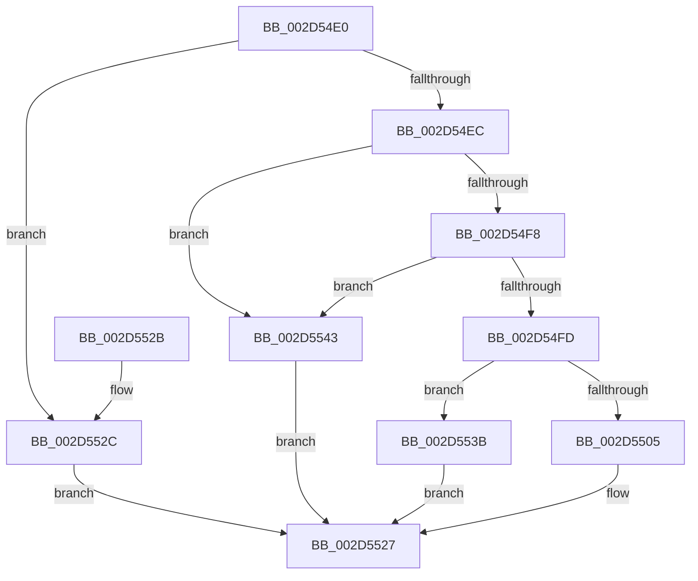

# KeQueryInterruptPartitionInformation

- RVA: `0x002D54E0`–`0x002D554B` (길이 `107` bytes)
- VA: `0x00000001402D54E0`
- 실행 섹션: `.text`
- PDB 이름 있음: `예`; PDB Function 태그: `아니요`
- unwind 정보 RVA: `0x000DB714`
- 디코드: `31`개 명령, `107/107` bytes 표시
- 미해석 바이트: `0` (있으면 어셈블리에 `.byte`로 보존)

> 이 문서는 커널 이미지의 기계어와 PDB 기호를 분석해 생성했습니다. 4번과 5번은 함수 원형과 자료형을 바이너리 사용 방식에서 추정한 C 해석이며 원본 소스 복구 결과는 아닙니다.

## 1. Dependencies

- 직접 호출 지점: **0**; 고유 호출 대상: **0**
- 직접 호출자로 확인된 함수: **2**
- RIP 상대 이미지 참조: **2**

### Outgoing calls
- 직접 디코드된 call 명령이 없습니다.

### Direct callers
- [IntPartIsInterruptSteerable](IntPartIsInterruptSteerable_function_002D4D30.md) at `0x002D4D95`
- [HalpInterruptAffinityIsSteerable](HalpInterruptAffinityIsSteerable_function_002D5414.md) at `0x002D5475`

### Static image references
- `0x002D54E3` → RVA `0x00F10E60` (`.data`; read)
- `0x002D54EC` → RVA `0x00F10E68` (`.data`; read)

## 2. Other-region calls and transfers

- 다른 실행 섹션으로 향하는 call: **0**
- 별도 외부 분기/꼬리 이동을 확인하지 못했습니다.

## 3. Assembly (complete function range)

```asm
002D54E0  45 33 C9                        xor r9d, r9d
002D54E3  44 38 0D 76 B9 C3 00            cmp byte ptr [rip + 0xc3b976], r9b
002D54EA  74 40                           je 0x1402d552c
002D54EC  48 8B 05 75 B9 C3 00            mov rax, qword ptr [rip + 0xc3b975]
002D54F3  48 85 C0                        test rax, rax
002D54F6  74 4B                           je 0x1402d5543
002D54F8  66 85 C9                        test cx, cx
002D54FB  75 46                           jne 0x1402d5543
002D54FD  0F B6 40 02                     movzx eax, byte ptr [rax + 2]
002D5501  3B C2                           cmp eax, edx
002D5503  76 36                           jbe 0x1402d553b
002D5505  0F 57 C0                        xorps xmm0, xmm0
002D5508  41 0F 11 00                     movups xmmword ptr [r8], xmm0
002D550C  66 41 89 48 08                  mov word ptr [r8 + 8], cx
002D5511  48 8B 05 50 B9 C3 00            mov rax, qword ptr [rip + 0xc3b950]
002D5518  8B CA                           mov ecx, edx
002D551A  48 FF C1                        inc rcx
002D551D  48 03 C9                        add rcx, rcx
002D5520  48 8B 0C C8                     mov rcx, qword ptr [rax + rcx*8]
002D5524  49 89 08                        mov qword ptr [r8], rcx
002D5527  41 8B C1                        mov eax, r9d
002D552A  C3                              ret
002D552B  CC                              int3
002D552C  0F 57 C0                        xorps xmm0, xmm0
002D552F  41 B9 03 01 00 00               mov r9d, 0x103
002D5535  41 0F 11 00                     movups xmmword ptr [r8], xmm0
002D5539  EB EC                           jmp 0x1402d5527
002D553B  41 B9 F0 00 00 C0               mov r9d, 0xc00000f0
002D5541  EB E4                           jmp 0x1402d5527
002D5543  41 B9 BB 00 00 C0               mov r9d, 0xc00000bb
002D5549  EB DC                           jmp 0x1402d5527
```

## 4. C-style interpretation (structured pseudocode)

```c
__int64 __fastcall KeQueryInterruptPartitionInformation(unsigned __int16 a1, int a2, __int64 a3, int a4)
{
    a4 = 0;
    if ((*(unsigned __int8 *)(v_rip + 12826998)) == 0) goto loc_002D552C;
    if (*(unsigned __int64 *)(v_rip + 12826997) == 0) goto loc_002D5543;
    if (a1 != 0) goto loc_002D5543;
    if (((unsigned int)(*(unsigned __int8 *)(*(unsigned __int64 *)(v_rip + 12826997) + 2))) <= a2) goto loc_002D553B;
    *(unsigned __int64 *)(a3) = v_xmm0;
    *(unsigned __int16 *)(a3 + 8) = a1;
    a1 = ((unsigned int)(a2)) + 1;
    a1 = (a1) + (a1);
    *(unsigned __int64 *)(a3) = *(unsigned __int64 *)(*(unsigned __int64 *)(v_rip + 12826960) + a1 * 8);
loc_002D5527:
    return 0;
loc_002D552C:
    *(unsigned __int64 *)(a3) = v_xmm0;
    goto loc_002D5527;
loc_002D553B:
    goto loc_002D5527;
loc_002D5543:
    goto loc_002D5527;
}
```

## 5. (Beta) C Style

```c
int64_t KeQueryInterruptPartitionInformation(uint16_t Arg1, int32_t Arg2, void *Arg3, int32_t Arg4)
{
    uint8_t *arg3 = (uint8_t *)Arg3;

    Arg4 = 0;
    if ((*(uint8_t *)(v_rip + 0xC3B976)) == 0) goto loc_002D552C;
    if (*(uint64_t *)(v_rip + 0xC3B975) == 0) goto loc_002D5543;
    if (Arg1 != 0) goto loc_002D5543;
    if (((uint32_t)(*(uint8_t *)(*(uint64_t *)(v_rip + 0xC3B975) + 0x2))) <= Arg2) goto loc_002D553B;
    *(uint64_t *)(arg3) = v_xmm0;
    *(uint16_t *)(arg3 + 0x8) = Arg1;
    Arg1 = ((uint32_t)(Arg2)) + 1;
    Arg1 = (Arg1) + (Arg1);
    *(uint64_t *)(arg3) = *(uint64_t *)(*(uint64_t *)(v_rip + 0xC3B950) + Arg1 * 8);
loc_002D5527:
    return 0;
loc_002D552C:
    *(uint64_t *)(arg3) = v_xmm0;
    goto loc_002D5527;
loc_002D553B:
    goto loc_002D5527;
loc_002D5543:
    goto loc_002D5527;
}
```

### 관측된 메모리 오프셋

구조체 형식이 확인되지 않은 접근은 인자 기준의 오프셋으로만 기록했습니다.

| 기준 인자 | 오프셋 표현 | 폭 (bit) | 접근 |
|---|---:|---:|---|
| `Arg3` | `+ 0x0` | `64` | `W` |
| `Arg3` | `+ 0x0` | `128` | `R` |
| `Arg3` | `+ 0x8` | `16` | `W` |

## 6. Execution-region graph

[열기: 2D/3D 그래프와 함수 탐색 컨트롤 패널](../../../control-panel.html?section=text&rva=0x002D54E0&view=graph)

- 2D 그래프는 위에서 아래로 흐르고, 3D 그래프는 빈 공간을 드래그해 회전합니다. Shift+드래그는 이동, 휠은 확대·축소, 함수 노드 선택은 대상 보고서 이동입니다.

### Static fallback


