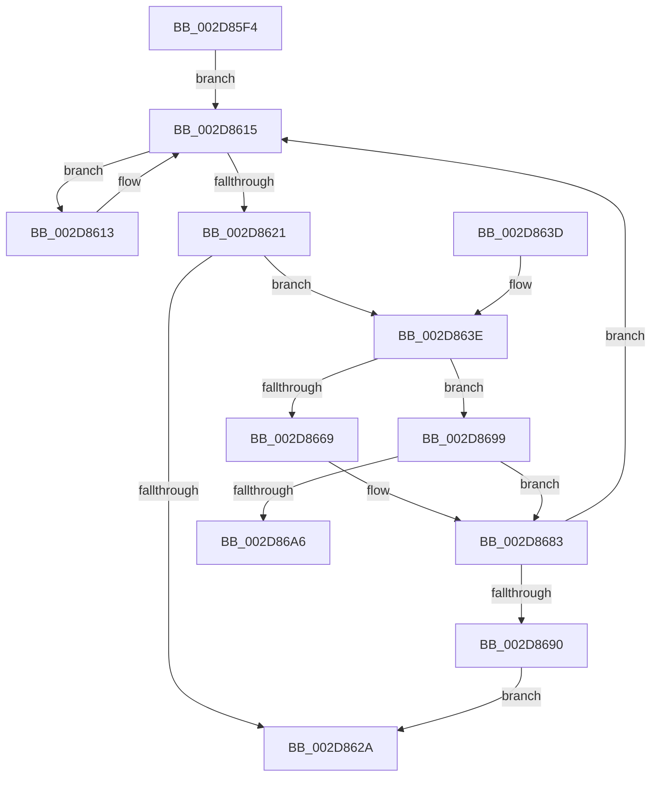

# KeQuerySystemAllowedCpuSetAffinity

- RVA: `0x002D85F4`–`0x002D86B2` (길이 `190` bytes)
- VA: `0x00000001402D85F4`
- 실행 섹션: `.text`
- PDB 이름 있음: `예`; PDB Function 태그: `예`
- unwind 정보 RVA: `0x000701AC`
- 디코드: `47`개 명령, `190/190` bytes 표시
- 미해석 바이트: `0` (있으면 어셈블리에 `.byte`로 보존)

> 이 문서는 커널 이미지의 기계어와 PDB 기호를 분석해 생성했습니다. 4번과 5번은 함수 원형과 자료형을 바이너리 사용 방식에서 추정한 C 해석이며 원본 소스 복구 결과는 아닙니다.

## 1. Dependencies

- 직접 호출 지점: **2**; 고유 호출 대상: **2**
- 직접 호출자로 확인된 함수: **2**
- RIP 상대 이미지 참조: **11**

### Outgoing calls
- `0x002D8653` → [memset](../6C/memset_function_006C6C40.md) (function, `0x006C6C40`)
- `0x002D867E` → [KiCopyAffinityEx](../2C/KiCopyAffinityEx_function_002CE860.md) (function, `0x002CE860`)

### Direct callers
- [sub_002D6584](Unknown_function_002D6584.md) at `0x002D66DF`
- [PpmCheckContinueExecution](PpmCheckContinueExecution_function_002D836C.md) at `0x002D8399`

### Static image references
- `0x002D8615` → RVA `0x00FC6BF8` (`ALMOSTRO`; read)
- `0x002D8621` → RVA `0x00F07208` (`.data`; read)
- `0x002D863E` → RVA `0x00F07100` (`.data`; read)
- `0x002D8646` → RVA `0x00F07108` (`.data`; read)
- `0x002D8658` → RVA `0x00FC6E68` (`ALMOSTRO`; read)
- `0x002D865F` → RVA `0x00F07100` (`.data`; write)
- `0x002D8669` → RVA `0x00F07102` (`.data`; read)
- `0x002D8670` → RVA `0x00FC7120` (`ALMOSTRO`; read)
- `0x002D8690` → RVA `0x00F07208` (`.data`; write)
- `0x002D8699` → RVA `0x00FC5018` (`ALMOSTRO`; read)
- `0x002D86A6` → RVA `0x00FC8320` (`ALMOSTRO`; read)

## 2. Other-region calls and transfers

- 다른 실행 섹션으로 향하는 call: **0**
- call이 아닌 외부 분기/꼬리 이동: **1**
  - `0x002D86AD` → [sub_006DDCDE](../6D/Unknown_function_006DDCDE.md) (`tail-transfer`)

## 3. Assembly (complete function range)

```asm
002D85F4  48 89 5C 24 08                  mov qword ptr [rsp + 8], rbx
002D85F9  48 89 6C 24 18                  mov qword ptr [rsp + 0x18], rbp
002D85FE  48 89 54 24 10                  mov qword ptr [rsp + 0x10], rdx
002D8603  56                              push rsi
002D8604  57                              push rdi
002D8605  41 56                           push r14
002D8607  48 83 EC 20                     sub rsp, 0x20
002D860B  41 BE 01 00 00 00               mov r14d, 1
002D8611  EB 02                           jmp 0x1402d8615
002D8613  F3 90                           pause
002D8615  48 8B 1D DC E5 CE 00            mov rbx, qword ptr [rip + 0xcee5dc]
002D861C  41 84 DE                        test r14b, bl
002D861F  75 F2                           jne 0x1402d8613
002D8621  48 39 1D E0 EB C2 00            cmp qword ptr [rip + 0xc2ebe0], rbx
002D8628  75 14                           jne 0x1402d863e
002D862A  48 8B 5C 24 40                  mov rbx, qword ptr [rsp + 0x40]
002D862F  48 8B 6C 24 50                  mov rbp, qword ptr [rsp + 0x50]
002D8634  48 83 C4 20                     add rsp, 0x20
002D8638  41 5E                           pop r14
002D863A  5F                              pop rdi
002D863B  5E                              pop rsi
002D863C  C3                              ret
002D863D  CC                              int3
002D863E  44 0F B7 05 BA EA C2 00         movzx r8d, word ptr [rip + 0xc2eaba]
002D8646  48 8D 0D BB EA C2 00            lea rcx, [rip + 0xc2eabb]
002D864D  49 C1 E0 03                     shl r8, 3
002D8651  33 D2                           xor edx, edx
002D8653  E8 E8 E5 3E 00                  call 0x1406c6c40
002D8658  83 3D 09 E8 CE 00 00            cmp dword ptr [rip + 0xcee809], 0
002D865F  66 44 89 35 99 EA C2 00         mov word ptr [rip + 0xc2ea99], r14w
002D8667  75 30                           jne 0x1402d8699
002D8669  0F B7 15 92 EA C2 00            movzx edx, word ptr [rip + 0xc2ea92]
002D8670  4C 8D 05 A9 EA CE 00            lea r8, [rip + 0xceeaa9]
002D8677  48 8D 0D 82 EA C2 00            lea rcx, [rip + 0xc2ea82]
002D867E  E8 DD 61 FF FF                  call 0x1402ce860
002D8683  90                              nop
002D8684  48 8B 05 6D E5 CE 00            mov rax, qword ptr [rip + 0xcee56d]
002D868B  48 3B C3                        cmp rax, rbx
002D868E  75 85                           jne 0x1402d8615
002D8690  48 89 1D 71 EB C2 00            mov qword ptr [rip + 0xc2eb71], rbx
002D8697  EB 91                           jmp 0x1402d862a
002D8699  0F B7 2D 78 C9 CE 00            movzx ebp, word ptr [rip + 0xcec978]
002D86A0  33 FF                           xor edi, edi
002D86A2  85 ED                           test ebp, ebp
002D86A4  74 DD                           je 0x1402d8683
002D86A6  48 8D 35 73 FC CE 00            lea rsi, [rip + 0xcefc73]
002D86AD  E9 2C 56 40 00                  jmp 0x1406ddcde
```

## 4. C-style interpretation (structured pseudocode)

```c
__int64 __fastcall KeQuerySystemAllowedCpuSetAffinity(__int64 a1, __int64 a2)
{
    __int64 result;
    __int64 v_rdi;
    __int64 v_rsp;
    unsigned __int64 v_stack_p10;
    unsigned __int64 v_stack_p18;
    unsigned __int64 v_stack_p8;

    v_stack_p8 = v_rbx;
    v_stack_p18 = v_rbp;
    v_stack_p10 = a2;
    v_rsp = (v_rsp) - (32);
    goto loc_002D8615;
loc_002D8613:
loc_002D8615:
    if (((1) & ((unsigned __int8)(*(unsigned __int64 *)(v_rip + 13559260)))) != 0) goto loc_002D8613;
    if ((*(unsigned __int64 *)(v_rip + 12774368)) != (*(unsigned __int64 *)(v_rip + 13559260))) goto loc_002D863E;
loc_002D862A:
    v_rsp = (v_rsp) + (32);
    return result;
loc_002D863E:
    a3 = (*(unsigned __int16 *)(v_rip + 12774074)) << (3);
    a2 = 0;
    result = memset(v_rip + 12774075, a2, a3, a4);
    *(unsigned __int16 *)(v_rip + 12774041) = 1;
    if ((*(unsigned int *)(v_rip + 13559817)) != 0) goto loc_002D8699;
    result = KiCopyAffinityEx(v_rip + 12774018, *(unsigned __int16 *)(v_rip + 12774034), v_rip + 13560489, a4);
loc_002D8683:
    if ((*(unsigned __int64 *)(v_rip + 13559149)) != v_stack_p8) goto loc_002D8615;
    *(unsigned __int64 *)(v_rip + 12774257) = v_stack_p8;
    goto loc_002D862A;
loc_002D8699:
    v_rdi = 0;
    if ((unsigned int)(*(unsigned __int16 *)(v_rip + 13551992)) == 0) goto loc_002D8683;
}
```

## 5. (Beta) C Style

```c
int64_t KeQuerySystemAllowedCpuSetAffinity(int64_t Arg1, int64_t Arg2)
{
    int64_t result;
    int64_t local_rdi;
    int64_t local_rsp;
    uint64_t v_stack_p10;
    uint64_t v_stack_p18;
    uint64_t v_stack_p8;

    v_stack_p8 = local_rbx;
    v_stack_p18 = local_rbp;
    v_stack_p10 = Arg2;
    local_rsp = (local_rsp) - (32);
    goto loc_002D8615;
loc_002D8613:
loc_002D8615:
    if (((1) & ((uint8_t)(*(uint64_t *)(v_rip + 0xCEE5DC)))) != 0) goto loc_002D8613;
    if ((*(uint64_t *)(v_rip + 0xC2EBE0)) != (*(uint64_t *)(v_rip + 0xCEE5DC))) goto loc_002D863E;
loc_002D862A:
    local_rsp = (local_rsp) + (32);
    return result;
loc_002D863E:
    a3 = (*(uint16_t *)(v_rip + 0xC2EABA)) << (3);
    Arg2 = 0;
    result = memset(v_rip + 12774075, Arg2, a3, a4);
    *(uint16_t *)(v_rip + 0xC2EA99) = 1;
    if ((*(uint32_t *)(v_rip + 0xCEE809)) != 0) goto loc_002D8699;
    result = KiCopyAffinityEx(v_rip + 12774018, *(uint16_t *)(v_rip + 0xC2EA92), v_rip + 13560489, a4);
loc_002D8683:
    if ((*(uint64_t *)(v_rip + 0xCEE56D)) != v_stack_p8) goto loc_002D8615;
    *(uint64_t *)(v_rip + 0xC2EB71) = v_stack_p8;
    goto loc_002D862A;
loc_002D8699:
    local_rdi = 0;
    if ((uint32_t)(*(uint16_t *)(v_rip + 0xCEC978)) == 0) goto loc_002D8683;
}
```

## 6. Execution-region graph

[열기: 2D/3D 그래프와 함수 탐색 컨트롤 패널](../../../control-panel.html?section=text&rva=0x002D85F4&view=graph)

- 2D 그래프는 위에서 아래로 흐르고, 3D 그래프는 빈 공간을 드래그해 회전합니다. Shift+드래그는 이동, 휠은 확대·축소, 함수 노드 선택은 대상 보고서 이동입니다.

### Static fallback


