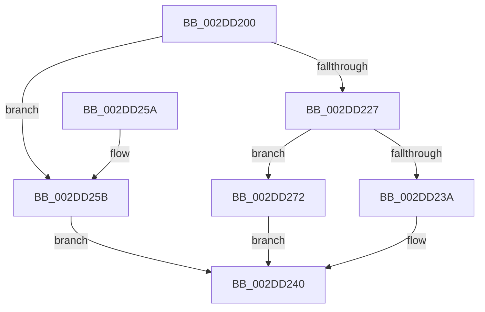

# KeSetIdealProcessorThreadByNumber

- RVA: `0x002DD200`–`0x002DD27A` (길이 `122` bytes)
- VA: `0x00000001402DD200`
- 실행 섹션: `.text`
- PDB 이름 있음: `예`; PDB Function 태그: `아니요`
- unwind 정보 RVA: `0x000707E0`
- 디코드: `34`개 명령, `122/122` bytes 표시
- 미해석 바이트: `0` (있으면 어셈블리에 `.byte`로 보존)

> 이 문서는 커널 이미지의 기계어와 PDB 기호를 분석해 생성했습니다. 4번과 5번은 함수 원형과 자료형을 바이너리 사용 방식에서 추정한 C 해석이며 원본 소스 복구 결과는 아닙니다.

## 1. Dependencies

- 직접 호출 지점: **3**; 고유 호출 대상: **3**
- 직접 호출자로 확인된 함수: **2**
- RIP 상대 이미지 참조: **0**

### Outgoing calls
- `0x002DD21D` → [KeGetProcessorIndexFromNumber](KeGetProcessorIndexFromNumber_function_002DD2D0.md) (function, `0x002DD2D0`)
- `0x002DD243` → [KeGetProcessorNumberFromIndex](KeGetProcessorNumberFromIndex_function_002DD320.md) (function, `0x002DD320`)
- `0x002DD265` → [KeSetIdealProcessorThreadEx](KeSetIdealProcessorThreadEx_function_002DD36C.md) (function, `0x002DD36C`)

### Direct callers
- [NtSetInformationThread](../../page/8C/NtSetInformationThread_function_008C9F60.md) at `0x008CB2B6`
- [NtQueryInformationThread](../../page/AE/NtQueryInformationThread_function_00AE3760.md) at `0x00AE4622`

### Static image references
- 디코드된 RIP-relative 메모리 참조가 없습니다.

## 2. Other-region calls and transfers

- 다른 실행 섹션으로 향하는 call: **0**
- 별도 외부 분기/꼬리 이동을 확인하지 못했습니다.

## 3. Assembly (complete function range)

```asm
002DD200  48 89 5C 24 08                  mov qword ptr [rsp + 8], rbx
002DD205  48 89 74 24 10                  mov qword ptr [rsp + 0x10], rsi
002DD20A  57                              push rdi
002DD20B  48 83 EC 20                     sub rsp, 0x20
002DD20F  83 64 24 48 00                  and dword ptr [rsp + 0x48], 0
002DD214  48 8B D9                        mov rbx, rcx
002DD217  48 8B CA                        mov rcx, rdx
002DD21A  49 8B F0                        mov rsi, r8
002DD21D  E8 AE 00 00 00                  call 0x1402dd2d0
002DD222  83 F8 FF                        cmp eax, -1
002DD225  75 34                           jne 0x1402dd25b
002DD227  65 48 8B 04 25 88 01 00 00      mov rax, qword ptr gs:[0x188]
002DD230  BF 0D 00 00 C0                  mov edi, 0xc000000d
002DD235  48 3B D8                        cmp rbx, rax
002DD238  75 38                           jne 0x1402dd272
002DD23A  8B 8B 4C 02 00 00               mov ecx, dword ptr [rbx + 0x24c]
002DD240  48 8B D6                        mov rdx, rsi
002DD243  E8 D8 00 00 00                  call 0x1402dd320
002DD248  48 8B 5C 24 30                  mov rbx, qword ptr [rsp + 0x30]
002DD24D  8B C7                           mov eax, edi
002DD24F  48 8B 74 24 38                  mov rsi, qword ptr [rsp + 0x38]
002DD254  48 83 C4 20                     add rsp, 0x20
002DD258  5F                              pop rdi
002DD259  C3                              ret
002DD25A  CC                              int3
002DD25B  4C 8D 44 24 48                  lea r8, [rsp + 0x48]
002DD260  8B D0                           mov edx, eax
002DD262  48 8B CB                        mov rcx, rbx
002DD265  E8 02 01 00 00                  call 0x1402dd36c
002DD26A  8B 4C 24 48                     mov ecx, dword ptr [rsp + 0x48]
002DD26E  8B F8                           mov edi, eax
002DD270  EB CE                           jmp 0x1402dd240
002DD272  8B 8B C4 00 00 00               mov ecx, dword ptr [rbx + 0xc4]
002DD278  EB C6                           jmp 0x1402dd240
```

## 4. C-style interpretation (structured pseudocode)

```c
__int64 __fastcall KeSetIdealProcessorThreadByNumber(__int64 a1, __int64 a2, __int64 a3)
{
    __int64 result;
    __int64 v_rsp;
    unsigned __int64 v_stack_p10;
    unsigned int v_stack_p20;
    unsigned __int64 v_stack_p48;
    unsigned __int64 v_stack_p8;

    v_stack_p8 = v_rbx;
    v_stack_p10 = v_rsi;
    v_rsp = (v_rsp) - (32);
    result = KeGetProcessorIndexFromNumber(a2, a2, a3, a4);
    if (((unsigned int)(result)) != -1) goto loc_002DD25B;
    if (a1 != (*(unsigned __int64 *)(gs_base + (0 + 392)))) goto loc_002DD272;
loc_002DD240:
    result = KeGetProcessorNumberFromIndex((unsigned int)(*(unsigned int *)(a1 + 588)), a3, a3, a4);
    v_rsp = (v_rsp) + (32);
    return (unsigned int)((unsigned int)((unsigned int)(0xC000000DULL)));
loc_002DD25B:
    result = KeSetIdealProcessorThreadEx(v_stack_p8, (unsigned int)((unsigned int)((unsigned int)((unsigned int)((unsigned int)(0xC000000DULL))))), v_stack_p48, a4);
    goto loc_002DD240;
loc_002DD272:
    goto loc_002DD240;
}
```

## 5. (Beta) C Style

```c
int64_t KeSetIdealProcessorThreadByNumber(int64_t Arg1, int64_t Arg2, int64_t Arg3)
{
    int64_t result;
    int64_t local_rsp;
    uint64_t v_stack_p10;
    uint32_t v_stack_p20;
    uint64_t v_stack_p48;
    uint64_t v_stack_p8;

    v_stack_p8 = local_rbx;
    v_stack_p10 = local_rsi;
    local_rsp = (local_rsp) - (32);
    result = KeGetProcessorIndexFromNumber(Arg2, Arg2, Arg3, a4);
    if (((uint32_t)(result)) != -1) goto loc_002DD25B;
    if (Arg1 != (*(uint64_t *)(gs_base + (0 + 0x188)))) goto loc_002DD272;
loc_002DD240:
    result = KeGetProcessorNumberFromIndex((uint32_t)(*(uint32_t *)(Arg1 + 0x24C)), Arg3, Arg3, a4);
    local_rsp = (local_rsp) + (32);
    return (uint32_t)((uint32_t)((uint32_t)(0xC000000DULL)));
loc_002DD25B:
    result = KeSetIdealProcessorThreadEx(v_stack_p8, (uint32_t)((uint32_t)((uint32_t)((uint32_t)((uint32_t)(0xC000000DULL))))), v_stack_p48, a4);
    goto loc_002DD240;
loc_002DD272:
    goto loc_002DD240;
}
```

## 6. Execution-region graph

[열기: 2D/3D 그래프와 함수 탐색 컨트롤 패널](../../../control-panel.html?section=text&rva=0x002DD200&view=graph)

- 2D 그래프는 위에서 아래로 흐르고, 3D 그래프는 빈 공간을 드래그해 회전합니다. Shift+드래그는 이동, 휠은 확대·축소, 함수 노드 선택은 대상 보고서 이동입니다.

### Static fallback


