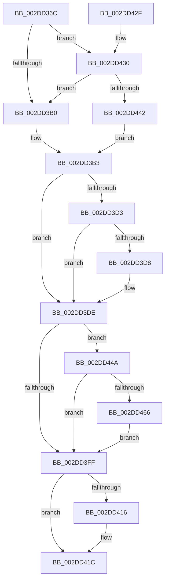

# KeSetIdealProcessorThreadEx

- RVA: `0x002DD36C`–`0x002DD47B` (길이 `271` bytes)
- VA: `0x00000001402DD36C`
- 실행 섹션: `.text`
- PDB 이름 있음: `예`; PDB Function 태그: `아니요`
- unwind 정보 RVA: `0x000707F4`
- 디코드: `73`개 명령, `271/271` bytes 표시
- 미해석 바이트: `0` (있으면 어셈블리에 `.byte`로 보존)

> 이 문서는 커널 이미지의 기계어와 PDB 기호를 분석해 생성했습니다. 4번과 5번은 함수 원형과 자료형을 바이너리 사용 방식에서 추정한 C 해석이며 원본 소스 복구 결과는 아닙니다.

## 1. Dependencies

- 직접 호출 지점: **5**; 고유 호출 대상: **4**
- 직접 호출자로 확인된 함수: **5**
- RIP 상대 이미지 참조: **1**

### Outgoing calls
- `0x002DD392` → [KiAcquireThreadLockRaiseToDpc](../39/KiAcquireThreadLockRaiseToDpc_function_00396280.md) (function, `0x00396280`)
- `0x002DD3C8` → [KiSetIdealProcessorThread](KiSetIdealProcessorThread_function_002DCFE0.md) (function, `0x002DCFE0`)
- `0x002DD40C` → [KiCheckForThreadDispatch](../25/KiCheckForThreadDispatch_function_00250648.md) (function, `0x00250648`)
- `0x002DD455` → [EtwTraceIdealProcessor](../3C/EtwTraceIdealProcessor_function_003C0808.md) (function, `0x003C0808`)
- `0x002DD474` → [EtwTraceIdealProcessor](../3C/EtwTraceIdealProcessor_function_003C0808.md) (function, `0x003C0808`)

### Direct callers
- [MiRevertProcessorMove](../2C/MiRevertProcessorMove_function_002C7420.md) at `0x002C7446`
- [MiSetIdealProcessorThread](../2C/MiSetIdealProcessorThread_function_002C760C.md) at `0x002C7691`
- [KeSetIdealProcessorThread](KeSetIdealProcessorThread_function_002DD150.md) at `0x002DD1E1`
- [KeSetIdealProcessorThreadByNumber](KeSetIdealProcessorThreadByNumber_function_002DD200.md) at `0x002DD265`
- [SMKM_STORE_MGR&lt;SM_TRAITS&gt;::SmCompressCtxUpdateThreadTopology](../3B/SMKM_STORE_MGR_SM_TRAITS_SmCompressCtxUpdateThreadTopology_function_003B216C.md) at `0x003B21AD`

### Static image references
- `0x002DD3F3` → RVA `0x00FC6B10` (`ALMOSTRO`; read)

## 2. Other-region calls and transfers

- 다른 실행 섹션으로 향하는 call: **0**
- 별도 외부 분기/꼬리 이동을 확인하지 못했습니다.

## 3. Assembly (complete function range)

```asm
002DD36C  48 8B C4                        mov rax, rsp
002DD36F  48 89 58 10                     mov qword ptr [rax + 0x10], rbx
002DD373  55                              push rbp
002DD374  56                              push rsi
002DD375  57                              push rdi
002DD376  41 56                           push r14
002DD378  41 57                           push r15
002DD37A  48 83 EC 30                     sub rsp, 0x30
002DD37E  83 60 18 00                     and dword ptr [rax + 0x18], 0
002DD382  8B EA                           mov ebp, edx
002DD384  48 8D 50 08                     lea rdx, [rax + 8]
002DD388  C6 40 08 00                     mov byte ptr [rax + 8], 0
002DD38C  49 8B F0                        mov rsi, r8
002DD38F  48 8B D9                        mov rbx, rcx
002DD392  E8 E9 8E 0B 00                  call 0x140396280
002DD397  8B 43 74                        mov eax, dword ptr [rbx + 0x74]
002DD39A  44 8B BB 4C 02 00 00            mov r15d, dword ptr [rbx + 0x24c]
002DD3A1  44 8B B3 C4 00 00 00            mov r14d, dword ptr [rbx + 0xc4]
002DD3A8  A8 08                           test al, 8
002DD3AA  0F 85 80 00 00 00               jne 0x1402dd430
002DD3B0  40 32 FF                        xor dil, dil
002DD3B3  8A 44 24 60                     mov al, byte ptr [rsp + 0x60]
002DD3B7  4C 8D 4C 24 70                  lea r9, [rsp + 0x70]
002DD3BC  44 8A C7                        mov r8b, dil
002DD3BF  88 44 24 20                     mov byte ptr [rsp + 0x20], al
002DD3C3  8B D5                           mov edx, ebp
002DD3C5  48 8B CB                        mov rcx, rbx
002DD3C8  E8 13 FC FF FF                  call 0x1402dcfe0
002DD3CD  8B E8                           mov ebp, eax
002DD3CF  85 C0                           test eax, eax
002DD3D1  78 0B                           js 0x1402dd3de
002DD3D3  40 84 FF                        test dil, dil
002DD3D6  75 06                           jne 0x1402dd3de
002DD3D8  F0 0F BA 6B 78 00               lock bts dword ptr [rbx + 0x78], 0
002DD3DE  44 8B 8B 4C 02 00 00            mov r9d, dword ptr [rbx + 0x24c]
002DD3E5  8B BB C4 00 00 00               mov edi, dword ptr [rbx + 0xc4]
002DD3EB  48 C7 43 40 00 00 00 00         mov qword ptr [rbx + 0x40], 0
002DD3F3  F7 05 13 97 CE 00 00 00 00 08   test dword ptr [rip + 0xce9713], 0x8000000
002DD3FD  75 4B                           jne 0x1402dd44a
002DD3FF  65 48 8B 0C 25 20 00 00 00      mov rcx, qword ptr gs:[0x20]
002DD408  8A 54 24 60                     mov dl, byte ptr [rsp + 0x60]
002DD40C  E8 37 32 F7 FF                  call 0x140250648
002DD411  48 85 F6                        test rsi, rsi
002DD414  74 06                           je 0x1402dd41c
002DD416  8B 44 24 70                     mov eax, dword ptr [rsp + 0x70]
002DD41A  89 06                           mov dword ptr [rsi], eax
002DD41C  48 8B 5C 24 68                  mov rbx, qword ptr [rsp + 0x68]
002DD421  8B C5                           mov eax, ebp
002DD423  48 83 C4 30                     add rsp, 0x30
002DD427  41 5F                           pop r15
002DD429  41 5E                           pop r14
002DD42B  5F                              pop rdi
002DD42C  5E                              pop rsi
002DD42D  5D                              pop rbp
002DD42E  C3                              ret
002DD42F  CC                              int3
002DD430  65 48 8B 04 25 88 01 00 00      mov rax, qword ptr gs:[0x188]
002DD439  48 3B D8                        cmp rbx, rax
002DD43C  0F 85 6E FF FF FF               jne 0x1402dd3b0
002DD442  40 B7 01                        mov dil, 1
002DD445  E9 69 FF FF FF                  jmp 0x1402dd3b3
002DD44A  BA 46 05 00 00                  mov edx, 0x546
002DD44F  45 8B C7                        mov r8d, r15d
002DD452  48 8B CB                        mov rcx, rbx
002DD455  E8 AE 33 0E 00                  call 0x1403c0808
002DD45A  F7 05 AC 96 CE 00 00 00 00 08   test dword ptr [rip + 0xce96ac], 0x8000000
002DD464  74 99                           je 0x1402dd3ff
002DD466  BA 47 05 00 00                  mov edx, 0x547
002DD46B  44 8B CF                        mov r9d, edi
002DD46E  45 8B C6                        mov r8d, r14d
002DD471  48 8B CB                        mov rcx, rbx
002DD474  E8 8F 33 0E 00                  call 0x1403c0808
002DD479  EB 84                           jmp 0x1402dd3ff
```

## 4. C-style interpretation (structured pseudocode)

```c
__int64 __fastcall KeSetIdealProcessorThreadEx(__int64 a1, int a2, __int64 a3)
{
    __int64 result;
    __int64 v_rdi;
    __int64 v_rsp;
    unsigned __int8 v_stack_m38;
    unsigned __int64 v_stack_p10;
    unsigned __int64 v_stack_p18;
    unsigned __int8 v_stack_p8;

    *(unsigned __int64 *)(v_rsp + 16) = v_rbx;
    v_rsp = (v_rsp) - (48);
    *(unsigned __int8 *)(v_rsp + 8) = 0;
    result = KiAcquireThreadLockRaiseToDpc(a1, v_rsp + 8, a3, a4);
    if ((((unsigned __int8)((unsigned int)(*(unsigned int *)(a1 + 116)))) & (8)) != 0) goto loc_002DD430;
loc_002DD3B0:
    v_rdi = 0;
loc_002DD3B3:
    v_stack_m38 = (unsigned __int8)(v_stack_p8);
    result = KiSetIdealProcessorThread(a1, (unsigned int)((unsigned int)((unsigned int)(a2))), 0, v_stack_p18);
    if (sign_flag) goto loc_002DD3DE;
    if (0 == 0) {
    }
    *(unsigned __int64 *)(a1 + 64) = 0;
    if (((*(unsigned int *)(v_rip + 13539091)) & (0x8000000ULL)) != 0) goto loc_002DD44A;
loc_002DD3FF:
    result = KiCheckForThreadDispatch(*(unsigned __int64 *)(gs_base + (0 + 32)), v_stack_p8, 0, (unsigned int)(*(unsigned int *)(a1 + 588)));
    if (a3 != 0) {
        result = v_stack_p18;
        *(unsigned int *)(a3) = (unsigned int)(result);
    }
    v_rsp = (v_rsp) + (48);
    return (unsigned int)((unsigned int)((unsigned int)((unsigned int)(result))));
loc_002DD430:
    if (v_stack_p10 != (*(unsigned __int64 *)(gs_base + (0 + 392)))) goto loc_002DD3B0;
    goto loc_002DD3B3;
loc_002DD44A:
    result = EtwTraceIdealProcessor(v_stack_p10, (unsigned int)(0x546ULL), (unsigned int)((unsigned int)((unsigned int)(*(unsigned int *)(a1 + 588)))), (unsigned int)(*(unsigned int *)(a1 + 588)));
    if (((*(unsigned int *)(v_rip + 13538988)) & (0x8000000ULL)) == 0) goto loc_002DD3FF;
    result = EtwTraceIdealProcessor(v_stack_p10, (unsigned int)(0x547ULL), (unsigned int)((unsigned int)((unsigned int)(*(unsigned int *)(a1 + 196)))), 1);
    goto loc_002DD3FF;
}
```

## 5. (Beta) C Style

```c
int64_t KeSetIdealProcessorThreadEx(void *Arg1, int32_t Arg2, int64_t Arg3)
{
    uint8_t *arg1 = (uint8_t *)Arg1;

    int64_t result;
    int64_t local_rdi;
    int64_t local_rsp;
    uint8_t v_stack_m38;
    uint64_t v_stack_p10;
    uint64_t v_stack_p18;
    uint8_t v_stack_p8;

    *(uint64_t *)(local_rsp + 0x10) = local_rbx;
    local_rsp = (local_rsp) - (48);
    *(uint8_t *)(local_rsp + 0x8) = 0;
    result = KiAcquireThreadLockRaiseToDpc(Arg1, local_rsp + 8, Arg3, a4);
    if ((((uint8_t)((uint32_t)(*(uint32_t *)(arg1 + 0x74)))) & (8)) != 0) goto loc_002DD430;
loc_002DD3B0:
    local_rdi = 0;
loc_002DD3B3:
    v_stack_m38 = (uint8_t)(v_stack_p8);
    result = KiSetIdealProcessorThread(Arg1, (uint32_t)((uint32_t)((uint32_t)(Arg2))), 0, v_stack_p18);
    if (sign_flag) goto loc_002DD3DE;
    if (0 == 0) {
    }
    *(uint64_t *)(arg1 + 0x40) = 0;
    if (((*(uint32_t *)(v_rip + 0xCE9713)) & (0x8000000ULL)) != 0) goto loc_002DD44A;
loc_002DD3FF:
    result = KiCheckForThreadDispatch(*(uint64_t *)(gs_base + (0 + 0x20)), v_stack_p8, 0, (uint32_t)(*(uint32_t *)(arg1 + 0x24C)));
    if (Arg3 != 0) {
        result = v_stack_p18;
        *(uint32_t *)(Arg3) = (uint32_t)(result);
    }
    local_rsp = (local_rsp) + (48);
    return (uint32_t)((uint32_t)((uint32_t)((uint32_t)(result))));
loc_002DD430:
    if (v_stack_p10 != (*(uint64_t *)(gs_base + (0 + 0x188)))) goto loc_002DD3B0;
    goto loc_002DD3B3;
loc_002DD44A:
    result = EtwTraceIdealProcessor(v_stack_p10, (uint32_t)(0x546ULL), (uint32_t)((uint32_t)((uint32_t)(*(uint32_t *)(arg1 + 0x24C)))), (uint32_t)(*(uint32_t *)(arg1 + 0x24C)));
    if (((*(uint32_t *)(v_rip + 0xCE96AC)) & (0x8000000ULL)) == 0) goto loc_002DD3FF;
    result = EtwTraceIdealProcessor(v_stack_p10, (uint32_t)(0x547ULL), (uint32_t)((uint32_t)((uint32_t)(*(uint32_t *)(arg1 + 0xC4)))), 1);
    goto loc_002DD3FF;
}
```

### 관측된 메모리 오프셋

구조체 형식이 확인되지 않은 접근은 인자 기준의 오프셋으로만 기록했습니다.

| 기준 인자 | 오프셋 표현 | 폭 (bit) | 접근 |
|---|---:|---:|---|
| `Arg1` | `+ 0x74` | `32` | `R` |
| `Arg1` | `+ 0xC4` | `32` | `R` |
| `Arg1` | `+ 0x24C` | `32` | `R` |

## 6. Execution-region graph

[열기: 2D/3D 그래프와 함수 탐색 컨트롤 패널](../../../control-panel.html?section=text&rva=0x002DD36C&view=graph)

- 2D 그래프는 위에서 아래로 흐르고, 3D 그래프는 빈 공간을 드래그해 회전합니다. Shift+드래그는 이동, 휠은 확대·축소, 함수 노드 선택은 대상 보고서 이동입니다.

### Static fallback


