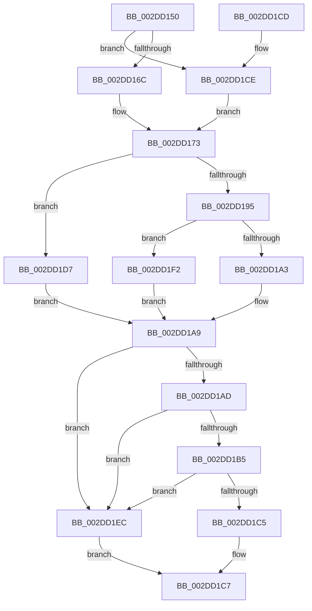

# KeSetIdealProcessorThread

- RVA: `0x002DD150`–`0x002DD1FA` (길이 `170` bytes)
- VA: `0x00000001402DD150`
- 실행 섹션: `.text`
- PDB 이름 있음: `예`; PDB Function 태그: `아니요`
- unwind 정보 RVA: `0x0006575C`
- 디코드: `46`개 명령, `170/170` bytes 표시
- 미해석 바이트: `0` (있으면 어셈블리에 `.byte`로 보존)

> 이 문서는 커널 이미지의 기계어와 PDB 기호를 분석해 생성했습니다. 4번과 5번은 함수 원형과 자료형을 바이너리 사용 방식에서 추정한 C 해석이며 원본 소스 복구 결과는 아닙니다.

## 1. Dependencies

- 직접 호출 지점: **2**; 고유 호출 대상: **2**
- 직접 호출자로 확인된 함수: **1**
- RIP 상대 이미지 참조: **2**

### Outgoing calls
- `0x002DD18B` → [KeGetProcessorIndexFromNumber](KeGetProcessorIndexFromNumber_function_002DD2D0.md) (function, `0x002DD2D0`)
- `0x002DD1E1` → [KeSetIdealProcessorThreadEx](KeSetIdealProcessorThreadEx_function_002DD36C.md) (function, `0x002DD36C`)

### Direct callers
- [NtSetInformationThread](../../page/8C/NtSetInformationThread_function_008C9F60.md) at `0x008CAC56`

### Static image references
- `0x002DD1AD` → RVA `0x00FC6AE8` (`ALMOSTRO`; read)
- `0x002DD1B7` → RVA `0x00F231B0` (`.data`; read)

## 2. Other-region calls and transfers

- 다른 실행 섹션으로 향하는 call: **0**
- 별도 외부 분기/꼬리 이동을 확인하지 못했습니다.

## 3. Assembly (complete function range)

```asm
002DD150  40 53                           push rbx
002DD152  48 83 EC 20                     sub rsp, 0x20
002DD156  83 64 24 40 00                  and dword ptr [rsp + 0x40], 0
002DD15B  48 8B D9                        mov rbx, rcx
002DD15E  65 48 8B 04 25 88 01 00 00      mov rax, qword ptr gs:[0x188]
002DD167  48 3B C8                        cmp rcx, rax
002DD16A  75 62                           jne 0x1402dd1ce
002DD16C  0F B7 81 48 02 00 00            movzx eax, word ptr [rcx + 0x248]
002DD173  83 64 24 30 00                  and dword ptr [rsp + 0x30], 0
002DD178  48 8D 4C 24 38                  lea rcx, [rsp + 0x38]
002DD17D  66 89 44 24 38                  mov word ptr [rsp + 0x38], ax
002DD182  88 54 24 3A                     mov byte ptr [rsp + 0x3a], dl
002DD186  C6 44 24 3B 00                  mov byte ptr [rsp + 0x3b], 0
002DD18B  E8 40 01 00 00                  call 0x1402dd2d0
002DD190  83 F8 FF                        cmp eax, -1
002DD193  75 42                           jne 0x1402dd1d7
002DD195  65 48 8B 04 25 88 01 00 00      mov rax, qword ptr gs:[0x188]
002DD19E  48 3B D8                        cmp rbx, rax
002DD1A1  75 4F                           jne 0x1402dd1f2
002DD1A3  8B 83 4C 02 00 00               mov eax, dword ptr [rbx + 0x24c]
002DD1A9  85 C0                           test eax, eax
002DD1AB  74 3F                           je 0x1402dd1ec
002DD1AD  3B 05 35 99 CE 00               cmp eax, dword ptr [rip + 0xce9935]
002DD1B3  73 37                           jae 0x1402dd1ec
002DD1B5  8B C8                           mov ecx, eax
002DD1B7  48 8B 05 F2 5F C4 00            mov rax, qword ptr [rip + 0xc45ff2]
002DD1BE  8B 04 88                        mov eax, dword ptr [rax + rcx*4]
002DD1C1  85 C0                           test eax, eax
002DD1C3  74 27                           je 0x1402dd1ec
002DD1C5  24 3F                           and al, 0x3f
002DD1C7  48 83 C4 20                     add rsp, 0x20
002DD1CB  5B                              pop rbx
002DD1CC  C3                              ret
002DD1CD  CC                              int3
002DD1CE  0F B7 81 30 02 00 00            movzx eax, word ptr [rcx + 0x230]
002DD1D5  EB 9C                           jmp 0x1402dd173
002DD1D7  4C 8D 44 24 30                  lea r8, [rsp + 0x30]
002DD1DC  8B D0                           mov edx, eax
002DD1DE  48 8B CB                        mov rcx, rbx
002DD1E1  E8 86 01 00 00                  call 0x1402dd36c
002DD1E6  8B 44 24 30                     mov eax, dword ptr [rsp + 0x30]
002DD1EA  EB BD                           jmp 0x1402dd1a9
002DD1EC  8A 44 24 42                     mov al, byte ptr [rsp + 0x42]
002DD1F0  EB D5                           jmp 0x1402dd1c7
002DD1F2  8B 83 C4 00 00 00               mov eax, dword ptr [rbx + 0xc4]
002DD1F8  EB AF                           jmp 0x1402dd1a9
```

## 4. C-style interpretation (structured pseudocode)

```c
__int64 __fastcall KeSetIdealProcessorThread(__int64 a1, unsigned __int8 a2)
{
    __int64 result;
    __int64 v_rsp;
    unsigned __int64 v_stack_p10;
    unsigned __int8 v_stack_p12;
    unsigned __int8 v_stack_p13;
    unsigned int v_stack_p18;
    unsigned __int64 v_stack_p30;
    unsigned __int8 v_stack_p42;
    unsigned int v_stack_p8;

    v_rsp = (v_rsp) - (32);
    if (a1 != (*(unsigned __int64 *)(gs_base + (0 + 392)))) goto loc_002DD1CE;
loc_002DD173:
    v_stack_p10 = (unsigned __int16)(*(unsigned __int16 *)(a1 + 584));
    v_stack_p12 = a2;
    v_stack_p13 = 0;
    result = KeGetProcessorIndexFromNumber(v_stack_p10, a2, a3, a4);
    if (((unsigned int)(result)) != -1) goto loc_002DD1D7;
    if (a1 != (*(unsigned __int64 *)(gs_base + (0 + 392)))) goto loc_002DD1F2;
loc_002DD1A9:
    if ((unsigned int)((unsigned int)(*(unsigned int *)(a1 + 588))) == 0) goto loc_002DD1EC;
    if (((unsigned int)((unsigned int)(*(unsigned int *)(a1 + 588)))) >= (*(unsigned int *)(v_rip + 13539637))) goto loc_002DD1EC;
    if ((unsigned int)((unsigned int)(*(unsigned int *)(*(unsigned __int64 *)(v_rip + 12869618) + (unsigned int)((unsigned int)((unsigned int)(*(unsigned int *)(a1 + 588)))) * 4))) == 0) goto loc_002DD1EC;
    result = (unsigned __int8)(((unsigned int)(*(unsigned int *)(*(unsigned __int64 *)(v_rip + 12869618) + (unsigned int)((unsigned int)((unsigned int)(*(unsigned int *)(a1 + 588)))) * 4))) & (63));
loc_002DD1C7:
    v_rsp = (v_rsp) + (32);
    return result;
loc_002DD1CE:
    goto loc_002DD173;
loc_002DD1D7:
    result = KeSetIdealProcessorThreadEx(a1, (unsigned int)((unsigned int)(*(unsigned __int16 *)((unsigned int)((unsigned int)((unsigned int)(*(unsigned int *)(a1 + 588)))) + 560))), v_stack_p30, a4);
    goto loc_002DD1A9;
loc_002DD1EC:
    goto loc_002DD1C7;
loc_002DD1F2:
    goto loc_002DD1A9;
}
```

## 5. (Beta) C Style

```c
int64_t KeSetIdealProcessorThread(int64_t Arg1, uint8_t Arg2)
{
    int64_t result;
    int64_t local_rsp;
    uint64_t v_stack_p10;
    uint8_t v_stack_p12;
    uint8_t v_stack_p13;
    uint32_t v_stack_p18;
    uint64_t v_stack_p30;
    uint8_t v_stack_p42;
    uint32_t v_stack_p8;

    local_rsp = (local_rsp) - (32);
    if (Arg1 != (*(uint64_t *)(gs_base + (0 + 0x188)))) goto loc_002DD1CE;
loc_002DD173:
    v_stack_p10 = (uint16_t)(*(uint16_t *)(Arg1 + 0x248));
    v_stack_p12 = Arg2;
    v_stack_p13 = 0;
    result = KeGetProcessorIndexFromNumber(v_stack_p10, Arg2, a3, a4);
    if (((uint32_t)(result)) != -1) goto loc_002DD1D7;
    if (Arg1 != (*(uint64_t *)(gs_base + (0 + 0x188)))) goto loc_002DD1F2;
loc_002DD1A9:
    if ((uint32_t)((uint32_t)(*(uint32_t *)(Arg1 + 0x24C))) == 0) goto loc_002DD1EC;
    if (((uint32_t)((uint32_t)(*(uint32_t *)(Arg1 + 0x24C)))) >= (*(uint32_t *)(v_rip + 0xCE9935))) goto loc_002DD1EC;
    if ((uint32_t)((uint32_t)(*(uint32_t *)(*(uint64_t *)(v_rip + 0xC45FF2) + (uint32_t)((uint32_t)((uint32_t)(*(uint32_t *)(Arg1 + 0x24C)))) * 4))) == 0) goto loc_002DD1EC;
    result = (uint8_t)(((uint32_t)(*(uint32_t *)(*(uint64_t *)(v_rip + 0xC45FF2) + (uint32_t)((uint32_t)((uint32_t)(*(uint32_t *)(Arg1 + 0x24C)))) * 4))) & (63));
loc_002DD1C7:
    local_rsp = (local_rsp) + (32);
    return result;
loc_002DD1CE:
    goto loc_002DD173;
loc_002DD1D7:
    result = KeSetIdealProcessorThreadEx(Arg1, (uint32_t)((uint32_t)(*(uint16_t *)((uint32_t)((uint32_t)((uint32_t)(*(uint32_t *)(Arg1 + 0x24C)))) + 0x230))), v_stack_p30, a4);
    goto loc_002DD1A9;
loc_002DD1EC:
    goto loc_002DD1C7;
loc_002DD1F2:
    goto loc_002DD1A9;
}
```

## 6. Execution-region graph

[열기: 2D/3D 그래프와 함수 탐색 컨트롤 패널](../../../control-panel.html?section=text&rva=0x002DD150&view=graph)

- 2D 그래프는 위에서 아래로 흐르고, 3D 그래프는 빈 공간을 드래그해 회전합니다. Shift+드래그는 이동, 휠은 확대·축소, 함수 노드 선택은 대상 보고서 이동입니다.

### Static fallback


