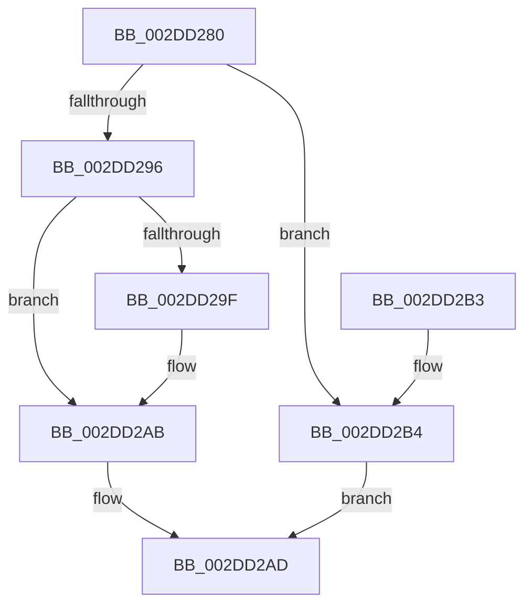

# KeSetTargetProcessorDpcEx

- RVA: `0x002DD280`–`0x002DD2BB` (길이 `59` bytes)
- VA: `0x00000001402DD280`
- 실행 섹션: `.text`
- PDB 이름 있음: `예`; PDB Function 태그: `아니요`
- unwind 정보 RVA: `0x0005DAC8`
- 디코드: `20`개 명령, `59/59` bytes 표시
- 미해석 바이트: `0` (있으면 어셈블리에 `.byte`로 보존)

> 이 문서는 커널 이미지의 기계어와 PDB 기호를 분석해 생성했습니다. 4번과 5번은 함수 원형과 자료형을 바이너리 사용 방식에서 추정한 C 해석이며 원본 소스 복구 결과는 아닙니다.

## 1. Dependencies

- 직접 호출 지점: **1**; 고유 호출 대상: **1**
- 직접 호출자로 확인된 함수: **6**
- RIP 상대 이미지 참조: **0**

### Outgoing calls
- `0x002DD28C` → [KeGetProcessorIndexFromNumber](KeGetProcessorIndexFromNumber_function_002DD2D0.md) (function, `0x002DD2D0`)

### Direct callers
- [HalpHvInitMcaPcrContext](../4D/HalpHvInitMcaPcrContext_function_004D7D88.md) at `0x004D7FF6`
- [HalpPmuReservedResourcesProcessorCallback](../54/HalpPmuReservedResourcesProcessorCallback_function_00547608.md) at `0x0054770B`
- [KiAltContextWorkQueueAddItem](../5C/KiAltContextWorkQueueAddItem_function_005CB028.md) at `0x005CB0C3`
- [WheaFlushETWEventsAddWorkRtn](../66/WheaFlushETWEventsAddWorkRtn_function_0066031C.md) at `0x006603B0`
- [sub_006DDA8E](../6D/Unknown_function_006DDA8E.md) at `0x006DDAD9`
- [HalpMcaInitializePcrContext](../../pagelk/B5/HalpMcaInitializePcrContext_function_00B5BDD0.md) at `0x00B5BEBB`

### Static image references
- 디코드된 RIP-relative 메모리 참조가 없습니다.

## 2. Other-region calls and transfers

- 다른 실행 섹션으로 향하는 call: **0**
- 별도 외부 분기/꼬리 이동을 확인하지 못했습니다.

## 3. Assembly (complete function range)

```asm
002DD280  40 53                           push rbx
002DD282  48 83 EC 20                     sub rsp, 0x20
002DD286  48 8B D9                        mov rbx, rcx
002DD289  48 8B CA                        mov rcx, rdx
002DD28C  E8 3F 00 00 00                  call 0x1402dd2d0
002DD291  83 F8 FF                        cmp eax, -1
002DD294  74 1E                           je 0x1402dd2b4
002DD296  48 8B 53 38                     mov rdx, qword ptr [rbx + 0x38]
002DD29A  48 85 D2                        test rdx, rdx
002DD29D  75 0C                           jne 0x1402dd2ab
002DD29F  B9 00 08 00 00                  mov ecx, 0x800
002DD2A4  66 03 C1                        add ax, cx
002DD2A7  66 89 43 02                     mov word ptr [rbx + 2], ax
002DD2AB  33 C0                           xor eax, eax
002DD2AD  48 83 C4 20                     add rsp, 0x20
002DD2B1  5B                              pop rbx
002DD2B2  C3                              ret
002DD2B3  CC                              int3
002DD2B4  B8 0D 00 00 C0                  mov eax, 0xc000000d
002DD2B9  EB F2                           jmp 0x1402dd2ad
```

## 4. C-style interpretation (structured pseudocode)

```c
__int64 __fastcall KeSetTargetProcessorDpcEx(__int64 a1, __int64 a2)
{
    __int64 result;
    __int64 v_rsp;

    v_rsp = (v_rsp) - (32);
    result = KeGetProcessorIndexFromNumber(a2, a2, a3, a4);
    if (((unsigned int)(result)) == -1) goto loc_002DD2B4;
    if (*(unsigned __int64 *)(a1 + 56) == 0) {
        a1 = 0x800ULL;
        result = (unsigned __int16)((result) + ((unsigned __int16)(a1)));
        *(unsigned __int16 *)(a1 + 2) = (unsigned __int16)(result);
    }
    result = 0;
loc_002DD2AD:
    v_rsp = (v_rsp) + (32);
    return result;
loc_002DD2B4:
    goto loc_002DD2AD;
}
```

## 5. (Beta) C Style

```c
int64_t KeSetTargetProcessorDpcEx(void *Arg1, int64_t Arg2)
{
    uint8_t *arg1 = (uint8_t *)Arg1;

    int64_t result;
    int64_t local_rsp;

    local_rsp = (local_rsp) - (32);
    result = KeGetProcessorIndexFromNumber(Arg2, Arg2, a3, a4);
    if (((uint32_t)(result)) == -1) goto loc_002DD2B4;
    if (*(uint64_t *)(arg1 + 0x38) == 0) {
        Arg1 = 0x800ULL;
        result = (uint16_t)((result) + ((uint16_t)(Arg1)));
        *(uint16_t *)(arg1 + 0x2) = (uint16_t)(result);
    }
    result = 0;
loc_002DD2AD:
    local_rsp = (local_rsp) + (32);
    return result;
loc_002DD2B4:
    goto loc_002DD2AD;
}
```

### 관측된 메모리 오프셋

구조체 형식이 확인되지 않은 접근은 인자 기준의 오프셋으로만 기록했습니다.

| 기준 인자 | 오프셋 표현 | 폭 (bit) | 접근 |
|---|---:|---:|---|
| `Arg1` | `+ 0x2` | `16` | `W` |
| `Arg1` | `+ 0x38` | `64` | `R` |

## 6. Execution-region graph

[열기: 2D/3D 그래프와 함수 탐색 컨트롤 패널](../../../control-panel.html?section=text&rva=0x002DD280&view=graph)

- 2D 그래프는 위에서 아래로 흐르고, 3D 그래프는 빈 공간을 드래그해 회전합니다. Shift+드래그는 이동, 휠은 확대·축소, 함수 노드 선택은 대상 보고서 이동입니다.

### Static fallback


