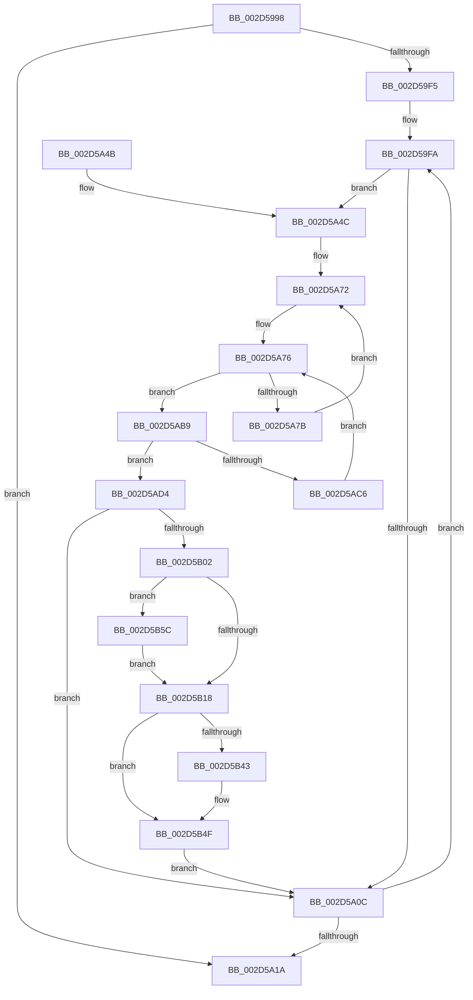

# KeUpdateSoftParkRankList

- RVA: `0x002D5998`–`0x002D5B68` (길이 `464` bytes)
- VA: `0x00000001402D5998`
- 실행 섹션: `.text`
- PDB 이름 있음: `예`; PDB Function 태그: `아니요`
- unwind 정보 RVA: `0x0006FCF8`
- 디코드: `115`개 명령, `464/464` bytes 표시
- 미해석 바이트: `0` (있으면 어셈블리에 `.byte`로 보존)

> 이 문서는 커널 이미지의 기계어와 PDB 기호를 분석해 생성했습니다. 4번과 5번은 함수 원형과 자료형을 바이너리 사용 방식에서 추정한 C 해석이며 원본 소스 복구 결과는 아닙니다.

## 1. Dependencies

- 직접 호출 지점: **10**; 고유 호출 대상: **9**
- 직접 호출자로 확인된 함수: **3**
- RIP 상대 이미지 참조: **7**

### Outgoing calls
- `0x002D59E0` → [memset](../6C/memset_function_006C6C40.md) (function, `0x006C6C40`)
- `0x002D5A25` → [_security_check_cookie](../6A/_security_check_cookie_function_006AC640.md) (function, `0x006AC640`)
- `0x002D5A5A` → [memset](../6C/memset_function_006C6C40.md) (function, `0x006C6C40`)
- `0x002D5ADE` → [KiCompressSoftParkRankList](../48/KiCompressSoftParkRankList_function_00486E2C.md) (function, `0x00486E2C`)
- `0x002D5AF5` → [memcmp](../6C/memcmp_function_006C6B10.md) (function, `0x006C6B10`)
- `0x002D5B1C` → [ExAcquireSpinLockExclusiveAtDpcLevel](../24/ExAcquireSpinLockExclusiveAtDpcLevel_function_00248E80.md) (function, `0x00248E80`)
- `0x002D5B2C` → [RtlCopyVolatileMemory](../6B/RtlCopyVolatileMemory_function_006BC9D0.md) (function, `0x006BC9D0`)
- `0x002D5B35` → [ExReleaseSpinLockExclusiveFromDpcLevel](../24/ExReleaseSpinLockExclusiveFromDpcLevel_function_002497E0.md) (function, `0x002497E0`)
- `0x002D5B4A` → [KiLowerIrqlProcessIrqlFlags](../4F/KiLowerIrqlProcessIrqlFlags_function_004F5698.md) (function, `0x004F5698`)
- `0x002D5B61` → [KiRaiseIrqlProcessIrqlFlags](../4F/KiRaiseIrqlProcessIrqlFlags_function_004F56FC.md) (function, `0x004F56FC`)

### Direct callers
- [PpmParkReportParkedCores](PpmParkReportParkedCores_function_002D5CB0.md) at `0x002D61B4`
- [PpmParkApplyPolicy](../4B/PpmParkApplyPolicy_function_004B613C.md) at `0x004B680D`
- [PpmParkApplyPolicyEx](../4F/PpmParkApplyPolicyEx_function_004F3090.md) at `0x004F38DA`

### Static image references
- `0x002D59B7` → RVA `0x00E0A740` (`.data`; read)
- `0x002D59C9` → RVA `0x00F083C8` (`.data`; read)
- `0x002D59E8` → RVA `0x00F21AC8` (`.data`; read)
- `0x002D59FA` → RVA `0x00F21AD0` (`.data`; read)
- `0x002D5A91` → RVA `0x00F231B8` (`.data`; read)
- `0x002D5A9B` → RVA `0x00FC8C40` (`ALMOSTRO`; read)
- `0x002D5B0F` → RVA `0x00FC6D20` (`ALMOSTRO`; read)

## 2. Other-region calls and transfers

- 다른 실행 섹션으로 향하는 call: **0**
- 별도 외부 분기/꼬리 이동을 확인하지 못했습니다.

## 3. Assembly (complete function range)

```asm
002D5998  48 89 5C 24 08                  mov qword ptr [rsp + 8], rbx
002D599D  48 89 6C 24 10                  mov qword ptr [rsp + 0x10], rbp
002D59A2  48 89 74 24 18                  mov qword ptr [rsp + 0x18], rsi
002D59A7  57                              push rdi
002D59A8  41 54                           push r12
002D59AA  41 55                           push r13
002D59AC  41 56                           push r14
002D59AE  41 57                           push r15
002D59B0  48 81 EC 80 01 00 00            sub rsp, 0x180
002D59B7  48 8B 05 82 4D B3 00            mov rax, qword ptr [rip + 0xb34d82]
002D59BE  48 33 C4                        xor rax, rsp
002D59C1  48 89 84 24 70 01 00 00         mov qword ptr [rsp + 0x170], rax
002D59C9  4C 8B 35 F8 29 C3 00            mov r14, qword ptr [rip + 0xc329f8]
002D59D0  48 8D 4C 24 30                  lea rcx, [rsp + 0x30]
002D59D5  41 BC 40 00 00 00               mov r12d, 0x40
002D59DB  33 D2                           xor edx, edx
002D59DD  45 8B C4                        mov r8d, r12d
002D59E0  E8 5B 12 3F 00                  call 0x1406c6c40
002D59E5  45 33 FF                        xor r15d, r15d
002D59E8  66 44 3B 3D D8 C0 C4 00         cmp r15w, word ptr [rip + 0xc4c0d8]
002D59F0  41 8B FF                        mov edi, r15d
002D59F3  73 25                           jae 0x1402d5a1a
002D59F5  45 8D 6C 24 C1                  lea r13d, [r12 - 0x3f]
002D59FA  48 8B 05 CF C0 C4 00            mov rax, qword ptr [rip + 0xc4c0cf]
002D5A01  8B CF                           mov ecx, edi
002D5A03  48 8B 1C C8                     mov rbx, qword ptr [rax + rcx*8]
002D5A07  48 85 DB                        test rbx, rbx
002D5A0A  75 40                           jne 0x1402d5a4c
002D5A0C  0F B7 05 B5 C0 C4 00            movzx eax, word ptr [rip + 0xc4c0b5]
002D5A13  41 03 FD                        add edi, r13d
002D5A16  3B F8                           cmp edi, eax
002D5A18  72 E0                           jb 0x1402d59fa
002D5A1A  48 8B 8C 24 70 01 00 00         mov rcx, qword ptr [rsp + 0x170]
002D5A22  48 33 CC                        xor rcx, rsp
002D5A25  E8 16 6C 3D 00                  call 0x1406ac640
002D5A2A  4C 8D 9C 24 80 01 00 00         lea r11, [rsp + 0x180]
002D5A32  49 8B 5B 30                     mov rbx, qword ptr [r11 + 0x30]
002D5A36  49 8B 6B 38                     mov rbp, qword ptr [r11 + 0x38]
002D5A3A  49 8B 73 40                     mov rsi, qword ptr [r11 + 0x40]
002D5A3E  49 8B E3                        mov rsp, r11
002D5A41  41 5F                           pop r15
002D5A43  41 5E                           pop r14
002D5A45  41 5D                           pop r13
002D5A47  41 5C                           pop r12
002D5A49  5F                              pop rdi
002D5A4A  C3                              ret
002D5A4B  CC                              int3
002D5A4C  BA FF 00 00 00                  mov edx, 0xff
002D5A51  48 8D 4C 24 70                  lea rcx, [rsp + 0x70]
002D5A56  44 8D 42 01                     lea r8d, [rdx + 1]
002D5A5A  E8 E1 11 3F 00                  call 0x1406c6c40
002D5A5F  44 0F B7 83 88 00 00 00         movzx r8d, word ptr [rbx + 0x88]
002D5A67  4C 8B 93 80 00 00 00            mov r10, qword ptr [rbx + 0x80]
002D5A6E  45 0F B7 C8                     movzx r9d, r8w
002D5A72  41 8D 48 01                     lea ecx, [r8 + 1]
002D5A76  4D 85 D2                        test r10, r10
002D5A79  74 3E                           je 0x1402d5ab9
002D5A7B  49 0F BC D2                     bsf rdx, r10
002D5A7F  41 8B C8                        mov ecx, r8d
002D5A82  0F B6 C2                        movzx eax, dl
002D5A85  49 0F B3 C2                     btr r10, rax
002D5A89  C1 E1 06                        shl ecx, 6
002D5A8C  0F B6 C2                        movzx eax, dl
002D5A8F  03 C8                           add ecx, eax
002D5A91  48 8B 05 20 D7 C4 00            mov rax, qword ptr [rip + 0xc4d720]
002D5A98  8B 0C 88                        mov ecx, dword ptr [rax + rcx*4]
002D5A9B  48 8D 05 9E 31 CF 00            lea rax, [rip + 0xcf319e]
002D5AA2  8B D1                           mov edx, ecx
002D5AA4  48 8B 04 C8                     mov rax, qword ptr [rax + rcx*8]
002D5AA8  0F B6 88 D1 00 00 00            movzx ecx, byte ptr [rax + 0xd1]
002D5AAF  41 8B 04 96                     mov eax, dword ptr [r14 + rdx*4]
002D5AB3  89 44 8C 70                     mov dword ptr [rsp + rcx*4 + 0x70], eax
002D5AB7  EB B9                           jmp 0x1402d5a72
002D5AB9  66 45 03 CD                     add r9w, r13w
002D5ABD  45 0F B7 C1                     movzx r8d, r9w
002D5AC1  44 3B C1                        cmp r8d, ecx
002D5AC4  73 0E                           jae 0x1402d5ad4
002D5AC6  41 0F B7 C1                     movzx eax, r9w
002D5ACA  4C 8B 14 C5 08 00 00 00         mov r10, qword ptr [rax*8 + 8]
002D5AD2  EB A2                           jmp 0x1402d5a76
002D5AD4  48 8D 54 24 30                  lea rdx, [rsp + 0x30]
002D5AD9  48 8D 4C 24 70                  lea rcx, [rsp + 0x70]
002D5ADE  E8 49 13 1B 00                  call 0x140486e2c
002D5AE3  48 8D AB C0 01 00 00            lea rbp, [rbx + 0x1c0]
002D5AEA  4D 8B C4                        mov r8, r12
002D5AED  48 8B D5                        mov rdx, rbp
002D5AF0  48 8D 4C 24 30                  lea rcx, [rsp + 0x30]
002D5AF5  E8 16 10 3F 00                  call 0x1406c6b10
002D5AFA  85 C0                           test eax, eax
002D5AFC  0F 84 0A FF FF FF               je 0x1402d5a0c
002D5B02  44 0F 20 C6                     mov rsi, cr8
002D5B06  B8 02 00 00 00                  mov eax, 2
002D5B0B  44 0F 22 C0                     mov cr8, rax
002D5B0F  44 39 3D 0A 12 CF 00            cmp dword ptr [rip + 0xcf120a], r15d
002D5B16  75 44                           jne 0x1402d5b5c
002D5B18  48 8D 4B 78                     lea rcx, [rbx + 0x78]
002D5B1C  E8 5F 33 F7 FF                  call 0x140248e80
002D5B21  4D 8B C4                        mov r8, r12
002D5B24  48 8D 54 24 30                  lea rdx, [rsp + 0x30]
002D5B29  48 8B CD                        mov rcx, rbp
002D5B2C  E8 9F 6E 3E 00                  call 0x1406bc9d0
002D5B31  48 8D 4B 78                     lea rcx, [rbx + 0x78]
002D5B35  E8 A6 3C F7 FF                  call 0x1402497e0
002D5B3A  44 39 3D DF 11 CF 00            cmp dword ptr [rip + 0xcf11df], r15d
002D5B41  74 0C                           je 0x1402d5b4f
002D5B43  44 0F 20 C1                     mov rcx, cr8
002D5B47  40 8A D6                        mov dl, sil
002D5B4A  E8 49 FB 21 00                  call 0x1404f5698
002D5B4F  40 0F B6 C6                     movzx eax, sil
002D5B53  44 0F 22 C0                     mov cr8, rax
002D5B57  E9 B0 FE FF FF                  jmp 0x1402d5a0c
002D5B5C  8A D0                           mov dl, al
002D5B5E  40 8A CE                        mov cl, sil
002D5B61  E8 96 FB 21 00                  call 0x1404f56fc
002D5B66  EB B0                           jmp 0x1402d5b18
```

## 4. C-style interpretation (structured pseudocode)

```c
__int64 __fastcall KeUpdateSoftParkRankList(__int64 a1, int a2)
{
    __int64 result;
    __int64 v_r15;
    __int64 v_rdi;
    __int64 v_rsp;
    unsigned __int64 v_stack_m110;
    unsigned __int64 v_stack_m150;
    unsigned __int64 v_stack_m178;
    unsigned __int64 v_stack_m28;
    unsigned __int64 v_stack_m38;
    unsigned __int64 v_stack_p10;
    unsigned __int64 v_stack_p18;
    unsigned __int64 v_stack_p8;

    v_stack_p8 = v_rbx;
    v_stack_p10 = v_rbp;
    v_stack_p18 = v_rsi;
    v_rsp = (v_rsp) - (384);
    result = (*(unsigned __int64 *)(v_rip + 11750786)) ^ (v_rsp);
    v_stack_m38 = result;
    a2 = 0;
    result = memset(v_stack_m178, a2, 64, a4);
    v_r15 = 0;
    if (0 >= (*(unsigned __int16 *)(v_rip + 12894424))) goto loc_002D5A1A;
loc_002D59FA:
    if (*(unsigned __int64 *)(*(unsigned __int64 *)(v_rip + 12894415) + 0 * 8) != 0) goto loc_002D5A4C;
loc_002D5A0C:
    v_rdi = (unsigned int)((0) + ((unsigned int)(64 - 63)));
    if (((unsigned int)(v_rdi)) < ((unsigned int)(*(unsigned __int16 *)(v_rip + 12894389)))) goto loc_002D59FA;
loc_002D5A1A:
    a1 = (v_stack_m38) ^ (v_rsp);
    result = _security_check_cookie(a1, a2, 64, a4);
    return result;
loc_002D5A4C:
    result = memset(v_stack_m110, 255, 255 + 1, a4);
loc_002D5A72:
loc_002D5A76:
    if (*(unsigned __int64 *)(*(unsigned __int64 *)(v_stack_m28 + 48) + 128) == 0) goto loc_002D5AB9;
    a1 = (unsigned int)(((unsigned int)((unsigned int)(*(unsigned __int16 *)(*(unsigned __int64 *)(v_stack_m28 + 48) + 136)))) << (6));
    a1 = (unsigned int)((a1) + (255));
    *(unsigned int *)(v_stack_m28 + *(unsigned __int8 *)(*(unsigned __int64 *)(v_rip + 13578654 + (unsigned int)(*(unsigned int *)(*(unsigned __int64 *)(v_rip + 12900128) + a1 * 4)) * 8) + 209) * 4 + 112) = (unsigned int)((unsigned int)(*(unsigned int *)(*(unsigned __int64 *)(v_rip + 12790264) + (unsigned int)((unsigned int)((unsigned int)(*(unsigned int *)(*(unsigned __int64 *)(v_rip + 12900128) + a1 * 4)))) * 4)));
    goto loc_002D5A72;
loc_002D5AB9:
    a4 = (unsigned __int16)(((unsigned __int16)(*(unsigned __int16 *)(*(unsigned __int64 *)(v_stack_m28 + 48) + 136))) + ((unsigned __int16)(64 - 63)));
    if (((unsigned int)((unsigned __int16)(a4))) >= ((unsigned int)(*(unsigned __int8 *)(*(unsigned __int64 *)(v_rip + 13578654 + (unsigned int)(*(unsigned int *)(*(unsigned __int64 *)(v_rip + 12900128) + a1 * 4)) * 8) + 209)))) goto loc_002D5AD4;
    goto loc_002D5A76;
loc_002D5AD4:
    result = KiCompressSoftParkRankList(v_stack_m110, v_stack_m150, (unsigned __int16)(a4), a4);
    result = memcmp(v_stack_m150, *(unsigned __int64 *)(v_stack_m28 + 48) + 448, 64, a4);
    if ((unsigned int)(result) == 0) goto loc_002D5A0C;
    if ((*(unsigned int *)(v_rip + 13570570)) != 0) goto loc_002D5B5C;
loc_002D5B18:
    result = ExAcquireSpinLockExclusiveAtDpcLevel(*(unsigned __int64 *)(v_stack_m28 + 48) + 120, *(unsigned __int64 *)(v_stack_m28 + 48) + 448, 64, a4);
    result = RtlCopyVolatileMemory(*(unsigned __int64 *)(v_stack_m28 + 48) + 448, v_stack_m150, 64, a4);
    result = ExReleaseSpinLockExclusiveFromDpcLevel(*(unsigned __int64 *)(v_stack_m28 + 48) + 120, v_stack_m150, 64, a4);
    if ((*(unsigned int *)(v_rip + 13570527)) != 0) {
        a1 = 2;
        a2 = (unsigned __int8)(v_cr8);
        result = KiLowerIrqlProcessIrqlFlags(a1, a2, 64, a4);
    }
    goto loc_002D5A0C;
loc_002D5B5C:
    result = KiRaiseIrqlProcessIrqlFlags((unsigned __int8)(v_cr8), (unsigned __int8)((unsigned __int8)(v_cr8)), 64, a4);
    goto loc_002D5B18;
}
```

## 5. (Beta) C Style

```c
int64_t KeUpdateSoftParkRankList(int64_t Arg1, int32_t Arg2)
{
    int64_t result;
    int64_t local_r15;
    int64_t local_rdi;
    int64_t local_rsp;
    uint64_t v_stack_m110;
    uint64_t v_stack_m150;
    uint64_t v_stack_m178;
    uint64_t v_stack_m28;
    uint64_t v_stack_m38;
    uint64_t v_stack_p10;
    uint64_t v_stack_p18;
    uint64_t v_stack_p8;

    v_stack_p8 = local_rbx;
    v_stack_p10 = local_rbp;
    v_stack_p18 = local_rsi;
    local_rsp = (local_rsp) - (384);
    result = (*(uint64_t *)(v_rip + 0xB34D82)) ^ (local_rsp);
    v_stack_m38 = result;
    Arg2 = 0;
    result = memset(v_stack_m178, Arg2, 64, a4);
    local_r15 = 0;
    if (0 >= (*(uint16_t *)(v_rip + 0xC4C0D8))) goto loc_002D5A1A;
loc_002D59FA:
    if (*(uint64_t *)(*(uint64_t *)(v_rip + 0xC4C0CF) + 0x0 * 8) != 0) goto loc_002D5A4C;
loc_002D5A0C:
    local_rdi = (uint32_t)((0) + ((uint32_t)(64 - 63)));
    if (((uint32_t)(local_rdi)) < ((uint32_t)(*(uint16_t *)(v_rip + 0xC4C0B5)))) goto loc_002D59FA;
loc_002D5A1A:
    Arg1 = (v_stack_m38) ^ (local_rsp);
    result = _security_check_cookie(Arg1, Arg2, 64, a4);
    return result;
loc_002D5A4C:
    result = memset(v_stack_m110, 255, 255 + 1, a4);
loc_002D5A72:
loc_002D5A76:
    if (*(uint64_t *)(*(uint64_t *)(v_stack_m28 + 0x30) + 0x80) == 0) goto loc_002D5AB9;
    Arg1 = (uint32_t)(((uint32_t)((uint32_t)(*(uint16_t *)(*(uint64_t *)(v_stack_m28 + 0x30) + 0x88)))) << (6));
    Arg1 = (uint32_t)((Arg1) + (255));
    *(uint32_t *)(v_stack_m28 + *(uint8_t *)(*(uint64_t *)(v_rip + 0xCF319E + (uint32_t)(*(uint32_t *)(*(uint64_t *)(v_rip + 0xC4D720) + Arg1 * 4)) * 8) + 0xD1) * 4 + 0x70) = (uint32_t)((uint32_t)(*(uint32_t *)(*(uint64_t *)(v_rip + 0xC329F8) + (uint32_t)((uint32_t)((uint32_t)(*(uint32_t *)(*(uint64_t *)(v_rip + 0xC4D720) + Arg1 * 4)))) * 4)));
    goto loc_002D5A72;
loc_002D5AB9:
    a4 = (uint16_t)(((uint16_t)(*(uint16_t *)(*(uint64_t *)(v_stack_m28 + 0x30) + 0x88))) + ((uint16_t)(64 - 63)));
    if (((uint32_t)((uint16_t)(a4))) >= ((uint32_t)(*(uint8_t *)(*(uint64_t *)(v_rip + 0xCF319E + (uint32_t)(*(uint32_t *)(*(uint64_t *)(v_rip + 0xC4D720) + Arg1 * 4)) * 8) + 0xD1)))) goto loc_002D5AD4;
    goto loc_002D5A76;
loc_002D5AD4:
    result = KiCompressSoftParkRankList(v_stack_m110, v_stack_m150, (uint16_t)(a4), a4);
    result = memcmp(v_stack_m150, *(uint64_t *)(v_stack_m28 + 0x30) + 448, 64, a4);
    if ((uint32_t)(result) == 0) goto loc_002D5A0C;
    if ((*(uint32_t *)(v_rip + 0xCF120A)) != 0) goto loc_002D5B5C;
loc_002D5B18:
    result = ExAcquireSpinLockExclusiveAtDpcLevel(*(uint64_t *)(v_stack_m28 + 0x30) + 120, *(uint64_t *)(v_stack_m28 + 0x30) + 448, 64, a4);
    result = RtlCopyVolatileMemory(*(uint64_t *)(v_stack_m28 + 0x30) + 448, v_stack_m150, 64, a4);
    result = ExReleaseSpinLockExclusiveFromDpcLevel(*(uint64_t *)(v_stack_m28 + 0x30) + 120, v_stack_m150, 64, a4);
    if ((*(uint32_t *)(v_rip + 0xCF11DF)) != 0) {
        Arg1 = 2;
        Arg2 = (uint8_t)(v_cr8);
        result = KiLowerIrqlProcessIrqlFlags(Arg1, Arg2, 64, a4);
    }
    goto loc_002D5A0C;
loc_002D5B5C:
    result = KiRaiseIrqlProcessIrqlFlags((uint8_t)(v_cr8), (uint8_t)((uint8_t)(v_cr8)), 64, a4);
    goto loc_002D5B18;
}
```

## 6. Execution-region graph

[열기: 2D/3D 그래프와 함수 탐색 컨트롤 패널](../../../control-panel.html?section=text&rva=0x002D5998&view=graph)

- 2D 그래프는 위에서 아래로 흐르고, 3D 그래프는 빈 공간을 드래그해 회전합니다. Shift+드래그는 이동, 휠은 확대·축소, 함수 노드 선택은 대상 보고서 이동입니다.

### Static fallback


