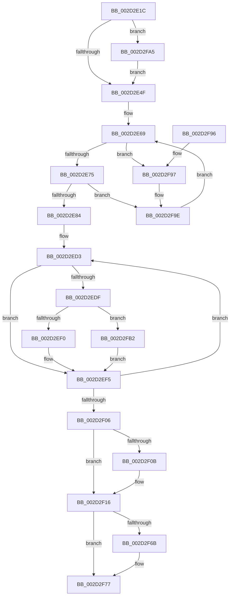

# KiConfigureCpuSetSchedulingInformation

- RVA: `0x002D2E1C`–`0x002D2FB9` (길이 `413` bytes)
- VA: `0x00000001402D2E1C`
- 실행 섹션: `.text`
- PDB 이름 있음: `예`; PDB Function 태그: `아니요`
- unwind 정보 RVA: `0x0006F9A0`
- 디코드: `99`개 명령, `413/413` bytes 표시
- 미해석 바이트: `0` (있으면 어셈블리에 `.byte`로 보존)

> 이 문서는 커널 이미지의 기계어와 PDB 기호를 분석해 생성했습니다. 4번과 5번은 함수 원형과 자료형을 바이너리 사용 방식에서 추정한 C 해석이며 원본 소스 복구 결과는 아닙니다.

## 1. Dependencies

- 직접 호출 지점: **5**; 고유 호출 대상: **5**
- 직접 호출자로 확인된 함수: **2**
- RIP 상대 이미지 참조: **5**

### Outgoing calls
- `0x002D2E56` → [KeAcquireSpinLockAtDpcLevel](../20/KeAcquireSpinLockAtDpcLevel_function_00208430.md) (function, `0x00208430`)
- `0x002D2ED6` → [KeIsEmptyAffinityEx](KeIsEmptyAffinityEx_function_002D1580.md) (function, `0x002D1580`)
- `0x002D2F5D` → [KxReleaseSpinLock](../20/KxReleaseSpinLock_function_00206670.md) (function, `0x00206670`)
- `0x002D2F72` → [KiLowerIrqlProcessIrqlFlags](../4F/KiLowerIrqlProcessIrqlFlags_function_004F5698.md) (function, `0x004F5698`)
- `0x002D2FA8` → [KiRaiseIrqlProcessIrqlFlags](../4F/KiRaiseIrqlProcessIrqlFlags_function_004F56FC.md) (function, `0x004F56FC`)

### Direct callers
- [KeConfigureHeteroProcessors](../42/KeConfigureHeteroProcessors_function_00427338.md) at `0x00427504`
- [KiConfigureSchedulingInformation](../../pagelk/B6/KiConfigureSchedulingInformation_function_00B66518.md) at `0x00B665FC`

### Static image references
- `0x002D2E42` → RVA `0x00FC6D20` (`ALMOSTRO`; read)
- `0x002D2E4F` → RVA `0x00F23440` (`.data`; read)
- `0x002D2E5B` → RVA `0x00FC6BF8` (`ALMOSTRO`; read)
- `0x002D2EA9` → RVA `0x00FC72F8` (`ALMOSTRO`; read)
- `0x002D2F56` → RVA `0x00FC6BF8` (`ALMOSTRO`; write)

## 2. Other-region calls and transfers

- 다른 실행 섹션으로 향하는 call: **0**
- 별도 외부 분기/꼬리 이동을 확인하지 못했습니다.

## 3. Assembly (complete function range)

```asm
002D2E1C  48 89 5C 24 18                  mov qword ptr [rsp + 0x18], rbx
002D2E21  48 89 6C 24 20                  mov qword ptr [rsp + 0x20], rbp
002D2E26  56                              push rsi
002D2E27  57                              push rdi
002D2E28  41 54                           push r12
002D2E2A  41 56                           push r14
002D2E2C  41 57                           push r15
002D2E2E  48 83 EC 20                     sub rsp, 0x20
002D2E32  48 8B F9                        mov rdi, rcx
002D2E35  44 0F 20 C5                     mov rbp, cr8
002D2E39  BA 02 00 00 00                  mov edx, 2
002D2E3E  44 0F 22 C2                     mov cr8, rdx
002D2E42  83 3D D7 3E CF 00 00            cmp dword ptr [rip + 0xcf3ed7], 0
002D2E49  0F 85 56 01 00 00               jne 0x1402d2fa5
002D2E4F  48 8D 0D EA 05 C5 00            lea rcx, [rip + 0xc505ea]
002D2E56  E8 D5 55 F3 FF                  call 0x140208430
002D2E5B  0F 0D 0D 96 3D CF 00            prefetchw byte ptr [rip + 0xcf3d96]
002D2E62  48 8B 05 8F 3D CF 00            mov rax, qword ptr [rip + 0xcf3d8f]
002D2E69  48 8D 48 01                     lea rcx, [rax + 1]
002D2E6D  A8 01                           test al, 1
002D2E6F  0F 85 22 01 00 00               jne 0x1402d2f97
002D2E75  F0 48 0F B1 0D 7A 3D CF 00      lock cmpxchg qword ptr [rip + 0xcf3d7a], rcx
002D2E7E  0F 85 1A 01 00 00               jne 0x1402d2f9e
002D2E84  0F B6 87 D1 00 00 00            movzx eax, byte ptr [rdi + 0xd1]
002D2E8B  4C 8D B7 00 AF 00 00            lea r14, [rdi + 0xaf00]
002D2E92  0F B6 8F D0 00 00 00            movzx ecx, byte ptr [rdi + 0xd0]
002D2E99  4D 8B FE                        mov r15, r14
002D2E9C  8B D9                           mov ebx, ecx
002D2E9E  48 C1 E3 06                     shl rbx, 6
002D2EA2  48 03 D8                        add rbx, rax
002D2EA5  48 C1 E3 04                     shl rbx, 4
002D2EA9  48 03 1D 48 44 CF 00            add rbx, qword ptr [rip + 0xcf4448]
002D2EB0  88 0B                           mov byte ptr [rbx], cl
002D2EB2  8A 87 D1 00 00 00               mov al, byte ptr [rdi + 0xd1]
002D2EB8  88 43 01                        mov byte ptr [rbx + 1], al
002D2EBB  48 8B 87 60 8E 00 00            mov rax, qword ptr [rdi + 0x8e60]
002D2EC2  48 0F BC C8                     bsf rcx, rax
002D2EC6  33 F6                           xor esi, esi
002D2EC8  89 4C 24 50                     mov dword ptr [rsp + 0x50], ecx
002D2ECC  88 4B 02                        mov byte ptr [rbx + 2], cl
002D2ECF  44 8D 66 05                     lea r12d, [rsi + 5]
002D2ED3  49 8B CF                        mov rcx, r15
002D2ED6  E8 A5 E6 FF FF                  call 0x1402d1580
002D2EDB  85 C0                           test eax, eax
002D2EDD  75 16                           jne 0x1402d2ef5
002D2EDF  0F B6 87 D0 00 00 00            movzx eax, byte ptr [rdi + 0xd0]
002D2EE6  66 41 3B 06                     cmp ax, word ptr [r14]
002D2EEA  0F 83 C2 00 00 00               jae 0x1402d2fb2
002D2EF0  49 8B 74 C6 08                  mov rsi, qword ptr [r14 + rax*8 + 8]
002D2EF5  B8 08 01 00 00                  mov eax, 0x108
002D2EFA  4C 03 F8                        add r15, rax
002D2EFD  4C 03 F0                        add r14, rax
002D2F00  49 83 EC 01                     sub r12, 1
002D2F04  75 CD                           jne 0x1402d2ed3
002D2F06  48 85 F6                        test rsi, rsi
002D2F09  74 0B                           je 0x1402d2f16
002D2F0B  48 0F BC C6                     bsf rax, rsi
002D2F0F  89 44 24 58                     mov dword ptr [rsp + 0x58], eax
002D2F13  88 43 03                        mov byte ptr [rbx + 3], al
002D2F16  48 8B 87 C0 00 00 00            mov rax, qword ptr [rdi + 0xc0]
002D2F1D  48 8D 0D 1C 05 C5 00            lea rcx, [rip + 0xc5051c]
002D2F24  48 8B 90 80 00 00 00            mov rdx, qword ptr [rax + 0x80]
002D2F2B  48 0F BC C2                     bsf rax, rdx
002D2F2F  88 43 04                        mov byte ptr [rbx + 4], al
002D2F32  80 BF 08 8A 00 00 00            cmp byte ptr [rdi + 0x8a08], 0
002D2F39  89 44 24 50                     mov dword ptr [rsp + 0x50], eax
002D2F3D  0F 95 C0                        setne al
002D2F40  88 43 05                        mov byte ptr [rbx + 5], al
002D2F43  8A 87 09 8A 00 00               mov al, byte ptr [rdi + 0x8a09]
002D2F49  88 43 06                        mov byte ptr [rbx + 6], al
002D2F4C  48 8B 05 A5 3C CF 00            mov rax, qword ptr [rip + 0xcf3ca5]
002D2F53  48 FF C0                        inc rax
002D2F56  48 89 05 9B 3C CF 00            mov qword ptr [rip + 0xcf3c9b], rax
002D2F5D  E8 0E 37 F3 FF                  call 0x140206670
002D2F62  83 3D B7 3D CF 00 00            cmp dword ptr [rip + 0xcf3db7], 0
002D2F69  74 0C                           je 0x1402d2f77
002D2F6B  44 0F 20 C1                     mov rcx, cr8
002D2F6F  40 8A D5                        mov dl, bpl
002D2F72  E8 21 27 22 00                  call 0x1404f5698
002D2F77  40 0F B6 C5                     movzx eax, bpl
002D2F7B  44 0F 22 C0                     mov cr8, rax
002D2F7F  48 8B 5C 24 60                  mov rbx, qword ptr [rsp + 0x60]
002D2F84  48 8B 6C 24 68                  mov rbp, qword ptr [rsp + 0x68]
002D2F89  48 83 C4 20                     add rsp, 0x20
002D2F8D  41 5F                           pop r15
002D2F8F  41 5E                           pop r14
002D2F91  41 5C                           pop r12
002D2F93  5F                              pop rdi
002D2F94  5E                              pop rsi
002D2F95  C3                              ret
002D2F96  CC                              int3
002D2F97  48 8B 05 5A 3C CF 00            mov rax, qword ptr [rip + 0xcf3c5a]
002D2F9E  F3 90                           pause
002D2FA0  E9 C4 FE FF FF                  jmp 0x1402d2e69
002D2FA5  40 8A CD                        mov cl, bpl
002D2FA8  E8 4F 27 22 00                  call 0x1404f56fc
002D2FAD  E9 9D FE FF FF                  jmp 0x1402d2e4f
002D2FB2  33 F6                           xor esi, esi
002D2FB4  E9 3C FF FF FF                  jmp 0x1402d2ef5
```

## 4. C-style interpretation (structured pseudocode)

```c
__int64 __fastcall KiConfigureCpuSetSchedulingInformation(__int64 a1)
{
    __int64 result;
    __int64 v_r12;
    __int64 v_r14;
    __int64 v_r15;
    __int64 v_rbx;
    __int64 v_rsi;
    __int64 v_rsp;
    unsigned int v_stack_p10;
    unsigned __int64 v_stack_p18;
    unsigned __int64 v_stack_p20;
    unsigned int v_stack_p8;

    v_stack_p18 = v_rbx;
    v_stack_p20 = v_rbp;
    v_rsp = (v_rsp) - (32);
    if ((*(unsigned int *)(v_rip + 13582039)) != 0) goto loc_002D2FA5;
loc_002D2E4F:
    result = KeAcquireSpinLockAtDpcLevel(v_rip + 12912106, 2, a3, a4);
loc_002D2E69:
    if ((((unsigned __int8)(*(unsigned __int64 *)(v_rip + 13581711))) & (1)) != 0) goto loc_002D2F97;
    if ((((unsigned __int8)(*(unsigned __int64 *)(v_rip + 13581711))) & (1)) != 0) goto loc_002D2F9E;
    v_rbx = ((unsigned int)((unsigned int)(*(unsigned __int8 *)(a1 + 208)))) << (6);
    v_rbx = (v_rbx) + (*(unsigned __int8 *)(a1 + 209));
    v_rbx = (v_rbx) << (4);
    v_rbx = (v_rbx) + (*(unsigned __int64 *)(v_rip + 13583432));
    *(unsigned __int8 *)(v_rbx) = (unsigned __int8)(*(unsigned __int8 *)(a1 + 208));
    *(unsigned __int8 *)(v_rbx + 1) = (unsigned __int8)(*(unsigned __int8 *)(a1 + 209));
    v_rsi = 0;
    v_stack_p8 = (unsigned int)(*(unsigned __int8 *)(a1 + 208));
    *(unsigned __int8 *)(v_rbx + 2) = (unsigned __int8)(*(unsigned __int8 *)(a1 + 208));
loc_002D2ED3:
    result = KeIsEmptyAffinityEx(a1 + 44800, 2, a3, a4);
    if ((unsigned int)(result) != 0) goto loc_002D2EF5;
    if (((unsigned __int16)(*(unsigned __int8 *)(a1 + 208))) >= (*(unsigned __int16 *)(a1 + 44800))) goto loc_002D2FB2;
loc_002D2EF5:
    v_r15 = (a1 + 44800) + (264);
    v_r14 = (a1 + 44800) + (264);
    v_r12 = (v_rsi + 5) - (1);
    if (condition_is_not_equal) goto loc_002D2ED3;
    if (*(unsigned __int64 *)(a1 + 44800 + *(unsigned __int8 *)(a1 + 208) * 8 + 8) != 0) {
        v_stack_p10 = 264;
        *(unsigned __int8 *)(v_rbx + 3) = 264;
    }
    *(unsigned __int8 *)(v_rbx + 4) = (unsigned __int8)(*(unsigned __int64 *)(a1 + 192));
    v_stack_p8 = (unsigned int)(*(unsigned __int64 *)(a1 + 192));
    result = ((*(unsigned __int8 *)(a1 + 35336)) != 0) ? 1 : 0;
    *(unsigned __int8 *)(v_rbx + 5) = (unsigned __int8)(result);
    *(unsigned __int8 *)(v_rbx + 6) = (unsigned __int8)(*(unsigned __int8 *)(a1 + 35337));
    result = (*(unsigned __int64 *)(v_rip + 13581477)) + 1;
    *(unsigned __int64 *)(v_rip + 13581467) = result;
    result = KxReleaseSpinLock(v_rip + 12911900, *(unsigned __int64 *)(*(unsigned __int64 *)(a1 + 192) + 128), a3, a4);
    if ((*(unsigned int *)(v_rip + 13581751)) != 0) {
        a1 = 2;
        a2 = (unsigned __int8)(v_cr8);
        result = KiLowerIrqlProcessIrqlFlags(a1, a2, a3, a4);
    }
    v_rsp = (v_rsp) + (32);
    return (unsigned __int8)(v_cr8);
loc_002D2F97:
loc_002D2F9E:
    goto loc_002D2E69;
loc_002D2FA5:
    result = KiRaiseIrqlProcessIrqlFlags((unsigned __int8)(v_stack_p20), a2, a3, a4);
    goto loc_002D2E4F;
loc_002D2FB2:
    v_rsi = 0;
    goto loc_002D2EF5;
}
```

## 5. (Beta) C Style

```c
int64_t KiConfigureCpuSetSchedulingInformation(void *Arg1)
{
    uint8_t *arg1 = (uint8_t *)Arg1;

    int64_t result;
    int64_t local_r12;
    int64_t local_r14;
    int64_t local_r15;
    int64_t local_rbx;
    int64_t local_rsi;
    int64_t local_rsp;
    uint32_t v_stack_p10;
    uint64_t v_stack_p18;
    uint64_t v_stack_p20;
    uint32_t v_stack_p8;

    v_stack_p18 = local_rbx;
    v_stack_p20 = local_rbp;
    local_rsp = (local_rsp) - (32);
    if ((*(uint32_t *)(v_rip + 0xCF3ED7)) != 0) goto loc_002D2FA5;
loc_002D2E4F:
    result = KeAcquireSpinLockAtDpcLevel(v_rip + 12912106, 2, a3, a4);
loc_002D2E69:
    if ((((uint8_t)(*(uint64_t *)(v_rip + 0xCF3D8F))) & (1)) != 0) goto loc_002D2F97;
    if ((((uint8_t)(*(uint64_t *)(v_rip + 0xCF3D8F))) & (1)) != 0) goto loc_002D2F9E;
    local_rbx = ((uint32_t)((uint32_t)(*(uint8_t *)(arg1 + 0xD0)))) << (6);
    local_rbx = (local_rbx) + (*(uint8_t *)(arg1 + 0xD1));
    local_rbx = (local_rbx) << (4);
    local_rbx = (local_rbx) + (*(uint64_t *)(v_rip + 0xCF4448));
    *(uint8_t *)(local_rbx) = (uint8_t)(*(uint8_t *)(arg1 + 0xD0));
    *(uint8_t *)(local_rbx + 0x1) = (uint8_t)(*(uint8_t *)(arg1 + 0xD1));
    local_rsi = 0;
    v_stack_p8 = (uint32_t)(*(uint8_t *)(arg1 + 0xD0));
    *(uint8_t *)(local_rbx + 0x2) = (uint8_t)(*(uint8_t *)(arg1 + 0xD0));
loc_002D2ED3:
    result = KeIsEmptyAffinityEx(Arg1 + 44800, 2, a3, a4);
    if ((uint32_t)(result) != 0) goto loc_002D2EF5;
    if (((uint16_t)(*(uint8_t *)(arg1 + 0xD0))) >= (*(uint16_t *)(arg1 + 0xAF00))) goto loc_002D2FB2;
loc_002D2EF5:
    local_r15 = (Arg1 + 44800) + (264);
    local_r14 = (Arg1 + 44800) + (264);
    local_r12 = (local_rsi + 5) - (1);
    if (condition_is_not_equal) goto loc_002D2ED3;
    if (*(uint64_t *)(arg1 + 0xAF00 + *(uint8_t *)(arg1 + 0xD0) * 8 + 0x8) != 0) {
        v_stack_p10 = 264;
        *(uint8_t *)(local_rbx + 0x3) = 264;
    }
    *(uint8_t *)(local_rbx + 0x4) = (uint8_t)(*(uint64_t *)(arg1 + 0xC0));
    v_stack_p8 = (uint32_t)(*(uint64_t *)(arg1 + 0xC0));
    result = ((*(uint8_t *)(arg1 + 0x8A08)) != 0) ? 1 : 0;
    *(uint8_t *)(local_rbx + 0x5) = (uint8_t)(result);
    *(uint8_t *)(local_rbx + 0x6) = (uint8_t)(*(uint8_t *)(arg1 + 0x8A09));
    result = (*(uint64_t *)(v_rip + 0xCF3CA5)) + 1;
    *(uint64_t *)(v_rip + 0xCF3C9B) = result;
    result = KxReleaseSpinLock(v_rip + 12911900, *(uint64_t *)(*(uint64_t *)(arg1 + 0xC0) + 0x80), a3, a4);
    if ((*(uint32_t *)(v_rip + 0xCF3DB7)) != 0) {
        Arg1 = 2;
        a2 = (uint8_t)(v_cr8);
        result = KiLowerIrqlProcessIrqlFlags(Arg1, a2, a3, a4);
    }
    local_rsp = (local_rsp) + (32);
    return (uint8_t)(v_cr8);
loc_002D2F97:
loc_002D2F9E:
    goto loc_002D2E69;
loc_002D2FA5:
    result = KiRaiseIrqlProcessIrqlFlags((uint8_t)(v_stack_p20), a2, a3, a4);
    goto loc_002D2E4F;
loc_002D2FB2:
    local_rsi = 0;
    goto loc_002D2EF5;
}
```

### 관측된 메모리 오프셋

구조체 형식이 확인되지 않은 접근은 인자 기준의 오프셋으로만 기록했습니다.

| 기준 인자 | 오프셋 표현 | 폭 (bit) | 접근 |
|---|---:|---:|---|
| `Arg1` | `+ 0x0` | `16` | `R` |
| `Arg1` | `+ 0x8 + rax*8` | `64` | `R` |
| `Arg1` | `+ 0xC0` | `64` | `R` |
| `Arg1` | `+ 0xD0` | `8` | `R` |
| `Arg1` | `+ 0xD1` | `8` | `R` |
| `Arg1` | `+ 0x8A08` | `8` | `R` |
| `Arg1` | `+ 0x8A09` | `8` | `R` |
| `Arg1` | `+ 0x8E60` | `64` | `R` |
| `Arg1` | `+ 0xAF00` | `64` | `R` |

## 6. Execution-region graph

[열기: 2D/3D 그래프와 함수 탐색 컨트롤 패널](../../../control-panel.html?section=text&rva=0x002D2E1C&view=graph)

- 2D 그래프는 위에서 아래로 흐르고, 3D 그래프는 빈 공간을 드래그해 회전합니다. Shift+드래그는 이동, 휠은 확대·축소, 함수 노드 선택은 대상 보고서 이동입니다.

### Static fallback


