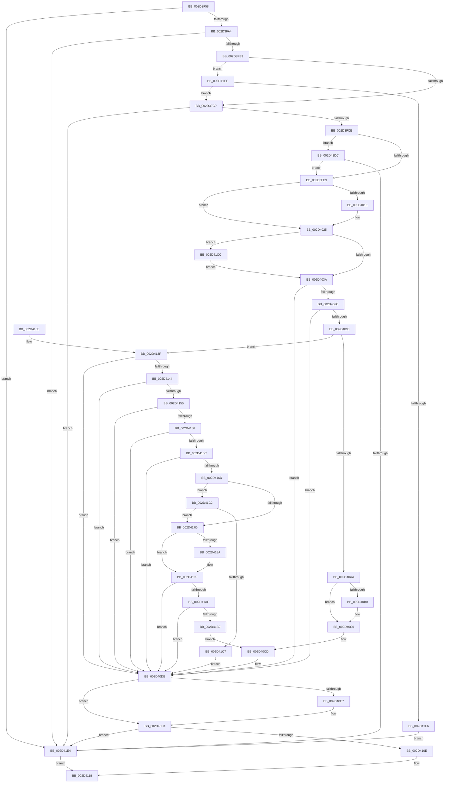

# KiConnectInterrupt

- RVA: `0x002D3F58`–`0x002D41F8` (길이 `672` bytes)
- VA: `0x00000001402D3F58`
- 실행 섹션: `.text`
- PDB 이름 있음: `예`; PDB Function 태그: `아니요`
- unwind 정보 RVA: `0x0006FB04`
- 디코드: `163`개 명령, `672/672` bytes 표시
- 미해석 바이트: `0` (있으면 어셈블리에 `.byte`로 보존)

> 이 문서는 커널 이미지의 기계어와 PDB 기호를 분석해 생성했습니다. 4번과 5번은 함수 원형과 자료형을 바이너리 사용 방식에서 추정한 C 해석이며 원본 소스 복구 결과는 아닙니다.

## 1. Dependencies

- 직접 호출 지점: **6**; 고유 호출 대상: **6**
- 직접 호출자로 확인된 함수: **1**
- RIP 상대 이미지 참조: **9**

### Outgoing calls
- `0x002D400B` → [KeSetSystemGroupAffinityThread](../39/KeSetSystemGroupAffinityThread_function_00399140.md) (function, `0x00399140`)
- `0x002D40EE` → [KiLowerIrqlProcessIrqlFlags](../4F/KiLowerIrqlProcessIrqlFlags_function_004F5698.md) (function, `0x004F5698`)
- `0x002D4100` → [KeRevertToUserGroupAffinityThread](../39/KeRevertToUserGroupAffinityThread_function_00398EC0.md) (function, `0x00398EC0`)
- `0x002D4120` → [_security_check_cookie](../6A/_security_check_cookie_function_006AC640.md) (function, `0x006AC640`)
- `0x002D419F` → [KiInsertInterruptObjectOrdered](../4A/KiInsertInterruptObjectOrdered_function_004AC7EC.md) (function, `0x004AC7EC`)
- `0x002D41D2` → [KiRaiseIrqlProcessIrqlFlags](../4F/KiRaiseIrqlProcessIrqlFlags_function_004F56FC.md) (function, `0x004F56FC`)

### Direct callers
- [KeConnectInterrupt](KeConnectInterrupt_function_002D3D5C.md) at `0x002D3DD4`

### Static image references
- `0x002D3F6E` → RVA `0x00E0A740` (`.data`; read)
- `0x002D3FC0` → RVA `0x00FC6A80` (`ALMOSTRO`; read)
- `0x002D3FDE` → RVA `0x00FC8C40` (`ALMOSTRO`; read)
- `0x002D402D` → RVA `0x00FC6D20` (`ALMOSTRO`; read)
- `0x002D406C` → RVA `0x01201840` (`CFGRO`; read)
- `0x002D4073` → RVA `0x00BCC2C0` (`KiIsrThunkShadow`; read)
- `0x002D407A` → RVA `0x006B4E70` (`KiIsrThunk`; read)
- `0x002D40B4` → RVA `0x006B3480` (`KiChainedDispatch`; read)
- `0x002D415C` → RVA `0x006B3B30` (`KiInterruptDispatch`; read)

## 2. Other-region calls and transfers

- 다른 실행 섹션으로 향하는 call: **0**
- 별도 외부 분기/꼬리 이동을 확인하지 못했습니다.

## 3. Assembly (complete function range)

```asm
002D3F58  48 89 5C 24 10                  mov qword ptr [rsp + 0x10], rbx
002D3F5D  48 89 6C 24 18                  mov qword ptr [rsp + 0x18], rbp
002D3F62  56                              push rsi
002D3F63  57                              push rdi
002D3F64  41 55                           push r13
002D3F66  41 56                           push r14
002D3F68  41 57                           push r15
002D3F6A  48 83 EC 50                     sub rsp, 0x50
002D3F6E  48 8B 05 CB 67 B3 00            mov rax, qword ptr [rip + 0xb367cb]
002D3F75  48 33 C4                        xor rax, rsp
002D3F78  48 89 44 24 40                  mov qword ptr [rsp + 0x40], rax
002D3F7D  8B 79 58                        mov edi, dword ptr [rcx + 0x58]
002D3F80  45 32 F6                        xor r14b, r14b
002D3F83  0F B6 51 5C                     movzx edx, byte ptr [rcx + 0x5c]
002D3F87  45 32 FF                        xor r15b, r15b
002D3F8A  8B 71 60                        mov esi, dword ptr [rcx + 0x60]
002D3F8D  0F 57 C0                        xorps xmm0, xmm0
002D3F90  48 8B D9                        mov rbx, rcx
002D3F93  0F 11 44 24 30                  movups xmmword ptr [rsp + 0x30], xmm0
002D3F98  81 FF FF 00 00 00               cmp edi, 0xff
002D3F9E  0F 87 40 02 00 00               ja 0x1402d41e4
002D3FA4  41 BD 0F 00 00 00               mov r13d, 0xf
002D3FAA  41 3A D5                        cmp dl, r13b
002D3FAD  0F 87 31 02 00 00               ja 0x1402d41e4
002D3FB3  8B CF                           mov ecx, edi
002D3FB5  C1 E9 04                        shr ecx, 4
002D3FB8  3B D1                           cmp edx, ecx
002D3FBA  0F 85 2E 02 00 00               jne 0x1402d41ee
002D3FC0  8B 05 BA 2A CF 00               mov eax, dword ptr [rip + 0xcf2aba]
002D3FC6  3B F0                           cmp esi, eax
002D3FC8  0F 83 16 02 00 00               jae 0x1402d41e4
002D3FCE  8A 43 5D                        mov al, byte ptr [rbx + 0x5d]
002D3FD1  3A C2                           cmp al, dl
002D3FD3  0F 82 03 02 00 00               jb 0x1402d41dc
002D3FD9  0F 11 44 24 20                  movups xmmword ptr [rsp + 0x20], xmm0
002D3FDE  48 8D 0D 5B 4C CF 00            lea rcx, [rip + 0xcf4c5b]
002D3FE5  48 8B 0C F1                     mov rcx, qword ptr [rcx + rsi*8]
002D3FE9  48 8D 54 24 30                  lea rdx, [rsp + 0x30]
002D3FEE  0F B6 81 D0 00 00 00            movzx eax, byte ptr [rcx + 0xd0]
002D3FF5  66 89 44 24 28                  mov word ptr [rsp + 0x28], ax
002D3FFA  48 8B 81 C8 00 00 00            mov rax, qword ptr [rcx + 0xc8]
002D4001  48 8D 4C 24 20                  lea rcx, [rsp + 0x20]
002D4006  48 89 44 24 20                  mov qword ptr [rsp + 0x20], rax
002D400B  E8 30 51 0C 00                  call 0x140399140
002D4010  65 48 8B 04 25 20 00 00 00      mov rax, qword ptr gs:[0x20]
002D4019  3B 70 24                        cmp esi, dword ptr [rax + 0x24]
002D401C  74 07                           je 0x1402d4025
002D401E  B9 28 00 00 00                  mov ecx, 0x28
002D4023  CD 29                           int 0x29
002D4025  44 0F 20 C5                     mov rbp, cr8
002D4029  45 0F 22 C5                     mov cr8, r13
002D402D  83 3D EC 2C CF 00 00            cmp dword ptr [rip + 0xcf2cec], 0
002D4034  0F 85 92 01 00 00               jne 0x1402d41cc
002D403A  65 48 8B 04 25 18 00 00 00      mov rax, qword ptr gs:[0x18]
002D4043  48 8B CF                        mov rcx, rdi
002D4046  48 C1 E1 04                     shl rcx, 4
002D404A  48 03 48 38                     add rcx, qword ptr [rax + 0x38]
002D404E  0F B7 01                        movzx eax, word ptr [rcx]
002D4051  66 89 44 24 20                  mov word ptr [rsp + 0x20], ax
002D4056  0F B7 41 06                     movzx eax, word ptr [rcx + 6]
002D405A  66 89 44 24 22                  mov word ptr [rsp + 0x22], ax
002D405F  8B 41 08                        mov eax, dword ptr [rcx + 8]
002D4062  89 44 24 24                     mov dword ptr [rsp + 0x24], eax
002D4066  44 38 73 5F                     cmp byte ptr [rbx + 0x5f], r14b
002D406A  75 72                           jne 0x1402d40de
002D406C  44 38 35 CD D7 F2 00            cmp byte ptr [rip + 0xf2d7cd], r14b
002D4073  48 8D 05 46 82 8F 00            lea rax, [rip + 0x8f8246]
002D407A  48 8D 0D EF 0D 3E 00            lea rcx, [rip + 0x3e0def]
002D4081  48 0F 44 C1                     cmove rax, rcx
002D4085  48 8D 04 F8                     lea rax, [rax + rdi*8]
002D4089  48 39 44 24 20                  cmp qword ptr [rsp + 0x20], rax
002D408E  75 4E                           jne 0x1402d40de
002D4090  65 48 8B 04 25 20 00 00 00      mov rax, qword ptr gs:[0x20]
002D4099  4C 8B 94 F8 00 39 00 00         mov r10, qword ptr [rax + rdi*8 + 0x3900]
002D40A1  4D 85 D2                        test r10, r10
002D40A4  0F 85 95 00 00 00               jne 0x1402d413f
002D40AA  44 38 73 5D                     cmp byte ptr [rbx + 0x5d], r14b
002D40AE  75 16                           jne 0x1402d40c6
002D40B0  48 8D 43 08                     lea rax, [rbx + 8]
002D40B4  4C 8D 1D C5 F3 3D 00            lea r11, [rip + 0x3df3c5]
002D40BB  48 89 40 08                     mov qword ptr [rax + 8], rax
002D40BF  48 89 00                        mov qword ptr [rax], rax
002D40C2  4C 89 5B 50                     mov qword ptr [rbx + 0x50], r11
002D40C6  41 B7 01                        mov r15b, 1
002D40C9  44 88 7B 5F                     mov byte ptr [rbx + 0x5f], r15b
002D40CD  65 48 8B 04 25 20 00 00 00      mov rax, qword ptr gs:[0x20]
002D40D6  48 89 9C F8 00 39 00 00         mov qword ptr [rax + rdi*8 + 0x3900], rbx
002D40DE  83 3D 3B 2C CF 00 00            cmp dword ptr [rip + 0xcf2c3b], 0
002D40E5  74 0C                           je 0x1402d40f3
002D40E7  44 0F 20 C1                     mov rcx, cr8
002D40EB  40 8A D5                        mov dl, bpl
002D40EE  E8 A5 15 22 00                  call 0x1404f5698
002D40F3  40 0F B6 C5                     movzx eax, bpl
002D40F7  44 0F 22 C0                     mov cr8, rax
002D40FB  48 8D 4C 24 30                  lea rcx, [rsp + 0x30]
002D4100  E8 BB 4D 0C 00                  call 0x140398ec0
002D4105  45 84 FF                        test r15b, r15b
002D4108  0F 84 D6 00 00 00               je 0x1402d41e4
002D410E  41 F6 DE                        neg r14b
002D4111  1B C0                           sbb eax, eax
002D4113  25 27 01 00 00                  and eax, 0x127
002D4118  48 8B 4C 24 40                  mov rcx, qword ptr [rsp + 0x40]
002D411D  48 33 CC                        xor rcx, rsp
002D4120  E8 1B 85 3D 00                  call 0x1406ac640
002D4125  4C 8D 5C 24 50                  lea r11, [rsp + 0x50]
002D412A  49 8B 5B 38                     mov rbx, qword ptr [r11 + 0x38]
002D412E  49 8B 6B 40                     mov rbp, qword ptr [r11 + 0x40]
002D4132  49 8B E3                        mov rsp, r11
002D4135  41 5F                           pop r15
002D4137  41 5E                           pop r14
002D4139  41 5D                           pop r13
002D413B  5F                              pop rdi
002D413C  5E                              pop rsi
002D413D  C3                              ret
002D413E  CC                              int3
002D413F  83 FF 30                        cmp edi, 0x30
002D4142  72 9A                           jb 0x1402d40de
002D4144  41 8B 42 6C                     mov eax, dword ptr [r10 + 0x6c]
002D4148  41 B6 01                        mov r14b, 1
002D414B  39 43 6C                        cmp dword ptr [rbx + 0x6c], eax
002D414E  75 8E                           jne 0x1402d40de
002D4150  44 38 7B 64                     cmp byte ptr [rbx + 0x64], r15b
002D4154  74 88                           je 0x1402d40de
002D4156  45 38 7A 64                     cmp byte ptr [r10 + 0x64], r15b
002D415A  74 82                           je 0x1402d40de
002D415C  48 8D 0D CD F9 3D 00            lea rcx, [rip + 0x3df9cd]
002D4163  48 39 4B 50                     cmp qword ptr [rbx + 0x50], rcx
002D4167  0F 85 71 FF FF FF               jne 0x1402d40de
002D416D  49 8B 42 50                     mov rax, qword ptr [r10 + 0x50]
002D4171  4C 8D 1D 08 F3 3D 00            lea r11, [rip + 0x3df308]
002D4178  49 3B C3                        cmp rax, r11
002D417B  75 45                           jne 0x1402d41c2
002D417D  44 88 73 5F                     mov byte ptr [rbx + 0x5f], r14b
002D4181  45 8A FE                        mov r15b, r14b
002D4184  4D 39 5A 50                     cmp qword ptr [r10 + 0x50], r11
002D4188  74 0F                           je 0x1402d4199
002D418A  49 8D 42 08                     lea rax, [r10 + 8]
002D418E  48 89 40 08                     mov qword ptr [rax + 8], rax
002D4192  48 89 00                        mov qword ptr [rax], rax
002D4195  4D 89 5A 50                     mov qword ptr [r10 + 0x50], r11
002D4199  48 8B D3                        mov rdx, rbx
002D419C  49 8B CA                        mov rcx, r10
002D419F  E8 48 86 1D 00                  call 0x1404ac7ec
002D41A4  41 80 7A 5D 00                  cmp byte ptr [r10 + 0x5d], 0
002D41A9  0F 85 2F FF FF FF               jne 0x1402d40de
002D41AF  80 7B 5D 00                     cmp byte ptr [rbx + 0x5d], 0
002D41B3  0F 84 25 FF FF FF               je 0x1402d40de
002D41B9  4C 89 5B 50                     mov qword ptr [rbx + 0x50], r11
002D41BD  E9 0B FF FF FF                  jmp 0x1402d40cd
002D41C2  48 3B C1                        cmp rax, rcx
002D41C5  74 B6                           je 0x1402d417d
002D41C7  E9 12 FF FF FF                  jmp 0x1402d40de
002D41CC  41 8A D5                        mov dl, r13b
002D41CF  40 8A CD                        mov cl, bpl
002D41D2  E8 25 15 22 00                  call 0x1404f56fc
002D41D7  E9 5E FE FF FF                  jmp 0x1402d403a
002D41DC  84 C0                           test al, al
002D41DE  0F 84 F5 FD FF FF               je 0x1402d3fd9
002D41E4  B8 EF 00 00 C0                  mov eax, 0xc00000ef
002D41E9  E9 2A FF FF FF                  jmp 0x1402d4118
002D41EE  84 D2                           test dl, dl
002D41F0  0F 84 CA FD FF FF               je 0x1402d3fc0
002D41F6  EB EC                           jmp 0x1402d41e4
```

## 4. C-style interpretation (structured pseudocode)

```c
__int64 __fastcall KiConnectInterrupt(__int64 a1)
{
    __int64 result;
    __int64 v_r11;
    __int64 v_r14;
    __int64 v_r15;
    __int64 v_rsp;
    unsigned __int64 v_stack_m28;
    unsigned __int64 v_stack_m38;
    unsigned __int64 v_stack_m48;
    unsigned __int16 v_stack_m50;
    unsigned int v_stack_m54;
    unsigned __int16 v_stack_m56;
    unsigned __int64 v_stack_m58;
    unsigned __int64 v_stack_p10;
    unsigned __int64 v_stack_p18;

    v_stack_p10 = v_rbx;
    v_stack_p18 = v_rbp;
    v_rsp = (v_rsp) - (80);
    result = (*(unsigned __int64 *)(v_rip + 11757515)) ^ (v_rsp);
    v_stack_m38 = result;
    v_r14 = 0;
    v_r15 = 0;
    v_stack_m48 = v_xmm0;
    if (((unsigned int)((unsigned int)(*(unsigned int *)(a1 + 88)))) > 255) goto loc_002D41E4;
    if (((unsigned __int8)(*(unsigned __int8 *)(a1 + 92))) > 15) goto loc_002D41E4;
    a1 = (unsigned int)(((unsigned int)((unsigned int)((unsigned int)(*(unsigned int *)(a1 + 88))))) >> (4));
    if (((unsigned int)(*(unsigned __int8 *)(a1 + 92))) != ((unsigned int)(a1))) goto loc_002D41EE;
loc_002D3FC0:
    if (((unsigned int)((unsigned int)(*(unsigned int *)(a1 + 96)))) >= ((unsigned int)((unsigned int)(*(unsigned int *)(v_rip + 13576890))))) goto loc_002D41E4;
    if (((unsigned __int8)(*(unsigned __int8 *)(a1 + 93))) < ((unsigned __int8)(*(unsigned __int8 *)(a1 + 92)))) goto loc_002D41DC;
loc_002D3FD9:
    v_stack_m58 = v_xmm0;
    v_stack_m50 = (unsigned __int16)(*(unsigned __int8 *)(*(unsigned __int64 *)(v_rip + 13585499 + (unsigned int)(*(unsigned int *)(a1 + 96)) * 8) + 208));
    v_stack_m58 = *(unsigned __int64 *)(*(unsigned __int64 *)(v_rip + 13585499 + (unsigned int)(*(unsigned int *)(a1 + 96)) * 8) + 200);
    result = KeSetSystemGroupAffinityThread(v_stack_m58, v_stack_m48, a3, a4);
    if (((unsigned int)((unsigned int)(*(unsigned int *)(a1 + 96)))) != (*(unsigned int *)(*(unsigned __int64 *)(gs_base + (0 + 32)) + 36))) {
        a1 = 40;
    }
    if ((*(unsigned int *)(v_rip + 13577452)) != 0) goto loc_002D41CC;
loc_002D403A:
    a1 = ((unsigned int)(*(unsigned int *)(a1 + 88))) << (4);
    a1 = (a1) + (*(unsigned __int64 *)(*(unsigned __int64 *)(gs_base + (0 + 24)) + 56));
    v_stack_m58 = (unsigned __int16)(*(unsigned __int16 *)(a1));
    v_stack_m56 = (unsigned __int16)(*(unsigned __int16 *)(a1 + 6));
    v_stack_m54 = (unsigned int)((unsigned int)(*(unsigned int *)(a1 + 8)));
    if ((*(unsigned __int8 *)(a1 + 95)) != 0) goto loc_002D40DE;
    result = v_rip + 9404998;
    if ((*(unsigned __int8 *)(v_rip + 15914957)) == 0) { result = v_rip + 4066799; }
    if (v_stack_m58 != (result + (unsigned int)(*(unsigned int *)(a1 + 88)) * 8)) goto loc_002D40DE;
    if (*(unsigned __int64 *)(*(unsigned __int64 *)(gs_base + (0 + 32)) + (unsigned int)(*(unsigned int *)(a1 + 88)) * 8 + 14592) != 0) goto loc_002D413F;
    result = *(unsigned __int64 *)(gs_base + (0 + 32));
    if ((*(unsigned __int8 *)(a1 + 93)) == 0) {
        result = a1 + 8;
        v_r11 = v_rip + 4060101;
        *(unsigned __int64 *)(result + 8) = result;
        *(unsigned __int64 *)(result) = result;
        *(unsigned __int64 *)(a1 + 80) = v_r11;
    }
    *(unsigned __int8 *)(a1 + 95) = 1;
loc_002D40CD:
    *(unsigned __int64 *)(*(unsigned __int64 *)(gs_base + (0 + 32)) + (unsigned int)(*(unsigned int *)(a1 + 88)) * 8 + 14592) = a1;
loc_002D40DE:
    result = *(unsigned __int64 *)(gs_base + (0 + 32));
    if ((*(unsigned int *)(v_rip + 13577275)) != 0) {
        a1 = 15;
        a2 = (unsigned __int8)(v_cr8);
        result = KiLowerIrqlProcessIrqlFlags(a1, a2, a3, a4);
    }
    result = KeRevertToUserGroupAffinityThread(v_stack_m48, a2, a3, a4);
    if (1 == 0) goto loc_002D41E4;
    v_r14 = (unsigned __int8)(-(v_r14));
    result = (unsigned int)((result) & (295));
loc_002D4118:
    a1 = (v_stack_m38) ^ (v_rsp);
    result = _security_check_cookie(a1, a2, a3, a4);
    return result;
loc_002D413F:
    if (((unsigned int)((unsigned int)(*(unsigned int *)(a1 + 88)))) < 48) goto loc_002D40DE;
    if ((*(unsigned int *)(*(unsigned __int64 *)(v_stack_m28 + 56) + 108)) != ((unsigned int)((unsigned int)(*(unsigned int *)(*(unsigned __int64 *)(*(unsigned __int64 *)(gs_base + (0 + 32)) + (unsigned int)(*(unsigned int *)(a1 + 88)) * 8 + 14592) + 108))))) goto loc_002D40DE;
    if ((*(unsigned __int8 *)(*(unsigned __int64 *)(v_stack_m28 + 56) + 100)) == 1) goto loc_002D40DE;
    if ((*(unsigned __int8 *)(*(unsigned __int64 *)(*(unsigned __int64 *)(gs_base + (0 + 32)) + (unsigned int)(*(unsigned int *)(a1 + 88)) * 8 + 14592) + 100)) == 1) goto loc_002D40DE;
    if ((*(unsigned __int64 *)(*(unsigned __int64 *)(v_stack_m28 + 56) + 80)) != (v_rip + 4061645)) goto loc_002D40DE;
    if ((*(unsigned __int64 *)(*(unsigned __int64 *)(*(unsigned __int64 *)(gs_base + (0 + 32)) + (unsigned int)(*(unsigned int *)(a1 + 88)) * 8 + 14592) + 80)) != (v_rip + 4059912)) goto loc_002D41C2;
loc_002D417D:
    *(unsigned __int8 *)(*(unsigned __int64 *)(v_stack_m28 + 56) + 95) = 1;
    result = *(unsigned __int64 *)(*(unsigned __int64 *)(*(unsigned __int64 *)(gs_base + (0 + 32)) + (unsigned int)(*(unsigned int *)(a1 + 88)) * 8 + 14592) + 80);
    if ((*(unsigned __int64 *)(*(unsigned __int64 *)(*(unsigned __int64 *)(gs_base + (0 + 32)) + (unsigned int)(*(unsigned int *)(a1 + 88)) * 8 + 14592) + 80)) != (v_rip + 4059912)) {
        result = *(unsigned __int64 *)(*(unsigned __int64 *)(gs_base + (0 + 32)) + (unsigned int)(*(unsigned int *)(a1 + 88)) * 8 + 14592) + 8;
        *(unsigned __int64 *)(result + 8) = result;
        *(unsigned __int64 *)(result) = result;
        *(unsigned __int64 *)(*(unsigned __int64 *)(*(unsigned __int64 *)(gs_base + (0 + 32)) + (unsigned int)(*(unsigned int *)(a1 + 88)) * 8 + 14592) + 80) = v_rip + 4059912;
    }
    result = KiInsertInterruptObjectOrdered(*(unsigned __int64 *)(*(unsigned __int64 *)(gs_base + (0 + 32)) + (unsigned int)(*(unsigned int *)(a1 + 88)) * 8 + 14592), *(unsigned __int64 *)(v_stack_m28 + 56), a3, a4);
    if ((*(unsigned __int8 *)(*(unsigned __int64 *)(*(unsigned __int64 *)(gs_base + (0 + 32)) + (unsigned int)(*(unsigned int *)(a1 + 88)) * 8 + 14592) + 93)) != 0) goto loc_002D40DE;
    if ((*(unsigned __int8 *)(*(unsigned __int64 *)(v_stack_m28 + 56) + 93)) == 0) goto loc_002D40DE;
    *(unsigned __int64 *)(*(unsigned __int64 *)(v_stack_m28 + 56) + 80) = v_rip + 4059912;
    goto loc_002D40CD;
loc_002D41C2:
    if (result == (*(unsigned __int64 *)(*(unsigned __int64 *)(gs_base + (0 + 32)) + (unsigned int)(*(unsigned int *)(a1 + 88)) * 8 + 14592))) goto loc_002D417D;
    goto loc_002D40DE;
loc_002D41CC:
    result = KiRaiseIrqlProcessIrqlFlags((unsigned __int8)(*(unsigned __int64 *)(v_stack_m28 + 64)), 15, a3, a4);
    goto loc_002D403A;
loc_002D41DC:
    if ((unsigned __int8)(result) == 0) goto loc_002D3FD9;
loc_002D41E4:
    goto loc_002D4118;
loc_002D41EE:
    if (15 == 0) goto loc_002D3FC0;
    goto loc_002D41E4;
}
```

## 5. (Beta) C Style

```c
int64_t KiConnectInterrupt(void *Arg1)
{
    uint8_t *arg1 = (uint8_t *)Arg1;

    int64_t result;
    int64_t local_r11;
    int64_t local_r14;
    int64_t local_r15;
    int64_t local_rsp;
    uint64_t v_stack_m28;
    uint64_t v_stack_m38;
    uint64_t v_stack_m48;
    uint16_t v_stack_m50;
    uint32_t v_stack_m54;
    uint16_t v_stack_m56;
    uint64_t v_stack_m58;
    uint64_t v_stack_p10;
    uint64_t v_stack_p18;

    v_stack_p10 = local_rbx;
    v_stack_p18 = local_rbp;
    local_rsp = (local_rsp) - (80);
    result = (*(uint64_t *)(v_rip + 0xB367CB)) ^ (local_rsp);
    v_stack_m38 = result;
    local_r14 = 0;
    local_r15 = 0;
    v_stack_m48 = v_xmm0;
    if (((uint32_t)((uint32_t)(*(uint32_t *)(arg1 + 0x58)))) > 255) goto loc_002D41E4;
    if (((uint8_t)(*(uint8_t *)(arg1 + 0x5C))) > 15) goto loc_002D41E4;
    Arg1 = (uint32_t)(((uint32_t)((uint32_t)((uint32_t)(*(uint32_t *)(arg1 + 0x58))))) >> (4));
    if (((uint32_t)(*(uint8_t *)(arg1 + 0x5C))) != ((uint32_t)(Arg1))) goto loc_002D41EE;
loc_002D3FC0:
    if (((uint32_t)((uint32_t)(*(uint32_t *)(arg1 + 0x60)))) >= ((uint32_t)((uint32_t)(*(uint32_t *)(v_rip + 0xCF2ABA))))) goto loc_002D41E4;
    if (((uint8_t)(*(uint8_t *)(arg1 + 0x5D))) < ((uint8_t)(*(uint8_t *)(arg1 + 0x5C)))) goto loc_002D41DC;
loc_002D3FD9:
    v_stack_m58 = v_xmm0;
    v_stack_m50 = (uint16_t)(*(uint8_t *)(*(uint64_t *)(v_rip + 0xCF4C5B + (uint32_t)(*(uint32_t *)(arg1 + 0x60)) * 8) + 0xD0));
    v_stack_m58 = *(uint64_t *)(*(uint64_t *)(v_rip + 0xCF4C5B + (uint32_t)(*(uint32_t *)(arg1 + 0x60)) * 8) + 0xC8);
    result = KeSetSystemGroupAffinityThread(v_stack_m58, v_stack_m48, a3, a4);
    if (((uint32_t)((uint32_t)(*(uint32_t *)(arg1 + 0x60)))) != (*(uint32_t *)(*(uint64_t *)(gs_base + (0 + 0x20)) + 0x24))) {
        Arg1 = 40;
    }
    if ((*(uint32_t *)(v_rip + 0xCF2CEC)) != 0) goto loc_002D41CC;
loc_002D403A:
    Arg1 = ((uint32_t)(*(uint32_t *)(arg1 + 0x58))) << (4);
    Arg1 = (Arg1) + (*(uint64_t *)(*(uint64_t *)(gs_base + (0 + 0x18)) + 0x38));
    v_stack_m58 = (uint16_t)(*(uint16_t *)(arg1));
    v_stack_m56 = (uint16_t)(*(uint16_t *)(arg1 + 0x6));
    v_stack_m54 = (uint32_t)((uint32_t)(*(uint32_t *)(arg1 + 0x8)));
    if ((*(uint8_t *)(arg1 + 0x5F)) != 0) goto loc_002D40DE;
    result = v_rip + 9404998;
    if ((*(uint8_t *)(v_rip + 0xF2D7CD)) == 0) { result = v_rip + 4066799; }
    if (v_stack_m58 != (result + (uint32_t)(*(uint32_t *)(arg1 + 0x58)) * 8)) goto loc_002D40DE;
    if (*(uint64_t *)(*(uint64_t *)(gs_base + (0 + 0x20)) + (uint32_t)(*(uint32_t *)(arg1 + 0x58)) * 8 + 0x3900) != 0) goto loc_002D413F;
    result = *(uint64_t *)(gs_base + (0 + 0x20));
    if ((*(uint8_t *)(arg1 + 0x5D)) == 0) {
        result = Arg1 + 8;
        local_r11 = v_rip + 4060101;
        *(uint64_t *)(result + 0x8) = result;
        *(uint64_t *)(result) = result;
        *(uint64_t *)(arg1 + 0x50) = local_r11;
    }
    *(uint8_t *)(arg1 + 0x5F) = 1;
loc_002D40CD:
    *(void **)(*(uint64_t *)(gs_base + (0 + 0x20)) + (uint32_t)(*(uint32_t *)(arg1 + 0x58)) * 8 + 0x3900) = Arg1;
loc_002D40DE:
    result = *(uint64_t *)(gs_base + (0 + 0x20));
    if ((*(uint32_t *)(v_rip + 0xCF2C3B)) != 0) {
        Arg1 = 15;
        a2 = (uint8_t)(v_cr8);
        result = KiLowerIrqlProcessIrqlFlags(Arg1, a2, a3, a4);
    }
    result = KeRevertToUserGroupAffinityThread(v_stack_m48, a2, a3, a4);
    if (1 == 0) goto loc_002D41E4;
    local_r14 = (uint8_t)(-(local_r14));
    result = (uint32_t)((result) & (295));
loc_002D4118:
    Arg1 = (v_stack_m38) ^ (local_rsp);
    result = _security_check_cookie(Arg1, a2, a3, a4);
    return result;
loc_002D413F:
    if (((uint32_t)((uint32_t)(*(uint32_t *)(arg1 + 0x58)))) < 48) goto loc_002D40DE;
    if ((*(uint32_t *)(*(uint64_t *)(v_stack_m28 + 0x38) + 0x6C)) != ((uint32_t)((uint32_t)(*(uint32_t *)(*(uint64_t *)(*(uint64_t *)(gs_base + (0 + 0x20)) + (uint32_t)(*(uint32_t *)(arg1 + 0x58)) * 8 + 0x3900) + 0x6C))))) goto loc_002D40DE;
    if ((*(uint8_t *)(*(uint64_t *)(v_stack_m28 + 0x38) + 0x64)) == 1) goto loc_002D40DE;
    if ((*(uint8_t *)(*(uint64_t *)(*(uint64_t *)(gs_base + (0 + 0x20)) + (uint32_t)(*(uint32_t *)(arg1 + 0x58)) * 8 + 0x3900) + 0x64)) == 1) goto loc_002D40DE;
    if ((*(uint64_t *)(*(uint64_t *)(v_stack_m28 + 0x38) + 0x50)) != (v_rip + 4061645)) goto loc_002D40DE;
    if ((*(uint64_t *)(*(uint64_t *)(*(uint64_t *)(gs_base + (0 + 0x20)) + (uint32_t)(*(uint32_t *)(arg1 + 0x58)) * 8 + 0x3900) + 0x50)) != (v_rip + 4059912)) goto loc_002D41C2;
loc_002D417D:
    *(uint8_t *)(*(uint64_t *)(v_stack_m28 + 0x38) + 0x5F) = 1;
    result = *(uint64_t *)(*(uint64_t *)(*(uint64_t *)(gs_base + (0 + 0x20)) + (uint32_t)(*(uint32_t *)(arg1 + 0x58)) * 8 + 0x3900) + 0x50);
    if ((*(uint64_t *)(*(uint64_t *)(*(uint64_t *)(gs_base + (0 + 0x20)) + (uint32_t)(*(uint32_t *)(arg1 + 0x58)) * 8 + 0x3900) + 0x50)) != (v_rip + 4059912)) {
        result = *(uint64_t *)(*(uint64_t *)(gs_base + (0 + 0x20)) + (uint32_t)(*(uint32_t *)(arg1 + 0x58)) * 8 + 0x3900) + 8;
        *(uint64_t *)(result + 0x8) = result;
        *(uint64_t *)(result) = result;
        *(uint64_t *)(*(uint64_t *)(*(uint64_t *)(gs_base + (0 + 0x20)) + (uint32_t)(*(uint32_t *)(arg1 + 0x58)) * 8 + 0x3900) + 0x50) = v_rip + 4059912;
    }
    result = KiInsertInterruptObjectOrdered(*(uint64_t *)(*(uint64_t *)(gs_base + (0 + 0x20)) + (uint32_t)(*(uint32_t *)(arg1 + 0x58)) * 8 + 0x3900), *(uint64_t *)(v_stack_m28 + 0x38), a3, a4);
    if ((*(uint8_t *)(*(uint64_t *)(*(uint64_t *)(gs_base + (0 + 0x20)) + (uint32_t)(*(uint32_t *)(arg1 + 0x58)) * 8 + 0x3900) + 0x5D)) != 0) goto loc_002D40DE;
    if ((*(uint8_t *)(*(uint64_t *)(v_stack_m28 + 0x38) + 0x5D)) == 0) goto loc_002D40DE;
    *(uint64_t *)(*(uint64_t *)(v_stack_m28 + 0x38) + 0x50) = v_rip + 4059912;
    goto loc_002D40CD;
loc_002D41C2:
    if (result == (*(uint64_t *)(*(uint64_t *)(gs_base + (0 + 0x20)) + (uint32_t)(*(uint32_t *)(arg1 + 0x58)) * 8 + 0x3900))) goto loc_002D417D;
    goto loc_002D40DE;
loc_002D41CC:
    result = KiRaiseIrqlProcessIrqlFlags((uint8_t)(*(uint64_t *)(v_stack_m28 + 0x40)), 15, a3, a4);
    goto loc_002D403A;
loc_002D41DC:
    if ((uint8_t)(result) == 0) goto loc_002D3FD9;
loc_002D41E4:
    goto loc_002D4118;
loc_002D41EE:
    if (15 == 0) goto loc_002D3FC0;
    goto loc_002D41E4;
}
```

### 관측된 메모리 오프셋

구조체 형식이 확인되지 않은 접근은 인자 기준의 오프셋으로만 기록했습니다.

| 기준 인자 | 오프셋 표현 | 폭 (bit) | 접근 |
|---|---:|---:|---|
| `Arg1` | `+ 0x0` | `64` | `W` |
| `Arg1` | `+ 0x8` | `64` | `R` |
| `Arg1` | `+ 0x8` | `64` | `W` |
| `Arg1` | `+ 0x50` | `64` | `R` |
| `Arg1` | `+ 0x50` | `64` | `W` |
| `Arg1` | `+ 0x58` | `32` | `R` |
| `Arg1` | `+ 0x5C` | `8` | `R` |
| `Arg1` | `+ 0x5D` | `8` | `R` |
| `Arg1` | `+ 0x5F` | `8` | `R` |
| `Arg1` | `+ 0x5F` | `8` | `W` |
| `Arg1` | `+ 0x60` | `32` | `R` |
| `Arg1` | `+ 0x64` | `8` | `R` |
| `Arg1` | `+ 0x6C` | `32` | `R` |

## 6. Execution-region graph

[열기: 2D/3D 그래프와 함수 탐색 컨트롤 패널](../../../control-panel.html?section=text&rva=0x002D3F58&view=graph)

- 2D 그래프는 위에서 아래로 흐르고, 3D 그래프는 빈 공간을 드래그해 회전합니다. Shift+드래그는 이동, 휠은 확대·축소, 함수 노드 선택은 대상 보고서 이동입니다.

### Static fallback


