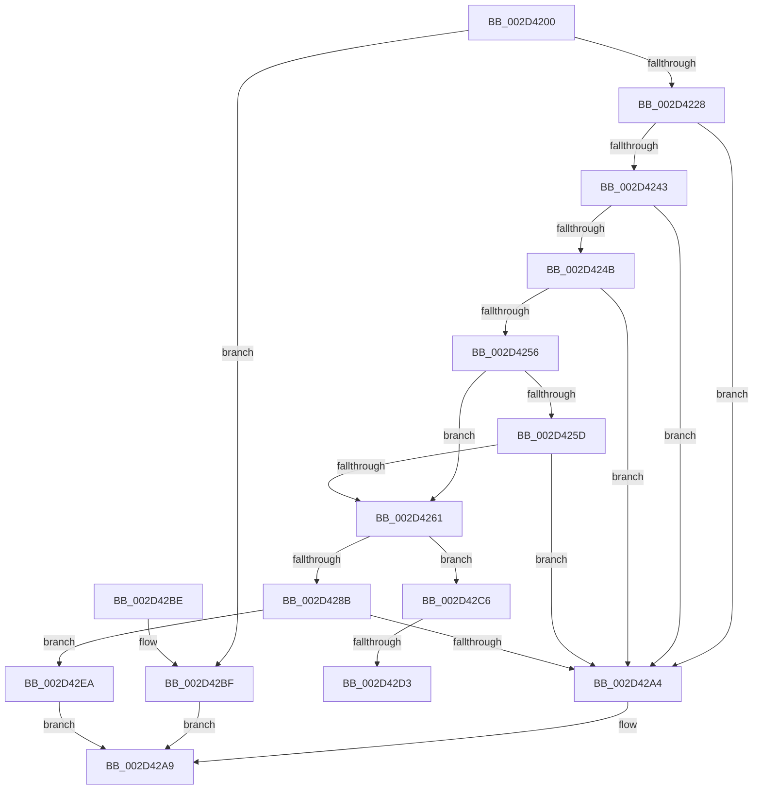

# KiConnectSecondaryInterrupt

- RVA: `0x002D4200`–`0x002D42F6` (길이 `246` bytes)
- VA: `0x00000001402D4200`
- 실행 섹션: `.text`
- PDB 이름 있음: `예`; PDB Function 태그: `예`
- unwind 정보 RVA: `0x0006FB28`
- 디코드: `68`개 명령, `246/246` bytes 표시
- 미해석 바이트: `0` (있으면 어셈블리에 `.byte`로 보존)

> 이 문서는 커널 이미지의 기계어와 PDB 기호를 분석해 생성했습니다. 4번과 5번은 함수 원형과 자료형을 바이너리 사용 방식에서 추정한 C 해석이며 원본 소스 복구 결과는 아닙니다.

## 1. Dependencies

- 직접 호출 지점: **4**; 고유 호출 대상: **4**
- 직접 호출자로 확인된 함수: **1**
- RIP 상대 이미지 참조: **3**

### Outgoing calls
- `0x002D4273` → [KiAcquireSecondaryPassiveConnectLock](../4C/KiAcquireSecondaryPassiveConnectLock_function_004C0290.md) (function, `0x004C0290`)
- `0x002D4280` → [KiAcquireSecondaryInterruptConnectLock](../47/KiAcquireSecondaryInterruptConnectLock_function_00479E58.md) (function, `0x00479E58`)
- `0x002D4292` → [HalpReleaseHighLevelLock](HalpReleaseHighLevelLock_function_002D1C58.md) (function, `0x002D1C58`)
- `0x002D429A` → [KiReleaseSecondaryPassiveConnectLock](../4D/KiReleaseSecondaryPassiveConnectLock_function_004DA2C4.md) (function, `0x004DA2C4`)

### Direct callers
- [KeConnectInterrupt](KeConnectInterrupt_function_002D3D5C.md) at `0x002D3DF8`

### Static image references
- `0x002D4214` → RVA `0x00F11030` (`.data`; read)
- `0x002D424B` → RVA `0x00FC6A80` (`ALMOSTRO`; read)
- `0x002D4269` → RVA `0x00F11028` (`.data`; read)

## 2. Other-region calls and transfers

- 다른 실행 섹션으로 향하는 call: **0**
- call이 아닌 외부 분기/꼬리 이동: **2**
  - `0x002D42CD` → [sub_006DDA4E](../6D/Unknown_function_006DDA4E.md) (`tail-transfer`)
  - `0x002D42E5` → [sub_006DDA4E + 0x33](../6D/Unknown_function_006DDA4E.md) (`tail-transfer`)

## 3. Assembly (complete function range)

```asm
002D4200  48 8B C4                        mov rax, rsp
002D4203  48 89 58 08                     mov qword ptr [rax + 8], rbx
002D4207  48 89 68 18                     mov qword ptr [rax + 0x18], rbp
002D420B  48 89 70 20                     mov qword ptr [rax + 0x20], rsi
002D420F  57                              push rdi
002D4210  48 83 EC 20                     sub rsp, 0x20
002D4214  80 3D 15 CE C3 00 00            cmp byte ptr [rip + 0xc3ce15], 0
002D421B  48 8B D9                        mov rbx, rcx
002D421E  C6 40 10 00                     mov byte ptr [rax + 0x10], 0
002D4222  0F 84 97 00 00 00               je 0x1402d42bf
002D4228  8B 51 58                        mov edx, dword ptr [rcx + 0x58]
002D422B  40 32 F6                        xor sil, sil
002D422E  44 8B 41 60                     mov r8d, dword ptr [rcx + 0x60]
002D4232  81 C2 00 FF FF FF               add edx, 0xffffff00
002D4238  40 32 ED                        xor bpl, bpl
002D423B  81 FA FF 00 00 00               cmp edx, 0xff
002D4241  77 61                           ja 0x1402d42a4
002D4243  8A 49 5C                        mov cl, byte ptr [rcx + 0x5c]
002D4246  80 F9 0C                        cmp cl, 0xc
002D4249  77 59                           ja 0x1402d42a4
002D424B  8B 05 2F 28 CF 00               mov eax, dword ptr [rip + 0xcf282f]
002D4251  44 3B C0                        cmp r8d, eax
002D4254  73 4E                           jae 0x1402d42a4
002D4256  8A 43 5D                        mov al, byte ptr [rbx + 0x5d]
002D4259  3A C1                           cmp al, cl
002D425B  73 04                           jae 0x1402d4261
002D425D  84 C0                           test al, al
002D425F  75 43                           jne 0x1402d42a4
002D4261  48 8D 3C 52                     lea rdi, [rdx + rdx*2]
002D4265  48 C1 E7 04                     shl rdi, 4
002D4269  48 03 3D B8 CD C3 00            add rdi, qword ptr [rip + 0xc3cdb8]
002D4270  48 8B CF                        mov rcx, rdi
002D4273  E8 18 C0 1E 00                  call 0x1404c0290
002D4278  48 8D 54 24 38                  lea rdx, [rsp + 0x38]
002D427D  48 8B CF                        mov rcx, rdi
002D4280  E8 D3 5B 1A 00                  call 0x140479e58
002D4285  40 38 73 5F                     cmp byte ptr [rbx + 0x5f], sil
002D4289  74 3B                           je 0x1402d42c6
002D428B  8A 54 24 38                     mov dl, byte ptr [rsp + 0x38]
002D428F  48 8B CF                        mov rcx, rdi
002D4292  E8 C1 D9 FF FF                  call 0x1402d1c58
002D4297  48 8B CF                        mov rcx, rdi
002D429A  E8 25 60 20 00                  call 0x1404da2c4
002D429F  40 84 ED                        test bpl, bpl
002D42A2  75 46                           jne 0x1402d42ea
002D42A4  B8 EF 00 00 C0                  mov eax, 0xc00000ef
002D42A9  48 8B 5C 24 30                  mov rbx, qword ptr [rsp + 0x30]
002D42AE  48 8B 6C 24 40                  mov rbp, qword ptr [rsp + 0x40]
002D42B3  48 8B 74 24 48                  mov rsi, qword ptr [rsp + 0x48]
002D42B8  48 83 C4 20                     add rsp, 0x20
002D42BC  5F                              pop rdi
002D42BD  C3                              ret
002D42BE  CC                              int3
002D42BF  B8 01 00 00 C0                  mov eax, 0xc0000001
002D42C4  EB E3                           jmp 0x1402d42a9
002D42C6  4C 8B 57 28                     mov r10, qword ptr [rdi + 0x28]
002D42CA  4D 85 D2                        test r10, r10
002D42CD  0F 85 7B 97 40 00               jne 0x1406dda4e
002D42D3  48 8D 43 08                     lea rax, [rbx + 8]
002D42D7  40 B5 01                        mov bpl, 1
002D42DA  48 89 40 08                     mov qword ptr [rax + 8], rax
002D42DE  48 89 00                        mov qword ptr [rax], rax
002D42E1  40 88 77 20                     mov byte ptr [rdi + 0x20], sil
002D42E5  E9 97 97 40 00                  jmp 0x1406dda81
002D42EA  40 F6 DE                        neg sil
002D42ED  1B C0                           sbb eax, eax
002D42EF  25 27 01 00 00                  and eax, 0x127
002D42F4  EB B3                           jmp 0x1402d42a9
```

## 4. C-style interpretation (structured pseudocode)

```c
__int64 __fastcall KiConnectSecondaryInterrupt(__int64 a1)
{
    __int64 result;
    __int64 v_rbp;
    __int64 v_rdi;
    __int64 v_rsi;
    __int64 v_rsp;
    unsigned __int64 v_stack_p10;
    unsigned __int64 v_stack_p18;
    unsigned __int64 v_stack_p20;
    unsigned __int64 v_stack_p8;

    *(unsigned __int64 *)(v_rsp + 8) = v_rbx;
    *(unsigned __int64 *)(v_rsp + 24) = v_rbp;
    *(unsigned __int64 *)(v_rsp + 32) = v_rsi;
    v_rsp = (v_rsp) - (32);
    *(unsigned __int8 *)(v_rsp + 16) = 0;
    if ((*(unsigned __int8 *)(v_rip + 12832277)) == 0) goto loc_002D42BF;
    v_rsi = 0;
    a2 = (unsigned int)(((unsigned int)(*(unsigned int *)(a1 + 88))) + (0xFFFFFF00ULL));
    v_rbp = 0;
    if (((unsigned int)(a2)) > 255) goto loc_002D42A4;
    if (((unsigned __int8)(*(unsigned __int8 *)(a1 + 92))) > 12) goto loc_002D42A4;
    if (((unsigned int)((unsigned int)(*(unsigned int *)(a1 + 96)))) >= ((unsigned int)((unsigned int)(*(unsigned int *)(v_rip + 13576239))))) goto loc_002D42A4;
    if (((unsigned __int8)(*(unsigned __int8 *)(a1 + 93))) >= ((unsigned __int8)(*(unsigned __int8 *)(a1 + 92)))) goto loc_002D4261;
    if ((unsigned __int8)(*(unsigned __int8 *)(a1 + 93)) != 0) goto loc_002D42A4;
loc_002D4261:
    v_rdi = (a2 + a2 * 2) << (4);
    v_rdi = (v_rdi) + (*(unsigned __int64 *)(v_rip + 12832184));
    result = KiAcquireSecondaryPassiveConnectLock(v_rdi, a2, (unsigned int)(*(unsigned int *)(a1 + 96)), a4);
    result = KiAcquireSecondaryInterruptConnectLock(v_rdi, v_stack_p10, (unsigned int)(*(unsigned int *)(a1 + 96)), a4);
    if ((*(unsigned __int8 *)(a1 + 95)) == 0) goto loc_002D42C6;
    result = HalpReleaseHighLevelLock(v_rdi, v_stack_p10, (unsigned int)(*(unsigned int *)(a1 + 96)), a4);
    result = KiReleaseSecondaryPassiveConnectLock(v_rdi, v_stack_p10, (unsigned int)(*(unsigned int *)(a1 + 96)), a4);
    if (0 != 0) goto loc_002D42EA;
loc_002D42A4:
loc_002D42A9:
    v_rsp = (v_rsp) + (32);
    return (unsigned int)(0xC00000EFULL);
loc_002D42BF:
    goto loc_002D42A9;
loc_002D42C6:
    *(unsigned __int64 *)(v_stack_p8 + 8 + 8) = v_stack_p8 + 8;
    *(unsigned __int64 *)(v_stack_p8 + 8) = v_stack_p8 + 8;
    *(unsigned __int8 *)(v_rdi + 32) = (unsigned __int8)(v_stack_p20);
loc_002D42EA:
    v_rsi = (unsigned __int8)(-(v_stack_p20));
    result = (unsigned int)((v_stack_p8 + 8) & (295));
    goto loc_002D42A9;
}
```

## 5. (Beta) C Style

```c
int64_t KiConnectSecondaryInterrupt(void *Arg1)
{
    uint8_t *arg1 = (uint8_t *)Arg1;

    int64_t result;
    int64_t local_rbp;
    int64_t local_rdi;
    int64_t local_rsi;
    int64_t local_rsp;
    uint64_t v_stack_p10;
    uint64_t v_stack_p18;
    uint64_t v_stack_p20;
    uint64_t v_stack_p8;

    *(uint64_t *)(local_rsp + 0x8) = local_rbx;
    *(uint64_t *)(local_rsp + 0x18) = local_rbp;
    *(uint64_t *)(local_rsp + 0x20) = local_rsi;
    local_rsp = (local_rsp) - (32);
    *(uint8_t *)(local_rsp + 0x10) = 0;
    if ((*(uint8_t *)(v_rip + 0xC3CE15)) == 0) goto loc_002D42BF;
    local_rsi = 0;
    a2 = (uint32_t)(((uint32_t)(*(uint32_t *)(arg1 + 0x58))) + (0xFFFFFF00ULL));
    local_rbp = 0;
    if (((uint32_t)(a2)) > 255) goto loc_002D42A4;
    if (((uint8_t)(*(uint8_t *)(arg1 + 0x5C))) > 12) goto loc_002D42A4;
    if (((uint32_t)((uint32_t)(*(uint32_t *)(arg1 + 0x60)))) >= ((uint32_t)((uint32_t)(*(uint32_t *)(v_rip + 0xCF282F))))) goto loc_002D42A4;
    if (((uint8_t)(*(uint8_t *)(arg1 + 0x5D))) >= ((uint8_t)(*(uint8_t *)(arg1 + 0x5C)))) goto loc_002D4261;
    if ((uint8_t)(*(uint8_t *)(arg1 + 0x5D)) != 0) goto loc_002D42A4;
loc_002D4261:
    local_rdi = (a2 + a2 * 2) << (4);
    local_rdi = (local_rdi) + (*(uint64_t *)(v_rip + 0xC3CDB8));
    result = KiAcquireSecondaryPassiveConnectLock(local_rdi, a2, (uint32_t)(*(uint32_t *)(arg1 + 0x60)), a4);
    result = KiAcquireSecondaryInterruptConnectLock(local_rdi, v_stack_p10, (uint32_t)(*(uint32_t *)(arg1 + 0x60)), a4);
    if ((*(uint8_t *)(arg1 + 0x5F)) == 0) goto loc_002D42C6;
    result = HalpReleaseHighLevelLock(local_rdi, v_stack_p10, (uint32_t)(*(uint32_t *)(arg1 + 0x60)), a4);
    result = KiReleaseSecondaryPassiveConnectLock(local_rdi, v_stack_p10, (uint32_t)(*(uint32_t *)(arg1 + 0x60)), a4);
    if (0 != 0) goto loc_002D42EA;
loc_002D42A4:
loc_002D42A9:
    local_rsp = (local_rsp) + (32);
    return (uint32_t)(0xC00000EFULL);
loc_002D42BF:
    goto loc_002D42A9;
loc_002D42C6:
    *(uint64_t *)(v_stack_p8 + 0x8 + 0x8) = v_stack_p8 + 8;
    *(uint64_t *)(v_stack_p8 + 0x8) = v_stack_p8 + 8;
    *(uint8_t *)(local_rdi + 0x20) = (uint8_t)(v_stack_p20);
loc_002D42EA:
    local_rsi = (uint8_t)(-(v_stack_p20));
    result = (uint32_t)((v_stack_p8 + 8) & (295));
    goto loc_002D42A9;
}
```

### 관측된 메모리 오프셋

구조체 형식이 확인되지 않은 접근은 인자 기준의 오프셋으로만 기록했습니다.

| 기준 인자 | 오프셋 표현 | 폭 (bit) | 접근 |
|---|---:|---:|---|
| `Arg1` | `+ 0x0` | `64` | `W` |
| `Arg1` | `+ 0x8` | `64` | `R` |
| `Arg1` | `+ 0x8` | `64` | `W` |
| `Arg1` | `+ 0x58` | `32` | `R` |
| `Arg1` | `+ 0x5C` | `8` | `R` |
| `Arg1` | `+ 0x5D` | `8` | `R` |
| `Arg1` | `+ 0x5F` | `8` | `R` |
| `Arg1` | `+ 0x60` | `32` | `R` |

## 6. Execution-region graph

[열기: 2D/3D 그래프와 함수 탐색 컨트롤 패널](../../../control-panel.html?section=text&rva=0x002D4200&view=graph)

- 2D 그래프는 위에서 아래로 흐르고, 3D 그래프는 빈 공간을 드래그해 회전합니다. Shift+드래그는 이동, 휠은 확대·축소, 함수 노드 선택은 대상 보고서 이동입니다.

### Static fallback


