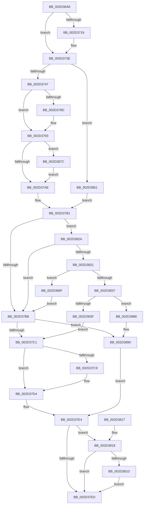

# KiDisconnectInterruptCommon

- RVA: `0x002D36A8`–`0x002D38BA` (길이 `530` bytes)
- VA: `0x00000001402D36A8`
- 실행 섹션: `.text`
- PDB 이름 있음: `예`; PDB Function 태그: `아니요`
- unwind 정보 RVA: `0x0006FA58`
- 디코드: `143`개 명령, `530/530` bytes 표시
- 미해석 바이트: `0` (있으면 어셈블리에 `.byte`로 보존)

> 이 문서는 커널 이미지의 기계어와 PDB 기호를 분석해 생성했습니다. 4번과 5번은 함수 원형과 자료형을 바이너리 사용 방식에서 추정한 C 해석이며 원본 소스 복구 결과는 아닙니다.

## 1. Dependencies

- 직접 호출 지점: **10**; 고유 호출 대상: **10**
- 직접 호출자로 확인된 함수: **2**
- RIP 상대 이미지 참조: **4**

### Outgoing calls
- `0x002D377A` → [KeSetSystemGroupAffinityThread](../39/KeSetSystemGroupAffinityThread_function_00399140.md) (function, `0x00399140`)
- `0x002D37CF` → [KiLowerIrqlProcessIrqlFlags](../4F/KiLowerIrqlProcessIrqlFlags_function_004F5698.md) (function, `0x004F5698`)
- `0x002D37DF` → [KeRevertToUserGroupAffinityThread](../39/KeRevertToUserGroupAffinityThread_function_00398EC0.md) (function, `0x00398EC0`)
- `0x002D37F7` → [_security_check_cookie](../6A/_security_check_cookie_function_006AC640.md) (function, `0x006AC640`)
- `0x002D381F` → [KiSignalWaitDisconnectLock](../5C/KiSignalWaitDisconnectLock_function_005C34DC.md) (function, `0x005C34DC`)
- `0x002D3842` → [KiDisconnectInterruptInternal](KiDisconnectInterruptInternal_function_002D38C0.md) (function, `0x002D38C0`)
- `0x002D386F` → [KiAcquireSecondaryInterruptConnectLock](../47/KiAcquireSecondaryInterruptConnectLock_function_00479E58.md) (function, `0x00479E58`)
- `0x002D387E` → [KiRaiseIrqlProcessIrqlFlags](../4F/KiRaiseIrqlProcessIrqlFlags_function_004F56FC.md) (function, `0x004F56FC`)
- `0x002D3888` → [KiDisconnectSecondaryInterruptInternal](../4B/KiDisconnectSecondaryInterruptInternal_function_004BCBD4.md) (function, `0x004BCBD4`)
- `0x002D3895` → [HalpReleaseHighLevelLock](HalpReleaseHighLevelLock_function_002D1C58.md) (function, `0x002D1C58`)

### Direct callers
- [KeDisconnectInterrupt](KeDisconnectInterrupt_function_002D3588.md) at `0x002D35FB`
- [KiDisconnectSecondaryInterrupt](KiDisconnectSecondaryInterrupt_function_002D3B88.md) at `0x002D3BF7`

### Static image references
- `0x002D36C2` → RVA `0x00E0A740` (`.data`; read)
- `0x002D374A` → RVA `0x00FC8C40` (`ALMOSTRO`; read)
- `0x002D37A2` → RVA `0x00FC6D20` (`ALMOSTRO`; read)
- `0x002D3865` → RVA `0x00F11028` (`.data`; read)

## 2. Other-region calls and transfers

- 다른 실행 섹션으로 향하는 call: **0**
- 별도 외부 분기/꼬리 이동을 확인하지 못했습니다.

## 3. Assembly (complete function range)

```asm
002D36A8  48 89 5C 24 08                  mov qword ptr [rsp + 8], rbx
002D36AD  55                              push rbp
002D36AE  56                              push rsi
002D36AF  57                              push rdi
002D36B0  41 54                           push r12
002D36B2  41 55                           push r13
002D36B4  41 56                           push r14
002D36B6  41 57                           push r15
002D36B8  48 8B EC                        mov rbp, rsp
002D36BB  48 81 EC 80 00 00 00            sub rsp, 0x80
002D36C2  48 8B 05 77 70 B3 00            mov rax, qword ptr [rip + 0xb37077]
002D36C9  48 33 C4                        xor rax, rsp
002D36CC  48 89 45 F8                     mov qword ptr [rbp - 8], rax
002D36D0  33 C0                           xor eax, eax
002D36D2  4C 89 45 C8                     mov qword ptr [rbp - 0x38], r8
002D36D6  48 8B FA                        mov rdi, rdx
002D36D9  48 89 45 B8                     mov qword ptr [rbp - 0x48], rax
002D36DD  33 D2                           xor edx, edx
002D36DF  0F 57 C0                        xorps xmm0, xmm0
002D36E2  44 8B F9                        mov r15d, ecx
002D36E5  48 89 55 C0                     mov qword ptr [rbp - 0x40], rdx
002D36E9  0F 11 45 A8                     movups xmmword ptr [rbp - 0x58], xmm0
002D36ED  48 8B 8F 98 00 00 00            mov rcx, qword ptr [rdi + 0x98]
002D36F4  4D 8B E8                        mov r13, r8
002D36F7  48 89 55 D0                     mov qword ptr [rbp - 0x30], rdx
002D36FB  41 BE EF 00 00 C0               mov r14d, 0xc00000ef
002D3701  65 48 8B 04 25 88 01 00 00      mov rax, qword ptr gs:[0x188]
002D370A  44 8A E2                        mov r12b, dl
002D370D  88 55 A0                        mov byte ptr [rbp - 0x60], dl
002D3710  0F 11 45 E8                     movups xmmword ptr [rbp - 0x18], xmm0
002D3714  48 3B C8                        cmp rcx, rax
002D3717  74 25                           je 0x1402d373e
002D3719  48 8D 45 B0                     lea rax, [rbp - 0x50]
002D371D  66 C7 45 A8 01 00               mov word ptr [rbp - 0x58], 1
002D3723  48 89 45 B8                     mov qword ptr [rbp - 0x48], rax
002D3727  48 8D 45 B0                     lea rax, [rbp - 0x50]
002D372B  48 89 45 B0                     mov qword ptr [rbp - 0x50], rax
002D372F  48 8D 45 A8                     lea rax, [rbp - 0x58]
002D3733  48 89 45 C0                     mov qword ptr [rbp - 0x40], rax
002D3737  C6 45 AA 06                     mov byte ptr [rbp - 0x56], 6
002D373B  89 55 AC                        mov dword ptr [rbp - 0x54], edx
002D373E  45 85 FF                        test r15d, r15d
002D3741  0F 85 0A 01 00 00               jne 0x1402d3851
002D3747  8B 5F 60                        mov ebx, dword ptr [rdi + 0x60]
002D374A  48 8D 0D EF 54 CF 00            lea rcx, [rip + 0xcf54ef]
002D3751  0F 11 45 D8                     movups xmmword ptr [rbp - 0x28], xmm0
002D3755  48 8B F2                        mov rsi, rdx
002D3758  48 8D 55 E8                     lea rdx, [rbp - 0x18]
002D375C  48 8B 0C D9                     mov rcx, qword ptr [rcx + rbx*8]
002D3760  0F B6 81 D0 00 00 00            movzx eax, byte ptr [rcx + 0xd0]
002D3767  66 89 45 E0                     mov word ptr [rbp - 0x20], ax
002D376B  48 8B 81 C8 00 00 00            mov rax, qword ptr [rcx + 0xc8]
002D3772  48 8D 4D D8                     lea rcx, [rbp - 0x28]
002D3776  48 89 45 D8                     mov qword ptr [rbp - 0x28], rax
002D377A  E8 C1 59 0C 00                  call 0x140399140
002D377F  65 48 8B 04 25 20 00 00 00      mov rax, qword ptr gs:[0x20]
002D3788  3B 58 24                        cmp ebx, dword ptr [rax + 0x24]
002D378B  74 06                           je 0x1402d3793
002D378D  41 8D 4F 28                     lea ecx, [r15 + 0x28]
002D3791  CD 29                           int 0x29
002D3793  44 0F 20 C3                     mov rbx, cr8
002D3797  BA 0F 00 00 00                  mov edx, 0xf
002D379C  44 0F 22 C2                     mov cr8, rdx
002D37A0  33 C0                           xor eax, eax
002D37A2  39 05 78 35 CF 00               cmp dword ptr [rip + 0xcf3578], eax
002D37A8  0F 85 CE 00 00 00               jne 0x1402d387c
002D37AE  88 5D A0                        mov byte ptr [rbp - 0x60], bl
002D37B1  33 C9                           xor ecx, ecx
002D37B3  38 4F 5F                        cmp byte ptr [rdi + 0x5f], cl
002D37B6  75 72                           jne 0x1402d382a
002D37B8  45 85 FF                        test r15d, r15d
002D37BB  0F 85 CF 00 00 00               jne 0x1402d3890
002D37C1  39 0D 59 35 CF 00               cmp dword ptr [rip + 0xcf3559], ecx
002D37C7  74 0B                           je 0x1402d37d4
002D37C9  44 0F 20 C1                     mov rcx, cr8
002D37CD  8A D3                           mov dl, bl
002D37CF  E8 C4 1E 22 00                  call 0x1404f5698
002D37D4  0F B6 C3                        movzx eax, bl
002D37D7  44 0F 22 C0                     mov cr8, rax
002D37DB  48 8D 4D E8                     lea rcx, [rbp - 0x18]
002D37DF  E8 DC 56 0C 00                  call 0x140398ec0
002D37E4  48 8B 4D C0                     mov rcx, qword ptr [rbp - 0x40]
002D37E8  48 85 C9                        test rcx, rcx
002D37EB  75 2B                           jne 0x1402d3818
002D37ED  41 8B C6                        mov eax, r14d
002D37F0  48 8B 4D F8                     mov rcx, qword ptr [rbp - 8]
002D37F4  48 33 CC                        xor rcx, rsp
002D37F7  E8 44 8E 3D 00                  call 0x1406ac640
002D37FC  48 8B 9C 24 C0 00 00 00         mov rbx, qword ptr [rsp + 0xc0]
002D3804  48 81 C4 80 00 00 00            add rsp, 0x80
002D380B  41 5F                           pop r15
002D380D  41 5E                           pop r14
002D380F  41 5D                           pop r13
002D3811  41 5C                           pop r12
002D3813  5F                              pop rdi
002D3814  5E                              pop rsi
002D3815  5D                              pop rbp
002D3816  C3                              ret
002D3817  CC                              int3
002D3818  45 84 E4                        test r12b, r12b
002D381B  74 D0                           je 0x1402d37ed
002D381D  B2 01                           mov dl, 1
002D381F  E8 B8 FC 2E 00                  call 0x1405c34dc
002D3824  44 8B 75 D0                     mov r14d, dword ptr [rbp - 0x30]
002D3828  EB C3                           jmp 0x1402d37ed
002D382A  8B 47 68                        mov eax, dword ptr [rdi + 0x68]
002D382D  A8 02                           test al, 2
002D382F  75 87                           jne 0x1402d37b8
002D3831  66 39 4F 66                     cmp word ptr [rdi + 0x66], cx
002D3835  77 68                           ja 0x1402d389f
002D3837  48 8B CF                        mov rcx, rdi
002D383A  45 85 FF                        test r15d, r15d
002D383D  75 49                           jne 0x1402d3888
002D383F  49 8B D5                        mov rdx, r13
002D3842  E8 79 00 00 00                  call 0x1402d38c0
002D3847  44 8B F0                        mov r14d, eax
002D384A  33 C9                           xor ecx, ecx
002D384C  E9 70 FF FF FF                  jmp 0x1402d37c1
002D3851  8B 47 58                        mov eax, dword ptr [rdi + 0x58]
002D3854  48 8D 55 A0                     lea rdx, [rbp - 0x60]
002D3858  2D 00 01 00 00                  sub eax, 0x100
002D385D  48 8D 34 40                     lea rsi, [rax + rax*2]
002D3861  48 C1 E6 04                     shl rsi, 4
002D3865  48 03 35 BC D7 C3 00            add rsi, qword ptr [rip + 0xc3d7bc]
002D386C  48 8B CE                        mov rcx, rsi
002D386F  E8 E4 65 1A 00                  call 0x140479e58
002D3874  8A 5D A0                        mov bl, byte ptr [rbp - 0x60]
002D3877  E9 35 FF FF FF                  jmp 0x1402d37b1
002D387C  8A CB                           mov cl, bl
002D387E  E8 79 1E 22 00                  call 0x1404f56fc
002D3883  E9 26 FF FF FF                  jmp 0x1402d37ae
002D3888  E8 47 93 1E 00                  call 0x1404bcbd4
002D388D  44 8B F0                        mov r14d, eax
002D3890  8A D3                           mov dl, bl
002D3892  48 8B CE                        mov rcx, rsi
002D3895  E8 BE E3 FF FF                  call 0x1402d1c58
002D389A  E9 45 FF FF FF                  jmp 0x1402d37e4
002D389F  F0 83 4F 68 02                  lock or dword ptr [rdi + 0x68], 2
002D38A4  8A 5D A0                        mov bl, byte ptr [rbp - 0x60]
002D38A7  48 8D 45 C0                     lea rax, [rbp - 0x40]
002D38AB  48 89 87 90 00 00 00            mov qword ptr [rdi + 0x90], rax
002D38B2  41 B4 01                        mov r12b, 1
002D38B5  E9 FE FE FF FF                  jmp 0x1402d37b8
```

## 4. C-style interpretation (structured pseudocode)

```c
__int64 __fastcall KiDisconnectInterruptCommon(int a1, __int64 a2, __int64 a3)
{
    __int64 result;
    __int64 v_rsi;
    __int64 v_rsp;
    unsigned __int64 v_stack_m40;
    unsigned __int64 v_stack_m50;
    unsigned __int16 v_stack_m58;
    unsigned __int64 v_stack_m60;
    unsigned __int64 v_stack_m68;
    unsigned __int64 v_stack_m70;
    unsigned __int64 v_stack_m78;
    unsigned __int64 v_stack_m80;
    unsigned __int64 v_stack_m88;
    unsigned int v_stack_m8C;
    unsigned __int8 v_stack_m8E;
    unsigned __int64 v_stack_m90;
    unsigned __int8 v_stack_m98;
    unsigned __int64 v_stack_p8;

    v_stack_p8 = v_rbx;
    v_rsp = (v_rsp) - (128);
    result = (*(unsigned __int64 *)(v_rip + 11759735)) ^ (v_rsp);
    v_stack_m40 = result;
    result = 0;
    v_stack_m70 = a3;
    v_stack_m80 = 0;
    a2 = 0;
    v_stack_m78 = 0;
    v_stack_m90 = v_xmm0;
    v_stack_m68 = 0;
    v_stack_m98 = 0;
    v_stack_m50 = v_xmm0;
    result = *(unsigned __int64 *)(gs_base + (0 + 392));
    if ((*(unsigned __int64 *)(a2 + 152)) != (*(unsigned __int64 *)(gs_base + (0 + 392)))) {
        result = v_stack_m88;
        v_stack_m90 = 1;
        v_stack_m80 = result;
        result = v_stack_m88;
        v_stack_m88 = result;
        result = v_stack_m90;
        v_stack_m78 = result;
        v_stack_m8E = 6;
        v_stack_m8C = 0;
    }
    if ((unsigned int)((unsigned int)(a1)) != 0) goto loc_002D3851;
    v_stack_m60 = v_xmm0;
    v_stack_m58 = (unsigned __int16)(*(unsigned __int8 *)(*(unsigned __int64 *)(v_rip + 13587695 + (unsigned int)(*(unsigned int *)(a2 + 96)) * 8) + 208));
    v_stack_m60 = *(unsigned __int64 *)(*(unsigned __int64 *)(v_rip + 13587695 + (unsigned int)(*(unsigned int *)(a2 + 96)) * 8) + 200);
    result = KeSetSystemGroupAffinityThread(v_stack_m60, v_stack_m50, a3, a4);
    if (((unsigned int)((unsigned int)(*(unsigned int *)(a2 + 96)))) != (*(unsigned int *)(*(unsigned __int64 *)(gs_base + (0 + 32)) + 36))) {
        a1 = (unsigned int)(a1) + 40;
    }
    result = 0;
    if ((*(unsigned int *)(v_rip + 13579640)) != 0) goto loc_002D387C;
loc_002D37AE:
    v_stack_m98 = (unsigned __int8)(v_cr8);
loc_002D37B1:
    a1 = 0;
    if ((*(unsigned __int8 *)(a2 + 95)) != 0) goto loc_002D382A;
loc_002D37B8:
    if ((unsigned int)((unsigned int)(a1)) != 0) goto loc_002D3890;
loc_002D37C1:
    if ((*(unsigned int *)(v_rip + 13579609)) != 0) {
        a1 = 15;
        a2 = (unsigned __int8)(v_cr8);
        result = KiLowerIrqlProcessIrqlFlags(a1, a2, a3, a4);
    }
    result = KeRevertToUserGroupAffinityThread(v_stack_m50, a2, a3, a4);
loc_002D37E4:
    if (v_stack_m78 != 0) goto loc_002D3818;
loc_002D37ED:
    a1 = (v_stack_m40) ^ (v_rsp);
    result = _security_check_cookie(a1, a2, a3, a4);
    v_rsp = (v_rsp) + (128);
    return result;
loc_002D3818:
    if (0 == 0) goto loc_002D37ED;
    result = KiSignalWaitDisconnectLock(a1, 1, a3, a4);
    goto loc_002D37ED;
loc_002D382A:
    if ((((unsigned __int8)((unsigned int)(*(unsigned int *)(a2 + 104)))) & (2)) != 0) goto loc_002D37B8;
    if ((*(unsigned __int16 *)(a2 + 102)) > ((unsigned __int16)(a1))) goto loc_002D389F;
    if ((unsigned int)((unsigned int)(a1)) != 0) goto loc_002D3888;
    result = KiDisconnectInterruptInternal(a2, a3, a3, a4);
    a1 = 0;
    goto loc_002D37C1;
loc_002D3851:
    result = (unsigned int)(((unsigned int)(*(unsigned int *)(a2 + 88))) - (256));
    v_rsi = (result + result * 2) << (4);
    v_rsi = (v_rsi) + (*(unsigned __int64 *)(v_rip + 12834748));
    result = KiAcquireSecondaryInterruptConnectLock(v_rsi, v_stack_m98, a3, a4);
    goto loc_002D37B1;
loc_002D387C:
    result = KiRaiseIrqlProcessIrqlFlags((unsigned __int8)(v_stack_m98), v_stack_m98, a3, a4);
    goto loc_002D37AE;
loc_002D3888:
    result = KiDisconnectSecondaryInterruptInternal((unsigned __int8)(v_stack_m98), v_stack_m98, a3, a4);
loc_002D3890:
    result = HalpReleaseHighLevelLock(v_rsi, (unsigned __int8)(v_stack_m98), a3, a4);
    goto loc_002D37E4;
loc_002D389F:
    *(unsigned __int64 *)(a2 + 144) = v_stack_m78;
    goto loc_002D37B8;
}
```

## 5. (Beta) C Style

```c
int64_t KiDisconnectInterruptCommon(int32_t Arg1, void *Arg2, int64_t Arg3)
{
    uint8_t *arg2 = (uint8_t *)Arg2;

    int64_t result;
    int64_t local_rsi;
    int64_t local_rsp;
    uint64_t v_stack_m40;
    uint64_t v_stack_m50;
    uint16_t v_stack_m58;
    uint64_t v_stack_m60;
    uint64_t v_stack_m68;
    uint64_t v_stack_m70;
    uint64_t v_stack_m78;
    uint64_t v_stack_m80;
    uint64_t v_stack_m88;
    uint32_t v_stack_m8C;
    uint8_t v_stack_m8E;
    uint64_t v_stack_m90;
    uint8_t v_stack_m98;
    uint64_t v_stack_p8;

    v_stack_p8 = local_rbx;
    local_rsp = (local_rsp) - (128);
    result = (*(uint64_t *)(v_rip + 0xB37077)) ^ (local_rsp);
    v_stack_m40 = result;
    result = 0;
    v_stack_m70 = Arg3;
    v_stack_m80 = 0;
    Arg2 = 0;
    v_stack_m78 = 0;
    v_stack_m90 = v_xmm0;
    v_stack_m68 = 0;
    v_stack_m98 = 0;
    v_stack_m50 = v_xmm0;
    result = *(uint64_t *)(gs_base + (0 + 0x188));
    if ((*(uint64_t *)(arg2 + 0x98)) != (*(uint64_t *)(gs_base + (0 + 0x188)))) {
        result = v_stack_m88;
        v_stack_m90 = 1;
        v_stack_m80 = result;
        result = v_stack_m88;
        v_stack_m88 = result;
        result = v_stack_m90;
        v_stack_m78 = result;
        v_stack_m8E = 6;
        v_stack_m8C = 0;
    }
    if ((uint32_t)((uint32_t)(Arg1)) != 0) goto loc_002D3851;
    v_stack_m60 = v_xmm0;
    v_stack_m58 = (uint16_t)(*(uint8_t *)(*(uint64_t *)(v_rip + 0xCF54EF + (uint32_t)(*(uint32_t *)(arg2 + 0x60)) * 8) + 0xD0));
    v_stack_m60 = *(uint64_t *)(*(uint64_t *)(v_rip + 0xCF54EF + (uint32_t)(*(uint32_t *)(arg2 + 0x60)) * 8) + 0xC8);
    result = KeSetSystemGroupAffinityThread(v_stack_m60, v_stack_m50, Arg3, a4);
    if (((uint32_t)((uint32_t)(*(uint32_t *)(arg2 + 0x60)))) != (*(uint32_t *)(*(uint64_t *)(gs_base + (0 + 0x20)) + 0x24))) {
        Arg1 = (uint32_t)(Arg1) + 40;
    }
    result = 0;
    if ((*(uint32_t *)(v_rip + 0xCF3578)) != 0) goto loc_002D387C;
loc_002D37AE:
    v_stack_m98 = (uint8_t)(v_cr8);
loc_002D37B1:
    Arg1 = 0;
    if ((*(uint8_t *)(arg2 + 0x5F)) != 0) goto loc_002D382A;
loc_002D37B8:
    if ((uint32_t)((uint32_t)(Arg1)) != 0) goto loc_002D3890;
loc_002D37C1:
    if ((*(uint32_t *)(v_rip + 0xCF3559)) != 0) {
        Arg1 = 15;
        Arg2 = (uint8_t)(v_cr8);
        result = KiLowerIrqlProcessIrqlFlags(Arg1, Arg2, Arg3, a4);
    }
    result = KeRevertToUserGroupAffinityThread(v_stack_m50, Arg2, Arg3, a4);
loc_002D37E4:
    if (v_stack_m78 != 0) goto loc_002D3818;
loc_002D37ED:
    Arg1 = (v_stack_m40) ^ (local_rsp);
    result = _security_check_cookie(Arg1, Arg2, Arg3, a4);
    local_rsp = (local_rsp) + (128);
    return result;
loc_002D3818:
    if (0 == 0) goto loc_002D37ED;
    result = KiSignalWaitDisconnectLock(Arg1, 1, Arg3, a4);
    goto loc_002D37ED;
loc_002D382A:
    if ((((uint8_t)((uint32_t)(*(uint32_t *)(arg2 + 0x68)))) & (2)) != 0) goto loc_002D37B8;
    if ((*(uint16_t *)(arg2 + 0x66)) > ((uint16_t)(Arg1))) goto loc_002D389F;
    if ((uint32_t)((uint32_t)(Arg1)) != 0) goto loc_002D3888;
    result = KiDisconnectInterruptInternal(Arg2, Arg3, Arg3, a4);
    Arg1 = 0;
    goto loc_002D37C1;
loc_002D3851:
    result = (uint32_t)(((uint32_t)(*(uint32_t *)(arg2 + 0x58))) - (256));
    local_rsi = (result + result * 2) << (4);
    local_rsi = (local_rsi) + (*(uint64_t *)(v_rip + 0xC3D7BC));
    result = KiAcquireSecondaryInterruptConnectLock(local_rsi, v_stack_m98, Arg3, a4);
    goto loc_002D37B1;
loc_002D387C:
    result = KiRaiseIrqlProcessIrqlFlags((uint8_t)(v_stack_m98), v_stack_m98, Arg3, a4);
    goto loc_002D37AE;
loc_002D3888:
    result = KiDisconnectSecondaryInterruptInternal((uint8_t)(v_stack_m98), v_stack_m98, Arg3, a4);
loc_002D3890:
    result = HalpReleaseHighLevelLock(local_rsi, (uint8_t)(v_stack_m98), Arg3, a4);
    goto loc_002D37E4;
loc_002D389F:
    *(uint64_t *)(arg2 + 0x90) = v_stack_m78;
    goto loc_002D37B8;
}
```

### 관측된 메모리 오프셋

구조체 형식이 확인되지 않은 접근은 인자 기준의 오프셋으로만 기록했습니다.

| 기준 인자 | 오프셋 표현 | 폭 (bit) | 접근 |
|---|---:|---:|---|
| `Arg2` | `+ 0x58` | `32` | `R` |
| `Arg2` | `+ 0x5F` | `8` | `R` |
| `Arg2` | `+ 0x60` | `32` | `R` |
| `Arg2` | `+ 0x66` | `16` | `R` |
| `Arg2` | `+ 0x68` | `32` | `R` |
| `Arg2` | `+ 0x68` | `32` | `R/W` |
| `Arg2` | `+ 0x90` | `64` | `W` |
| `Arg2` | `+ 0x98` | `64` | `R` |

## 6. Execution-region graph

[열기: 2D/3D 그래프와 함수 탐색 컨트롤 패널](../../../control-panel.html?section=text&rva=0x002D36A8&view=graph)

- 2D 그래프는 위에서 아래로 흐르고, 3D 그래프는 빈 공간을 드래그해 회전합니다. Shift+드래그는 이동, 휠은 확대·축소, 함수 노드 선택은 대상 보고서 이동입니다.

### Static fallback


