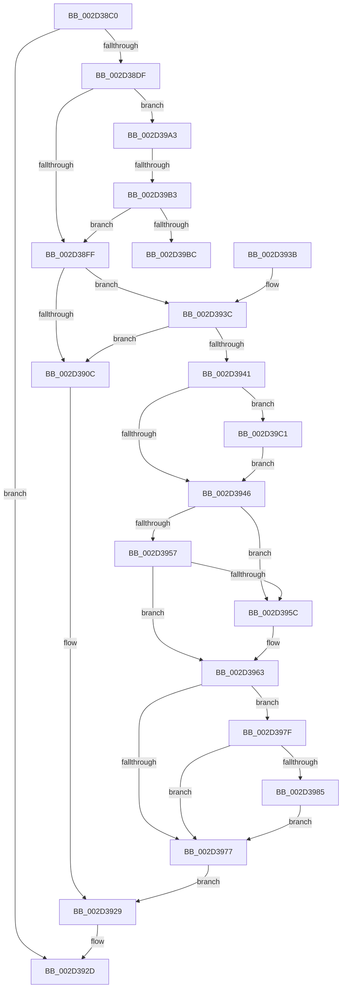

# KiDisconnectInterruptInternal

- RVA: `0x002D38C0`–`0x002D39E3` (길이 `291` bytes)
- VA: `0x00000001402D38C0`
- 실행 섹션: `.text`
- PDB 이름 있음: `예`; PDB Function 태그: `예`
- unwind 정보 RVA: `0x0006FA7C`
- 디코드: `71`개 명령, `291/291` bytes 표시
- 미해석 바이트: `0` (있으면 어셈블리에 `.byte`로 보존)

> 이 문서는 커널 이미지의 기계어와 PDB 기호를 분석해 생성했습니다. 4번과 5번은 함수 원형과 자료형을 바이너리 사용 방식에서 추정한 C 해석이며 원본 소스 복구 결과는 아닙니다.

## 1. Dependencies

- 직접 호출 지점: **1**; 고유 호출 대상: **1**
- 직접 호출자로 확인된 함수: **3**
- RIP 상대 이미지 참조: **2**

### Outgoing calls
- `0x002D390F` → [HalDisableInterrupt](HalDisableInterrupt_function_002D39F0.md) (function, `0x002D39F0`)

### Direct callers
- [KiDisconnectInterruptCommon](KiDisconnectInterruptCommon_function_002D36A8.md) at `0x002D3842`
- [KiProcessPendingDisconnect](../39/KiProcessPendingDisconnect_function_0039F374.md) at `0x0039F3BF`
- [KiInterruptDispatchCommon](../39/KiInterruptDispatchCommon_function_0039F3D0.md) at `0x0039F7EF`

### Static image references
- `0x002D38FF` → RVA `0x006B3480` (`KiChainedDispatch`; read)
- `0x002D3985` → RVA `0x006B3B30` (`KiInterruptDispatch`; read)

## 2. Other-region calls and transfers

- 다른 실행 섹션으로 향하는 call: **0**
- call이 아닌 외부 분기/꼬리 이동: **2**
  - `0x002D39AD` → [sub_006DDA46](../6D/Unknown_function_006DDA46.md) (`tail-transfer`)
  - `0x002D39BC` → [sub_006DDA46](../6D/Unknown_function_006DDA46.md) (`tail-transfer`)

## 3. Assembly (complete function range)

```asm
002D38C0  48 89 5C 24 08                  mov qword ptr [rsp + 8], rbx
002D38C5  57                              push rdi
002D38C6  48 83 EC 20                     sub rsp, 0x20
002D38CA  45 32 C9                        xor r9b, r9b
002D38CD  4C 8B D2                        mov r10, rdx
002D38D0  48 8B D9                        mov rbx, rcx
002D38D3  41 B8 EF 00 00 C0               mov r8d, 0xc00000ef
002D38D9  44 38 49 5F                     cmp byte ptr [rcx + 0x5f], r9b
002D38DD  74 4E                           je 0x1402d392d
002D38DF  8B 41 58                        mov eax, dword ptr [rcx + 0x58]
002D38E2  65 4C 8B 04 25 20 00 00 00      mov r8, qword ptr gs:[0x20]
002D38EB  8B F8                           mov edi, eax
002D38ED  49 8B 8C C0 00 39 00 00         mov rcx, qword ptr [r8 + rax*8 + 0x3900]
002D38F5  44 38 49 5D                     cmp byte ptr [rcx + 0x5d], r9b
002D38F9  0F 84 A4 00 00 00               je 0x1402d39a3
002D38FF  48 8D 05 7A FB 3D 00            lea rax, [rip + 0x3dfb7a]
002D3906  48 39 41 50                     cmp qword ptr [rcx + 0x50], rax
002D390A  74 30                           je 0x1402d393c
002D390C  49 8B CA                        mov rcx, r10
002D390F  E8 DC 00 00 00                  call 0x1402d39f0
002D3914  65 48 8B 04 25 20 00 00 00      mov rax, qword ptr gs:[0x20]
002D391D  48 83 A4 F8 00 39 00 00 00      and qword ptr [rax + rdi*8 + 0x3900], 0
002D3926  45 33 C0                        xor r8d, r8d
002D3929  C6 43 5F 00                     mov byte ptr [rbx + 0x5f], 0
002D392D  48 8B 5C 24 30                  mov rbx, qword ptr [rsp + 0x30]
002D3932  41 8B C0                        mov eax, r8d
002D3935  48 83 C4 20                     add rsp, 0x20
002D3939  5F                              pop rdi
002D393A  C3                              ret
002D393B  CC                              int3
002D393C  45 84 C9                        test r9b, r9b
002D393F  75 CB                           jne 0x1402d390c
002D3941  48 3B D9                        cmp rbx, rcx
002D3944  74 7B                           je 0x1402d39c1
002D3946  48 8D 43 08                     lea rax, [rbx + 8]
002D394A  4C 8B 00                        mov r8, qword ptr [rax]
002D394D  48 8B 50 08                     mov rdx, qword ptr [rax + 8]
002D3951  49 39 40 08                     cmp qword ptr [r8 + 8], rax
002D3955  75 05                           jne 0x1402d395c
002D3957  48 39 02                        cmp qword ptr [rdx], rax
002D395A  74 07                           je 0x1402d3963
002D395C  B9 03 00 00 00                  mov ecx, 3
002D3961  CD 29                           int 0x29
002D3963  4C 89 02                        mov qword ptr [rdx], r8
002D3966  49 89 50 08                     mov qword ptr [r8 + 8], rdx
002D396A  48 8B 51 08                     mov rdx, qword ptr [rcx + 8]
002D396E  48 83 EA 08                     sub rdx, 8
002D3972  48 3B CA                        cmp rcx, rdx
002D3975  74 08                           je 0x1402d397f
002D3977  41 B8 28 01 00 00               mov r8d, 0x128
002D397D  EB AA                           jmp 0x1402d3929
002D397F  80 7A 5D 00                     cmp byte ptr [rdx + 0x5d], 0
002D3983  74 F2                           je 0x1402d3977
002D3985  48 8D 05 A4 01 3E 00            lea rax, [rip + 0x3e01a4]
002D398C  48 89 42 50                     mov qword ptr [rdx + 0x50], rax
002D3990  65 48 8B 04 25 20 00 00 00      mov rax, qword ptr gs:[0x20]
002D3999  48 89 94 F8 00 39 00 00         mov qword ptr [rax + rdi*8 + 0x3900], rdx
002D39A1  EB D4                           jmp 0x1402d3977
002D39A3  48 8D 51 08                     lea rdx, [rcx + 8]
002D39A7  48 8B 02                        mov rax, qword ptr [rdx]
002D39AA  48 85 C0                        test rax, rax
002D39AD  0F 84 93 A0 40 00               je 0x1406dda46
002D39B3  48 3B C2                        cmp rax, rdx
002D39B6  0F 85 43 FF FF FF               jne 0x1402d38ff
002D39BC  E9 85 A0 40 00                  jmp 0x1406dda46
002D39C1  48 8B 49 08                     mov rcx, qword ptr [rcx + 8]
002D39C5  48 83 E9 08                     sub rcx, 8
002D39C9  48 89 41 50                     mov qword ptr [rcx + 0x50], rax
002D39CD  65 48 8B 04 25 20 00 00 00      mov rax, qword ptr gs:[0x20]
002D39D6  48 89 8C F8 00 39 00 00         mov qword ptr [rax + rdi*8 + 0x3900], rcx
002D39DE  E9 63 FF FF FF                  jmp 0x1402d3946
```

## 4. C-style interpretation (structured pseudocode)

```c
__int64 __fastcall KiDisconnectInterruptInternal(__int64 a1, __int64 a2, __int64 a3, unsigned __int8 a4)
{
    __int64 result;
    __int64 v_rsp;
    unsigned __int64 v_stack_p8;

    v_stack_p8 = v_rbx;
    v_rsp = (v_rsp) - (32);
    a4 = 0;
    if ((*(unsigned __int8 *)(a1 + 95)) == 0) goto loc_002D392D;
    if ((*(unsigned __int8 *)(*(unsigned __int64 *)(*(unsigned __int64 *)(gs_base + (0 + 32)) + (unsigned int)(*(unsigned int *)(a1 + 88)) * 8 + 14592) + 93)) == 0) goto loc_002D39A3;
loc_002D38FF:
    if ((*(unsigned __int64 *)(*(unsigned __int64 *)(*(unsigned __int64 *)(gs_base + (0 + 32)) + (unsigned int)(*(unsigned int *)(a1 + 88)) * 8 + 14592) + 80)) == (v_rip + 4062074)) goto loc_002D393C;
loc_002D390C:
    result = HalDisableInterrupt(a2, a2, *(unsigned __int64 *)(gs_base + (0 + 32)), a4);
    a3 = 0;
loc_002D3929:
    *(unsigned __int8 *)(a1 + 95) = 0;
loc_002D392D:
    v_rsp = (v_rsp) + (32);
    return 0;
loc_002D393C:
    if (0 != 0) goto loc_002D390C;
    if (v_stack_p8 == a2) goto loc_002D39C1;
loc_002D3946:
    if ((*(unsigned __int64 *)(*(unsigned __int64 *)(v_stack_p8 + 8) + 8)) != (v_stack_p8 + 8)) goto loc_002D395C;
    if ((*(unsigned __int64 *)(*(unsigned __int64 *)(v_stack_p8 + 8 + 8))) != (v_stack_p8 + 8)) {
        a1 = 3;
    }
    *(unsigned __int64 *)(*(unsigned __int64 *)(v_stack_p8 + 8 + 8)) = *(unsigned __int64 *)(v_stack_p8 + 8);
    *(unsigned __int64 *)(*(unsigned __int64 *)(v_stack_p8 + 8) + 8) = *(unsigned __int64 *)(v_stack_p8 + 8 + 8);
    a2 = (*(unsigned __int64 *)(a1 + 8)) - (8);
    if (a1 == a2) goto loc_002D397F;
loc_002D3977:
    goto loc_002D3929;
loc_002D397F:
    if ((*(unsigned __int8 *)(a2 + 93)) == 0) goto loc_002D3977;
    *(unsigned __int64 *)(a2 + 80) = v_rip + 4063652;
    *(unsigned __int64 *)(*(unsigned __int64 *)(gs_base + (0 + 32)) + (unsigned int)((unsigned int)((unsigned int)(*(unsigned int *)(a1 + 88)))) * 8 + 14592) = a2;
    goto loc_002D3977;
loc_002D39A3:
    if ((*(unsigned __int64 *)(a1 + 8)) != (a1 + 8)) goto loc_002D38FF;
loc_002D39C1:
    a1 = (*(unsigned __int64 *)(a1 + 8)) - (8);
    *(unsigned __int64 *)(a1 + 80) = *(unsigned __int64 *)(a1 + 8);
    *(unsigned __int64 *)(*(unsigned __int64 *)(gs_base + (0 + 32)) + (unsigned int)((unsigned int)((unsigned int)(*(unsigned int *)(a1 + 88)))) * 8 + 14592) = a1;
    goto loc_002D3946;
}
```

## 5. (Beta) C Style

```c
int64_t KiDisconnectInterruptInternal(void *Arg1, int64_t Arg2, int64_t Arg3, uint8_t Arg4)
{
    uint8_t *arg1 = (uint8_t *)Arg1;

    int64_t result;
    int64_t local_rsp;
    uint64_t v_stack_p8;

    v_stack_p8 = local_rbx;
    local_rsp = (local_rsp) - (32);
    Arg4 = 0;
    if ((*(uint8_t *)(arg1 + 0x5F)) == 0) goto loc_002D392D;
    if ((*(uint8_t *)(*(uint64_t *)(*(uint64_t *)(gs_base + (0 + 0x20)) + (uint32_t)(*(uint32_t *)(arg1 + 0x58)) * 8 + 0x3900) + 0x5D)) == 0) goto loc_002D39A3;
loc_002D38FF:
    if ((*(uint64_t *)(*(uint64_t *)(*(uint64_t *)(gs_base + (0 + 0x20)) + (uint32_t)(*(uint32_t *)(arg1 + 0x58)) * 8 + 0x3900) + 0x50)) == (v_rip + 4062074)) goto loc_002D393C;
loc_002D390C:
    result = HalDisableInterrupt(Arg2, Arg2, *(uint64_t *)(gs_base + (0 + 0x20)), Arg4);
    Arg3 = 0;
loc_002D3929:
    *(uint8_t *)(arg1 + 0x5F) = 0;
loc_002D392D:
    local_rsp = (local_rsp) + (32);
    return 0;
loc_002D393C:
    if (0 != 0) goto loc_002D390C;
    if (v_stack_p8 == Arg2) goto loc_002D39C1;
loc_002D3946:
    if ((*(uint64_t *)(*(uint64_t *)(v_stack_p8 + 0x8) + 0x8)) != (v_stack_p8 + 8)) goto loc_002D395C;
    if ((*(uint64_t *)(*(uint64_t *)(v_stack_p8 + 0x8 + 0x8))) != (v_stack_p8 + 8)) {
        Arg1 = 3;
    }
    *(uint64_t *)(*(uint64_t *)(v_stack_p8 + 0x8 + 0x8)) = *(uint64_t *)(v_stack_p8 + 0x8);
    *(uint64_t *)(*(uint64_t *)(v_stack_p8 + 0x8) + 0x8) = *(uint64_t *)(v_stack_p8 + 0x8 + 0x8);
    Arg2 = (*(uint64_t *)(arg1 + 0x8)) - (8);
    if (Arg1 == Arg2) goto loc_002D397F;
loc_002D3977:
    goto loc_002D3929;
loc_002D397F:
    if ((*(uint8_t *)(Arg2 + 0x5D)) == 0) goto loc_002D3977;
    *(uint64_t *)(Arg2 + 0x50) = v_rip + 4063652;
    *(uint64_t *)(*(uint64_t *)(gs_base + (0 + 0x20)) + (uint32_t)((uint32_t)((uint32_t)(*(uint32_t *)(arg1 + 0x58)))) * 8 + 0x3900) = Arg2;
    goto loc_002D3977;
loc_002D39A3:
    if ((*(uint64_t *)(arg1 + 0x8)) != (Arg1 + 8)) goto loc_002D38FF;
loc_002D39C1:
    Arg1 = (*(uint64_t *)(arg1 + 0x8)) - (8);
    *(uint64_t *)(arg1 + 0x50) = *(uint64_t *)(arg1 + 0x8);
    *(void **)(*(uint64_t *)(gs_base + (0 + 0x20)) + (uint32_t)((uint32_t)((uint32_t)(*(uint32_t *)(arg1 + 0x58)))) * 8 + 0x3900) = Arg1;
    goto loc_002D3946;
}
```

### 관측된 메모리 오프셋

구조체 형식이 확인되지 않은 접근은 인자 기준의 오프셋으로만 기록했습니다.

| 기준 인자 | 오프셋 표현 | 폭 (bit) | 접근 |
|---|---:|---:|---|
| `Arg1` | `+ 0x58` | `32` | `R` |
| `Arg1` | `+ 0x5F` | `8` | `R` |

## 6. Execution-region graph

[열기: 2D/3D 그래프와 함수 탐색 컨트롤 패널](../../../control-panel.html?section=text&rva=0x002D38C0&view=graph)

- 2D 그래프는 위에서 아래로 흐르고, 3D 그래프는 빈 공간을 드래그해 회전합니다. Shift+드래그는 이동, 휠은 확대·축소, 함수 노드 선택은 대상 보고서 이동입니다.

### Static fallback


