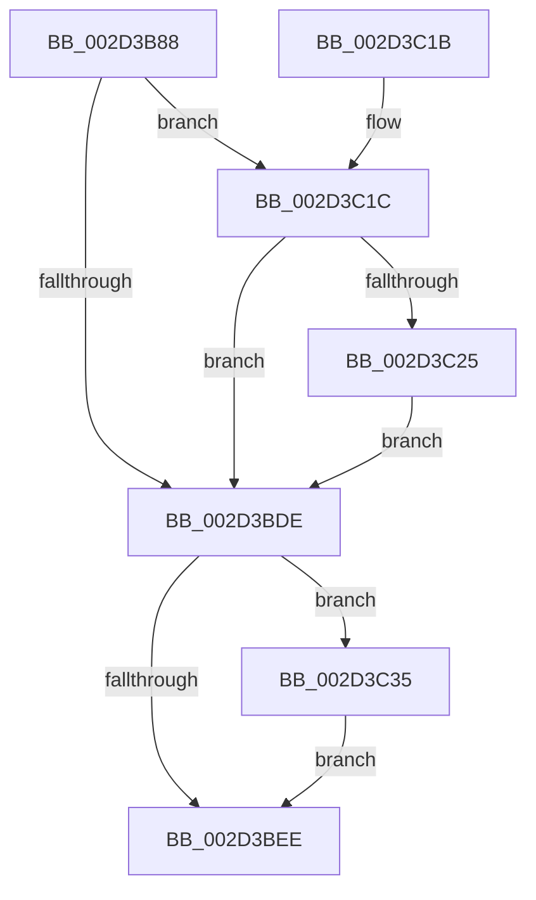

# KiDisconnectSecondaryInterrupt

- RVA: `0x002D3B88`–`0x002D3C3F` (길이 `183` bytes)
- VA: `0x00000001402D3B88`
- 실행 섹션: `.text`
- PDB 이름 있음: `예`; PDB Function 태그: `아니요`
- unwind 정보 RVA: `0x0006FAB4`
- 디코드: `55`개 명령, `183/183` bytes 표시
- 미해석 바이트: `0` (있으면 어셈블리에 `.byte`로 보존)

> 이 문서는 커널 이미지의 기계어와 PDB 기호를 분석해 생성했습니다. 4번과 5번은 함수 원형과 자료형을 바이너리 사용 방식에서 추정한 C 해석이며 원본 소스 복구 결과는 아닙니다.

## 1. Dependencies

- 직접 호출 지점: **6**; 고유 호출 대상: **6**
- 직접 호출자로 확인된 함수: **1**
- RIP 상대 이미지 참조: **1**

### Outgoing calls
- `0x002D3BC1` → [KiAcquireSecondaryPassiveConnectLock](../4C/KiAcquireSecondaryPassiveConnectLock_function_004C0290.md) (function, `0x004C0290`)
- `0x002D3BCE` → [KiAcquireSecondaryInterruptConnectLock](../47/KiAcquireSecondaryInterruptConnectLock_function_00479E58.md) (function, `0x00479E58`)
- `0x002D3BE5` → [HalpReleaseHighLevelLock](HalpReleaseHighLevelLock_function_002D1C58.md) (function, `0x002D1C58`)
- `0x002D3BF7` → [KiDisconnectInterruptCommon](KiDisconnectInterruptCommon_function_002D36A8.md) (function, `0x002D36A8`)
- `0x002D3C01` → [KiReleaseSecondaryPassiveConnectLock](../4D/KiReleaseSecondaryPassiveConnectLock_function_004DA2C4.md) (function, `0x004DA2C4`)
- `0x002D3C38` → [HalDisableInterrupt](HalDisableInterrupt_function_002D39F0.md) (function, `0x002D39F0`)

### Direct callers
- [KeDisconnectInterrupt](KeDisconnectInterrupt_function_002D3588.md) at `0x002D3670`

### Static image references
- `0x002D3BB7` → RVA `0x00F11028` (`.data`; read)

## 2. Other-region calls and transfers

- 다른 실행 섹션으로 향하는 call: **0**
- 별도 외부 분기/꼬리 이동을 확인하지 못했습니다.

## 3. Assembly (complete function range)

```asm
002D3B88  48 89 5C 24 10                  mov qword ptr [rsp + 0x10], rbx
002D3B8D  48 89 6C 24 18                  mov qword ptr [rsp + 0x18], rbp
002D3B92  56                              push rsi
002D3B93  57                              push rdi
002D3B94  41 56                           push r14
002D3B96  48 83 EC 20                     sub rsp, 0x20
002D3B9A  8B 41 58                        mov eax, dword ptr [rcx + 0x58]
002D3B9D  48 8B F1                        mov rsi, rcx
002D3BA0  2D 00 01 00 00                  sub eax, 0x100
002D3BA5  C6 44 24 40 00                  mov byte ptr [rsp + 0x40], 0
002D3BAA  48 8B EA                        mov rbp, rdx
002D3BAD  32 DB                           xor bl, bl
002D3BAF  48 8D 3C 40                     lea rdi, [rax + rax*2]
002D3BB3  48 C1 E7 04                     shl rdi, 4
002D3BB7  48 03 3D 6A D4 C3 00            add rdi, qword ptr [rip + 0xc3d46a]
002D3BBE  48 8B CF                        mov rcx, rdi
002D3BC1  E8 CA C6 1E 00                  call 0x1404c0290
002D3BC6  48 8D 54 24 40                  lea rdx, [rsp + 0x40]
002D3BCB  48 8B CF                        mov rcx, rdi
002D3BCE  E8 85 62 1A 00                  call 0x140479e58
002D3BD3  41 BE 01 00 00 00               mov r14d, 1
002D3BD9  38 5E 5F                        cmp byte ptr [rsi + 0x5f], bl
002D3BDC  75 3E                           jne 0x1402d3c1c
002D3BDE  8A 54 24 40                     mov dl, byte ptr [rsp + 0x40]
002D3BE2  48 8B CF                        mov rcx, rdi
002D3BE5  E8 6E E0 FF FF                  call 0x1402d1c58
002D3BEA  84 DB                           test bl, bl
002D3BEC  75 47                           jne 0x1402d3c35
002D3BEE  4C 8B C5                        mov r8, rbp
002D3BF1  48 8B D6                        mov rdx, rsi
002D3BF4  41 8B CE                        mov ecx, r14d
002D3BF7  E8 AC FA FF FF                  call 0x1402d36a8
002D3BFC  48 8B CF                        mov rcx, rdi
002D3BFF  8B D8                           mov ebx, eax
002D3C01  E8 BE 66 20 00                  call 0x1404da2c4
002D3C06  48 8B 6C 24 50                  mov rbp, qword ptr [rsp + 0x50]
002D3C0B  8B C3                           mov eax, ebx
002D3C0D  48 8B 5C 24 48                  mov rbx, qword ptr [rsp + 0x48]
002D3C12  48 83 C4 20                     add rsp, 0x20
002D3C16  41 5E                           pop r14
002D3C18  5F                              pop rdi
002D3C19  5E                              pop rsi
002D3C1A  C3                              ret
002D3C1B  CC                              int3
002D3C1C  48 8B 47 28                     mov rax, qword ptr [rdi + 0x28]
002D3C20  48 3B C6                        cmp rax, rsi
002D3C23  75 B9                           jne 0x1402d3bde
002D3C25  48 83 C0 08                     add rax, 8
002D3C29  0F B6 DB                        movzx ebx, bl
002D3C2C  48 39 00                        cmp qword ptr [rax], rax
002D3C2F  41 0F 44 DE                     cmove ebx, r14d
002D3C33  EB A9                           jmp 0x1402d3bde
002D3C35  48 8B CD                        mov rcx, rbp
002D3C38  E8 B3 FD FF FF                  call 0x1402d39f0
002D3C3D  EB AF                           jmp 0x1402d3bee
```

## 4. C-style interpretation (structured pseudocode)

```c
__int64 __fastcall KiDisconnectSecondaryInterrupt(__int64 a1, __int64 a2)
{
    __int64 result;
    __int64 v_rbx;
    __int64 v_rdi;
    __int64 v_rsp;
    unsigned __int64 v_stack_p10;
    unsigned __int64 v_stack_p18;
    unsigned __int8 v_stack_p8;

    v_stack_p10 = v_rbx;
    v_stack_p18 = v_rbp;
    v_rsp = (v_rsp) - (32);
    result = (unsigned int)(((unsigned int)(*(unsigned int *)(a1 + 88))) - (256));
    v_stack_p8 = 0;
    v_rbx = 0;
    v_rdi = (result + result * 2) << (4);
    v_rdi = (v_rdi) + (*(unsigned __int64 *)(v_rip + 12833898));
    result = KiAcquireSecondaryPassiveConnectLock(v_rdi, a2, a3, a4);
    result = KiAcquireSecondaryInterruptConnectLock(v_rdi, v_stack_p8, a3, a4);
    if ((*(unsigned __int8 *)(a1 + 95)) != 0) goto loc_002D3C1C;
loc_002D3BDE:
    result = HalpReleaseHighLevelLock(v_rdi, v_stack_p8, a3, a4);
    if (0 != 0) goto loc_002D3C35;
loc_002D3BEE:
    result = KiDisconnectInterruptCommon(1, a1, a2, a4);
    result = KiReleaseSecondaryPassiveConnectLock(v_rdi, a1, a2, a4);
    v_rsp = (v_rsp) + (32);
    return (unsigned int)((unsigned int)((unsigned int)((unsigned int)(result))));
loc_002D3C1C:
    if ((*(unsigned __int64 *)(v_rdi + 40)) != a1) goto loc_002D3BDE;
    result = (*(unsigned __int64 *)(v_rdi + 40)) + (8);
    v_rbx = (unsigned __int8)(v_stack_p10);
    if ((*(unsigned __int64 *)(result)) == result) { v_rbx = 1; }
    goto loc_002D3BDE;
loc_002D3C35:
    result = HalDisableInterrupt(v_stack_p18, a1, a2, a4);
    goto loc_002D3BEE;
}
```

## 5. (Beta) C Style

```c
int64_t KiDisconnectSecondaryInterrupt(void *Arg1, int64_t Arg2)
{
    uint8_t *arg1 = (uint8_t *)Arg1;

    int64_t result;
    int64_t local_rbx;
    int64_t local_rdi;
    int64_t local_rsp;
    uint64_t v_stack_p10;
    uint64_t v_stack_p18;
    uint8_t v_stack_p8;

    v_stack_p10 = local_rbx;
    v_stack_p18 = local_rbp;
    local_rsp = (local_rsp) - (32);
    result = (uint32_t)(((uint32_t)(*(uint32_t *)(arg1 + 0x58))) - (256));
    v_stack_p8 = 0;
    local_rbx = 0;
    local_rdi = (result + result * 2) << (4);
    local_rdi = (local_rdi) + (*(uint64_t *)(v_rip + 0xC3D46A));
    result = KiAcquireSecondaryPassiveConnectLock(local_rdi, Arg2, a3, a4);
    result = KiAcquireSecondaryInterruptConnectLock(local_rdi, v_stack_p8, a3, a4);
    if ((*(uint8_t *)(arg1 + 0x5F)) != 0) goto loc_002D3C1C;
loc_002D3BDE:
    result = HalpReleaseHighLevelLock(local_rdi, v_stack_p8, a3, a4);
    if (0 != 0) goto loc_002D3C35;
loc_002D3BEE:
    result = KiDisconnectInterruptCommon(1, Arg1, Arg2, a4);
    result = KiReleaseSecondaryPassiveConnectLock(local_rdi, Arg1, Arg2, a4);
    local_rsp = (local_rsp) + (32);
    return (uint32_t)((uint32_t)((uint32_t)((uint32_t)(result))));
loc_002D3C1C:
    if ((*(uint64_t *)(local_rdi + 0x28)) != Arg1) goto loc_002D3BDE;
    result = (*(uint64_t *)(local_rdi + 0x28)) + (8);
    local_rbx = (uint8_t)(v_stack_p10);
    if ((*(uint64_t *)(result)) == result) { local_rbx = 1; }
    goto loc_002D3BDE;
loc_002D3C35:
    result = HalDisableInterrupt(v_stack_p18, Arg1, Arg2, a4);
    goto loc_002D3BEE;
}
```

### 관측된 메모리 오프셋

구조체 형식이 확인되지 않은 접근은 인자 기준의 오프셋으로만 기록했습니다.

| 기준 인자 | 오프셋 표현 | 폭 (bit) | 접근 |
|---|---:|---:|---|
| `Arg1` | `+ 0x58` | `32` | `R` |
| `Arg1` | `+ 0x5F` | `8` | `R` |

## 6. Execution-region graph

[열기: 2D/3D 그래프와 함수 탐색 컨트롤 패널](../../../control-panel.html?section=text&rva=0x002D3B88&view=graph)

- 2D 그래프는 위에서 아래로 흐르고, 3D 그래프는 빈 공간을 드래그해 회전합니다. Shift+드래그는 이동, 휠은 확대·축소, 함수 노드 선택은 대상 보고서 이동입니다.

### Static fallback


