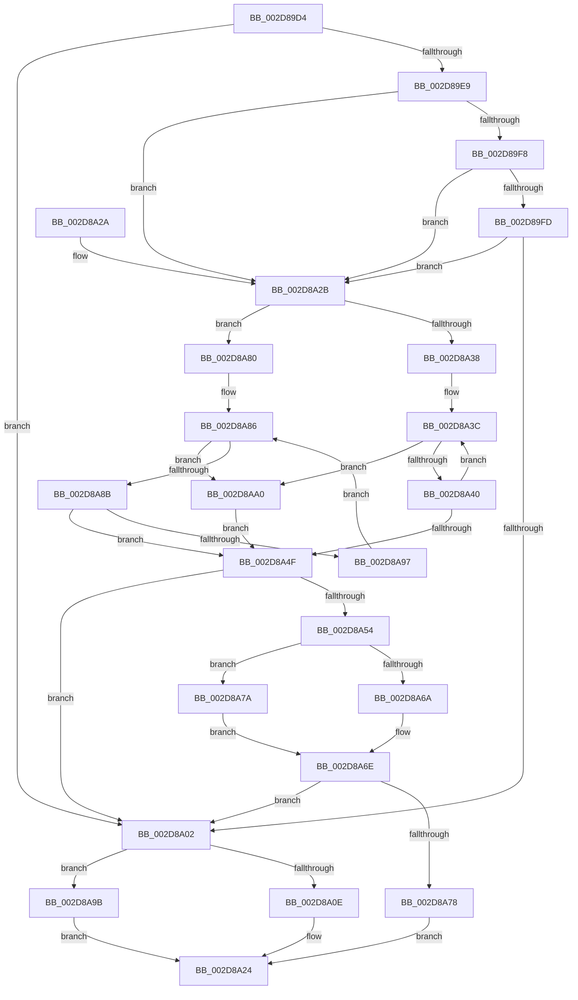

# KiIntPartGetLowestClassProcessorInMask

- RVA: `0x002D89D4`–`0x002D8AA5` (길이 `209` bytes)
- VA: `0x00000001402D89D4`
- 실행 섹션: `.text`
- PDB 이름 있음: `예`; PDB Function 태그: `아니요`
- unwind 정보 RVA: `0x0007025C`
- 디코드: `66`개 명령, `209/209` bytes 표시
- 미해석 바이트: `0` (있으면 어셈블리에 `.byte`로 보존)

> 이 문서는 커널 이미지의 기계어와 PDB 기호를 분석해 생성했습니다. 4번과 5번은 함수 원형과 자료형을 바이너리 사용 방식에서 추정한 C 해석이며 원본 소스 복구 결과는 아닙니다.

## 1. Dependencies

- 직접 호출 지점: **0**; 고유 호출 대상: **0**
- 직접 호출자로 확인된 함수: **5**
- RIP 상대 이미지 참조: **3**

### Outgoing calls
- 직접 디코드된 call 명령이 없습니다.

### Direct callers
- [KiIntSteerChooseInitialTargetProcessors](KiIntSteerChooseInitialTargetProcessors_function_002D4B98.md) at `0x002D4C14`
- [KiIntSteerCalculateUniformDistribution](KiIntSteerCalculateUniformDistribution_function_002D5698.md) at `0x002D5712`
- [KiIntSteerCalculateUniformDistribution](KiIntSteerCalculateUniformDistribution_function_002D5698.md) at `0x002D57A3`
- [sub_002D6C05](Unknown_function_002D6C05.md) at `0x002D6C5F`
- [KiIntSteerCalculateDistribution](KiIntSteerCalculateDistribution_function_002D7420.md) at `0x002D75AB`
- [KiIntSteerCalculateDistribution](KiIntSteerCalculateDistribution_function_002D7420.md) at `0x002D7638`
- [sub_002D8832](Unknown_function_002D8832.md) at `0x002D887F`

### Static image references
- `0x002D89E9` → RVA `0x00F10E78` (`.data`; read)
- `0x002D8A1A` → RVA `0x00F231B8` (`.data`; read)
- `0x002D8A2F` → RVA `0x00F10E70` (`.data`; read)

## 2. Other-region calls and transfers

- 다른 실행 섹션으로 향하는 call: **0**
- 별도 외부 분기/꼬리 이동을 확인하지 못했습니다.

## 3. Assembly (complete function range)

```asm
002D89D4  48 89 5C 24 10                  mov qword ptr [rsp + 0x10], rbx
002D89D9  44 0F B7 51 08                  movzx r10d, word ptr [rcx + 8]
002D89DE  33 DB                           xor ebx, ebx
002D89E0  4C 8B C9                        mov r9, rcx
002D89E3  66 45 85 D2                     test r10w, r10w
002D89E7  75 19                           jne 0x1402d8a02
002D89E9  44 8B 05 88 84 C3 00            mov r8d, dword ptr [rip + 0xc38488]
002D89F0  41 8B D0                        mov edx, r8d
002D89F3  83 EA 01                        sub edx, 1
002D89F6  74 33                           je 0x1402d8a2b
002D89F8  83 EA 01                        sub edx, 1
002D89FB  74 2E                           je 0x1402d8a2b
002D89FD  83 FA 01                        cmp edx, 1
002D8A00  74 29                           je 0x1402d8a2b
002D8A02  49 8B 01                        mov rax, qword ptr [r9]
002D8A05  48 85 C0                        test rax, rax
002D8A08  0F 84 8D 00 00 00               je 0x1402d8a9b
002D8A0E  48 0F BC C8                     bsf rcx, rax
002D8A12  41 8B C2                        mov eax, r10d
002D8A15  C1 E0 06                        shl eax, 6
002D8A18  03 C8                           add ecx, eax
002D8A1A  48 8B 05 97 A7 C4 00            mov rax, qword ptr [rip + 0xc4a797]
002D8A21  8B 04 88                        mov eax, dword ptr [rax + rcx*4]
002D8A24  48 8B 5C 24 10                  mov rbx, qword ptr [rsp + 0x10]
002D8A29  C3                              ret
002D8A2A  CC                              int3
002D8A2B  41 83 F8 03                     cmp r8d, 3
002D8A2F  4C 8B 05 3A 84 C3 00            mov r8, qword ptr [rip + 0xc3843a]
002D8A36  75 48                           jne 0x1402d8a80
002D8A38  41 0F B6 10                     movzx edx, byte ptr [r8]
002D8A3C  85 D2                           test edx, edx
002D8A3E  74 60                           je 0x1402d8aa0
002D8A40  8D 42 FF                        lea eax, [rdx - 1]
002D8A43  49 8B 4C C0 08                  mov rcx, qword ptr [r8 + rax*8 + 8]
002D8A48  8B D0                           mov edx, eax
002D8A4A  49 23 09                        and rcx, qword ptr [r9]
002D8A4D  74 ED                           je 0x1402d8a3c
002D8A4F  48 85 C9                        test rcx, rcx
002D8A52  74 AE                           je 0x1402d8a02
002D8A54  48 8B 05 5D A7 C4 00            mov rax, qword ptr [rip + 0xc4a75d]
002D8A5B  41 8B D2                        mov edx, r10d
002D8A5E  C1 E2 06                        shl edx, 6
002D8A61  83 3D 10 84 C3 00 02            cmp dword ptr [rip + 0xc38410], 2
002D8A68  74 10                           je 0x1402d8a7a
002D8A6A  48 0F BC C9                     bsf rcx, rcx
002D8A6E  03 CA                           add ecx, edx
002D8A70  8B 04 88                        mov eax, dword ptr [rax + rcx*4]
002D8A73  83 F8 FF                        cmp eax, -1
002D8A76  74 8A                           je 0x1402d8a02
002D8A78  EB AA                           jmp 0x1402d8a24
002D8A7A  48 0F BD C9                     bsr rcx, rcx
002D8A7E  EB EE                           jmp 0x1402d8a6e
002D8A80  45 0F B6 18                     movzx r11d, byte ptr [r8]
002D8A84  8B D3                           mov edx, ebx
002D8A86  41 3B D3                        cmp edx, r11d
002D8A89  73 15                           jae 0x1402d8aa0
002D8A8B  8B C2                           mov eax, edx
002D8A8D  49 8B 4C C0 08                  mov rcx, qword ptr [r8 + rax*8 + 8]
002D8A92  49 23 09                        and rcx, qword ptr [r9]
002D8A95  75 B8                           jne 0x1402d8a4f
002D8A97  FF C2                           inc edx
002D8A99  EB EB                           jmp 0x1402d8a86
002D8A9B  83 C8 FF                        or eax, 0xffffffff
002D8A9E  EB 84                           jmp 0x1402d8a24
002D8AA0  48 8B CB                        mov rcx, rbx
002D8AA3  EB AA                           jmp 0x1402d8a4f
```

## 4. C-style interpretation (structured pseudocode)

```c
__int64 __fastcall KiIntPartGetLowestClassProcessorInMask(__int64 a1)
{
    __int64 result;
    __int64 v_rbx;
    unsigned __int64 v_stack_p10;

    v_stack_p10 = v_rbx;
    v_rbx = 0;
    if ((unsigned __int16)(*(unsigned __int16 *)(a1 + 8)) != 0) goto loc_002D8A02;
    a2 = (unsigned int)(((unsigned int)((unsigned int)((unsigned int)(*(unsigned int *)(v_rip + 12813448))))) - (1));
    if (condition_is_equal) goto loc_002D8A2B;
    a2 = (unsigned int)((a2) - (1));
    if (condition_is_equal) goto loc_002D8A2B;
    if (((unsigned int)(a2)) == 1) goto loc_002D8A2B;
loc_002D8A02:
    if (*(unsigned __int64 *)(a1) == 0) goto loc_002D8A9B;
    result = (unsigned int)(((unsigned int)((unsigned int)(*(unsigned __int16 *)(a1 + 8)))) << (6));
    a1 = (unsigned int)((a1) + ((unsigned int)(result)));
loc_002D8A24:
    return (unsigned int)(*(unsigned int *)(*(unsigned __int64 *)(v_rip + 12887959) + a1 * 4));
loc_002D8A2B:
    if (((unsigned int)((unsigned int)(*(unsigned int *)(v_rip + 12813448)))) != 3) goto loc_002D8A80;
loc_002D8A3C:
    if ((unsigned int)(*(unsigned __int8 *)(*(unsigned __int64 *)(v_rip + 12813370))) == 0) goto loc_002D8AA0;
    a1 = (*(unsigned __int64 *)(*(unsigned __int64 *)(v_rip + 12813370) + *(unsigned __int8 *)(*(unsigned __int64 *)(v_rip + 12813370)) - 1 * 8 + 8)) & (*(unsigned __int64 *)(a1));
    if (condition_is_equal) goto loc_002D8A3C;
loc_002D8A4F:
    if (a1 == 0) goto loc_002D8A02;
    a2 = (unsigned int)(((unsigned int)((unsigned int)(*(unsigned __int16 *)(a1 + 8)))) << (6));
    if ((*(unsigned int *)(v_rip + 12813328)) == 2) goto loc_002D8A7A;
loc_002D8A6E:
    a1 = (unsigned int)((a1) + ((unsigned int)(a2)));
    if (((unsigned int)((unsigned int)(*(unsigned int *)(*(unsigned __int64 *)(v_rip + 12887901) + a1 * 4)))) == -1) goto loc_002D8A02;
    goto loc_002D8A24;
loc_002D8A7A:
    goto loc_002D8A6E;
loc_002D8A80:
loc_002D8A86:
    if (((unsigned int)((unsigned int)((unsigned int)(v_stack_p10)))) >= ((unsigned int)(*(unsigned __int8 *)(*(unsigned __int64 *)(v_rip + 12813370))))) goto loc_002D8AA0;
    a1 = (*(unsigned __int64 *)(*(unsigned __int64 *)(v_rip + 12813370) + (unsigned int)((unsigned int)((unsigned int)((unsigned int)(v_stack_p10)))) * 8 + 8)) & (*(unsigned __int64 *)(a1));
    if (condition_is_not_equal) goto loc_002D8A4F;
    a2 = (unsigned int)(((unsigned int)((unsigned int)(v_stack_p10))) + 1);
    goto loc_002D8A86;
loc_002D8A9B:
    result = (unsigned int)(((unsigned int)((unsigned int)((unsigned int)((unsigned int)(v_stack_p10))))) | (0xFFFFFFFFULL));
    goto loc_002D8A24;
loc_002D8AA0:
    goto loc_002D8A4F;
}
```

## 5. (Beta) C Style

```c
int64_t KiIntPartGetLowestClassProcessorInMask(void *Arg1)
{
    uint8_t *arg1 = (uint8_t *)Arg1;

    int64_t result;
    int64_t local_rbx;
    uint64_t v_stack_p10;

    v_stack_p10 = local_rbx;
    local_rbx = 0;
    if ((uint16_t)(*(uint16_t *)(arg1 + 0x8)) != 0) goto loc_002D8A02;
    a2 = (uint32_t)(((uint32_t)((uint32_t)((uint32_t)(*(uint32_t *)(v_rip + 0xC38488))))) - (1));
    if (condition_is_equal) goto loc_002D8A2B;
    a2 = (uint32_t)((a2) - (1));
    if (condition_is_equal) goto loc_002D8A2B;
    if (((uint32_t)(a2)) == 1) goto loc_002D8A2B;
loc_002D8A02:
    if (*(uint64_t *)(arg1) == 0) goto loc_002D8A9B;
    result = (uint32_t)(((uint32_t)((uint32_t)(*(uint16_t *)(arg1 + 0x8)))) << (6));
    Arg1 = (uint32_t)((Arg1) + ((uint32_t)(result)));
loc_002D8A24:
    return (uint32_t)(*(uint32_t *)(*(uint64_t *)(v_rip + 0xC4A797) + arg1 * 4));
loc_002D8A2B:
    if (((uint32_t)((uint32_t)(*(uint32_t *)(v_rip + 0xC38488)))) != 3) goto loc_002D8A80;
loc_002D8A3C:
    if ((uint32_t)(*(uint8_t *)(*(uint64_t *)(v_rip + 0xC3843A))) == 0) goto loc_002D8AA0;
    Arg1 = (*(uint64_t *)(*(uint64_t *)(v_rip + 0xC3843A) + *(uint8_t *)(*(uint64_t *)(v_rip + 0xC3843A)) - 0x1 * 8 + 0x8)) & (*(uint64_t *)(arg1));
    if (condition_is_equal) goto loc_002D8A3C;
loc_002D8A4F:
    if (Arg1 == NULL) goto loc_002D8A02;
    a2 = (uint32_t)(((uint32_t)((uint32_t)(*(uint16_t *)(arg1 + 0x8)))) << (6));
    if ((*(uint32_t *)(v_rip + 0xC38410)) == 2) goto loc_002D8A7A;
loc_002D8A6E:
    Arg1 = (uint32_t)((Arg1) + ((uint32_t)(a2)));
    if (((uint32_t)((uint32_t)(*(uint32_t *)(*(uint64_t *)(v_rip + 0xC4A75D) + arg1 * 4)))) == -1) goto loc_002D8A02;
    goto loc_002D8A24;
loc_002D8A7A:
    goto loc_002D8A6E;
loc_002D8A80:
loc_002D8A86:
    if (((uint32_t)((uint32_t)((uint32_t)(v_stack_p10)))) >= ((uint32_t)(*(uint8_t *)(*(uint64_t *)(v_rip + 0xC3843A))))) goto loc_002D8AA0;
    Arg1 = (*(uint64_t *)(*(uint64_t *)(v_rip + 0xC3843A) + (uint32_t)((uint32_t)((uint32_t)((uint32_t)(v_stack_p10)))) * 8 + 0x8)) & (*(uint64_t *)(arg1));
    if (condition_is_not_equal) goto loc_002D8A4F;
    a2 = (uint32_t)(((uint32_t)((uint32_t)(v_stack_p10))) + 1);
    goto loc_002D8A86;
loc_002D8A9B:
    result = (uint32_t)(((uint32_t)((uint32_t)((uint32_t)((uint32_t)(v_stack_p10))))) | (0xFFFFFFFFULL));
    goto loc_002D8A24;
loc_002D8AA0:
    goto loc_002D8A4F;
}
```

### 관측된 메모리 오프셋

구조체 형식이 확인되지 않은 접근은 인자 기준의 오프셋으로만 기록했습니다.

| 기준 인자 | 오프셋 표현 | 폭 (bit) | 접근 |
|---|---:|---:|---|
| `Arg1` | `+ 0x0` | `64` | `R` |
| `Arg1` | `+ 0x8` | `16` | `R` |

## 6. Execution-region graph

[열기: 2D/3D 그래프와 함수 탐색 컨트롤 패널](../../../control-panel.html?section=text&rva=0x002D89D4&view=graph)

- 2D 그래프는 위에서 아래로 흐르고, 3D 그래프는 빈 공간을 드래그해 회전합니다. Shift+드래그는 이동, 휠은 확대·축소, 함수 노드 선택은 대상 보고서 이동입니다.

### Static fallback


